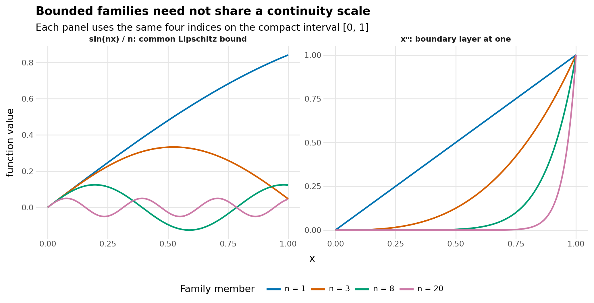

# Baire Category and Function-Space Compactness {#sec-baire-ascoli}

Analysis repeatedly turns infinitely many local facts into one uniform conclusion.
That passage is never automatic. The Baire category theorem supplies one route:
completeness prevents a space from being assembled from countably many closed
pieces with no interior. Arzelà–Ascoli supplies another: boundedness plus a
common continuity scale makes a family of functions compact.

**Prerequisites.** Metric spaces, completeness, compactness, and uniform
convergence from [sec-metric-spaces](10-metric-spaces.md#sec-metric-spaces); continuity from [sec-continuity](06-continuity.md#sec-continuity). This chapter
recalls every additional definition it uses.

## Category as a notion of smallness

A set $A$ in a topological space $X$ is **nowhere dense** when the interior of
its closure is empty. Equivalently, every nonempty open set contains a smaller
nonempty open set disjoint from $A$. A countable union of nowhere-dense sets is
**meagre** or **of first category**. Its complement is **comeagre**; a set
containing a countable intersection of open dense sets is often called
**residual**.

These words describe topology, not probability or size.

- Every singleton is nowhere dense in $\mathbb R$, so $\mathbb Q$ is meagre
  even though it is dense.
- The irrationals are comeagre because their complement is $\mathbb Q$.
- A closed interval has nonempty interior relative to itself, so it is not
  nowhere dense in that relative topology.

The ambient space matters. The set $[0,1]$ is nowhere dense in $\mathbb R^2$
when embedded on an axis, but not in itself.

<div class="callout callout-warning">
<p class="callout-title">Category is not measure</p>

A meagre set can have full measure, and a residual set can have measure zero.
“Typical” must therefore be qualified as category-typical or measure-typical.
Neither notion permits conclusions about a named point without another argument.

</div>

## The Baire category theorem

**Theorem 25.1 (Baire category).** A nonempty complete metric space is not a countable
union of nowhere-dense sets. Equivalently, every countable intersection of open
dense sets is dense.

Here is the nested-ball proof architecture. Let $G_1,G_2,\ldots$ be open dense
sets and let $U$ be any nonempty open set. Choose a closed ball
$\overline B_1\subset U\cap G_1$ with radius below $1/2$. Density and openness
let us choose inductively

$$
\overline B_{n+1}\subset B_n\cap G_{n+1},
\qquad
\operatorname{radius}(B_{n+1})<2^{-n-1}.
$$

The centres form a Cauchy sequence. Completeness supplies a limit $x$, and the
nesting puts $x$ in every closed ball. Hence
$x\in U\cap\bigcap_nG_n$. Since $U$ was arbitrary, the intersection is
dense.

Every hypothesis has a job: density lets the construction continue, openness
allows a smaller closed ball, shrinking radii create a Cauchy sequence, and
completeness keeps its limit in the space.

The rational line $\mathbb Q$, with its usual metric, shows the completeness
condition cannot be deleted. It is the countable union of its singleton subsets,
each nowhere dense in $\mathbb Q$.

## Hidden uniform control

Suppose a family of continuous functions is pointwise bounded: for each $x$,
the numbers $\{|f(x)|:f\in\mathcal F\}$ are bounded, but the bound may depend on
$x$. Set

$$
E_m=\{x:|f(x)|\le m\text{ for every }f\in\mathcal F\}.
$$

When the functions are continuous, each $E_m$ is closed, and pointwise
boundedness says $X=\bigcup_mE_m$. If $X$ is complete, Baire implies some
$E_m$ contains a ball. Thus one pointwise statement yields one region of
uniform control. The uniform boundedness principle in [sec-banach-pillars](26-banach-pillars.md#sec-banach-pillars) turns
this template into a theorem about operators.

Baire arguments often prove existence without locating the good ball. That is a
feature of the method, not an algorithm for finding its centre.

## Equicontinuity

A family $\mathcal F\subset C(K)$ is **equicontinuous at $x$** if for every
$\varepsilon>0$ there is a $\delta>0$, independent of $f\in\mathcal F$,
such that

$$
d(x,y)<\delta\quad\Longrightarrow\quad
|f(x)-f(y)|<\varepsilon
\quad\text{for every }f\in\mathcal F.
$$

It is equicontinuous if this holds at every point. On compact $K$, pointwise
equicontinuity produces one finite-cover modulus for the whole domain. A useful
sufficient condition is a common Lipschitz bound:
$|f(x)-f(y)|\le Ld(x,y)$.

The family $f_n(x)=\sin(nx)/n$ on $[0,1]$ has
$|f_n'|\le1$, so it is equicontinuous. The family $g_n(x)=x^n$ is uniformly
bounded but not equicontinuous at $1$: for any proposed $\delta$, choose
$y<1$ within $\delta$, then choose $n$ so large that $y^n$ is close to
zero while $g_n(1)=1$.

<figure id="fig-equicontinuity">


<figcaption>

Figure 25.1: Two bounded function families display different shared continuity behaviour.

</figcaption>
</figure>

[Figure 25.1](#fig-equicontinuity) distinguishes an individual fact from a family fact. Every
$x^n$ is uniformly continuous on the compact interval, but there is no single
modulus that works for all $n$.

## The Arzelà–Ascoli theorem

**Arzelà–Ascoli, compact metric version.** Let $K$ be compact. A subset
$\mathcal F\subset C(K)$, with the supremum norm, has compact closure if and
only if it is equicontinuous and pointwise relatively compact. For real-valued
functions, the second condition means $\{f(x):f\in\mathcal F\}$ is bounded for
each $x$.

On compact $K$, equicontinuity plus pointwise boundedness actually gives a
uniform bound. Choose a finite collection of neighbourhoods on which all
functions oscillate by less than $1$, and combine the finitely many bounds at
their centres.

The sequential proof has two scales.

1. Choose a countable dense set $D=\{x_1,x_2,\ldots\}$ in $K$. Repeated
   Bolzano–Weierstrass extraction and a diagonal argument produce a subsequence
   converging at every point of $D$.
2. Equicontinuity transports convergence from a finite $\delta$-net in $D$
   to every point of $K$, making the subsequence uniformly Cauchy.

Completeness of $C(K)$ then supplies a uniform limit, which is continuous.
Necessity is also informative: a compact set in $C(K)$ has a finite
$\varepsilon$-net, and the finitely many net functions provide a shared
continuity modulus.

**Worked example.** Let

$$
\mathcal F=\{f\in C^1([0,1]): |f(0)|\le2,\ |f'(x)|\le3\}.
$$

The derivative bound gives common Lipschitz constant $3$, and
$|f(x)|\le5$. Hence every sequence in $\mathcal F$ has a uniformly convergent
subsequence. The limit need not be differentiable, because compactness was proved
in the supremum norm, not the $C^1$ norm.

On a noncompact domain, apply the theorem to an exhaustion
$K_1\subset K_2\subset\cdots$ and diagonalise again. The result is convergence
uniformly on each compact set, called **locally uniform convergence**. Without
control at infinity, this is weaker than uniform convergence on the whole
domain.

### From derivative estimates to compactness {#sec-primitive-compactness}

An integral bound on a derivative needs a function class that connects the
derivative back to the function. Work with the **absolutely continuous
representatives** from [sec-signed-measures](20-signed-measures.md#sec-signed-measures) and [sec-sobolev](23-sobolev.md#sec-sobolev). They satisfy the
fundamental theorem

$$
f(y)-f(x)=\int_x^y f'(t)\,dt
\qquad(0\le x\le y\le1),
$$

where $f'$ is the almost-everywhere derivative, which also represents the weak
derivative. An arbitrary continuous function with an almost-everywhere
derivative need not satisfy this identity.

For $1<p<\infty$, consider absolutely continuous functions with $f(0)=0$ and
$\|f'\|_p\le1$. For $0\le x\le y\le1$, Hölder's inequality gives

$$
|f(y)-f(x)|
\le\int_x^y|f'(t)|\,dt
\le\|f'\|_p\,|y-x|^{1-1/p}
\le|y-x|^{1-1/p}.
$$

Taking $x=0$ gives $|f(y)|\le1$. The same modulus works for every function,
so Arzelà–Ascoli gives compact closure in $C([0,1])$ with its supremum norm.
For $p=2$, this is exactly the one-half-Hölder estimate in Exercise 6. The
argument begins with the fundamental theorem, then applies Cauchy–Schwarz;
the integral estimate alone does not supply that first step.

**Why the function class matters.** Let $C$ be the Cantor function on $[0,1]$,
with $C(0)=0$, $C(1)=1$, and $C'=0$ almost everywhere. The continuous functions

$$
c_n(x)=C\bigl(\min(nx,1)\bigr)
$$

have $c_n(0)=0$, $0\le c_n\le1$, and almost-everywhere classical derivative
zero. In particular, the integral of $|c_n'|^2$ is zero. Yet $c_n(1/n)=1$,
and their pointwise limit is zero at $0$ and one at every $x>0$. Every
subsequence has this discontinuous limit, so none converges uniformly. These
functions are not absolutely continuous and are not elements of the Sobolev
class with weak derivative zero. Thus a bound on the classical
almost-everywhere derivative cannot replace absolute continuity. The alternative
assumption $f\in C^1([0,1])$ also supplies the required fundamental-theorem
identity.

The distinction between a classical almost-everywhere derivative and a weak
derivative is developed in Hunter's
[PDE notes, Example 3.5 and Theorem 3.60](https://math.ucdavis.edu/~hunter/pdes/pde_notes.pdf).

**The endpoint $p=1$.** Even within the absolutely continuous class, an $L^1$
derivative bound gives no common modulus by itself. For

$$
r_n(x)=\min(nx,1),
\qquad r_n'=n\mathbf1_{(0,1/n)}\quad\text{almost everywhere},
$$

we have $r_n(0)=0$ and $\|r_n'\|_1=1$. Again, the pointwise limit jumps at
zero, so there is no uniformly convergent subsequence. Absolute continuity of
each member does not give one absolute-continuity tolerance for the family.

A sufficient repair is **uniform integrability of the derivatives**, as defined
in [sec-lp-convergence](21-lp-convergence.md#sec-lp-convergence). Suppose $\mathcal F\subset AC([0,1])$, the anchors
satisfy $|f(0)|\le A$, and $\{f':f\in\mathcal F\}$ is uniformly integrable.
Its $L^1$ norms have a common bound $B$. Given $\varepsilon>0$, choose
$\delta>0$ so that every measurable $E$ with $|E|<\delta$ satisfies

$$
\int_E|f'|<\varepsilon
\qquad\text{for all }f\in\mathcal F.
$$

Apply this to the interval between $x$ and $y$. The fundamental theorem gives
equicontinuity whenever $|x-y|<\delta$, while $|f(x)|\le A+B$ gives uniform
boundedness. Arzelà–Ascoli proves compact closure in $C([0,1])$. Uniform
small-set control of integrals is discussed in Carlen's
[uniform integrability notes, Definition 1.2](https://sites.math.rutgers.edu/~carlen/501F10/uniformint3.pdf).

**This sufficient condition has no converse.** Distribute the derivative mass
over many short intervals instead of concentrating it at one endpoint. Set

$$
S_n=\bigcup_{j=0}^{n-1}
\left(\frac jn,\frac jn+\frac1{n^2}\right),
\qquad a_n=n\mathbf1_{S_n},
\qquad v_n(x)=\int_0^x a_n(t)\,dt.
$$

These nondecreasing, absolutely continuous functions have $v_n(0)=0$,
$v_n(1)=1$, and $\|v_n'\|_1=1$. The derivatives are not uniformly integrable:
$|S_n|=1/n\to0$ but $\int_{S_n}|a_n|=1$ for every $n$.
Nevertheless, $v_n$ converges uniformly to the identity function. To compute
the exact error, write $x=j/n+t$ on one cell, where $0\le t\le1/n$. Then

$$
v_n(x)-x=
\begin{cases}
(n-1)t,&0\le t\le1/n^2,\\
1/n-t,&1/n^2\le t\le1/n.
\end{cases}
$$

Both pieces are nonnegative, and their maximum occurs at $t=1/n^2$. Thus

$$
\|v_n-\mathrm{id}\|_\infty=\frac{n-1}{n^2}\longrightarrow0.
$$

The set $\{v_n:n\ge1\}\cup\{\mathrm{id}\}$ is compact, as a convergent
sequence together with its limit. There is no sign cancellation: all derivatives
are nonnegative. Compactness of the primitives controls increments across
short intervals; uniform integrability controls derivative mass on every
measurable set of small total length. The latter is a stronger requirement.

## Stone–Weierstrass approximation

**Theorem 25.2 (Real Stone–Weierstrass).** If $K$ is compact Hausdorff and
$\mathcal A\subset C(K,\mathbb R)$ is a subalgebra that contains the constants
and separates points, then $\mathcal A$ is dense in $C(K,\mathbb R)$ in the
supremum norm.

“Separates points” means that for $x\ne y$ there is an $f\in\mathcal A$ with
$f(x)\ne f(y)$. Polynomials on a closed interval meet the hypotheses, recovering
Weierstrass approximation. Trigonometric polynomials form the corresponding
algebra on the circle.

The proof builds lattice operations such as $\max$ and $\min$ approximately
inside the algebra, constructs functions fitting values at two points, and uses
compactness twice to reduce infinitely many local inequalities to finite choices.
The theorem gives existence of approximants; rates require more structure.

## Pointwise limits and generic continuity

For a function $f:X\to\mathbb R$, define its oscillation at $x$ by

$$
\omega_f(x)=
\inf_{r>0}\sup\{|f(y)-f(z)|:y,z\in B(x,r)\}.
$$

Then $f$ is continuous at $x$ exactly when $\omega_f(x)=0$. For each
$\varepsilon>0$, the set
$\{x:\omega_f(x)<\varepsilon\}$ is open. Consequently the set of continuity
points is a $G_\delta$:

$$
\{x:f\text{ is continuous at }x\}
=\bigcap_{m=1}^{\infty}
\{x:\omega_f(x)<1/m\}.
$$

A **Baire-one function** is a pointwise limit of continuous functions. If $X$
is a complete metric space, every real-valued Baire-one function is continuous
on a dense $G_\delta$ set. The proof fixes a nonempty closed region, uses
pointwise convergence to cover it by closed sets on which the approximating
sequence has controlled tails, and applies Baire to find a smaller open region
of uniform control. Continuity of one approximant then makes the limit's
oscillation small there. Repeating for tolerances $1/m$ gives the residual set.

This theorem does not say the discontinuity set is small in measure. It says it
is meagre. It also gives a diagnostic: a function discontinuous at every point of
a complete metric domain cannot be the pointwise limit of continuous functions.
Thus the Dirichlet function $\mathbf1_{\mathbb Q}$ is not Baire one on
$\mathbb R$.

Thomae's function,

$$
t(x)=
\begin{cases}
1/q,&x=p/q\text{ in lowest terms},\\
0,&x\notin\mathbb Q,
\end{cases}
$$

is continuous at every irrational and discontinuous at every rational. Its
continuity set is residual, and it can be obtained as a pointwise limit of
continuous functions. Dense discontinuities are therefore compatible with
generic continuity: dense is not the same as residual.

<!-- inline-formula-code:start -->
## Formula and finite computation

A useful formula in this chapter is

$$
|f(x)-f(y)|\le L|x-y|
$$

Adjacent slopes provide a declared-grid audit of a common Lipschitz bound. The following standalone Python block expresses that finite rule with its inputs and stopping conditions visible.

```python
import numpy as np
from numpy.typing import NDArray

def adjacent_slope_bound(
    points: NDArray[np.float64], values: NDArray[np.float64]
) -> float:
    """Return the largest adjacent difference quotient on a strict grid."""
    if points.ndim != 1 or values.shape != points.shape or len(points) < 2:
        raise ValueError("points and values must be matching one-dimensional arrays")
    spacings = np.diff(points)
    if np.any(spacings <= 0.0):
        raise ValueError("points must be strictly increasing")
    return float(np.max(np.abs(np.diff(values) / spacings)))

grid = np.linspace(0.0, 2.0 * np.pi, 20_001)
for frequency in (1, 4, 16, 64):
    scaled = np.sin(frequency * grid) / frequency
    unscaled = np.sin(frequency * grid)
    print(
        frequency,
        adjacent_slope_bound(grid, scaled),
        adjacent_slope_bound(grid, unscaled),
    )
```

**What the computation establishes.** The calculation checks a declared finite instance; the surrounding argument explains what is true beyond those inputs.
<!-- inline-formula-code:end -->

## Summary

- Baire category is a topological notion of smallness distinct from measure.
- Completeness makes countable open-dense intersections dense.
- Equicontinuity requires one continuity scale for an entire family.
- Arzelà–Ascoli converts equicontinuity and boundedness into subsequential
  uniform convergence.
- Stone–Weierstrass gives a structural criterion for uniform approximation.

## Exercises

<div class="exercise" id="real_analysis-25-baire-ascoli-ex-1">
<p class="exercise-title"><strong>Exercise 1</strong></p>

Prove that every countable subset of $\mathbb R$ is meagre.

<details class="solution"><summary>Solution</summary>

Write it as a union of singleton nowhere-dense sets.

</details>

</div>

<div class="exercise" id="real_analysis-25-baire-ascoli-ex-2">
<p class="exercise-title"><strong>Exercise 2</strong></p>

Show that a dense set need not be residual.

<details class="solution"><summary>Solution</summary>

$\mathbb Q$ is dense and meagre.

</details>

</div>

<div class="exercise" id="real_analysis-25-baire-ascoli-ex-3">
<p class="exercise-title"><strong>Exercise 3</strong></p>

Identify the failed hypothesis when applying Baire to $\mathbb Q$.

<details class="solution"><summary>Solution</summary>

$\mathbb Q$ is not complete in the inherited metric.

</details>

</div>

<div class="exercise" id="real_analysis-25-baire-ascoli-ex-4">
<p class="exercise-title"><strong>Exercise 4</strong></p>

Prove that a common Lipschitz constant implies equicontinuity.

<details class="solution"><summary>Solution</summary>

Choose $\delta=\varepsilon/L$, with the constant-family case handled
separately.

</details>

</div>

<div class="exercise" id="real_analysis-25-baire-ascoli-ex-5">
<p class="exercise-title"><strong>Exercise 5</strong></p>

Show directly that $\{x^n:n\ge1\}$ is not equicontinuous at $1$.

<details class="solution"><summary>Solution</summary>

Fix $y<1$ arbitrarily close to $1$ and let $n$ grow.

</details>

</div>

<div class="exercise" id="real_analysis-25-baire-ascoli-ex-6">
<p class="exercise-title"><strong>Exercise 6</strong></p>

Let $\mathcal F\subset AC([0,1])$ consist of absolutely continuous functions
with $f(0)=0$ and $\int_0^1|f'|^2\le1$. Use their fundamental-theorem
representatives to prove that $\mathcal F$ has compact closure in
$C([0,1])$ with the supremum norm.

<details class="hint"><summary>Hint 1</summary>

Use absolute continuity to write $f(y)-f(x)=\int_x^yf'$, then apply
Cauchy–Schwarz. This turns the $L^2$ derivative bound into a common
one-half-Hölder modulus; the endpoint value supplies the uniform bound. An
almost-everywhere classical derivative without the fundamental-theorem
representation is insufficient; see [Section 25.5.1](#sec-primitive-compactness).

</details>

<details class="solution"><summary>Solution</summary>

Absolute continuity first gives $f(y)-f(x)=\int_x^yf'$. Cauchy–Schwarz then
gives $|f(x)-f(y)|\le|x-y|^{1/2}$, and the anchor gives $|f(x)|\le1$.
Thus the family is uniformly bounded and equicontinuous; Arzelà–Ascoli gives
compact closure. A classical almost-everywhere derivative alone does not
justify the first identity, as the Cantor transition family shows.

</details>

</div>

<div class="exercise" id="real_analysis-25-baire-ascoli-ex-7">
<p class="exercise-title"><strong>Exercise 7</strong></p>

Give a locally uniformly convergent sequence on $\mathbb R$ that is not
uniformly convergent there.

<details class="solution"><summary>Solution</summary>

$f_n(x)=x/n$ converges locally uniformly to zero but not uniformly.

</details>

</div>

<div class="exercise" id="real_analysis-25-baire-ascoli-ex-8">
<p class="exercise-title"><strong>Exercise 8</strong></p>

Verify that polynomials form a point-separating unital algebra on $[a,b]$.

<details class="solution"><summary>Solution</summary>

Constants are included, sums and products stay polynomial, and $p(t)=t$
separates distinct points.

</details>

</div>

<div class="exercise" id="real_analysis-25-baire-ascoli-ex-9">
<p class="exercise-title"><strong>Exercise 9</strong></p>

Replace the $L^2$ bound in Exercise 6 by $\|f'\|_1\le1$. Use the functions
$r_n$ in [Section 25.5.1](#sec-primitive-compactness) to test compactness. Then prove the
sufficient repair using uniformly integrable derivatives and uniformly
bounded anchors. Identify exactly where absolute continuity is used.

<details class="solution"><summary>Solution</summary>

Each $r_n$ is absolutely continuous, is anchored at zero, and has derivative
$n\mathbf1_{(0,1/n)}$ of $L^1$ norm one. Every subsequence tends pointwise to
the same function, zero at $0$ and one elsewhere. A uniform subsequential
limit would be continuous and would equal that pointwise limit, a
contradiction. For the repair, let $B$ bound the derivative $L^1$ norms and
$A$ bound the anchors. The fundamental theorem gives $|f(x)|\le A+B$ and,
for $x\le y$, $|f(y)-f(x)|\le\int_x^y|f'|$. Uniform integrability makes this last integral
uniformly small when $|y-x|$ is small. Apply Arzelà–Ascoli. Absolute
continuity supplies both fundamental-theorem identities.

</details>

</div>

<div class="exercise" id="real_analysis-25-baire-ascoli-ex-10">
<p class="exercise-title"><strong>Exercise 10</strong></p>

Consider a changed family on $[0,1]$, for integers $n\ge1$:

$$
T_n=\bigcup_{j=0}^{n-1}
\left(\frac{j}{2n},\frac{j}{2n}+\frac1{2n^2}\right),
$$

$$
b_n=2n\mathbf1_{T_n},
\qquad w_n(x)=\int_0^x b_n(t)\,dt.
$$

Find its uniform limit $h$ and the sharp error $\|w_n-h\|_\infty$,
including $n=1$. Does $w_n$ converge uniformly to the identity? Decide
whether the derivatives are uniformly integrable and explain the relation
to compactness of the primitives.

<details class="solution"><summary>Solution</summary>

Substitution gives $w_n(x)=v_n(2x)$ for $0\le x\le1/2$ and $w_n(x)=1$
for $1/2\le x\le1$. Hence $h(x)=\min(2x,1)$ and
$\|w_n-h\|_\infty=(n-1)/n^2\to0$. Equality is attained at each rescaled
spike endpoint $x=j/(2n)+1/(2n^2)$; when $n=1$, $w_1=h$. Convergence to
the identity is impossible: $w_n(1/2)=1$ for every $n$, while
$\mathrm{id}(1/2)=1/2$. Finally, $|T_n|=1/(2n)\to0$ but
$\int_{T_n}b_n=1$, so the derivatives are not uniformly integrable. The
uniformly convergent primitives nevertheless have compact closure. Thus
derivative uniform integrability is sufficient, not necessary, even with
nonnegative derivatives.

</details>

</div>

### Answer support

1. Write it as a union of singleton nowhere-dense sets.
2. $\mathbb Q$ is dense and meagre.
3. $\mathbb Q$ is not complete in the inherited metric.
4. Choose $\delta=\varepsilon/L$, with the constant-family case handled
   separately.
5. Fix $y<1$ arbitrarily close to $1$ and let $n$ grow.
6. Absolute continuity first gives $f(y)-f(x)=\int_x^yf'$. Cauchy–Schwarz then
   gives $|f(x)-f(y)|\le|x-y|^{1/2}$, and the anchor gives $|f(x)|\le1$.
   Thus the family is uniformly bounded and equicontinuous; Arzelà–Ascoli gives
   compact closure. A classical almost-everywhere derivative alone does not
   justify the first identity, as the Cantor transition family shows.
7. $f_n(x)=x/n$ converges locally uniformly to zero but not uniformly.
8. Constants are included, sums and products stay polynomial, and $p(t)=t$
   separates distinct points.
9. Each $r_n$ is absolutely continuous, is anchored at zero, and has derivative
   $n\mathbf1_{(0,1/n)}$ of $L^1$ norm one. Every subsequence tends pointwise to
   the same function, zero at $0$ and one elsewhere. A uniform subsequential
   limit would be continuous and would equal that pointwise limit, a
   contradiction. For the repair, let $B$ bound the derivative $L^1$ norms and
   $A$ bound the anchors. The fundamental theorem gives $|f(x)|\le A+B$ and,
   for $x\le y$, $|f(y)-f(x)|\le\int_x^y|f'|$. Uniform integrability makes this last integral
   uniformly small when $|y-x|$ is small. Apply Arzelà–Ascoli. Absolute
   continuity supplies both fundamental-theorem identities.
10. Substitution gives $w_n(x)=v_n(2x)$ for $0\le x\le1/2$ and $w_n(x)=1$
    for $1/2\le x\le1$. Hence $h(x)=\min(2x,1)$ and
    $\|w_n-h\|_\infty=(n-1)/n^2\to0$. Equality is attained at each rescaled
    spike endpoint $x=j/(2n)+1/(2n^2)$; when $n=1$, $w_1=h$. Convergence to
    the identity is impossible: $w_n(1/2)=1$ for every $n$, while
    $\mathrm{id}(1/2)=1/2$. Finally, $|T_n|=1/(2n)\to0$ but
    $\int_{T_n}b_n=1$, so the derivatives are not uniformly integrable. The
    uniformly convergent primitives nevertheless have compact closure. Thus
    derivative uniform integrability is sufficient, not necessary, even with
    nonnegative derivatives.
