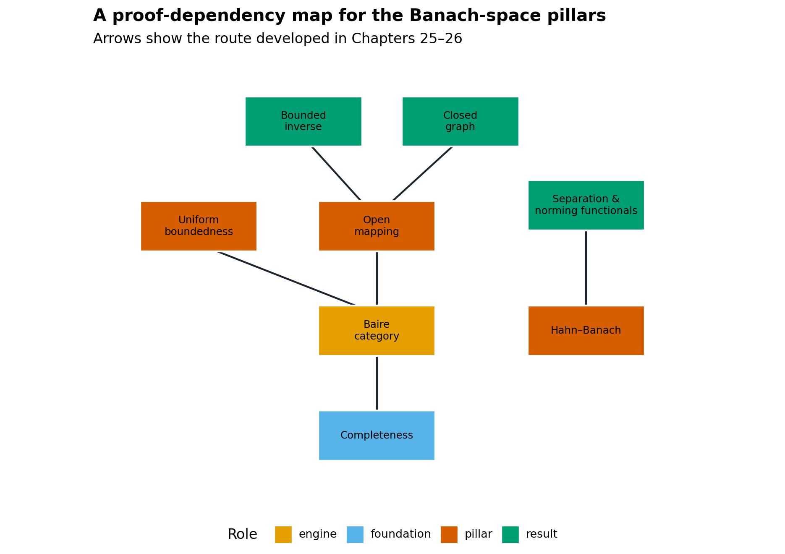

# The Pillars of Banach-Space Theory {#sec-banach-pillars}

Finite-dimensional linear algebra hides several miracles: every linear map is
continuous, every injective map onto its range has a well-behaved inverse, and
bounded sequences have convergent subsequences. Infinite-dimensional analysis
keeps only those conclusions supported by completeness, topology, or compactness.
Four central theorems organise that support.

**Prerequisites.** Normed and Banach spaces, bounded operators, and $L^p$ spaces
from [sec-functional-analysis](13-functional-analysis.md#sec-functional-analysis) and [sec-lp-convergence](21-lp-convergence.md#sec-lp-convergence); Baire category from
[sec-baire-ascoli](25-baire-ascoli.md#sec-baire-ascoli).

## Bounded operators and dual spaces

For normed spaces $X,Y$, a linear map $T:X\to Y$ is continuous if and only if
there is $C$ with

$$
\|Tx\|_Y\le C\|x\|_X
\quad\text{for every }x\in X.
$$

The smallest such $C$ is the operator norm
$\|T\|=\sup_{\|x\|\le1}\|Tx\|$. The bounded operators form
$\mathcal L(X,Y)$, a Banach space when $Y$ is Banach.

The continuous dual $X^*=\mathcal L(X,\mathbb F)$ records all continuous linear
measurements of vectors. For $M\subset X$, its annihilator is

$$
M^\perp=\{\phi\in X^*:\phi(m)=0\text{ for every }m\in M\}.
$$

The kernel of a continuous functional is closed. Conversely, separating a point
from a closed subspace requires Hahn–Banach.

Quotient spaces package directions modulo a closed subspace $M$. The norm

$$
\|x+M\|_{X/M}=\inf_{m\in M}\|x-m\|
$$

is genuine precisely when $M$ is closed, and $X/M$ is Banach when $X$ is.

## Hahn–Banach extension and separation

**Theorem 26.1 (Hahn–Banach, real normed form).** If $M$ is a linear subspace of $X$
and $f:M\to\mathbb R$ is linear with
$|f(m)|\le C\|m\|$, then there is a linear extension $F:X\to\mathbb R$ with
$F|_M=f$ and $\|F\|\le C$.

The one-dimensional extension step chooses $F(m+tx_0)=f(m)+t\alpha$. The
domination inequalities place lower and upper bounds on $\alpha$, and the
triangle inequality proves those intervals overlap. Extending through all
remaining directions uses a maximality principle. In separable settings,
successive extension over a dense chain gives useful intuition, but it is not the
general proof.

**Corollary 26.1 (Norming-functional).** For every nonzero $x\in X$, there is
$\phi\in X^*$ with

$$
\|\phi\|=1,\qquad \phi(x)=\|x\|.
$$

Define $f(tx)=t\|x\|$ on the line spanned by $x$, then extend. Hence the dual
detects the norm:

$$
\|x\|=\sup_{\|\phi\|\le1}|\phi(x)|.
$$

If $M$ is a closed subspace and $x\notin M$, Hahn–Banach yields a functional
vanishing on $M$ but not on $x$. Closed subspaces are therefore exactly
recoverable from continuous linear equations.

## Uniform boundedness

**Uniform boundedness principle.** Let $X$ be Banach and
$\mathcal T\subset\mathcal L(X,Y)$. If

$$
\sup_{T\in\mathcal T}\|Tx\|<\infty
\quad\text{for each fixed }x\in X,
$$

then $\sup_{T\in\mathcal T}\|T\|<\infty$.

Set $E_m=\{x:\sup_T\|Tx\|\le m\}$. These sets are closed and cover $X$.
Baire gives a ball $B(x_0,r)\subset E_m$. For $\|h\|\le r$, both $x_0$ and
$x_0+h$ are controlled, so

$$
\|Th\|\le\|T(x_0+h)\|+\|Tx_0\|\le2m.
$$

Scaling gives $\|T\|\le2m/r$ uniformly.

The contrapositive is often more memorable: if operator norms are unbounded,
there exists one $x$ for which $\{\|Tx\|\}$ is unbounded. It does not say that
most $x$ have this property without an additional category argument.

## Open mapping and bounded inverse

**Theorem 26.2 (Open mapping).** A bounded surjective linear map between Banach spaces
maps open sets to open sets.

The proof first shows that the closure of $T(B_X)$ contains a ball around zero.
Surjectivity writes $Y=\bigcup_{n\ge1}T(nB_X)$, and Baire supplies interior to
one closure. Translation and subtraction move that interior to zero. An iterative
correction then replaces “in the closure” by an actual preimage: approximate a
target, correct the residual at geometrically shrinking scales, and use
completeness to sum the corrections.

**Theorem 26.3 (Bounded inverse).** If $T:X\to Y$ is a bounded linear bijection between
Banach spaces, then $T^{-1}$ is bounded. Indeed, openness of $T$ is continuity
of the inverse.

This theorem explains why a uniquely solvable linear equation is stable once its
operator acts between the correct Banach spaces. Algebraic bijectivity by itself
does not quantify sensitivity.

## Closed graphs

The graph of $T:X\to Y$ is
$\{(x,Tx):x\in X\}\subset X\times Y$.

**Theorem 26.4 (Closed graph).** If $X,Y$ are Banach, $T:X\to Y$ is linear and its
graph is closed, then $T$ is bounded.

Equip the graph with the product norm. Closedness makes it Banach. The projection
$P:\operatorname{graph}(T)\to X$, $P(x,Tx)=x$, is a bounded bijection. Its
inverse is bounded by the bounded inverse theorem, so
$\|Tx\|\le C\|x\|$.

The derivative illustrates the importance of the domain norm. The map

$$
D:C^1([0,1])\to C([0,1]),\qquad Df=f',
$$

is bounded when $C^1$ has norm $\|f\|_\infty+\|f'\|_\infty$. It is not an
everywhere-defined operator from $C([0,1])$, so the closed graph theorem cannot
magically differentiate arbitrary continuous functions.

<figure id="fig-banach-map">


<figcaption>

Figure 26.1: The four Banach-space pillars depend on completeness and feed several corollaries.

</figcaption>
</figure>

[Figure 26.1](#fig-banach-map) records proof dependence, not logical equivalence. There are
alternative derivations among these theorems, but each displayed arrow names the
route used in this book.

## Weak and weak-star convergence

A sequence $x_n$ converges **weakly** to $x$ in $X$ if

$$
\phi(x_n)\longrightarrow\phi(x)
\quad\text{for every }\phi\in X^*.
$$

Norm convergence implies weak convergence. The converse fails in infinite
dimensions: the standard basis $e_n$ of $\ell^2$ converges weakly to zero
because $\langle e_n,y\rangle=\overline{y_n}\to0$ for each $y\in\ell^2$, while
$\|e_n\|=1$. The first slot is linear: for $y=i e_1$, $\langle e_1,y\rangle=-i$.

Uniform boundedness supplies an essential fact: every weakly convergent sequence
is norm bounded. Apply it to the evaluation operators
$Jx_n:X^*\to\mathbb F$, $Jx_n(\phi)=\phi(x_n)$.

A sequence $\phi_n\in X^*$ converges **weak-star** to $\phi$ if
$\phi_n(x)\to\phi(x)$ for every $x\in X$. Weak convergence in $X^*$ tests
against all of $X^{**}$; weak-star convergence tests only against the embedded
copy of $X$, so it is generally weaker.

## Banach–Alaoglu and reflexivity

**Theorem 26.5 (Banach–Alaoglu).** The closed unit ball of $X^*$ is compact in the
weak-star topology.

This compactness need not be sequential in an arbitrary nonseparable setting.
When $X$ is separable, the weak-star topology on the dual unit ball is
metrizable, and sequences recover the familiar compactness language.

A Banach space is **reflexive** if the canonical embedding
$J:X\to X^{**}$ is onto. In a reflexive Banach space, the closed unit ball is
weakly compact. The spaces $L^p$ for $1<p<\infty$ are reflexive. With Lebesgue measure on $[0,1]$, $L^1([0,1])$ and
$L^\infty([0,1])$ are not reflexive; neither is $C([0,1])$.

Weak compactness is powerful because bounded sequences may have weakly convergent
subsequences even when norm compactness is impossible. Variational methods use
exactly this replacement, but a nonlinear functional must also be weakly lower
semicontinuous before limits preserve minimisation.

### Two preduals and an unattained minimum {#sec-two-preduals}

A **predual** of a Banach space $Y$ is a Banach space whose continuous dual
is identified isometrically with $Y$. The identification specifies the test
functions and therefore the weak-star topology. Even the same norm on $Y$ can
come from two preduals with different weak-star limits. The following example
makes us check both closed constraints and lower semicontinuity before using
compactness to minimize an objective.

Work over $\mathbb R$, put $I=\{0,1,2,\ldots\}$, and fix
$Y=\ell^1(I)$ with its usual norm. Let $A=c_0(I)$ be the sequences tending
to zero, with the supremum norm. Let $C=c(\mathbb N)$ be the convergent
sequences $f=(f_1,f_2,\ldots)$, also with the supremum norm. Define

$$
\langle p,z\rangle_A=\sum_{j\ge0}p_jz_j,
\qquad
\langle p,f\rangle_C
=p_0\lim_{n\to\infty}f_n+\sum_{n\ge1}p_nf_n.
$$

The zeroth coefficient in the second pairing measures the limiting value of
$f$; it is not evaluation at an ordinary zeroth entry of $f$. We will prove
that both pairings identify $Y$ isometrically with the respective dual.
These standard dual identifications also appear in
[Erdman's Examples 6.5.25 and 6.5.31](https://web.pdx.edu/~erdman/FAOA/functional_analysis_operator_algebras_pdf.pdf),
printed pages 80–81.

#### Why both identifications are isometric

If $L\in A^*$, set $p_j=L(e_j)$, where $e_j$ denotes a single coordinate
vector. For each finite $F\subset I$, applying $L$ to the finitely supported
sign sequence gives

$$
\sum_{j\in F}|p_j|\le\|L\|.
$$

Thus $p\in\ell^1(I)$. Truncating any $z\in c_0(I)$ in the supremum norm
shows $L(z)=\sum_jp_jz_j$. Conversely this formula defines a bounded
functional for every $p\in Y$. The triangle inequality and the same finite
sign tests prove $\|L\|=\sum_j|p_j|$.

If $L\in C^*$, restrict it to $c_0(\mathbb N)$ and obtain coefficients
$p_n$, $n\ge1$, with $\sum_{n\ge1}|p_n|<\infty$. Put

$$
p_0=L(\mathbf1)-\sum_{n\ge1}p_n.
$$

For $\ell=\lim f_n$, the decomposition
$f=(f-\ell\mathbf1)+\ell\mathbf1$ proves the displayed $C$ pairing.
Its norm is at most $\sum_{j\ge0}|p_j|$. For the reverse inequality, choose
$f_n=\operatorname{sgn}(p_n)$ for $1\le n\le N$ and the constant tail
$f_n=\operatorname{sgn}(p_0)$ for $n>N$. At zero coefficients choose either
sign. This $f$ belongs to $C$, has norm one, and satisfies

$$
\langle p,f\rangle_C
\ge\sum_{j\ge0}|p_j|-2\sum_{n>N}|p_n|.
$$

Letting $N\to\infty$ proves the norm identity. Conversely every $p\in Y$
defines this functional, so the identification is onto.

Both $A$ and $C$ are Banach: a uniform limit preserves, respectively, a zero
limit or existence of a limit. They are separable. Finite rational sequences
are dense in $A$; sequences with finitely many rational entries followed by a
rational constant tail are dense in $C$. Banach–Alaoglu and the preceding
separability clause therefore make each dual unit ball compact and metrizable
in its own weak-star topology. This example has no nonseparable obstruction
to extracting subsequences.

#### Three topologies and one sequence

Write $\sigma(Y,A)$ and $\sigma(Y,C)$ for convergence against the respective
test spaces. For $n\ge1$ the same vectors $e_n\in Y$ satisfy

$$
e_n\longrightarrow0\quad\text{in }\sigma(Y,A),
\qquad
e_n\longrightarrow e_0\quad\text{in }\sigma(Y,C),
$$

because $z_n\to0$ for $z\in A$, whereas $f_n\to\lim f$ for $f\in C$.
Ordinary weak convergence in $Y$ instead tests all of
$Y^*=\ell^\infty(I)$. It gives neither of these limits. In fact no
subsequence of $e_n$ converges weakly: every fixed coordinate test would force
the limit to be zero, while the bounded constant-one test always gives one.
The weak topology is fixed by $Y$; a weak-star topology also needs its declared
predual and pairing.

#### The same minimization problem in two weak-star topologies

Let

$$
S=\left\{p\in Y:p_j\ge0,\ \sum_{j\ge0}p_j=1\right\},
\qquad
J_a(p)=a p_0+\sum_{n\ge1}\frac{p_n}{n},\qquad a>0.
$$

All coefficients in $J_a$ are positive. Therefore $J_a(p)>0$ for every
$p\in S$, but $J_a(e_n)=1/n\to0$. Its infimum on $S$ is zero and is not
attained. Which hypothesis blocks a compactness proof?

For the $A$ predual, $J_a$ is weak-star continuous: its coefficient sequence
$(a,1,1/2,\ldots)$ belongs to $c_0(I)$. But $S$ is not weak-star closed,
since $e_n\in S$ converges to $0\notin S$. Its exact closure is the positive
subprobability ball

$$
\overline S^{\,\sigma(Y,A)}
=D=\{p\in Y:p_j\ge0,\ \|p\|_1\le1\}.
$$

Indeed, coordinate positivity is weak-star closed and the dual unit ball is
compact, hence closed in this Hausdorff topology. Thus $D$ is closed and
contains $S$. Conversely, for any $p\in D$, put $m=\sum_jp_j\le1$.
Then $p+(1-m)e_n\in S$ and converges to $p$ against every $z\in A$.
This proves both inclusions. The minimizing sequence loses its mass in this
topology, so its zero limit is inadmissible.

For the $C$ predual, the total mass
$M(p)=\sum_{j\ge0}p_j=\langle p,\mathbf1\rangle_C$ is continuous.
Moreover

$$
S=B_Y\cap\{M(p)=1\},
\qquad B_Y=\{p:\|p\|_1\le1\}.
$$

To check the equality, $\sum_jp_j=1$ and $\sum_j|p_j|\le1$ force every
$p_j\ge0$. Thus $S$ is a closed subset of the weak-star compact ball and
is compact. Here the minimizing sequence stays in $S$ and converges to
$e_0$, but

$$
J_a(e_0)=a>0=\liminf_{n\to\infty}J_a(e_n).
$$

The missing hypothesis is lower semicontinuity: the value at the limit jumps
upward. In this topology $p_0$ itself is not a continuous coordinate, as the
same sequence shows. Continuity in the norm topology or in $\sigma(Y,A)$
cannot replace lower semicontinuity in $\sigma(Y,C)$.

| topology | properties |
|---|---|
| $\sigma(Y,A)$ | Not closed; $J_a$ continuous |
| $\sigma(Y,C)$ | Compact; upward objective jump |

The finite values $J_a(e_n)=1/n$ alone do not identify either failure. The
pairings, the exact closure, and the limit inequality decide which existence
argument is available. Exercise 8 changes the objective at the limiting
coordinate; the minimizing behaviour then changes even though $S$ is the same.

## Condensation of singularities

Uniform boundedness has a sharper category form. Let
$T_n\in\mathcal L(X,Y)$, where $X$ is Banach, and suppose
$\sup_n\|T_n\|=\infty$. For $m\ge1$, set

$$
G_m=\bigcup_{n=1}^{\infty}\{x:\|T_nx\|>m\}.
$$

Every $G_m$ is open. It is also dense. If one ball avoided $G_m$, translating
and subtracting two points in that ball would uniformly bound all $T_n$ on a
ball around zero, and scaling would uniformly bound their operator norms.
Baire now shows

$$
\bigcap_{m=1}^{\infty}G_m
$$

is residual. For every $x$ in this set,
$\sup_n\|T_nx\|=\infty$. Operator-norm blow-up is therefore witnessed not by
one exceptional vector but by a category-large set of vectors.

This principle is called **condensation of singularities**. It is frequently used
contrapositively in approximation theory. If a sequence of reconstruction
operators has unbounded norms, then some input—and in fact a residual collection
of inputs—has unbounded reconstructed values. To turn that abstract conclusion
into a named explicit function generally requires a separate construction.

## Duality examples

For $1<p<\infty$, every bounded functional on $\ell^p$ has the form

$$
\phi_y(x)=\sum_{k=1}^{\infty}x_ky_k
$$

for a unique $y\in\ell^q$, where $1/p+1/q=1$, and
$\|\phi_y\|=\|y\|_q$. Hölder proves boundedness. To recover $y$, evaluate the
functional on coordinate vectors and use truncated norming sequences. Thus
$(\ell^p)^*\cong\ell^q$, and applying the result again proves reflexivity.

The endpoint changes character: $(\ell^1)^*\cong\ell^\infty$, but not every
functional on $\ell^\infty$ comes from an $\ell^1$ sequence. This is one
reason endpoint theorems in analysis need separate proofs rather than formal
substitution of $p=1$ or $p=\infty$.

<!-- inline-formula-code:start -->
## Formula and finite computation

A useful formula in this chapter is

$$
B_n(f)(x)=\sum_{k=0}^nf(k/n){n\choose k}x^k(1-x)^{n-k}
$$

The finite positive operator is evaluated term by term. The following standalone Python block expresses that finite rule with its inputs and stopping conditions visible.

```python
from collections.abc import Callable
from math import comb

def bernstein_value(
    function: Callable[[float], float], degree: int, point: float
) -> float:
    """Evaluate one Bernstein polynomial on the closed unit interval."""
    if degree <= 0 or not 0.0 <= point <= 1.0:
        raise ValueError("use a positive degree and a point in [0, 1]")
    return sum(
        function(index / degree)
        * comb(degree, index)
        * point**index
        * (1.0 - point) ** (degree - index)
        for index in range(degree + 1)
    )

target = lambda x: abs(x - 0.35)
grid = [index / 1_000 for index in range(1_001)]
for degree in (4, 16, 64):
    error = max(abs(bernstein_value(target, degree, x) - target(x)) for x in grid)
    print(degree, error)
```

**What the computation establishes.** The calculation checks a declared finite instance; the surrounding argument explains what is true beyond those inputs.
<!-- inline-formula-code:end -->

## Summary

- Hahn–Banach extends bounded functionals and separates points from closed
  subspaces.
- Uniform boundedness converts pointwise operator control into norm control.
- Open mapping turns surjective solvability into quantitative stability.
- Closed graph recognises boundedness from convergence compatibility.
- Weak and weak-star topologies recover compactness unavailable in norm.

## Exercises

<div class="exercise" id="real_analysis-26-banach-pillars-ex-1">
<p class="exercise-title"><strong>Exercise 1</strong></p>

Prove that $\mathcal L(X,Y)$ is Banach when $Y$ is Banach.

<details class="solution"><summary>Solution</summary>

A Cauchy operator sequence is pointwise Cauchy; take pointwise limits and pass
the common norm bound to the limit.

</details>

</div>

<div class="exercise" id="real_analysis-26-banach-pillars-ex-2">
<p class="exercise-title"><strong>Exercise 2</strong></p>

Construct a norming functional for $x\in\ell^1$.

<details class="solution"><summary>Solution</summary>

Choose a bounded sign sequence attaining
$\sum_k|x_k|$ under the $\ell^1$-$\ell^\infty$ pairing.

</details>

</div>

<div class="exercise" id="real_analysis-26-banach-pillars-ex-3">
<p class="exercise-title"><strong>Exercise 3</strong></p>

State the contrapositive of uniform boundedness with all quantifiers.

<details class="solution"><summary>Solution</summary>

If $\sup_T\|T\|=\infty$, then some $x$ satisfies
$\sup_T\|Tx\|=\infty$.

</details>

</div>

<div class="exercise" id="real_analysis-26-banach-pillars-ex-4">
<p class="exercise-title"><strong>Exercise 4</strong></p>

Explain where completeness enters the open-mapping proof.

<details class="solution"><summary>Solution</summary>

Baire uses completeness of $Y$; the correction series uses completeness of
$X$.

</details>

</div>

<div class="exercise" id="real_analysis-26-banach-pillars-ex-5">
<p class="exercise-title"><strong>Exercise 5</strong></p>

Show that a bounded bijection with unbounded inverse cannot exist between
Banach spaces.

<details class="solution"><summary>Solution</summary>

It is ruled out by the bounded inverse theorem.

</details>

</div>

<div class="exercise" id="real_analysis-26-banach-pillars-ex-6">
<p class="exercise-title"><strong>Exercise 6</strong></p>

Prove $e_n\rightharpoonup0$ in $\ell^p$ for $1<p<\infty$.

<details class="hint"><summary>Hint 1</summary>

The dual exponent $q$ is finite. Pair $e_n$ against an arbitrary
$\ell^q$ sequence and use the fact that its coordinates tend to zero.

</details>

<details class="solution"><summary>Solution</summary>

Pair against $\ell^q$; every $\ell^q$ sequence tends to zero.

</details>

</div>

<div class="exercise" id="real_analysis-26-banach-pillars-ex-7">
<p class="exercise-title"><strong>Exercise 7</strong></p>

Distinguish weak from weak-star convergence in $X^*$.

<details class="solution"><summary>Solution</summary>

Weak tests against $X^{**}$, whereas weak-star tests only against $X$.

</details>

</div>

<div class="exercise" id="real_analysis-26-banach-pillars-ex-8">
<p class="exercise-title"><strong>Exercise 8</strong></p>

**Change the objective at the limit point.** In [Section 26.7.1](#sec-two-preduals) keep
$S$ and the $C$ predual, but now allow $a\le0$ in
$J_a(p)=a p_0+\sum_{n\ge1}p_n/n$. Determine the infimum and every minimizer
separately for $a=0$ and $a<0$. Prove whether $J_a|_S$ is continuous or
merely lower semicontinuous in $\sigma(Y,C)$, and decide whether either
assertion extends to all of the signed space $Y$. Explain why the unchanged
lack of $\sigma(Y,A)$-closedness of $S$ does not force nonattainment in this
new problem. Name the topology used in each claim.

<details class="solution"><summary>Solution</summary>

On $S$, the mass constraint gives

$$
J_a(p)=a+\sum_{n\ge1}(1/n-a)p_n.
$$

For $a\le0$ every coefficient in the sum is strictly positive. Therefore
$J_a(p)\ge a$, with equality exactly when every $p_n=0$ for $n\ge1$,
hence exactly at $p=e_0$. For $a=0$ the minimum is zero; for $a<0$ it is
$a$. In contrast, the worked case $a>0$ has an unattained infimum zero.

For either $a\le0$, the identity on $S$ can be written

$$
J_a|_S=\sup_{N\ge1}F_N|_S,
\qquad
F_N(p)=a+\sum_{n=1}^N(1/n-a)p_n.
$$

Each $F_N$ is $\sigma(Y,C)$-continuous because $p_n$ for $n\ge1$ is
evaluation at a finitely supported test in $c$. Thus
$\{p\in S:J_a(p)>t\}=\bigcup_N\{p\in S:F_N(p)>t\}$ is relatively
open. This proves topological lower semicontinuity on $S$, not just a
sequential inequality.

If $a=0$, the test $f_n=1/n$ belongs to $c$ with limit zero. Its pairing
is $J_0$, so $J_0$ is continuous on the whole signed space $Y$ in
$\sigma(Y,C)$. Equivalently, on $S$ its finite-sum tail is uniformly
at most $1/(N+1)$.

If $a<0$, $e_n\to e_0$ in $\sigma(Y,C)$ but
$J_a(e_n)=1/n\to0\ne a=J_a(e_0)$. Hence $J_a|_S$ is discontinuous,
although lower semicontinuous. That last assertion is restricted to $S$:
on the signed space $Y$, $-e_n\to-e_0$ gives
$J_a(-e_n)=-1/n\to0<-a=J_a(-e_0)$, violating lower semicontinuity.

Finally, $S$ is still not closed in $\sigma(Y,A)$, even though $J_a$
is continuous there for every $a$. Failure of an existence theorem's
sufficient hypothesis does not imply failure of existence. In the
$C$-predual topology the set is compact and $J_a|_S$ is lower
semicontinuous for $a\le0$; this matching pair of hypotheses proves
attainment and agrees with the explicit unique minimizer.

</details>

</div>

### Hint for the changed objective

For Exercise 8, eliminate $p_0$ with the mass constraint before studying
regularity. Finite sums of the coordinates $p_n$, $n\ge1$, are continuous
in $\sigma(Y,C)$. Compare their supremum with $J_a$ on $S$, and test
continuity using $e_n\to e_0$. For the signed-space question, also test
$-e_n\to-e_0$. Full solutions follow separately below.

### Answer support

1. A Cauchy operator sequence is pointwise Cauchy; take pointwise limits and pass
   the common norm bound to the limit.
2. Choose a bounded sign sequence attaining
   $\sum_k|x_k|$ under the $\ell^1$-$\ell^\infty$ pairing.
3. If $\sup_T\|T\|=\infty$, then some $x$ satisfies
   $\sup_T\|Tx\|=\infty$.
4. Baire uses completeness of $Y$; the correction series uses completeness of
   $X$.
5. It is ruled out by the bounded inverse theorem.
6. Pair against $\ell^q$; every $\ell^q$ sequence tends to zero.
7. Weak tests against $X^{**}$, whereas weak-star tests only against $X$.
8. On $S$, the mass constraint gives

   $$
   J_a(p)=a+\sum_{n\ge1}(1/n-a)p_n.
   $$

   For $a\le0$ every coefficient in the sum is strictly positive. Therefore
   $J_a(p)\ge a$, with equality exactly when every $p_n=0$ for $n\ge1$,
   hence exactly at $p=e_0$. For $a=0$ the minimum is zero; for $a<0$ it is
   $a$. In contrast, the worked case $a>0$ has an unattained infimum zero.

   For either $a\le0$, the identity on $S$ can be written

   $$
   J_a|_S=\sup_{N\ge1}F_N|_S,
   \qquad
   F_N(p)=a+\sum_{n=1}^N(1/n-a)p_n.
   $$

   Each $F_N$ is $\sigma(Y,C)$-continuous because $p_n$ for $n\ge1$ is
   evaluation at a finitely supported test in $c$. Thus
   $\{p\in S:J_a(p)>t\}=\bigcup_N\{p\in S:F_N(p)>t\}$ is relatively
   open. This proves topological lower semicontinuity on $S$, not just a
   sequential inequality.

   If $a=0$, the test $f_n=1/n$ belongs to $c$ with limit zero. Its pairing
   is $J_0$, so $J_0$ is continuous on the whole signed space $Y$ in
   $\sigma(Y,C)$. Equivalently, on $S$ its finite-sum tail is uniformly
   at most $1/(N+1)$.

   If $a<0$, $e_n\to e_0$ in $\sigma(Y,C)$ but
   $J_a(e_n)=1/n\to0\ne a=J_a(e_0)$. Hence $J_a|_S$ is discontinuous,
   although lower semicontinuous. That last assertion is restricted to $S$:
   on the signed space $Y$, $-e_n\to-e_0$ gives
   $J_a(-e_n)=-1/n\to0<-a=J_a(-e_0)$, violating lower semicontinuity.

   Finally, $S$ is still not closed in $\sigma(Y,A)$, even though $J_a$
   is continuous there for every $a$. Failure of an existence theorem's
   sufficient hypothesis does not imply failure of existence. In the
   $C$-predual topology the set is compact and $J_a|_S$ is lower
   semicontinuous for $a\le0$; this matching pair of hypotheses proves
   attainment and agrees with the explicit unique minimizer.
