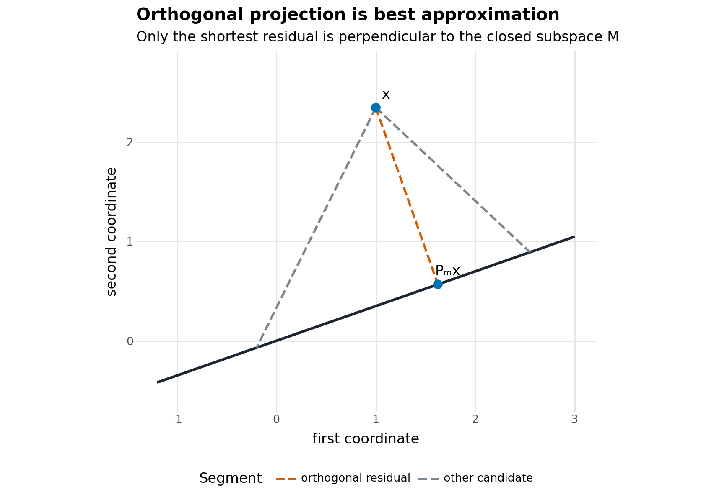

# Hilbert Spaces, Projections, and Spectral Ideas {#sec-hilbert-spectral}

A Hilbert space is a complete inner-product space. Its geometry resembles
Euclidean space closely enough that perpendicular projection, Fourier
coefficients, and self-adjoint eigenvectors survive in infinite dimensions.
Completeness is what turns finite geometric approximations into actual vectors.

**Prerequisites.** Normed spaces and operators from [sec-functional-analysis](13-functional-analysis.md#sec-functional-analysis);
Banach-space terminology from [sec-banach-pillars](26-banach-pillars.md#sec-banach-pillars); integration from
[sec-lebesgue-construction](19-lebesgue-measure.md#sec-lebesgue-construction).

## Inner-product geometry

An inner product on a real vector space is a symmetric bilinear form
$\langle x,y\rangle$ with $\langle x,x\rangle>0$ for $x\ne0$. It induces
$\|x\|=\sqrt{\langle x,x\rangle}$. In complex spaces the first slot is usually
linear and the second conjugate-linear, or conversely by convention; this book
uses linearity in the first slot.

Cauchy–Schwarz,

$$
|\langle x,y\rangle|\le\|x\|\|y\|,
$$

follows by expanding $\|x-ty\|^2\ge0$ and minimising over $t$. It yields the
triangle inequality. The inner-product origin of the norm is detected by the
**parallelogram law**

$$
\|x+y\|^2+\|x-y\|^2=2\|x\|^2+2\|y\|^2.
$$

Conversely, a norm satisfying this identity comes from an inner product. Over
$\mathbb R$, polarization recovers it:

$$
\langle x,y\rangle=
\frac{\|x+y\|^2-\|x-y\|^2}{4}.
$$

Thus $\ell^2$ is Hilbert, while $\ell^1$ and $\ell^\infty$ are not: their
norms fail the parallelogram test.

Vectors are orthogonal when $\langle x,y\rangle=0$. Pythagoras becomes
$\|x+y\|^2=\|x\|^2+\|y\|^2$, and finite orthogonal sums have no cross terms.

## Best approximation and projection

**Theorem 27.1 (Projection).** If $C$ is a nonempty closed convex subset of a Hilbert
space $H$, then for every $x\in H$ there is a unique $c_0\in C$ satisfying

$$
\|x-c_0\|=\inf_{c\in C}\|x-c\|.
$$

Take a minimizing sequence $c_n$. The parallelogram identity applied to
$(x-c_n)$ and $(x-c_m)$, together with convexity of
$(c_n+c_m)/2$, shows that $c_n$ is Cauchy. Completeness gives a limit and
closedness keeps it in $C$. Strict convexity of the squared norm gives
uniqueness.

When $C=M$ is a closed subspace, the residual is orthogonal:

$$
x-P_Mx\in M^\perp.
$$

Indeed, vary $P_Mx$ along $tm$ and minimise the resulting quadratic in
$t$. Consequently

$$
H=M\oplus M^\perp.
$$

The map $P_M$ is linear, bounded, idempotent, and self-adjoint, with
$\|P_M\|\le1$.

<figure id="fig-hilbert-projection">


<figcaption>

Figure 27.1: Orthogonal projection makes the residual perpendicular to the approximating subspace.

</figcaption>
</figure>

[Figure 27.1](#fig-hilbert-projection) shows a two-dimensional model of a theorem valid in every
Hilbert space. Convexity and the inner product, rather than the drawing, prove
existence and orthogonality.

**Least-squares example.** Given linearly independent vectors
$v_1,\ldots,v_n$, the best approximation
$\sum_jc_jv_j$ to $x$ satisfies the normal equations

$$
\sum_j c_j\langle v_j,v_i\rangle=\langle x,v_i\rangle
\quad(1\le i\le n).
$$

The Gram matrix is positive definite, so the coefficients are unique.

## Riesz representation and adjoints

**Theorem 27.2 (Riesz representation).** For every $\phi\in H^*$, there is a unique
$y\in H$ such that

$$
\phi(x)=\langle x,y\rangle
\quad\text{for every }x\in H,
\qquad
\|\phi\|=\|y\|.
$$

If $\phi\ne0$, project any point outside $\ker\phi$ onto that closed
hyperplane. The orthogonal residual spans $(\ker\phi)^\perp$; scaling it
represents $\phi$. The theorem identifies $H^*$ with $H$, but the
identification depends on the inner product and is conjugate-linear under one of
the complex conventions.

For $T\in\mathcal L(H,K)$, Riesz supplies a unique adjoint $T^*:K\to H$
defined by

$$
\langle Tx,y\rangle_K=\langle x,T^*y\rangle_H.
$$

It satisfies $\|T^*\|=\|T\|$, $(ST)^*=T^*S^*$, and
$\ker T^*=(\operatorname{ran}T)^\perp$. An operator on $H$ is self-adjoint
when $T=T^*$, positive when it is self-adjoint and $\langle Tx,x\rangle\ge0$ for every vector, and unitary when
$T^*T=TT^*=I$.

## Orthonormal systems and bases

An orthonormal family $(e_j)$ satisfies
$\langle e_i,e_j\rangle=\delta_{ij}$. For finite sums, the best coefficients
are Fourier coefficients:

$$
\left\|x-\sum_{j=1}^n c_je_j\right\|^2
= \left\|x-\sum_{j=1}^n\langle x,e_j\rangle e_j\right\|^2
+\sum_{j=1}^n|c_j-\langle x,e_j\rangle|^2.
$$

Letting $n$ grow gives **Bessel's inequality**

$$
\sum_j|\langle x,e_j\rangle|^2\le\|x\|^2.
$$

The family is complete, or an orthonormal basis, if its closed linear span is all
of $H$. Then

$$
x=\sum_j\langle x,e_j\rangle e_j,
\qquad
\|x\|^2=\sum_j|\langle x,e_j\rangle|^2,
$$

with convergence in norm. The second identity is Parseval's theorem.

Gram–Schmidt turns a linearly independent sequence into an orthonormal sequence
with the same successive spans. A separable Hilbert space has a countable
orthonormal basis; every infinite-dimensional separable Hilbert space is
isometrically isomorphic to $\ell^2$.

For trigonometric functions in $L^2[-\pi,\pi]$, abstract norm convergence means
mean-square convergence. It does not by itself imply pointwise or uniform
convergence. Different convergence questions require maximal estimates or
additional regularity.

## Compact operators

A bounded operator $T:X\to Y$ is **compact** when it maps every bounded sequence
to a sequence with a convergent image subsequence. Finite-rank operators are
compact. A norm limit of compact operators is compact.

The identity on an infinite-dimensional Hilbert space is not compact: an
orthonormal sequence is bounded and has pairwise distance $\sqrt2$, so it has
no norm-convergent subsequence.

An integral operator

$$
(Tf)(x)=\int_a^bK(x,y)f(y)\,dy
$$

with $K\in L^2([a,b]^2)$ is Hilbert–Schmidt and compact on $L^2$.
Approximate $K$ in $L^2$ by finite sums
$\sum_{j=1}^nu_j(x)v_j(y)$; the corresponding operators have finite rank, and
the operator-norm error is bounded by the kernel's $L^2$ error.

Compact operators turn weak convergence into strong convergence along the full
image sequence: if $x_n\rightharpoonup x$, then $Tx_n\to Tx$ in norm. Any
subsequence has a norm-convergent subsubsequence, and dual testing identifies its
only possible limit as $Tx$.

## Spectral theorem for compact self-adjoint operators

**Theorem 27.3 (Spectral).** Let $T$ be compact and self-adjoint on a Hilbert space.
Every nonzero spectral value is a real eigenvalue of finite multiplicity;
distinct eigenspaces are orthogonal; zero is the only possible accumulation
point of the eigenvalues; and

$$
Tx=\sum_j\lambda_j\langle x,e_j\rangle e_j
$$

on the closed span of the nonzero eigenspaces, with $T=0$ on its orthogonal
complement.

Self-adjointness makes eigenvalues real and distinct eigenspaces orthogonal.
Compactness ensures the supremum of
$|\langle Tx,x\rangle|$ on the unit sphere is attained after a maximizing
sequence is processed, producing an eigenvector. Restrict to its orthogonal
complement and repeat. If infinitely many eigenvalues stayed away from zero, the
images of their orthonormal eigenvectors would have no convergent subsequence,
contradicting compactness.

For a compact positive operator, $\lambda_j\ge0$. For a general compact
operator, apply the spectral theorem to $T^*T$ to obtain singular values.

## Inverse problems and regularisation

If $Te_j=\lambda_je_j$ with $\lambda_j\to0$, formally solving $Tx=y$ gives

$$
x=\sum_j\frac{\langle y,e_j\rangle}{\lambda_j}e_j.
$$

Small measurement errors in high-index coefficients are amplified by
$1/|\lambda_j|$. The inverse is unbounded on its range unless only finitely
many nonzero eigenvalues occur with a positive lower bound.

Spectral cutoff replaces $1/\lambda_j$ by zero once $|\lambda_j|$ is too
small. Tikhonov regularisation replaces it by
$\lambda_j/(\lambda_j^2+\alpha)$. Both trade bias for stability; choosing the
regularisation scale requires an error model or prior smoothness information.

## Rayleigh quotients and unbounded operators

For a bounded self-adjoint operator, the Rayleigh quotient is

$$
R_T(x)=\frac{\langle Tx,x\rangle}{\|x\|^2},
\qquad x\ne0.
$$

Its extrema over invariant finite-dimensional subspaces locate eigenvalues. For
a compact positive operator with eigenvalues
$\lambda_1\ge\lambda_2\ge\cdots>0$, the min–max principle states

$$
\lambda_k=
\min_{\dim M=k-1}
\ \max_{\substack{x\perp M\\\|x\|=1}}
\langle Tx,x\rangle.
$$

Choosing $M$ as the span of the first $k-1$ eigenvectors proves one
inequality; dimension counting forces every competing $M$ to miss a direction
in their $k$-dimensional span and proves the other. Variational eigenvalue
formulas connect spectral theory to energy minimisation and numerical Galerkin
methods.

Differential operators are usually unbounded. The derivative cannot be a bounded
map $L^2\to L^2$: for
$e_n(x)=e^{2\pi inx}$, the input norm is one while the derivative norm grows
like $n$. An unbounded operator is therefore specified together with a dense
domain,

$$
A:D(A)\subset H\longrightarrow H.
$$

Closedness now means: if $x_n\to x$ and $Ax_n\to y$, then
$x\in D(A)$ and $Ax=y$. Self-adjointness requires equality with the adjoint
including equality of domains, a stronger statement than the formal integration
by parts identity.

The Dirichlet Laplacian on a bounded domain is an unbounded positive
self-adjoint operator with compact inverse under standard hypotheses. Applying
the compact spectral theorem to its inverse yields eigenfunctions of the
Laplacian and eigenvalues tending to infinity. This is the bridge from the
bounded theorem proved here to heat and wave expansions in [sec-analysis-pde](32-pde.md#sec-analysis-pde).

<!-- inline-formula-code:start -->
## Formula and finite computation

A useful formula in this chapter is

$$
P_ux=\frac{\langle x,u\rangle}{\langle u,u\rangle}u
$$

The finite vector calculation checks that the residual is orthogonal to the target line. The following standalone Python block expresses that finite rule with its inputs and stopping conditions visible.

```python
import numpy as np

x = np.array([3.0, 1.0, 2.0])
u = np.array([1.0, 2.0, 0.0])
projection = (x @ u) / (u @ u) * u
residual = x - projection
print(projection, residual @ u)
```

**What the computation establishes.** The output certifies only the declared finite case. The theorem, if one is claimed, still requires the argument developed in the chapter.
<!-- inline-formula-code:end -->

## Summary

- Inner products provide orthogonality, Pythagoras, and nearest-point projection.
- Riesz representation turns continuous functionals into inner products and
  creates adjoints.
- Orthonormal bases give norm-convergent Fourier expansions and Parseval.
- Compactness is an operator property stronger than boundedness.
- Compact self-adjoint operators admit an orthogonal spectral expansion, while
  vanishing eigenvalues make inversion unstable.

## Related results {#fifth-edition-handoff}

Compact self-adjoint operators admit eigen-expansions, but many differential
and multiplication operators are unbounded and may have continuous spectrum.
Chapter [sec-unbounded-spectral](44-unbounded-spectral.md#sec-unbounded-spectral) replaces coefficient sums by projection-valued
measures, makes domains part of every operator identity, and proves the full
position-operator model.

## Exercises

<div class="exercise" id="real_analysis-27-hilbert-spectral-ex-1">
<p class="exercise-title"><strong>Exercise 1</strong></p>

Derive Cauchy–Schwarz by minimising $\|x-ty\|^2$.

<details class="solution"><summary>Solution</summary>

Choose the real or complex scalar making the quadratic smallest.

</details>

</div>

<div class="exercise" id="real_analysis-27-hilbert-spectral-ex-2">
<p class="exercise-title"><strong>Exercise 2</strong></p>

Test the parallelogram law in $\mathbb R^2$ with the $\ell^1$ norm.

<details class="solution"><summary>Solution</summary>

Use $x=(1,0)$, $y=(0,1)$; the two sides are $8$ and $4$.

</details>

</div>

<div class="exercise" id="real_analysis-27-hilbert-spectral-ex-3">
<p class="exercise-title"><strong>Exercise 3</strong></p>

Derive the normal equations for a finite-dimensional least-squares problem.

<details class="solution"><summary>Solution</summary>

Orthogonality of the residual to each spanning vector gives the system.

</details>

</div>

<div class="exercise" id="real_analysis-27-hilbert-spectral-ex-4">
<p class="exercise-title"><strong>Exercise 4</strong></p>

Prove $M^{\perp\perp}=\overline M$.

<details class="solution"><summary>Solution</summary>

One inclusion is immediate; separate a point outside $\overline M$ and use
Riesz for the other.

</details>

</div>

<div class="exercise" id="real_analysis-27-hilbert-spectral-ex-5">
<p class="exercise-title"><strong>Exercise 5</strong></p>

Establish Bessel's inequality from the best-approximation identity.

<details class="solution"><summary>Solution</summary>

Expand the norm of the residual after orthogonal projection.

</details>

</div>

<div class="exercise" id="real_analysis-27-hilbert-spectral-ex-6">
<p class="exercise-title"><strong>Exercise 6</strong></p>

Show an orthonormal sequence converges weakly to zero.

<details class="solution"><summary>Solution</summary>

Bessel implies the coefficient sequence
$(\langle x,e_n\rangle)$ lies in $\ell^2$, hence tends to zero.

</details>

</div>

<div class="exercise" id="real_analysis-27-hilbert-spectral-ex-7">
<p class="exercise-title"><strong>Exercise 7</strong></p>

Prove a norm limit of compact operators is compact.

<details class="hint"><summary>Hint 1</summary>

Given a bounded sequence, first use compactness of one approximating
operator, then choose a diagonal subsequence while the operator-norm error tends
to zero.

</details>

<details class="solution"><summary>Solution</summary>

Approximate image sequences by one compact operator and use a diagonal
subsequence.

</details>

</div>

<div class="exercise" id="real_analysis-27-hilbert-spectral-ex-8">
<p class="exercise-title"><strong>Exercise 8</strong></p>

Explain why spectral cutoff is stable for a fixed cutoff but biased.

<details class="solution"><summary>Solution</summary>

The retained inverse factors are bounded, but omitted true coefficients
create deterministic error.

</details>

</div>

### Answer support

1. Choose the real or complex scalar making the quadratic smallest.
2. Use $x=(1,0)$, $y=(0,1)$; the two sides are $8$ and $4$.
3. Orthogonality of the residual to each spanning vector gives the system.
4. One inclusion is immediate; separate a point outside $\overline M$ and use
   Riesz for the other.
5. Expand the norm of the residual after orthogonal projection.
6. Bessel implies the coefficient sequence
   $(\langle x,e_n\rangle)$ lies in $\ell^2$, hence tends to zero.
7. Approximate image sequences by one compact operator and use a diagonal
   subsequence.
8. The retained inverse factors are bounded, but omitted true coefficients
   create deterministic error.
