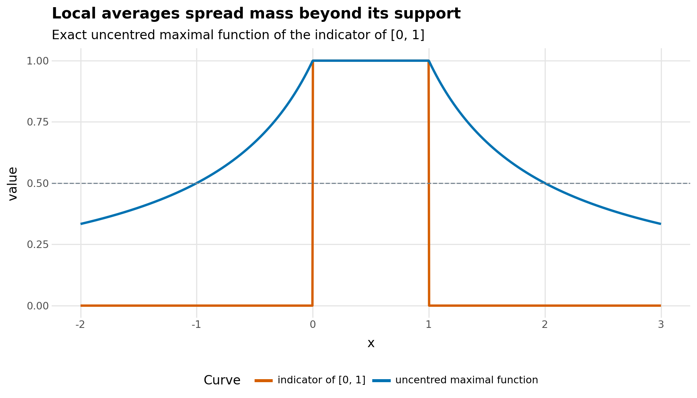

# Differentiation of Measures and Maximal Functions {#sec-maximal-differentiation}

An integral averages a function over a set. If the sets shrink to a point, should
their averages recover the function? Continuity makes the answer immediate, but
integrable functions may be discontinuous everywhere on a dense set. The
Hardy–Littlewood maximal operator controls the exceptional points and turns
approximation by continuous functions into an almost-everywhere theorem.

**Prerequisites.** Lebesgue measure and integration from
[sec-lebesgue-construction](19-lebesgue-measure.md#sec-lebesgue-construction); signed measures and Radon–Nikodym from
[sec-signed-measures](20-signed-measures.md#sec-signed-measures); $L^p$ approximation from [sec-lp-convergence](21-lp-convergence.md#sec-lp-convergence).

## Local averages and Lebesgue points

For $f\in L^1_{\mathrm{loc}}(\mathbb R^d)$, define the average over a ball by

$$
A_rf(x)=\frac1{|B(x,r)|}\int_{B(x,r)}f(y)\,dy.
$$

A point $x$ is a **Lebesgue point** of $f$ if

$$
\lim_{r\downarrow0}
\frac1{|B(x,r)|}\int_{B(x,r)}|f(y)-f(x)|\,dy=0.
$$

At such a point, $A_rf(x)\to f(x)$. Every continuity point is a Lebesgue point,
but the definition tolerates sparse or small oscillations that continuity would
forbid.

The value $f(x)$ is ambiguous for an $L^1$ equivalence class at a null set.
The theorem below selects an almost-everywhere representative through limiting
averages; it does not assign meaningful values at every point.

## Covering intervals efficiently

The one-dimensional covering lemma needed here is simple. From a finite family of
intervals, choose a longest interval, discard every interval meeting it, and
repeat. The selected intervals are disjoint, and every discarded interval lies
inside a fixed dilation—three times the selected interval is enough. Therefore
the union of the original intervals has length at most three times the total
length of the selected ones.

In $\mathbb R^d$, a Vitali-type selection produces disjoint balls whose fixed
dilations cover the original family. The dilation constant depends on dimension.
This bounded-overlap geometry is why the maximal theorem works for balls and
cubes.

## The Hardy–Littlewood maximal operator

The centred maximal function is

$$
Mf(x)=\sup_{r>0}\frac1{|B(x,r)|}
\int_{B(x,r)}|f(y)|\,dy.
$$

An uncentred version takes the supremum over all balls containing $x$. The two
versions are pointwise comparable up to a dimension-dependent constant.

**Weak type $(1,1)$.** There is a constant $C_d$ such that for every
$f\in L^1(\mathbb R^d)$ and $\lambda>0$,

$$
\big|\{x:Mf(x)>\lambda\}\big|
\le\frac{C_d}{\lambda}\|f\|_1.
$$

For each point in the level set, choose a ball on which the average exceeds
$\lambda$. On a compact portion, the covering lemma selects disjoint balls
$B_j$ whose dilations cover the portion. Then

$$
\lambda\sum_j|B_j|
<\sum_j\int_{B_j}|f|
\le\|f\|_1.
$$

The dilation factor gives $C_d$; exhaustion removes compactness.

Weak type does not mean $\|Mf\|_1\le C\|f\|_1$, which is false. Interpolation
with the trivial $L^\infty$ bound yields the strong estimate
$\|Mf\|_p\le C_{p,d}\|f\|_p$ for $1<p\le\infty$.

<figure id="fig-maximal-function">


<figcaption>

Figure 28.1: A narrow integrable spike creates a broad but decaying maximal-function envelope.

</figcaption>
</figure>

[Figure 28.1](#fig-maximal-function) explains why a level-set estimate is plausible: the set
where $Mf$ is large can exceed the support of $f$, but a large average spends
a definite amount of the finite $L^1$ mass.

## Lebesgue differentiation

**Theorem 28.1 (Lebesgue differentiation).** If
$f\in L^1_{\mathrm{loc}}(\mathbb R^d)$, then almost every point is a Lebesgue
point. In particular,

$$
\lim_{r\downarrow0}A_rf(x)=f(x)
\quad\text{for almost every }x.
$$

The proof separates a good approximation from a bad remainder. On a bounded
region, choose continuous compactly supported $g$ with
$\|f-g\|_1$ small. Continuity makes the local oscillation of $g$ tend to zero
at every point. For $h=f-g$, the limsup of its local average is bounded by
$Mh$. Weak type gives

$$
\left|\left\{x:\limsup_{r\downarrow0}A_r|h|(x)>\lambda\right\}\right|
\le \frac{C_d}{\lambda}\|h\|_1.
$$

Let the approximation error decrease to zero, then let $\lambda$ decrease.
This “dense good class plus maximal control” pattern reappears throughout
harmonic analysis.

The theorem is local. For $L^1_{\mathrm{loc}}$, multiply by a cutoff or work on
successive bounded sets before taking a countable union of exceptional null sets.

## Differentiating measures

If a finite Borel measure $\nu$ is absolutely continuous with respect to
Lebesgue measure, Radon–Nikodym gives $d\nu=f\,dx$. Differentiation yields

$$
\lim_{r\downarrow0}\frac{\nu(B(x,r))}{|B(x,r)|}=f(x)
\quad\text{for almost every }x.
$$

The density is therefore an infinitesimal ratio of measures, almost everywhere.
This interpretation is a theorem, not the definition used to prove
Radon–Nikodym.

For a singular measure, the ratio can behave very differently. A Dirac mass at
zero has ratio zero at every $x\ne0$ and infinite growth at the atom. The
Cantor measure is singular and atomless; its mass concentrates on a null set, so
ordinary density with respect to length vanishes almost everywhere with respect
to length while still carrying total mass one.

For a general finite measure $\nu=f\,dx+\nu_s$, differentiation recovers $f$
at almost every Lebesgue point and does not erase the singular part as a measure.
“Derivative zero almost everywhere” is not enough to conclude a measure is zero.

## Bounded variation and derivative measures

If $F$ has bounded variation on an interval, its distributional derivative
$DF$ is a finite signed measure. Lebesgue decomposition separates

$$
DF=f\,dx+D^jF+D^cF,
$$

where the pieces are absolutely continuous, atomic jump, and singular continuous.
Correspondingly, a normalised $F$ decomposes into an absolutely continuous
function, a jump function, and a Cantor-type function.

The classical derivative satisfies $F'=f$ almost everywhere, but it does not
record the jump or Cantor parts. The fundamental theorem

$$
F(x)=F(a)+\int_a^xF'(t)\,dt
$$

holds for every $x$ exactly for absolutely continuous $F$, not for every
continuous BV function. The Cantor function is the standard warning: it is
continuous, increases from zero to one, and has derivative zero almost
everywhere.

## Approximate identities

Let $\phi\ge0$, $\int\phi=1$, and
$\phi_\varepsilon(x)=\varepsilon^{-d}\phi(x/\varepsilon)$.
Then

$$
(f*\phi_\varepsilon)(x)
=\int f(x-y)\phi_\varepsilon(y)\,dy
$$

is a weighted local average. Under a mild tail condition on $\phi$, it
converges to $f(x)$ at every Lebesgue point and in $L^p$ for
$1\le p<\infty$.

Positivity makes maximal domination transparent. Oscillatory kernels such as
Dirichlet kernels are not positive approximate identities and can have growing
$L^1$ norm; pointwise Fourier convergence is therefore subtler than
mollification.

## Density points and differentiation bases

Apply the differentiation theorem to $f=\mathbf1_E$. For almost every $x$,

$$
\lim_{r\downarrow0}
\frac{|E\cap B(x,r)|}{|B(x,r)|}
=\mathbf1_E(x).
$$

This is the **Lebesgue density theorem**. Almost every point of $E$ has density
one, and almost every point of its complement has density zero. A measurable set
can have a topologically complicated boundary of positive measure, but the
measure-theoretic boundary—points with neither density zero nor one—is null.

Density does not imply interior. A positive-measure set may have empty interior
while almost every one of its points has density one. Topological and
measure-theoretic local structure answer different questions.

Balls may be replaced by other shrinking families, called a
**differentiation basis**, when a suitable covering theorem and maximal estimate
hold. Axis-parallel cubes work. Arbitrarily eccentric rectangles are much more
delicate because their overlap geometry deteriorates; the associated strong
maximal function has different endpoint bounds.

One-sided intervals differentiate $L^1_{\mathrm{loc}}(\mathbb R)$ as well.
Intervals constrained to a sparse or poorly distributed set of scales may fail
to inspect all local behaviour. The safe workflow is to name the basis, prove
its covering lemma, establish its maximal inequality, and only then assert
almost-everywhere differentiation.

At an atom of a measure, ratios against Lebesgue volume diverge as the ball
shrinks. If one instead divides by the measure itself, a different
differentiation theorem for one measure relative to another is needed. The
denominator is part of the claim, not notation to be changed informally.

<!-- inline-formula-code:start -->
## Formula and finite computation

A useful formula in this chapter is

$$
f_n\to f\text{ pointwise}\not\Longrightarrow\int f_n\to\int f
$$

The spikes $f_n=n\mathbf{1}_{(0,1/n]}$ converge to zero at every point of $[0,1]$, including zero, while their integrals remain one. Exact integrals and point values expose the missing domination hypothesis. The following standalone Python block expresses that finite rule with its inputs and stopping conditions visible.

```python
from fractions import Fraction

def power_integral(index: int) -> Fraction:
    """Return the exact integral of x**index over [0,1]."""
    if index < 0:
        raise ValueError("index must be nonnegative")
    return Fraction(1, index + 1)

def spike_value(index: int, point: Fraction) -> int:
    """Evaluate index times the indicator of (0,1/index] at a rational point."""
    if index <= 0 or point < 0 or point > 1:
        raise ValueError("use a positive index and a point in [0,1]")
    return index if 0 < point <= Fraction(1, index) else 0

for index in (2, 10, 100, 1_000):
    print(index, power_integral(index), spike_value(index, Fraction(1, 2)), 1)
```

**What the computation establishes.** The calculation checks a declared finite instance; the surrounding argument explains what is true beyond those inputs.
<!-- inline-formula-code:end -->

## Summary

- Lebesgue points express recovery by shrinking local averages.
- Covering lemmas turn many overlapping witnesses into controlled disjoint
  families.
- The maximal operator is weak type $(1,1)$ and strong type $(p,p)$ for
  $p>1$.
- Almost every point of a locally integrable function is a Lebesgue point.
- Differentiation recovers the absolutely continuous density but classical
  derivatives miss singular measure components.

## Related results {#fifth-edition-handoff}

The strong $L^p$ maximal estimate quoted here is proved from the weak endpoint
in [sec-interpolation-singular](43-interpolation-singular-integrals.md#sec-interpolation-singular). That chapter then reuses the same level-set
architecture with Calderón–Zygmund cancellation to control singular integral
operators.

## Exercises

<div class="exercise" id="real_analysis-28-maximal-differentiation-ex-1">
<p class="exercise-title"><strong>Exercise 1</strong></p>

Prove every continuity point of $f$ is a Lebesgue point.

<details class="solution"><summary>Solution</summary>

Bound the average oscillation by the supremum oscillation on the ball.

</details>

</div>

<div class="exercise" id="real_analysis-28-maximal-differentiation-ex-2">
<p class="exercise-title"><strong>Exercise 2</strong></p>

Compute the uncentred maximal function qualitatively for
$f=\mathbf 1_{[0,1]}$.

<details class="solution"><summary>Solution</summary>

It equals one on the interval and decays like the reciprocal of the shortest
interval containing the point and $[0,1]$.

</details>

</div>

<div class="exercise" id="real_analysis-28-maximal-differentiation-ex-3">
<p class="exercise-title"><strong>Exercise 3</strong></p>

Identify why weak type $(1,1)$ does not imply an $L^1$ norm bound.

<details class="hint"><summary>Hint 1</summary>

Integrate the weak distribution bound by the layer-cake formula and
notice the logarithmic divergence at infinity.

</details>

<details class="solution"><summary>Solution</summary>

The distribution estimate has a $1/\lambda$ tail whose layer-cake integral
diverges logarithmically.

</details>

</div>

<div class="exercise" id="real_analysis-28-maximal-differentiation-ex-4">
<p class="exercise-title"><strong>Exercise 4</strong></p>

Fill in the disjoint-ball inequality in the weak-type proof.

<details class="solution"><summary>Solution</summary>

Each chosen ball has $\lambda|B_j|<\int_{B_j}|f|$, and disjointness permits
summation.

</details>

</div>

<div class="exercise" id="real_analysis-28-maximal-differentiation-ex-5">
<p class="exercise-title"><strong>Exercise 5</strong></p>

Use differentiation to recover the density of
$\nu(E)=\int_E(1+x^2)\,dx$.

<details class="solution"><summary>Solution</summary>

The ratio tends to $1+x^2$ at every point.

</details>

</div>

<div class="exercise" id="real_analysis-28-maximal-differentiation-ex-6">
<p class="exercise-title"><strong>Exercise 6</strong></p>

Explain why the Cantor function does not contradict the differentiation
theorem.

<details class="solution"><summary>Solution</summary>

Its derivative measure is singular; its classical derivative sees only the
absolutely continuous density.

</details>

</div>

<div class="exercise" id="real_analysis-28-maximal-differentiation-ex-7">
<p class="exercise-title"><strong>Exercise 7</strong></p>

Show $f*\phi_\varepsilon\to f$ uniformly when $f$ is bounded and uniformly
continuous and $\phi$ has compact support.

<details class="solution"><summary>Solution</summary>

Split the convolution difference and apply the common continuity modulus.

</details>

</div>

<div class="exercise" id="real_analysis-28-maximal-differentiation-ex-8">
<p class="exercise-title"><strong>Exercise 8</strong></p>

Give the three components of the derivative measure of a BV function and one
model for each.

<details class="solution"><summary>Solution</summary>

Respectively use an integral of an $L^1$ function, a step, and the Cantor
function.

</details>

</div>

### Answer support

1. Bound the average oscillation by the supremum oscillation on the ball.
2. It equals one on the interval and decays like the reciprocal of the shortest
   interval containing the point and $[0,1]$.
3. The distribution estimate has a $1/\lambda$ tail whose layer-cake integral
   diverges logarithmically.
4. Each chosen ball has $\lambda|B_j|<\int_{B_j}|f|$, and disjointness permits
   summation.
5. The ratio tends to $1+x^2$ at every point.
6. Its derivative measure is singular; its classical derivative sees only the
   absolutely continuous density.
7. Split the convolution difference and apply the common continuity modulus.
8. Respectively use an integral of an $L^1$ function, a step, and the Cantor
   function.
