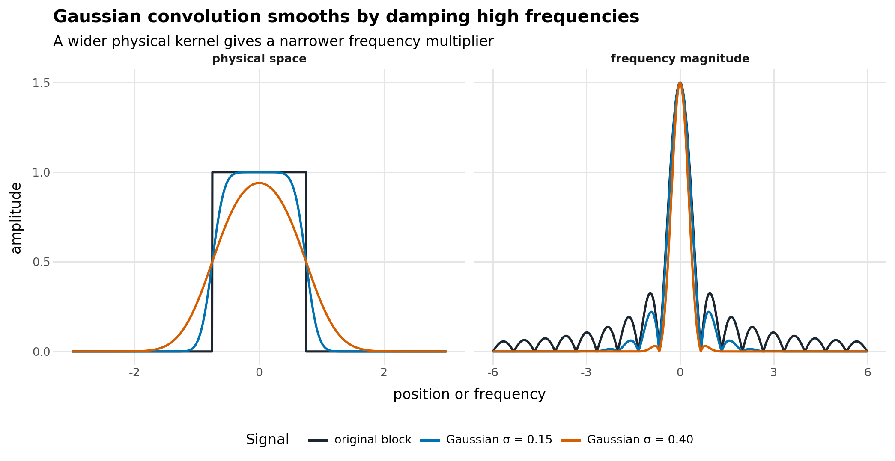

# Convolution, Fourier Transform, and Distributions {#sec-fourier-distributions}

Convolution averages a function against a moving kernel. The Fourier transform
turns that averaging into multiplication and turns differentiation into
frequency weighting. Distributions then extend both operations to idealised
objects such as point masses and derivatives of nonsmooth functions.

**Prerequisites.** Lebesgue integration and Fubini from
[sec-lebesgue-construction](19-lebesgue-measure.md#sec-lebesgue-construction) and [sec-product-probability](22-product-measures-probability.md#sec-product-probability); $L^p$ spaces from
[sec-lp-convergence](21-lp-convergence.md#sec-lp-convergence); Hilbert-space ideas from [sec-hilbert-spectral](27-hilbert-spectral.md#sec-hilbert-spectral).

Throughout this chapter,

$$
\widehat f(\xi)=\int_{\mathbb R^d}f(x)e^{-2\pi i x\cdot\xi}\,dx.
$$

The factors of $2\pi$ in later identities follow from this convention.

## Convolution

For suitable functions,

$$
(f*g)(x)=\int_{\mathbb R^d}f(x-y)g(y)\,dy.
$$

Tonelli or Fubini justifies the changes of variables proving
$f*g=g*f$, associativity, and distributivity. If $f,g\in L^1$, then

$$
\|f*g\|_1\le\|f\|_1\|g\|_1.
$$

More generally, Young's inequality states

$$
\|f*g\|_r\le\|f\|_p\|g\|_q,
\qquad
1+\frac1r=\frac1p+\frac1q,
$$

for the standard range $1\le p,q,r\le\infty$. The endpoint
$L^1*L^p\subset L^p$ follows from Minkowski's integral inequality.

If $f$ and $g$ have compact support, then

$$
\operatorname{supp}(f*g)
\subset \operatorname{supp}f+\operatorname{supp}g,
$$

the Minkowski sum. Cancellation may make the inclusion strict.

**Worked example.** With $f=\mathbf1_{[0,1]}$,

$$
(f*f)(x)=
\begin{cases}
x,&0\le x\le1,\\
2-x,&1<x\le2,\\
0,&\text{otherwise}.
\end{cases}
$$

The triangular profile is the length of
$[0,1]\cap[x-1,x]$.

## Approximate identities and mollifiers

Choose $\phi\in C_c^\infty(\mathbb R^d)$, $\phi\ge0$, and
$\int\phi=1$. Set
$\phi_\varepsilon(x)=\varepsilon^{-d}\phi(x/\varepsilon)$.
Then $f*\phi_\varepsilon$ is smooth, because derivatives may be moved to the
kernel:

$$
D^\alpha(f*\phi_\varepsilon)
=f*D^\alpha\phi_\varepsilon.
$$

For $1\le p<\infty$,

$$
\|f*\phi_\varepsilon-f\|_p\longrightarrow0.
$$

One proof first handles continuous compactly supported $f$ using uniform
continuity, then uses density and Young's inequality. At every Lebesgue point,
the convergence is pointwise.

Mollification can violate boundary conditions or enlarge support by
$\varepsilon$. Extend, mollify, and restrict only after proving that the
extension respects the intended space. In Sobolev problems, cutoff and extension
operators are substantive parts of the argument.

## Fourier transform on $L^1$

For $f\in L^1$, $\widehat f$ is bounded and uniformly continuous, with
$\|\widehat f\|_\infty\le\|f\|_1$. Direct substitutions give

$$
\begin{aligned}
\widehat{f(\,\cdot-a\,)}(\xi)&=e^{-2\pi i a\cdot\xi}\widehat f(\xi),\\
\widehat{e^{2\pi i b\cdot(\cdot)}f}(\xi)&=\widehat f(\xi-b),\\
\widehat{f(c\,\cdot\,)}(\xi)&=|c|^{-d}\widehat f(\xi/c),\\
\widehat{f*g}(\xi)&=\widehat f(\xi)\widehat g(\xi).
\end{aligned}
$$

If $f$ and its weak derivative are integrable, integration by parts yields

$$
\widehat{\partial_jf}(\xi)=2\pi i\xi_j\widehat f(\xi).
$$

Smoothness in physical space therefore forces weighted frequency control.

**Lemma 29.1 (Riemann–Lebesgue).** If $f\in L^1$, then
$\widehat f(\xi)\to0$ as $|\xi|\to\infty$. Prove it for smooth compactly
supported functions by integration by parts or translation cancellation, then
use $L^1$ density and the uniform transform bound.

The lemma gives decay without a universal rate. Faster decay requires specified
derivatives, moments, or variation.

<figure id="fig-convolution-frequency">


<figcaption>

Figure 29.1: Convolution smooths a signal while its Fourier transform suppresses high frequencies.

</figcaption>
</figure>

[Figure 29.1](#fig-convolution-frequency) visualises the identity
$\widehat{f*g}=\widehat f\,\widehat g$. The finite frequency window is
illustrative; the theorem concerns the full transform under its integrability
hypotheses.

## Inversion and uniqueness

**Fourier inversion.** If $f,\widehat f\in L^1(\mathbb R^d)$, then at every
Lebesgue point at which the usual symmetric interpretation is valid,

$$
f(x)=\int_{\mathbb R^d}\widehat f(\xi)
e^{2\pi i x\cdot\xi}\,d\xi.
$$

A clean proof inserts Gaussian damping
$e^{-\pi\varepsilon|\xi|^2}$. Fubini identifies the damped inverse with
convolution by a Gaussian approximate identity. Letting
$\varepsilon\downarrow0$ recovers $f$.

If two $L^1$ functions have the same transform, Gaussian regularisation makes
their mollifications equal. Approximate-identity convergence then proves they
agree almost everywhere. This is the uniqueness theorem.

Pointwise inversion cannot be invoked from $f\in L^1$ alone. The inverse
integral may not converge absolutely, and its truncation shape can matter.

## Plancherel theory

For Schwartz functions, a Fubini calculation gives

$$
\int f(x)\overline{g(x)}\,dx
=\int\widehat f(\xi)\overline{\widehat g(\xi)}\,d\xi.
$$

In particular, $\|\widehat f\|_2=\|f\|_2$. Density extends the Fourier transform
uniquely to a unitary operator on $L^2$. This is the **Plancherel theorem**.
For a general $L^2$ function, the defining integral need not converge
pointwise; the transform is an $L^2$ limit.

Sobolev norms become frequency-weighted norms:

$$
\|f\|_{H^s}^2
=\int_{\mathbb R^d}(1+4\pi^2|\xi|^2)^s
|\widehat f(\xi)|^2\,d\xi.
$$

Differential equations with constant coefficients become algebraic multiplier
equations, but division by a multiplier near its zeros can be unstable or
impossible.

## Poisson summation and sampling

For a Schwartz function,

$$
\sum_{n\in\mathbb Z}f(n)
=\sum_{k\in\mathbb Z}\widehat f(k).
$$

One proof periodises $f$, computes the Fourier coefficients of the resulting
smooth periodic function, and evaluates its Fourier series at zero. Scaling gives
the dual-lattice form.

Sampling a function in physical space periodises its spectrum. If shifted copies
of the spectrum overlap, different frequencies become indistinguishable:
**aliasing**. A perfectly band-limited $L^2$ signal sampled above the Nyquist
rate admits sinc reconstruction, but practical signals are time-limited, noisy,
and not exactly band-limited. Windowing and filtering change the theorem's
hypotheses and must be included in an error analysis.

Poisson summation is not valid for every integrable function merely because both
formal sums can be written. Decay, smoothness, and the chosen convergence mode
matter.

## Tempered distributions

The Schwartz space $\mathcal S(\mathbb R^d)$ consists of smooth functions for
which every $x^\alpha D^\beta\phi(x)$ is bounded. A **tempered distribution** is
a continuous linear functional on $\mathcal S$.

Every slowly growing locally integrable function defines

$$
\langle T_f,\phi\rangle=\int f\phi.
$$

The Dirac mass is
$\langle\delta_a,\phi\rangle=\phi(a)$. Distributional derivatives are defined
by moving differentiation to the test function:

$$
\langle\partial_jT,\phi\rangle
=-\langle T,\partial_j\phi\rangle.
$$

Thus the Heaviside step has derivative $\delta_0$, encoding its jump.

The Fourier transform is defined by duality:

$$
\langle\widehat T,\phi\rangle
=\langle T,\widehat\phi\rangle
$$

with the inverse convention inserted when necessary. Under the present
normalisation, $\widehat{\delta_0}=1$ and
$\widehat1=\delta_0$. These identities are distributional, not assertions that
the ordinary integral of $1$ converges.

## Localisation and uncertainty

Translation and modulation show that physical location and central frequency can
be moved independently, but their spreads cannot both be arbitrarily small. For
a sufficiently regular one-dimensional $f$ centred in both variables,
Cauchy–Schwarz and integration by parts give

$$
\|xf\|_2\,\|\xi\widehat f\|_2
\ge\frac1{4\pi}\|f\|_2^2.
$$

Indeed, Plancherel turns
$\xi\widehat f$ into $\widehat{f'}/(2\pi i)$, while

$$
\|f\|_2^2
=-\int x\frac d{dx}|f(x)|^2\,dx
\le2\|xf\|_2\|f'\|_2.
$$

Gaussian functions attain equality after centring and scaling. This
**Heisenberg uncertainty inequality** is an analytic variance trade-off, not a
claim about measurement disturbance.

A stronger qualitative statement says that a nonzero function and its Fourier
transform cannot both have compact support. If $\widehat f$ has compact
support, the inverse transform extends $f$ to an entire function of a complex
variable. If $f$ also vanishes outside a compact interval, that entire function
vanishes on an open real interval and therefore everywhere.

Time-frequency methods compromise by using windows. The short-time Fourier
transform analyses $f$ after multiplication by translated windows; wavelets
change scale as well as location. Narrow windows localise time but blur
frequency, exactly as the uncertainty inequality predicts. Claims about
“frequency at an instant” always depend on a chosen window and resolution.

## Fourier multipliers

A multiplier operator is formally defined by

$$
\widehat{Tf}(\xi)=m(\xi)\widehat f(\xi).
$$

On $L^2$, every bounded measurable $m$ gives a bounded operator with
$\|T\|\le\|m\|_\infty$, directly by Plancherel. On $L^p$ for $p\ne2$,
boundedness of $m$ alone is not sufficient; smoothness and derivative
conditions such as those in multiplier theorems replace orthogonality.

The heat semigroup has $m_t(\xi)=e^{-4\pi^2t|\xi|^2}$, while a derivative has
the unbounded multiplier $2\pi i\xi_j$. This frequency view predicts smoothing,
loss of derivatives, and ill-posed inversion before any explicit kernel is
computed.

<!-- inline-formula-code:start -->
## Formula and finite computation

A useful formula in this chapter is

$$
(f*\phi_\delta)(x)=\int f(x-y)\phi_\delta(y)\,dy
$$

A normalised discrete kernel provides a finite analogue of convolution. The following standalone Python block expresses that finite rule with its inputs and stopping conditions visible.

```python
import numpy as np
from numpy.typing import NDArray

def gaussian_mollify(
    values: NDArray[np.float64], sigma_cells: float
) -> NDArray[np.float64]:
    """Return a one-dimensional Gaussian-smoothed copy of sampled values."""
    if values.ndim != 1 or values.size < 3 or sigma_cells <= 0.0:
        raise ValueError("use a one-dimensional sample and positive scale")
    radius = max(1, int(4.0 * sigma_cells))
    offsets = np.arange(-radius, radius + 1, dtype=float)
    weights = np.exp(-(offsets**2) / (2.0 * sigma_cells**2))
    weights /= weights.sum()
    padded = np.pad(values.astype(float), radius, mode="edge")
    return np.convolve(padded, weights, mode="valid")

x = np.linspace(-1.0, 1.0, 401)
jump = np.where(x < 0.0, 0.0, 1.0)
smoothed = gaussian_mollify(jump, sigma_cells=8.0)
print(smoothed.min(), smoothed.max(), smoothed[200])
```

**What the computation establishes.** The calculation checks a declared finite instance; the surrounding argument explains what is true beyond those inputs.
<!-- inline-formula-code:end -->

## Summary

- Convolution combines supports and obeys Young's norm inequalities.
- Mollifiers smooth while converging in $L^p$ and at Lebesgue points.
- Fourier transformation exchanges convolution with multiplication and
  differentiation with frequency weighting.
- Plancherel extends the transform unitarily to $L^2$.
- Tempered distributions legitimise point masses, jumps, and weak derivatives.

## Related results {#fifth-edition-handoff}

Fourier multipliers lead in two directions. Chapter [sec-interpolation-singular](43-interpolation-singular-integrals.md#sec-interpolation-singular)
uses the sign multiplier to construct the Hilbert transform on $L^2$ before
real-variable interpolation extends it. Chapter [sec-unbounded-spectral](44-unbounded-spectral.md#sec-unbounded-spectral) treats
the multiplier $2\pi\xi$ as the self-adjoint momentum operator and recovers its
translation group through functional calculus.

## Exercises

<div class="exercise" id="real_analysis-29-fourier-distributions-ex-1">
<p class="exercise-title"><strong>Exercise 1</strong></p>

Derive the triangular formula for
$\mathbf1_{[0,1]}*\mathbf1_{[0,1]}$.

<details class="solution"><summary>Solution</summary>

Measure the overlap of $[0,1]$ and $[x-1,x]$.

</details>

</div>

<div class="exercise" id="real_analysis-29-fourier-distributions-ex-2">
<p class="exercise-title"><strong>Exercise 2</strong></p>

Prove the $L^1*L^\infty\to L^\infty$ case of Young's inequality.

<details class="solution"><summary>Solution</summary>

Bound the integrand by $\|g\|_\infty|f(x-y)|$ and integrate.

</details>

</div>

<div class="exercise" id="real_analysis-29-fourier-distributions-ex-3">
<p class="exercise-title"><strong>Exercise 3</strong></p>

Derive the translation and modulation identities.

<details class="solution"><summary>Solution</summary>

Substitute $u=x-a$ for translation and combine exponentials for
modulation.

</details>

</div>

<div class="exercise" id="real_analysis-29-fourier-distributions-ex-4">
<p class="exercise-title"><strong>Exercise 4</strong></p>

Explain why $L^2$ Fourier transformation cannot always be defined by an
absolutely convergent integral.

<details class="solution"><summary>Solution</summary>

$L^2$ does not imply $L^1$ on an infinite-measure domain.

</details>

</div>

<div class="exercise" id="real_analysis-29-fourier-distributions-ex-5">
<p class="exercise-title"><strong>Exercise 5</strong></p>

Compute the transform of a Gaussian under the stated convention.

<details class="solution"><summary>Solution</summary>

$e^{-\pi|x|^2}$ transforms to itself; obtain other variances by scaling.

</details>

</div>

<div class="exercise" id="real_analysis-29-fourier-distributions-ex-6">
<p class="exercise-title"><strong>Exercise 6</strong></p>

Derive Poisson summation from periodisation for a Schwartz function.

<details class="hint"><summary>Hint 1</summary>

Periodise the Schwartz function. Compute its Fourier coefficients by
splitting the real line into unit intervals and use uniform convergence.

</details>

<details class="solution"><summary>Solution</summary>

Fourier coefficients of $\sum_nf(x+n)$ are $\widehat f(k)$.

</details>

</div>

<div class="exercise" id="real_analysis-29-fourier-distributions-ex-7">
<p class="exercise-title"><strong>Exercise 7</strong></p>

Prove distributionally that the derivative of the Heaviside function is
$\delta_0$.

<details class="solution"><summary>Solution</summary>

Integrate $\int_0^\infty\phi'$ and include the defining minus sign.

</details>

</div>

<div class="exercise" id="real_analysis-29-fourier-distributions-ex-8">
<p class="exercise-title"><strong>Exercise 8</strong></p>

Explain the difference between spectral truncation and mollification.

<details class="solution"><summary>Solution</summary>

Truncation discards frequencies sharply; mollification multiplies them by a
smooth kernel transform.

</details>

</div>

### Answer support

1. Measure the overlap of $[0,1]$ and $[x-1,x]$.
2. Bound the integrand by $\|g\|_\infty|f(x-y)|$ and integrate.
3. Substitute $u=x-a$ for translation and combine exponentials for
   modulation.
4. $L^2$ does not imply $L^1$ on an infinite-measure domain.
5. $e^{-\pi|x|^2}$ transforms to itself; obtain other variances by scaling.
6. Fourier coefficients of $\sum_nf(x+n)$ are $\widehat f(k)$.
7. Integrate $\int_0^\infty\phi'$ and include the defining minus sign.
8. Truncation discards frequencies sharply; mollification multiplies them by a
   smooth kernel transform.
