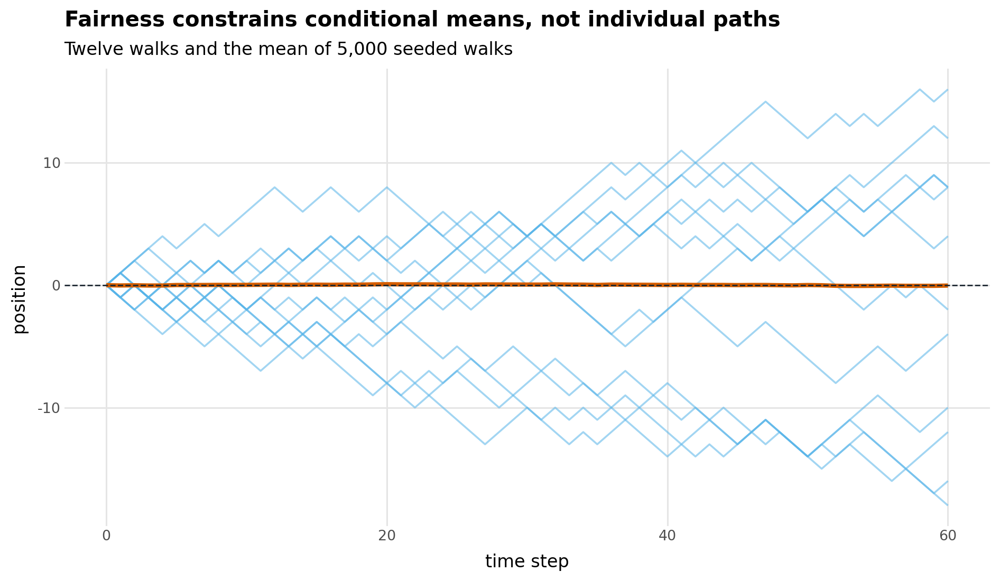

# Conditional Expectation and Martingale Convergence {#sec-martingales}

Probability becomes analysis when information is represented by sigma-algebras.
Conditional expectation is the best integrable prediction compatible with
specified information. Martingales are processes whose present value is already
that prediction of every future value.

**Prerequisites.** Probability spaces and product measures from
[sec-product-probability](22-product-measures-probability.md#sec-product-probability); Radon–Nikodym from [sec-signed-measures](20-signed-measures.md#sec-signed-measures); $L^p$
convergence from [sec-lp-convergence](21-lp-convergence.md#sec-lp-convergence).

## Sigma-algebras as information

If $\mathcal G\subset\mathcal F$, then $\mathcal G$ records fewer observable
events. A random variable $Y$ is $\mathcal G$-measurable when its value can be
determined from that information.

For a finite partition $A_1,\ldots,A_m$, the generated sigma-algebra knows only
which cell occurred. A $\mathcal G$-measurable random variable is constant on
each cell. Refining the partition enlarges the sigma-algebra and reveals more.

The sigma-algebra $\sigma(Y)$ generated by $Y$ contains exactly the events
that can be phrased in terms of $Y$. Conditioning on $Y$ is shorthand for
conditioning on $\sigma(Y)$.

## Conditional expectation

Let $X\in L^1$. A conditional expectation
$\mathbb E[X\mid\mathcal G]$ is a $\mathcal G$-measurable integrable random
variable $Z$ satisfying

$$
\int_GZ\,d\mathbb P=\int_GX\,d\mathbb P
\quad\text{for every }G\in\mathcal G.
$$

It is unique almost surely. To obtain existence, define the signed measure
$\nu(G)=\int_GX\,d\mathbb P$ on $\mathcal G$. It is absolutely continuous
with respect to $\mathbb P|_{\mathcal G}$; Radon–Nikodym supplies $Z$.

For the finite partition above, if $\mathbb P(A_j)>0$,

$$
\mathbb E[X\mid\mathcal G]
=\sum_j
\frac{\mathbb E[X\mathbf1_{A_j}]}{\mathbb P(A_j)}
\mathbf1_{A_j}.
$$

Thus conditioning replaces $X$ on each information cell by its cell average.

In $L^2$, conditional expectation is the orthogonal projection onto the closed
subspace $L^2(\mathcal G)$. Hence it uniquely minimises
$\mathbb E|X-Z|^2$ among $\mathcal G$-measurable $Z$.

## Calculus of conditioning

For integrable variables and nested sigma-algebras:

$$
\begin{aligned}
\mathbb E[aX+bY\mid\mathcal G]
&=a\mathbb E[X\mid\mathcal G]+b\mathbb E[Y\mid\mathcal G],\\
X\ge0&\Longrightarrow\mathbb E[X\mid\mathcal G]\ge0,\\
\mathbb E[\mathbb E[X\mid\mathcal G]]
&=\mathbb E[X],\\
\mathbb E[\mathbb E[X\mid\mathcal H]\mid\mathcal G]
&=\mathbb E[X\mid\mathcal G]\quad(\mathcal G\subset\mathcal H).
\end{aligned}
$$

The last identity is the tower property. If $Y$ is bounded and
$\mathcal G$-measurable, then

$$
\mathbb E[YX\mid\mathcal G]
=Y\mathbb E[X\mid\mathcal G].
$$

For unbounded $Y$, integrability must be checked.

Conditional Jensen says

$$
\varphi(\mathbb E[X\mid\mathcal G])
\le\mathbb E[\varphi(X)\mid\mathcal G]
$$

for convex $\varphi$ under suitable integrability. In particular, conditional
expectation contracts every $L^p$ norm for $1\le p\le\infty$.

If $X$ is independent of $\mathcal G$, then
$\mathbb E[X\mid\mathcal G]=\mathbb E[X]$. Independence must concern the whole
sigma-algebra, not just one conveniently chosen event.

## Filtrations and martingales

A **filtration** is an increasing sequence
$\mathcal F_0\subset\mathcal F_1\subset\cdots$, modelling information over
time. A process $X_n$ is adapted when $X_n$ is
$\mathcal F_n$-measurable.

An integrable adapted process is a martingale if

$$
\mathbb E[X_{n+1}\mid\mathcal F_n]=X_n.
$$

Replace equality by $\ge$ for a submartingale and by $\le$ for a
supermartingale.

If $Z_1,Z_2,\ldots$ are independent, integrable, and mean zero, their partial
sums $S_n=\sum_{k=1}^nZ_k$ form a martingale under the natural filtration.
Another fundamental example is

$$
X_n=\mathbb E[X\mid\mathcal F_n].
$$

The tower property proves the martingale identity.

If $H_n$ is bounded and $\mathcal F_{n-1}$-measurable, the martingale
transform
$\sum_{k=1}^nH_k(X_k-X_{k-1})$ is a martingale. A betting stake may depend on
the past, not on the unseen next increment.

<figure id="fig-martingale-paths">


<figcaption>

Figure 30.1: Sample paths of a fair martingale spread while their ensemble mean remains near its initial value.

</figcaption>
</figure>

[Figure 30.1](#fig-martingale-paths) is a seeded finite simulation, not a proof of fairness or
convergence. The martingale property is the exact conditional-expectation
identity.

## Stopping times

A random time $\tau$ is a stopping time if
$\{\tau\le n\}\in\mathcal F_n$ for every $n$. At time $n$, the available
information must reveal whether stopping has occurred. The last time a walk
visits zero before a fixed horizon is generally not a stopping time: recognising
“last” requires future knowledge.

The stopped process $X_{n\wedge\tau}$ is a martingale when $X_n$ is. This
does not automatically imply
$\mathbb E[X_\tau]=\mathbb E[X_0]$ for an arbitrary unbounded $\tau$.
Valid optional-stopping hypotheses include bounded $\tau$, uniformly bounded
stopped variables, or suitable uniform integrability and almost-sure finiteness.

A doubling betting strategy violates the boundedness and integrability controls
that make optional stopping valid. Its apparent sure profit hides unbounded
capital and a small probability of catastrophic loss.

## Maximal and upcrossing inequalities

For a nonnegative submartingale,

$$
\lambda\,
\mathbb P\!\left(\max_{0\le k\le n}X_k\ge\lambda\right)
\le\mathbb E[X_n\mathbf1_{\{\max_{k\le n}X_k\ge\lambda\}}]
\le\mathbb E[X_n]
$$

in the standard nonnegative form. The proof stops at the first crossing and uses
the submartingale property. More general versions use $X_n^+$.

Doob's $L^p$ maximal inequality, for $p>1$, states

$$
\left\|\max_{k\le n}|X_k|\right\|_p
\le\frac p{p-1}\|X_n\|_p
$$

for a martingale represented by terminal conditioning, with the usual
submartingale formulation for $|X_k|$.

For $a<b$, an upcrossing is a completed passage from at most $a$ to at least
$b$. Doob's upcrossing inequality bounds the expected number
$U_n[a,b]$ by endpoint data divided by $b-a$. If a real sequence has
$\liminf<\limsup$, it completes infinitely many upcrossings of some rational
interval. Controlling every rational interval therefore forces convergence.

## Martingale convergence

**Theorem 30.1 (Doob convergence).** If $(X_n)$ is a submartingale with

$$
\sup_n\mathbb E[X_n^+]<\infty,
$$

then $X_n$ converges almost surely to a finite integrable random variable
$X_\infty$.

Upcrossing inequalities rule out persistent oscillation, and the positive-part
bound rules out escape to $+\infty$. Fatou supplies integrability of the limit.
Almost-sure convergence does not by itself give $L^1$ convergence.

A family $\mathcal X\subset L^1$ is **uniformly integrable** if

$$
\sup_{X\in\mathcal X}
\mathbb E\big[|X|\mathbf1_{\{|X|>K\}}\big]\longrightarrow0
\quad(K\to\infty).
$$

Almost-sure or in-probability convergence plus uniform integrability gives
$L^1$ convergence. A martingale is uniformly integrable exactly when it can be
represented as $X_n=\mathbb E[X_\infty\mid\mathcal F_n]$ for some
$X_\infty\in L^1$.

**Theorem 30.2 (Lévy upward).** If
$\mathcal F_n\uparrow\mathcal F_\infty=
\sigma(\bigcup_n\mathcal F_n)$ and $X\in L^1$, then

$$
\mathbb E[X\mid\mathcal F_n]
\longrightarrow
\mathbb E[X\mid\mathcal F_\infty]
$$

almost surely and in $L^1$. Refining finite partitions therefore recovers the
best prediction available from all limiting information.

## Doob decomposition and orthogonal increments

Every integrable discrete-time submartingale has a unique decomposition

$$
X_n=M_n+A_n,
$$

where $M_n$ is a martingale, $A_0=0$, and $A_n$ is predictable and
increasing. Predictable means $A_n$ is $\mathcal F_{n-1}$-measurable for
$n\ge1$. Construct

$$
A_n=\sum_{k=1}^n
\mathbb E[X_k-X_{k-1}\mid\mathcal F_{k-1}],
\qquad
M_n=X_n-A_n.
$$

The submartingale inequality makes every increment of $A$ nonnegative.
Uniqueness follows because a predictable finite-variation martingale starting at
zero must have every increment zero. The decomposition separates fair
fluctuation from accumulated predictable drift.

For a square-integrable martingale, increments are orthogonal in $L^2$. If
$j<k$, then

$$
\mathbb E[(M_k-M_{k-1})(M_j-M_{j-1})]=0
$$

because the earlier increment is $\mathcal F_{k-1}$-measurable and the later
one has conditional mean zero. Consequently

$$
\mathbb E|M_n-M_0|^2
=\sum_{k=1}^n
\mathbb E|M_k-M_{k-1}|^2.
$$

This is Pythagoras in the Hilbert space $L^2(\Omega)$. If the sum of increment
variances is finite, $(M_n)$ is $L^2$-Cauchy and converges in $L^2$, hence
also in $L^1$ and in probability; the martingale convergence theorem supplies
an almost-sure version.

For independent mean-zero increments, the identity reduces to additivity of
variance. Martingale differences extend that calculation to dependent processes
whose new increments are unpredictable from the past.

<!-- inline-formula-code:start -->
## Formula and finite computation

A useful formula in this chapter is

$$
\overline X_n=\frac1n\sum_{k=1}^nX_k
$$

Running means are the literal finite averages in the law-of-large-numbers statement. The following standalone Python block expresses that finite rule with its inputs and stopping conditions visible.

```python
import numpy as np
from numpy.typing import NDArray

def running_bernoulli_means(
    samples: int, probability: float, seed: int
) -> NDArray[np.float64]:
    """Return running means of independent Bernoulli trials."""
    if samples <= 0 or not 0.0 <= probability <= 1.0:
        raise ValueError("samples must be positive and probability in [0, 1]")
    generator = np.random.default_rng(seed)
    draws = generator.random(samples) < probability
    return np.cumsum(draws) / np.arange(1, samples + 1)

means = running_bernoulli_means(10_000, probability=0.3, seed=20260811)
print(means[9], means[99], means[999], means[-1])
```

**What the computation establishes.** The calculation checks a declared finite instance; the surrounding argument explains what is true beyond those inputs.
<!-- inline-formula-code:end -->

## Summary

- Conditional expectation is defined by integral identities and constructed by
  Radon–Nikodym.
- In $L^2$, conditioning is orthogonal projection onto observable variables.
- Martingales encode fair conditional evolution relative to a filtration.
- Maximal and upcrossing inequalities control excursions and oscillation.
- Almost-sure martingale convergence needs an integrability bound; $L^1$
  convergence needs uniform integrability.
- Optional stopping is a theorem with hypotheses, not a universal gambling rule.

## Related results {#fifth-edition-handoff}

Conditional expectation becomes a measurable kernel in
[sec-polish-disintegration](39-polish-disintegration.md#sec-polish-disintegration), including conditioning on continuously distributed
observations. Chapter [sec-stochastic-processes](42-stochastic-processes.md#sec-stochastic-processes) then carries the filtration and
martingale language into continuous time, constructs Brownian motion, and uses
$L^2$ completion to define the Itô integral.

## Exercises

<div class="exercise" id="real_analysis-30-martingales-ex-1">
<p class="exercise-title"><strong>Exercise 1</strong></p>

Compute conditional expectation on a three-cell finite partition.

<details class="solution"><summary>Solution</summary>

Replace $X$ on each positive-probability cell by its cell average.

</details>

</div>

<div class="exercise" id="real_analysis-30-martingales-ex-2">
<p class="exercise-title"><strong>Exercise 2</strong></p>

Prove the tower property directly from the defining integral identities.

<details class="solution"><summary>Solution</summary>

Test both sides on every event in the smaller sigma-algebra.

</details>

</div>

<div class="exercise" id="real_analysis-30-martingales-ex-3">
<p class="exercise-title"><strong>Exercise 3</strong></p>

Show $X_n=\mathbb E[X\mid\mathcal F_n]$ is a martingale.

<details class="solution"><summary>Solution</summary>

Apply the tower property to consecutive sigma-algebras.

</details>

</div>

<div class="exercise" id="real_analysis-30-martingales-ex-4">
<p class="exercise-title"><strong>Exercise 4</strong></p>

Let $S_0=0$ and let the increments be independent, each equal to $1$ or $-1$ with probability $1/2$. For positive integers $a,b$, let $\tau$ be the first time the walk reaches
$\{-a,b\}$. Prove $-a\le S_{n\wedge\tau}\le b$ for every $n$.

<details class="solution"><summary>Solution</summary>

Unit steps cannot cross either integer boundary without hitting it, so the stopped path remains in $[-a,b]$, including before the first hit; hence $|S_{n\wedge\tau}|\le\max(a,b)$.
Mean zero alone is insufficient: with independent equally likely $\pm2$ increments and $a=b=1$, parity prevents hitting, while $N$ consecutive $+2$ steps give $S_N=2N$ with probability $2^{-N}$.

</details>

</div>

<div class="exercise" id="real_analysis-30-martingales-ex-5">
<p class="exercise-title"><strong>Exercise 5</strong></p>

Give a random time that is not a stopping time and explain why.

<details class="solution"><summary>Solution</summary>

The last zero before a horizon depends on future observations.

</details>

</div>

<div class="exercise" id="real_analysis-30-martingales-ex-6">
<p class="exercise-title"><strong>Exercise 6</strong></p>

Use the upcrossing criterion to explain why bounded oscillation with no limit
creates a rational interval crossed infinitely often.

<details class="solution"><summary>Solution</summary>

Choose rational $a,b$ strictly between the liminf and limsup.

</details>

</div>

<div class="exercise" id="real_analysis-30-martingales-ex-7">
<p class="exercise-title"><strong>Exercise 7</strong></p>

Give an almost-surely convergent sequence that is not $L^1$-convergent.

<details class="hint"><summary>Hint 1</summary>

Keep the integral of the spike fixed while its support shrinks. This is
exactly the tail concentration uniform integrability forbids.

</details>

<details class="solution"><summary>Solution</summary>

On $(0,1)$, take $X_n=n\mathbf1_{(0,1/n)}$: it converges almost surely to
zero but has expectation one.

</details>

</div>

<div class="exercise" id="real_analysis-30-martingales-ex-8">
<p class="exercise-title"><strong>Exercise 8</strong></p>

State two sufficient optional-stopping hypotheses.

<details class="solution"><summary>Solution</summary>

For example, bounded stopping time; or a uniformly integrable stopped
martingale with almost-surely finite stopping time.

</details>

</div>

### Answer support

1. Replace $X$ on each positive-probability cell by its cell average.
2. Test both sides on every event in the smaller sigma-algebra.
3. Apply the tower property to consecutive sigma-algebras.
4. Unit steps cannot cross either integer boundary without hitting it, so the stopped path remains in $[-a,b]$, including before the first hit; hence $|S_{n\wedge\tau}|\le\max(a,b)$.
   Mean zero alone is insufficient: with independent equally likely $\pm2$ increments and $a=b=1$, parity prevents hitting, while $N$ consecutive $+2$ steps give $S_N=2N$ with probability $2^{-N}$.
5. The last zero before a horizon depends on future observations.
6. Choose rational $a,b$ strictly between the liminf and limsup.
7. On $(0,1)$, take $X_n=n\mathbf1_{(0,1/n)}$: it converges almost surely to
   zero but has expectation one.
8. For example, bounded stopping time; or a uniformly integrable stopped
   martingale with almost-surely finite stopping time.
