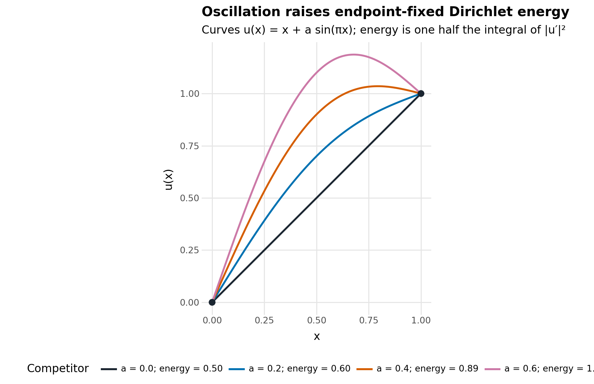

# Calculus of Variations and the Direct Method {#sec-variational-methods}

Ordinary calculus varies a number. The calculus of variations varies an entire
function and asks which admissible function minimises an energy. Differential
equations arise as necessary conditions, while compactness and lower
semicontinuity answer the separate question of whether a minimiser exists.

**Prerequisites.** Differentiation and integration from [sec-differentiation](07-differentiation.md#sec-differentiation) and
[sec-riemann](08-riemann.md#sec-riemann); weak convergence and reflexivity from [sec-banach-pillars](26-banach-pillars.md#sec-banach-pillars); Sobolev
spaces from [sec-sobolev](23-sobolev.md#sec-sobolev).

## Functionals and admissible classes

A **functional** maps functions to numbers. A basic integral functional is

$$
J[u]=\int_a^bL(x,u(x),u'(x))\,dx.
$$

The admissible class records regularity and constraints, for example

$$
\mathcal A=\{u\in H^1(a,b):u(a)=A,\ u(b)=B\}.
$$

Changing the class can change the answer. A discontinuous competitor may lower an
energy defined only through $u'$, but may not belong to $H^1$. Boundary
values for Sobolev functions are interpreted through traces, not arbitrary
pointwise representatives.

Topology also matters. Strong $H^1$ convergence controls more than weak
$H^1$ convergence; compactness is often available only in the weak topology.
The objective must therefore behave correctly under the convergence one can
actually extract.

## First variation

Choose a test function $\eta$ satisfying the homogeneous version of the
boundary conditions and consider $u_t=u+t\eta$. The **first variation** is

$$
\delta J[u](\eta)
=\left.\frac d{dt}J[u+t\eta]\right|_{t=0}.
$$

If differentiation under the integral is justified,

$$
\delta J[u](\eta)
=\int_a^b
\left(L_u(x,u,u')\eta+L_p(x,u,u')\eta'\right)\,dx.
$$

A local minimiser in a vector-like admissible class must satisfy
$\delta J[u](\eta)=0$ for every admissible direction. This is only a necessary
condition unless convexity or another argument supplies sufficiency.

**Lemma 31.1 (Fundamental).** If $f\in L^1_{\mathrm{loc}}(a,b)$ and

$$
\int_a^bf(x)\eta(x)\,dx=0
$$

for every smooth compactly supported $\eta$, then $f=0$ almost everywhere.
For continuous $f$, a sign-preserving bump near a point where $f\ne0$ gives
the contradiction. The integrable case uses approximation of sign and
localisation.

## Euler–Lagrange equations

If $\eta(a)=\eta(b)=0$, integration by parts gives

$$
\delta J[u](\eta)
=\int_a^b
\left(
L_u-\frac d{dx}L_p
\right)\eta\,dx.
$$

The fundamental lemma yields the Euler–Lagrange equation

$$
\frac d{dx}L_p(x,u,u')=L_u(x,u,u').
$$

**Worked example.** For

$$
J[u]=\int_0^1\left(\frac12|u'|^2-fu\right)\,dx,
\qquad u(0)=u(1)=0,
$$

the equation is $-u''=f$. More fundamentally, the first variation gives the
weak equation

$$
\int_0^1u'\eta'\,dx=\int_0^1f\eta\,dx
$$

for every $\eta\in H_0^1(0,1)$. This remains meaningful when $u''$ does not
exist classically.

If an endpoint is free, the boundary term need not vanish. Its coefficient gives
a **natural boundary condition**, such as $L_p=0$ at that endpoint.
Prescribing both $u$ and $u'$ at an endpoint changes which test functions are
allowed.

For $u:\Omega\to\mathbb R^m$ and
$J[u]=\int_\Omega L(x,u,\nabla u)\,dx$, the system becomes

$$
\frac{\partial L}{\partial u_\alpha}
-\sum_{j=1}^d
\partial_j\!\left(
\frac{\partial L}{\partial(\partial_ju_\alpha)}
\right)=0.
$$

Higher derivatives create repeated integration by parts and additional boundary
terms.

## Constraints and conservation laws

For an integral constraint $G[u]=c$, a regular constrained minimiser often
satisfies

$$
\delta J[u]=\lambda\,\delta G[u]
$$

for a scalar multiplier $\lambda$. Regularity means that $\delta G[u]$ is not
the zero functional. The multiplier converts the problem to the Euler–Lagrange
equation for $J-\lambda G$, with $\lambda$ determined by the constraint.

**Isoperimetric example.** Minimising
$\int_0^1|u'|^2\,dx$ subject to fixed endpoints and
$\int_0^1u\,dx=m$ gives

$$
-2u''=\lambda,
$$

so the minimiser is quadratic; the three scalar conditions determine its
coefficients.

Symmetry creates conserved quantities. If $L$ has no explicit $x$-dependence,
an Euler–Lagrange solution satisfies the Beltrami identity

$$
L-u'L_p=\text{constant}.
$$

Noether's theorem systematises this: differentiable one-parameter symmetries of
the action yield conservation laws. This statement requires regularity and a
precise symmetry notion; it is not the claim that every visually symmetric
problem has an unexplained constant.

## The direct method

Euler–Lagrange analysis begins with a minimiser. The **direct method** constructs
one.

1. Show the infimum $m=\inf_{\mathcal A}J$ is finite and choose a minimizing
   sequence $u_n$ with $J[u_n]\to m$.
2. Use **coercivity** to bound $u_n$ in a reflexive space $X$.
3. Extract a weakly convergent subsequence $u_{n_k}\rightharpoonup u$.
4. Prove the admissible class is weakly closed, so $u\in\mathcal A$.
5. Use weak lower semicontinuity:
   $J[u]\le\liminf_kJ[u_{n_k}]$.

Then $J[u]\le m$, hence equality.

For the Dirichlet energy on $H_0^1(\Omega)$, Poincaré's inequality gives
$\|u\|_{H^1}\le C\|\nabla u\|_2$, so the gradient term is coercive. The
functional $u\mapsto\|\nabla u\|_2^2$ is convex and weakly lower
semicontinuous. A linear forcing term is weakly continuous.

Coercivity is not merely $J[u]\to\infty$ when a displayed scalar grows; it must
bound the norm in the space where compactness will be used.

## Convexity and uniqueness

If $\mathcal A$ is convex and $J$ is convex, every critical point is a global
minimiser. If $J$ is strictly convex, there is at most one minimiser. For

$$
J[u]=\frac12a(u,u)-\ell(u)
$$

with a coercive symmetric bilinear form $a$, strict convexity and Lax–Milgram
give the same unique solution from two viewpoints.

Nonconvex energies can have several local minima and minimizing sequences that
oscillate at finer scales. Weak limits average those oscillations, and the
original energy may fail to be weakly lower semicontinuous. Relaxation replaces
the integrand by an effective lower-semicontinuous envelope; in materials models,
the lost small-scale structure is called microstructure.

<div class="callout callout-warning">
<p class="callout-title">Stationary is not minimal</p>

A solution of the Euler–Lagrange equation may be a maximum or saddle. Existence,
stationarity, and uniqueness are three different claims with different proofs.

</div>

## Worked models

### Shortest curves

The length of a graph is

$$
J[u]=\int_a^b\sqrt{1+|u'|^2}\,dx.
$$

The integrand has no $u$-dependence, so $L_p$ is constant:

$$
\frac{u'}{\sqrt{1+|u'|^2}}=c.
$$

Thus $u'$ is constant and the graph is a straight segment. The strict
convexity of $p\mapsto\sqrt{1+p^2}$ gives uniqueness among graphs with fixed
endpoints.

### Dirichlet energy

Among functions on $\Omega$ with fixed boundary trace, a minimiser of

$$
E[u]=\frac12\int_\Omega|\nabla u|^2\,dx
$$

is weakly harmonic:
$\int_\Omega\nabla u\cdot\nabla\eta=0$ for all
$\eta\in H_0^1(\Omega)$. The energy measures roughness; harmonic functions are
the least-energy interpolants.

<figure id="fig-variational-energy">


<figcaption>

Figure 31.1: Competing endpoint-fixed curves have different Dirichlet energies, with the straight path minimal.

</figcaption>
</figure>

[Figure 31.1](#fig-variational-energy) concerns one convex energy and a finite comparison
family. Strict convexity and the first-variation argument prove the global
statement.

### Brachistochrone vista

Travel time under gravity leads, after energy conservation, to an integrand
involving $\sqrt{(1+y'^2)/y}$. Its extremal is a cycloid, not a straight line,
because greater depth increases speed. A complete treatment must handle the
integrand's singularity at the initial point and the admissible orientation.

## Discretisation

Choose a finite-dimensional space $V_h\subset\mathcal A$ and minimise $J$ on
it. For a coercive convex quadratic energy this produces a linear system whose
matrix is positive definite. As the mesh size $h\to0$, convergence requires:

- approximation: elements of $V_h$ approach admissible functions;
- stability: discrete coercivity does not degenerate;
- consistency: the discrete functional or weak equation represents the same
  model.

A decreasing discrete energy on one fixed mesh proves only success inside that
finite space. Mesh refinement and an a priori or a posteriori error estimate are
needed before claiming approximation of the continuum minimiser.

## Second variation and stability

For a smooth integrand, differentiate twice along $u+t\eta$:

$$
\delta^2J[u](\eta,\eta)
=\int_a^b
\left(
L_{uu}\eta^2
+2L_{up}\eta\eta'
+L_{pp}(\eta')^2
\right)\,dx.
$$

A local minimiser must have nonnegative second variation in every admissible
direction, provided the differentiability and constraint hypotheses justify the
test. If the second variation is uniformly positive,

$$
\delta^2J[u](\eta,\eta)\ge c\|\eta\|_X^2,
$$

and the higher-order remainder is controlled, then $u$ is a strict stable local
minimum. A merely nonnegative second variation can be inconclusive, just as
$f''(0)=0$ does not classify $x^3$ or $x^4$.

For the Dirichlet functional,
$\delta^2J[u](\eta,\eta)=\int|\eta'|^2$, independent of $u$. Poincaré makes
this coercive on zero-boundary variations, giving both strict convexity and
stability. For geometric length, the second variation detects directions in
which a geodesic ceases to minimise after conjugate points; stationarity can
persist beyond minimality.

## Convergence of variational models

When both the space and energy change with a discretisation parameter,
pointwise convergence $J_h[u]\to J[u]$ is often too weak to control minimisers.
The concept of **Gamma convergence** uses two inequalities:

1. every $u_h\to u$ satisfies
   $J[u]\le\liminf_hJ_h[u_h]$;
2. for every $u$, some recovery sequence $u_h\to u$ satisfies
   $J[u]\ge\limsup_hJ_h[u_h]$.

Together with equicoercivity, these conditions imply that cluster points of
minimisers of $J_h$ minimise $J$, and minimum values converge. The topology
is part of the definition.

Gamma convergence does not provide a rate and need not make minimisers unique.
It is a qualitative stability framework for discretisation, homogenisation, and
singular perturbation. Ordinary consistency checks become insufficient when
minimising sequences develop oscillations or boundary layers.

<!-- inline-formula-code:start -->
## Formula and finite computation

A useful formula in this chapter is

$$
E(u)=\sum_{i=0}^{n-1}(u_{i+1}-u_i)^2
$$

The straight discrete path is compared with perturbed competitors under fixed endpoints. The following standalone Python block expresses that finite rule with its inputs and stopping conditions visible.

```python
def energy(path: list[float]) -> float:
    if len(path) < 2:
        raise ValueError("a path needs two endpoints")
    return sum((right - left) ** 2 for left, right in zip(path, path[1:]))

straight = [0.0, 0.25, 0.5, 0.75, 1.0]
perturbed = [0.0, 0.4, 0.45, 0.9, 1.0]
print(energy(straight), energy(perturbed))
```

**What the computation establishes.** The output certifies only the declared finite case. The theorem, if one is claimed, still requires the argument developed in the chapter.
<!-- inline-formula-code:end -->

## Summary

- The first variation differentiates a functional along admissible directions.
- Euler–Lagrange equations are necessary stationarity conditions.
- The direct method combines coercivity, weak compactness, closed constraints,
  and lower semicontinuity to prove existence.
- Convexity upgrades stationarity to global minimality and strict convexity gives
  uniqueness.
- Numerical minimisation needs approximation, stability, and mesh-aware error
  control.

## Exercises

<div class="exercise" id="real_analysis-31-variational-methods-ex-1">
<p class="exercise-title"><strong>Exercise 1</strong></p>

Derive the Euler–Lagrange equation for
$\int_0^1((u')^2+u^2)\,dx$.

<details class="solution"><summary>Solution</summary>

The equation is $-u''+u=0$, after cancelling a common factor two.

</details>

</div>

<div class="exercise" id="real_analysis-31-variational-methods-ex-2">
<p class="exercise-title"><strong>Exercise 2</strong></p>

Find the natural boundary condition when $u(0)$ is fixed and $u(1)$ is
free.

<details class="solution"><summary>Solution</summary>

The boundary term gives $L_p(1,u(1),u'(1))=0$.

</details>

</div>

<div class="exercise" id="real_analysis-31-variational-methods-ex-3">
<p class="exercise-title"><strong>Exercise 3</strong></p>

Derive the Beltrami identity along a smooth extremal.

<details class="solution"><summary>Solution</summary>

Differentiate $L-u'L_p$ and substitute the Euler–Lagrange equation.

</details>

</div>

<div class="exercise" id="real_analysis-31-variational-methods-ex-4">
<p class="exercise-title"><strong>Exercise 4</strong></p>

Prove the Dirichlet energy is strictly convex on $H_0^1$.

<details class="solution"><summary>Solution</summary>

Equality in the convexity inequality forces equal gradients; zero trace then
forces equal functions.

</details>

</div>

<div class="exercise" id="real_analysis-31-variational-methods-ex-5">
<p class="exercise-title"><strong>Exercise 5</strong></p>

Apply the direct-method checklist to
$\frac12\int|u'|^2-\int fu$.

<details class="hint"><summary>Hint 1</summary>

Name the space, use Poincaré for coercivity, extract a weak subsequence,
and separate the quadratic and linear terms when passing to the limit.

</details>

<details class="solution"><summary>Solution</summary>

Poincaré gives coercivity, reflexivity gives a weak subsequence, and the
quadratic norm is weakly lower semicontinuous.

</details>

</div>

<div class="exercise" id="real_analysis-31-variational-methods-ex-6">
<p class="exercise-title"><strong>Exercise 6</strong></p>

Give a coercive continuous function on $\mathbb R$ with several local
minima.

<details class="solution"><summary>Solution</summary>

For example $J(x)=(x^2-1)^2+x^2$ after adjusting coefficients to preserve
two wells; verify critical points rather than relying on the sketch.

</details>

</div>

<div class="exercise" id="real_analysis-31-variational-methods-ex-7">
<p class="exercise-title"><strong>Exercise 7</strong></p>

Explain why weak convergence alone cannot pass a nonconvex energy to the
limit.

<details class="solution"><summary>Solution</summary>

Nonlinear oscillations may survive in energy while disappearing in the weak
limit.

</details>

</div>

<div class="exercise" id="real_analysis-31-variational-methods-ex-8">
<p class="exercise-title"><strong>Exercise 8</strong></p>

Derive the finite-element stiffness entries for piecewise-linear hat
functions in one dimension.

<details class="solution"><summary>Solution</summary>

Integrate the products of the constant slopes of neighbouring hat functions.

</details>

</div>

### Answer support

1. The equation is $-u''+u=0$, after cancelling a common factor two.
2. The boundary term gives $L_p(1,u(1),u'(1))=0$.
3. Differentiate $L-u'L_p$ and substitute the Euler–Lagrange equation.
4. Equality in the convexity inequality forces equal gradients; zero trace then
   forces equal functions.
5. Poincaré gives coercivity, reflexivity gives a weak subsequence, and the
   quadratic norm is weakly lower semicontinuous.
6. For example $J(x)=(x^2-1)^2+x^2$ after adjusting coefficients to preserve
   two wells; verify critical points rather than relying on the sketch.
7. Nonlinear oscillations may survive in energy while disappearing in the weak
   limit.
8. Integrate the products of the constant slopes of neighbouring hat functions.
