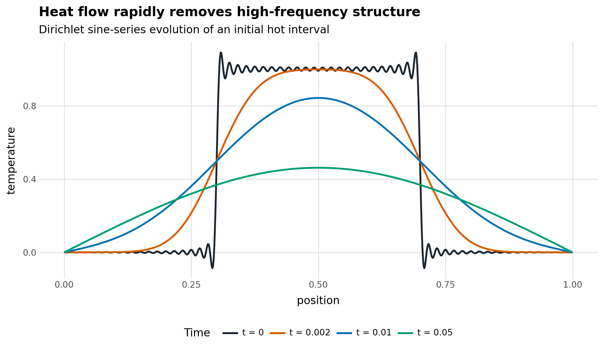

# Elliptic and Evolution Equations {#sec-analysis-pde}

Partial differential equations connect local differential laws with global
boundary or initial data. Modern existence theory rarely begins by finding a
formula. It chooses a function space, moves derivatives onto test functions,
proves an energy estimate, and only then asks whether the weak solution is
smoother.

**Prerequisites.** Sobolev spaces from [sec-sobolev](23-sobolev.md#sec-sobolev); Hilbert-space representation
from [sec-hilbert-spectral](27-hilbert-spectral.md#sec-hilbert-spectral); variational methods from [sec-variational-methods](31-variational-methods.md#sec-variational-methods);
ODE energy and fixed-point methods from [sec-ode-analysis](24-ode-analysis.md#sec-ode-analysis).

## Weak formulations

Consider Poisson's equation

$$
-\Delta u=f\quad\text{in }\Omega,
\qquad
u=0\quad\text{on }\partial\Omega.
$$

Multiply by a smooth test function $\eta$ vanishing at the boundary and
integrate by parts:

$$
\int_\Omega\nabla u\cdot\nabla\eta\,dx
=\int_\Omega f\eta\,dx.
$$

This identity makes sense for $u,\eta\in H_0^1(\Omega)$ and
$f\in H^{-1}(\Omega)=(H_0^1)^*$. A **weak solution** is a $u\in H_0^1$
satisfying it for every $\eta\in H_0^1$.

The boundary condition is encoded by the space. A Neumann problem instead keeps
test functions in $H^1(\Omega)$; its boundary term represents prescribed
normal flux. Constants lie in the kernel, so solvability requires a compatibility
condition such as $\int_\Omega f=0$, and uniqueness holds only modulo
constants.

Weak formulation is not approximation. It is an exact reformulation for smooth
solutions and a definition that remains meaningful at lower regularity.

## Lax–Milgram

Let $H$ be a real Hilbert space. A bilinear form $a:H\times H\to\mathbb R$
is bounded if

$$
|a(u,v)|\le M\|u\|\|v\|,
$$

and coercive if

$$
a(u,u)\ge\alpha\|u\|^2
$$

for some $\alpha>0$.

**Theorem 32.1 (Lax–Milgram).** For every $\ell\in H^*$, there is a unique $u\in H$
such that

$$
a(u,v)=\ell(v)\quad\text{for every }v\in H,
$$

and

$$
\|u\|\le\frac1\alpha\|\ell\|.
$$

Riesz representation writes $a(u,v)=\langle Au,v\rangle$ for a bounded
operator $A$. Coercivity gives
$\|Au\|\ge\alpha\|u\|$, so $A$ is injective with closed range. Applying the
same estimate to the adjoint shows the range is dense; hence it is all of $H$.
The estimate follows by testing with $v=u$.

For Poisson, take $H=H_0^1(\Omega)$ with gradient norm and

$$
a(u,v)=\int_\Omega\nabla u\cdot\nabla v.
$$

Poincaré makes the gradient norm equivalent to the full $H^1$ norm, and
Cauchy–Schwarz gives boundedness. Thus every $f\in H^{-1}$ produces one weak
solution, continuously dependent on the data.

When $a$ is symmetric, this solution uniquely minimises

$$
J[v]=\frac12a(v,v)-\ell(v).
$$

Lax–Milgram and the direct method are then operator and variational views of the
same problem.

## Elliptic principles and regularity

For a classical solution of $-\Delta u=f$ with $f\ge0$,
$\Delta u\le0$, so $u$ cannot have a strict interior minimum unless it is
locally constant. The maximum/minimum principle yields uniqueness and comparison
for classical Dirichlet problems.

Weak maximum principles require testing with positive or negative parts and
checking that those truncations belong to the Sobolev space. Sign conventions
must be tracked: changing $-\Delta$ to $+\Delta$ swaps maximum and minimum
statements.

Existence and regularity are separate.

- Lax–Milgram may give only $u\in H_0^1$.
- If $f\in L^2$, the domain is smooth enough, and coefficients are regular,
  elliptic estimates may give $u\in H^2$.
- Sobolev embedding can then convert derivative integrability into continuity.
- Corners, rough coefficients, incompatible boundary data, or singular forcing
  can limit regularity.

An estimate has the schematic form

$$
\|u\|_{H^{k+2}(\Omega')}
\le C\big(\|f\|_{H^k(\Omega)}+\|u\|_{L^2(\Omega)}\big)
$$

for $\Omega'$ compactly inside $\Omega$. Boundary regularity requires
additional geometry and trace compatibility.

## The heat equation

For

$$
u_t-\Delta u=0,\qquad u|_{\partial\Omega}=0,
$$

multiply by $u$ and integrate:

$$
\frac12\frac d{dt}\|u(t)\|_2^2
+\|\nabla u(t)\|_2^2=0.
$$

Thus $L^2$ energy decreases. Poincaré gives exponential decay on a bounded
domain:

$$
\|u(t)\|_2\le e^{-\lambda_1t}\|u(0)\|_2,
$$

where $\lambda_1>0$ is the first Dirichlet eigenvalue.

If $-\Delta e_k=\lambda_ke_k$ is an orthonormal eigenbasis, then

$$
u(t)=\sum_ke^{-\lambda_kt}
\langle u_0,e_k\rangle e_k.
$$

High-frequency modes have larger $\lambda_k$ and decay faster, explaining
smoothing. In operator language, $u(t)=e^{t\Delta}u_0$ is a contraction
semigroup.

<figure id="fig-heat-equation">


<figcaption>

Figure 32.1: Heat flow damps high-frequency modes and smooths an initially rough profile.

</figcaption>
</figure>

[Figure 32.1](#fig-heat-equation) plots a finite eigenfunction approximation. Energy estimates
and semigroup theory, not the finite truncation, establish decay and smoothing.

Backward heat flow would multiply mode $k$ by $e^{\lambda_kt}$, amplifying
arbitrarily small high-frequency error. It is a canonical ill-posed inverse
problem.

## The wave equation

For

$$
u_{tt}-c^2\Delta u=0,
$$

multiply by $u_t$. Under homogeneous boundary conditions,

$$
E(t)=\frac12\int_\Omega
\left(|u_t|^2+c^2|\nabla u|^2\right)\,dx
$$

is constant. Heat flow dissipates energy; ideal wave flow transports it.

On the whole space, disturbances propagate at finite speed $c$: data outside
the backward light cone of $(t,x)$ cannot affect $u(t,x)$. An energy proof
integrates over a shrinking cone. This property contrasts with the heat
equation, whose Gaussian kernel is immediately positive everywhere.

On a bounded interval, eigenfunction coefficients solve harmonic-oscillator
ODEs. Boundary reflection and standing waves arise from the permitted spatial
eigenfunctions.

Energy uniqueness is robust. Apply the identity to the difference of two
solutions with zero data; zero energy forces both time and spatial derivatives
to vanish, and boundary or initial conditions remove the remaining constant.

## Nonlinear equations

For a semilinear equation

$$
u_t+Au=F(u),
$$

the mild form is

$$
u(t)=e^{-tA}u_0+
\int_0^te^{-(t-s)A}F(u(s))\,ds.
$$

A contraction argument gives local existence when $F$ is Lipschitz in a
compatible space. Energy estimates may extend the solution globally. If
contraction fails, compactness, monotonicity, or topological fixed-point methods
may replace it.

Nonlinearity complicates limits: from $u_n\rightharpoonup u$, it does not
generally follow that $F(u_n)\rightharpoonup F(u)$. Strong compactness, monotone
operator theory, compensated compactness, or problem-specific structure is
needed.

## Galerkin approximation

Choose basis functions $e_1,\ldots,e_N$ and seek

$$
u_N(t)=\sum_{k=1}^Nc_k(t)e_k
$$

so the residual is orthogonal to their span. A PDE becomes a finite ODE system.
Uniform energy estimates independent of $N$ provide weak compactness; one then
passes to a limit in the weak formulation.

For coercive elliptic problems, Céa's lemma gives

$$
\|u-u_h\|_H
\le\frac M\alpha
\inf_{v_h\in V_h}\|u-v_h\|_H.
$$

The numerical solution is therefore nearly as good as the best approximation
available in the discrete space. Turning this into a mesh rate requires
regularity of $u$ and an interpolation estimate.

## Transport and conservation laws

The constant-velocity transport equation

$$
u_t+b\cdot\nabla u=0,
\qquad u(0,x)=u_0(x),
$$

has solution $u(t,x)=u_0(x-bt)$. It moves the profile without smoothing or
damping. Translation preserves every $L^p$ norm. Thus elliptic, parabolic,
hyperbolic, and transport equations have genuinely different regularising
behaviour.

For a variable velocity field, characteristics solve
$X'(t)=b(t,X(t))$, and $u(t,X(t))$ is constant along them when sufficient
regularity holds. If $\nabla\cdot b=0$, the flow preserves volume and
$L^p$ norms. With nonzero divergence, a continuity equation

$$
\rho_t+\nabla\cdot(\rho b)=0
$$

tracks the Jacobian change in density.

Nonlinear scalar conservation laws,

$$
u_t+\nabla\cdot F(u)=0,
$$

can form shocks from smooth data because characteristics intersect. Weak
solutions are then not unique. An additional entropy inequality selects the
physically stable solution obtained by vanishing viscosity. This is a warning
that “satisfies the weak equation” may be only the first admissibility test for a
nonlinear PDE.

For forced linear evolution, Duhamel's principle separates propagation from
input. The heat equation $u_t-\Delta u=f$ has mild form

$$
u(t)=e^{t\Delta}u_0+
\int_0^te^{(t-s)\Delta}f(s)\,ds.
$$

Semigroup bounds then estimate initial-data and forcing effects separately,
mirroring variation of constants for ODEs.

## Equation-selection guide

- Use Lax–Milgram for linear coercive weak equations.
- Use the direct method for symmetric energies and constrained minimisation.
- Use semigroups and energy decay for parabolic evolution.
- Use conserved energy and domains of dependence for hyperbolic evolution.
- Use contractions for locally Lipschitz semilinear perturbations.
- Treat regularity, uniqueness, and numerical approximation as separate
  theorems after existence.

<!-- inline-formula-code:start -->
## Formula and finite computation

A useful formula in this chapter is

$$
u_i^{n+1}=u_i^n+r(u_{i-1}^n-2u_i^n+u_{i+1}^n)
$$

One stable explicit heat step is a direct finite-difference reading of the PDE. The following standalone Python block expresses that finite rule with its inputs and stopping conditions visible.

```python
import numpy as np

state = np.array([0.0, 0.0, 1.0, 0.0, 0.0])
ratio = 0.4
next_state = state.copy()
next_state[1:-1] = state[1:-1] + ratio * (
    state[:-2] - 2.0 * state[1:-1] + state[2:]
)
print(next_state)
```

**What the computation establishes.** The output certifies only the declared finite case. The theorem, if one is claimed, still requires the argument developed in the chapter.
<!-- inline-formula-code:end -->

## Summary

- Weak formulations move derivatives onto test functions and encode boundary
  conditions in spaces.
- Lax–Milgram gives existence, uniqueness, stability, and an a priori bound.
- Elliptic regularity is additional information beyond weak existence.
- Heat flow dissipates and smooths; wave flow conserves energy and propagates at
  finite speed.
- Galerkin schemes require uniform estimates and justified limit passage.

## Exercises

<div class="exercise" id="real_analysis-32-pde-ex-1">
<p class="exercise-title"><strong>Exercise 1</strong></p>

Derive the weak form of $-\Delta u+u=f$ with zero Dirichlet data.

<details class="solution"><summary>Solution</summary>

It is
$\int\nabla u\cdot\nabla v+\int uv=\langle f,v\rangle$.

</details>

</div>

<div class="exercise" id="real_analysis-32-pde-ex-2">
<p class="exercise-title"><strong>Exercise 2</strong></p>

Verify boundedness and coercivity of its bilinear form on $H_0^1$.

<details class="solution"><summary>Solution</summary>

Use Cauchy–Schwarz; the form controls the full $H^1$ norm directly.

</details>

</div>

<div class="exercise" id="real_analysis-32-pde-ex-3">
<p class="exercise-title"><strong>Exercise 3</strong></p>

Derive the compatibility condition for a pure Neumann Poisson problem.

<details class="solution"><summary>Solution</summary>

Test the weak equation with the constant function $1$.

</details>

</div>

<div class="exercise" id="real_analysis-32-pde-ex-4">
<p class="exercise-title"><strong>Exercise 4</strong></p>

Prove uniqueness for heat flow from the energy identity.

<details class="solution"><summary>Solution</summary>

Apply the identity to the difference with zero initial and boundary data.

</details>

</div>

<div class="exercise" id="real_analysis-32-pde-ex-5">
<p class="exercise-title"><strong>Exercise 5</strong></p>

Compute the decay of a single Dirichlet eigenmode.

<details class="solution"><summary>Solution</summary>

A coefficient of $e_k$ is multiplied by $e^{-\lambda_kt}$.

</details>

</div>

<div class="exercise" id="real_analysis-32-pde-ex-6">
<p class="exercise-title"><strong>Exercise 6</strong></p>

Explain why backward heat evolution is unstable in $L^2$.

<details class="solution"><summary>Solution</summary>

Inversion multiplies high modes by unbounded factors
$e^{\lambda_kt}$.

</details>

</div>

<div class="exercise" id="real_analysis-32-pde-ex-7">
<p class="exercise-title"><strong>Exercise 7</strong></p>

Derive conserved wave energy for a smooth solution.

<details class="solution"><summary>Solution</summary>

Multiply by $u_t$, integrate, and remove the boundary flux.

</details>

</div>

<div class="exercise" id="real_analysis-32-pde-ex-8">
<p class="exercise-title"><strong>Exercise 8</strong></p>

State the four ingredients needed to pass from Galerkin approximations to a
weak solution.

<details class="hint"><summary>Hint 1</summary>

The four headings are uniform estimate, subsequence compactness,
admissibility of the limit, and justified convergence in the weak equation.

</details>

<details class="solution"><summary>Solution</summary>

Uniform bounds, compactness or subsequence extraction, admissibility of the
limit, and convergence of every weak-form term.

</details>

</div>

### Answer support

1. It is
   $\int\nabla u\cdot\nabla v+\int uv=\langle f,v\rangle$.
2. Use Cauchy–Schwarz; the form controls the full $H^1$ norm directly.
3. Test the weak equation with the constant function $1$.
4. Apply the identity to the difference with zero initial and boundary data.
5. A coefficient of $e_k$ is multiplied by $e^{-\lambda_kt}$.
6. Inversion multiplies high modes by unbounded factors
   $e^{\lambda_kt}$.
7. Multiply by $u_t$, integrate, and remove the boundary flux.
8. Uniform bounds, compactness or subsequence extraction, admissibility of the
   limit, and convergence of every weak-form term.
