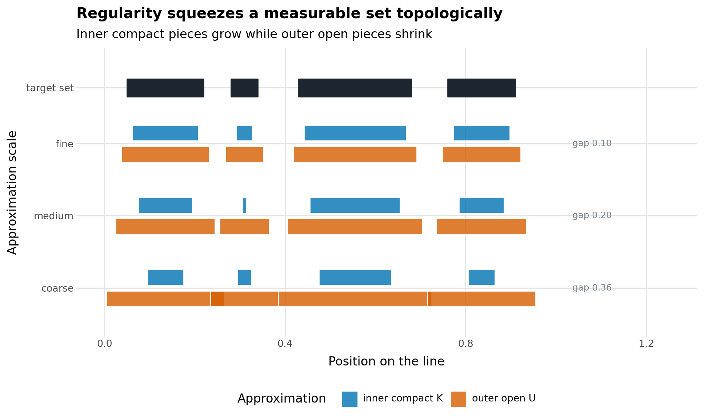

# Locally Compact Spaces and Radon Measures {#sec-radon-measures}

Length on the line, area in the plane, counting measure on a discrete set, and
probability on a compact space all share a local principle: bounded regions can
be approximated by well-behaved pieces. Radon measures formalise that principle
on spaces more general than $\mathbb R^n$ and connect integration to positive
linear functionals.

This chapter assumes no topology beyond the repair kit below. Chapters
[sec-metric-spaces](10-metric-spaces.md#sec-metric-spaces) and [sec-lebesgue-construction](19-lebesgue-measure.md#sec-lebesgue-construction) develop the same ingredients more
fully, but every specialised term is defined before use here.

## Local repair kit: open, compact, and support

A **topological space** is a set $X$ together with a collection of open sets
containing $\varnothing$ and $X$, closed under arbitrary unions and finite
intersections. A set is closed when its complement is open. A **neighbourhood**
of $x$ is a set containing an open set that contains $x$.

An open cover of $K\subseteq X$ is a family of open sets whose union contains
$K$. The set $K$ is **compact** if every open cover has a finite subcover. In
$\mathbb R^n$, Heine–Borel identifies compact sets as exactly the closed and
bounded sets; that characterisation is not the definition and fails in many
spaces.

A space is **Hausdorff** if distinct points have disjoint neighbourhoods.
Compact subsets of Hausdorff spaces are closed, and limits are unique.

For a function $f:X\to\mathbb R$, its support is

$$
\operatorname{supp}f
=\overline{\{x:f(x)\ne0\}}.
$$

Write $C_c(X)$ for continuous real-valued functions with compact support. The
closure matters: a function can vanish at a boundary point while remaining
nonzero arbitrarily close to it.

## Local compactness

A Hausdorff space is **locally compact** if every point has a neighbourhood
whose closure is compact. Equivalent formulations need mild separation
assumptions, which is why Hausdorffness is included.

Examples include:

- $\mathbb R^n$: a small open ball has compact closed ball;
- every discrete space: the singleton $\{x\}$ is compact and open;
- every compact Hausdorff space;
- open subsets of locally compact Hausdorff spaces;
- locally finite graphs with their geometric realisation;
- $\mathbb Q_p$, whose closed balls are compact.

An infinite-dimensional normed space is not locally compact. If its closed unit
ball were compact, a sequence of unit vectors separated by a fixed distance
would have a convergent subsequence, a contradiction. This distinction is why
Radon-measure theory and infinite-dimensional Gaussian measure require
different care.

For noncompact locally compact Hausdorff $X$, adjoining a point $\infty$ and
declaring its neighbourhoods to be complements of compact sets creates the
**one-point compactification** $X^\ast$. For $X=\mathbb R$, it is topologically
a circle. A function $f\in C_c(X)$ extends continuously to $X^\ast$ with
$f(\infty)=0$.

## Borel and regular measures

The **Borel sigma-algebra** $\mathcal B(X)$ is generated by the open sets. A
Borel measure assigns a value in $[0,\infty]$ to each Borel set, sends the empty
set to zero, and is countably additive on disjoint families.

A Borel measure $\mu$ is:

- **locally finite** if every point has a neighbourhood of finite measure;
- **inner regular** if

  $$
  \mu(E)=\sup\{\mu(K):K\subseteq E,\ K\text{ compact}\};
  $$

- **outer regular** if

  $$
  \mu(E)=\inf\{\mu(U):E\subseteq U,\ U\text{ open}\}.
  $$

A **Radon measure** in this book is a positive locally finite Borel measure
on a locally compact Hausdorff space that is **outer regular on every Borel
set** and **inner regular on open sets**, using compact sets for inner
approximation. Local finiteness is equivalent here to finiteness on compact
sets: a finite subcover proves one direction, and a relatively compact
neighbourhood proves the other.

Authors use different conventions. Some require compact inner regularity on
every Borel set instead; the worked investigation below shows that these
classes can differ even on a metrizable space. Under our convention
finite-measure Borel sets are inner regular, as the next lemma proves. Sigma-finiteness gives
inner regularity on all Borel sets; sigma-compactness supplies sigma-finiteness
because compact sets have finite mass. Neither countability conclusion follows
from metrizability alone.

The exact outer-all-Borel/inner-open convention and its representation theorem
are stated in [Sternberg, §6.9.1](https://people.math.harvard.edu/~shlomo/docs/Real_Variables.pdf)
and [Weikard, §§5.3.3–5.3.6](https://www.uab.edu/cas/mathematics/images/Documents/reals.pdf).

Lebesgue measure on $\mathbb R^n$, counting measure on a discrete space, and a
finite Borel measure on a compact metric space are Radon. Counting measure on
an uncountable discrete space is still locally finite and Radon, although not
sigma-finite.

## Approximating sets and functions

**Lemma 33.1 (Finite-Borel approximation).** If $\mu$ is Radon in the declared
convention, $E$ is Borel with $\mu(E)<\infty$, and $\varepsilon>0$, there are
compact $K$ and open $U$ with

$$
K\subseteq E\subseteq U,\qquad
\mu(U\setminus K)<\varepsilon.
$$

To prove this, put $\delta=\varepsilon/4$. Outer regularity gives open
$U\supseteq E$ with $\mu(U\setminus E)<\delta$, so $\mu(U)<\infty$.
Inner regularity on $U$ gives compact $C\subseteq U$ with
$\mu(U\setminus C)<\delta$. Choose open $W\supseteq U\setminus E$ with

$$
\mu(W)<\mu(U\setminus E)+\delta.
$$

The compact set $K=C\setminus W$ lies in $E$. Since
$W=(U\setminus E)\sqcup(E\cap W)\sqcup(W\setminus U)$ and $\mu(W)<\infty$,
we have $\mu(E\cap W)<\delta$. Consequently

$$
\mu(E\setminus K)<2\delta,\qquad
\mu(U\setminus K)<3\delta<\varepsilon.
$$

This proof needs no compact exhaustion of the whole space.

In a **locally compact metric** space choose an open intermediate set $V$ with

$$
K\subseteq V\subseteq\overline V\subseteq U,\qquad
\overline V\text{ compact}.
$$

One obtains $V$ by shrinking a relatively compact neighbourhood of each point
of $K$ inside $U$, then taking a finite union. When $K=\varnothing$, take
$\phi=0$ directly. When $U=X$ and $X$ is compact, take $V=X$ and $\phi=1$ directly.
In the remaining cases $K$ and $X\setminus V$ are nonempty, and define

$$
\phi(x)=
\frac{d(x,X\setminus V)}
{d(x,K)+d(x,X\setminus V)}.
$$

The denominator is positive. The function is continuous, satisfies
$0\le\phi\le1$, equals one on $K$, and vanishes outside $V$. Therefore

$$
\operatorname{supp}\phi\subseteq\overline V\subseteq U,\qquad
\phi\in C_c(X),\qquad
\|1_E-\phi\|_1\le\mu(U\setminus K)<\varepsilon.
$$

The compact intermediate set is essential: replacing $V$ by an unbounded
open $U$ can give noncompact support even when $\mu(U\setminus K)$ is small.
The later laboratory verifies each cutoff property separately.

On a general locally compact Hausdorff space, use the **compact-bump lemma**:
if $K$ is compact and $K\subseteq U$ with $U$ open, there exists
$\phi\in C_c(X)$ with $0\le\phi\le1$, $\phi=1$ on $K$, and
$\operatorname{supp}\phi\subseteq U$. This topological lemma gives the same
approximation without assuming a metric; its relatively compact
neighbourhood and cutoff statements appear in
[Driver, Proposition 12.7 and Lemma 12.8](https://mathweb.ucsd.edu/~bdriver/240A-C-03-04/Lecture_Notes/Older-Versions/part3.pdf).

<figure id="fig-radon-regularity">


<figcaption>

Figure 33.1: Compact sets approximate from inside and open sets from outside as the scale is refined.

</figcaption>
</figure>

[Figure 33.1](#fig-radon-regularity) shows one finite construction. The theorem guarantees
arbitrarily small measure gap; it does not guarantee that every visually close
boundary approximation has small measure.

## Positive functionals become measures

A linear functional $L:C_c(X)\to\mathbb R$ is **positive** if
$L(f)\ge0$ whenever $f\ge0$. Integration against a Radon measure gives one:

$$
L(f)=\int_X f\,d\mu.
$$

The Riesz–Markov–Kakutani theorem reverses this construction.

**Theorem 33.2 (Representation, locally compact form).** If $X$ is locally compact
Hausdorff and $L$ is a positive linear functional on $C_c(X)$, then there is a
unique positive Borel measure $\mu$ that is locally finite, outer regular on
every Borel set, and compact-inner-regular on open sets, such that

$$
L(f)=\int_X f\,d\mu
\quad\text{for all }f\in C_c(X).
$$

One proof architecture defines the measure of an open set by

$$
\mu(U)=\sup\{L(f):f\in C_c(X),\ 0\le f\le1,\
\operatorname{supp}f\subset U\},
$$

then constructs an outer measure, proves Borel measurability, establishes
the stated regularity, and recovers $L$. Uniqueness is within this declared
measure class. Positivity supplies local bounds: for compact $K$, choose a
nonnegative compact bump equal to one on $K$ and apply positivity to that
bump times $\|f\|_\infty$, plus and minus $f$. This bounds $|L(f)|$ for
functions supported in $K$; it does not assert one global bound on $C_c(X)$.

For compact $X$, $C_c(X)=C(X)$ and the theorem identifies the dual of
$C(X)$ with finite signed regular measures after applying the Jordan
decomposition. For noncompact $X$, the Banach-space version uses bounded
functionals on $C_0(X)$, the continuous functions vanishing at infinity, and
finite representing measures. A positive functional on $C_c(X)$ need not
extend to a bounded functional on $C_0(X)$; the next example has infinite
total mass.

## Worked investigation: continuous data and Borel regularity {#sec-radon-conventions}

Let $I$ be uncountable and form the topological disjoint union

$$
X=\coprod_{i\in I}\mathbb R_i.
$$

Every component is open and closed. The space is locally compact Hausdorff
and metrizable: use $\min(1,|x-y|)$ within a component and distance $2$
between different components. Every compact set meets only finitely many
components, since the components form an open cover. Thus $X$ is neither
sigma-compact nor second-countable.

For a Borel set $B\subseteq X$, write $B_i$ for its section in component $i$
and $J(B)=\{i:B_i\ne\varnothing\}$. Every section is Borel by continuity of
the component inclusion. We work with actual Borel sets of $X$; no claim
about arbitrary uncountable families of Borel sections is needed. Define

$$
\nu(B)=\sup_{\substack{F\subseteq I\\F\text{ finite}}}
       \sum_{i\in F}\lambda(B_i),\qquad
\mu(B)=
\begin{cases}
\nu(B),&J(B)\text{ is at most countable},\\
\infty,&J(B)\text{ is uncountable},
\end{cases}
$$

where $\lambda$ is ordinary Lebesgue measure. The possibly uncountable
nonnegative sum defining $\nu$ means exactly the supremum of finite subsums.

### Check that both are measures

For disjoint Borel $B_n$, sectionwise countable additivity gives

$$
\nu\left(\bigcup_n B_n\right)=\sum_n\nu(B_n).
$$

Here is the finite-subsum justification. For every fixed finite component
set $F$, sum the section measures first over $F$ and then over $n$ to obtain
the inequality $\le$. For the reverse inequality, approximate finitely
many values $\nu(B_n)$ by finite component subsums, then take the union of
their finite index sets. Let the approximation error decrease and the
number of terms increase. Infinite values are handled by exceeding an
arbitrary finite target. This uses no uncountable additivity.

If $J(\bigcup_nB_n)$ is uncountable, some $J(B_n)$ is uncountable, so
countable additivity for $\mu$ has both sides infinite. Otherwise all the
sets occupy the same at most countable family of components, where
$\mu=\nu$, and additivity follows from that of $\nu$. Both measures give
zero to the empty set. Every point has a bounded interval neighbourhood in
one component, on which both measures equal finite length. Thus both are
locally finite.

### Which data do they share?

Lebesgue inner regularity in finitely many components proves

$$
\nu(B)=\sup_{K\subseteq B,\ K\text{ compact}}\nu(K)
\quad\text{for every Borel }B.
$$

For finite mass choose a finite subsum close to $\nu(B)$ and compact
section subsets with a finite error budget. For infinite mass first choose
a finite subsum exceeding any prescribed target, then compact section
subsets still exceeding that target. A finite union of those section
compacts is compact in $X$.

Both measures agree on compact sets, since these meet finitely many
components. They also agree on every open $U$. This is immediate when
$J(U)$ is countable. Otherwise its nonempty open sections have positive
length in uncountably many components. Uncountably many positive numbers
have unbounded finite subsums: if each threshold set
$\{i:\lambda(U_i)\ge1/m\}$ were finite, their countable union would contain
only countably many positive entries. Therefore one threshold set is
infinite, and its finite subsums grow arbitrarily large. Hence

$$
\mu(U)=\nu(U)=\infty
\quad\text{when }J(U)\text{ is uncountable}.
$$

It follows that both measures are inner regular on open sets. Every
$f\in C_c(X)$ is supported in finitely many components, where the measures
agree; it is bounded and its absolute integral is finite. Thus

$$
L(f)=\int_X f\,d\nu=\int_X f\,d\mu
$$

defines the same positive real linear functional on $C_c(X)$.

### A closed set separates the measures

The transversal $T=\{0_i:i\in I\}$ is closed: its complement is the union
of the open punctured components. We have

$$
\nu(T)=0,\qquad\mu(T)=\infty.
$$

Every compact subset of $T$ is finite and has mass zero, whereas every
open superset occupies all components and has infinite mass for either
measure. Thus $\nu$ fails outer regularity at $T$, and $\mu$ fails inner
regularity there.

In fact $\mu$ is outer regular on every Borel set, with

$$
\mu(B)=\inf_{B\subseteq U,\ U\text{ open}}\nu(U)
      =\inf_{B\subseteq U,\ U\text{ open}}\mu(U).
$$

If $\mu(B)=\infty$, monotonicity makes the second infimum infinite, and
the first is the same because $\mu$ and $\nu$ agree on opens. If
$\mu(B)<\infty$, enumerate its occupied components as $i_k$ and choose
open $O_k\supseteq B_{i_k}$ with excess length less than
$\varepsilon2^{-k}$. Their union is open in $X$, occupies only countably
many components, and has mass at most $\mu(B)+\varepsilon$. Let
$\varepsilon\downarrow0$. The empty set is immediate.

| Property | $\nu$ | $\mu$ |
|---|---|---|
| Locally finite and inner regular on opens | Yes | Yes |
| Inner regular on all Borel sets | Yes | No |
| Outer regular on all Borel sets | No | Yes |

Both would satisfy the weaker definition consisting only of local
finiteness and inner regularity on opens. Only $\mu$ is Radon under this
chapter's declared convention, so the example does not contradict the
representation theorem.

Neither measure is sigma-finite. A finite $\mu$-mass set occupies countably
many components. A finite $\nu$-mass set may occupy uncountably many null
sections, so it needs a different argument: its positive-length sections
occur in only countably many components. A countable cover by finite
$\nu$-mass sets would leave some component covered by countably many null
sections, contradicting the positive length of an interval there.

### Why requiring both global regularities would destroy existence

Suppose a Borel measure $\rho$ represents this same $L$. Compact triangular
bumps of height one around $0_i$, with integrals tending to zero, imply
$\rho(\{0_i\})=0$. If $\rho$ were inner regular on every Borel set, compact
subsets of $T$ being finite would give $\rho(T)=0$.

For every open $U\supseteq T$ and each component $i$, choose
$0\le g_i\le1$ with compact support in $U_i$ and positive length integral.
Representation gives $\rho(U_i)\ge\int g_i\,d\rho=L(g_i)>0$.
The positive-subsum argument forces $\rho(U)=\infty$. Outer regularity at
$T$ would therefore give $\rho(T)=\infty$, a contradiction. For this
functional on this uncountable space, no representing measure has both
global regularities. The countable-component exercise below gives a
different conclusion under a genuinely changed hypothesis.

## Product measures and Fubini

If $X$ and $Y$ are locally compact second-countable Hausdorff spaces and
$\mu,\nu$ are Radon and sigma-finite, their product measure is Radon on
$X\times Y$. For nonnegative measurable $f$, Tonelli gives

$$
\int_{X\times Y}f\,d(\mu\times\nu)
=\int_X\left(\int_Y f(x,y)\,d\nu(y)\right)d\mu(x).
$$

For integrable signed $f$, Fubini permits both iterated integrals and equality.
Sigma-finiteness prevents pathologies in the general product construction.

Compactly supported continuous functions on the product can be approximated by
finite sums $g(x)h(y)$ under common hypotheses, so product integration is
determined by

$$
\int g(x)h(y)\,d(\mu\times\nu)
=\left(\int g\,d\mu\right)\left(\int h\,d\nu\right).
$$

## Haar measure

Here a locally compact group is a locally compact **Hausdorff** group whose
multiplication and inversion are continuous. A **left Haar measure** is a nonzero Radon measure satisfying

$$
\mu(gE)=\mu(E)
$$

for every group element $g$ and Borel set $E$. Every locally compact group has
one, unique up to multiplication by a positive constant.

- On $(\mathbb R^n,+)$, Haar measure is Lebesgue measure.
- On a discrete group, it is counting measure.
- On the circle, normalised arc length has total mass one.
- On $(\mathbb Q_p,+)$, it is normalised by
  $\mu(\mathbb Z_p)=1$.

Right translation need not preserve a left Haar measure. The modular function
quantifies the difference. Abelian and compact groups are unimodular, so left
and right Haar measures agree.

## Weak-star convergence and escaping mass

Radon measures $\mu_n$ converge **vaguely** to $\mu$ if

$$
\int f\,d\mu_n\longrightarrow\int f\,d\mu
\quad\text{for every }f\in C_c(X).
$$

On a noncompact space, mass can escape. The point masses
$\delta_n$ on $\mathbb R$ converge vaguely to the zero measure because every
compactly supported $f$ eventually vanishes at $n$, even though each measure
has total mass one.

A family is **tight** if for every $\varepsilon>0$ there is compact $K$ such
that $\mu(X\setminus K)<\varepsilon$ for every measure in the family. Tightness
blocks escape and upgrades compactness results for probability measures.

<div class="callout callout-warning">
<p class="callout-title">Test-function class determines the convergence</p>

Testing only with $C_c$ cannot see mass infinitely far away. Testing bounded
continuous functions does see total mass but creates a stronger notion.
Always name the test class.

</div>

## Regularity and representation laboratory

This section slows down the chapter's three main transitions: from local
finiteness to usable finite pieces, from sets to continuous test functions, and
from positive functionals back to measures.

### Repair kit: three different finiteness conditions

A measure can be finite, sigma-finite, or locally finite, and none of these words
should be silently substituted for another.

- **Finite** means $\mu(X)<\infty$.
- **Sigma-finite** means $X=\bigcup_{n=1}^\infty E_n$ with
  $\mu(E_n)<\infty$.
- **Locally finite** means every point has a neighbourhood of finite measure.

Lebesgue measure on $\mathbb R$ is not finite, but it is sigma-finite because
$\mathbb R=\bigcup_n[-n,n]$, and it is locally finite because bounded intervals
have finite length. Counting measure on an uncountable discrete space is locally
finite: every singleton is an open neighbourhood of measure one. It is not
sigma-finite, because a countable union of finite sets is countable and cannot
cover the space. A probability measure is finite and hence automatically
sigma-finite.

Local compactness and local finiteness work together. If every $x$ has an open
neighbourhood $V_x$ with compact closure and finite measure, then a compact set
$K$ is covered by finitely many such $V_x$. Therefore $\mu(K)<\infty$. This
finite-subcover step is why compactly supported test functions have finite
integrals even when $\mu(X)=\infty$.

The support condition also needs care. For

$$
f(x)=\max(1-|x|,0),
$$

the nonzero set is $(-1,1)$, but its closure is $[-1,1]$. Thus
$\operatorname{supp}f=[-1,1]$. Support records where nonzero values occur or can
be approached; it is not merely the set on which the displayed value is nonzero.

### From regular sets to an explicit L1 approximation

Work in a locally compact metric space. Let $E$ be Borel with finite
measure. The finite-Borel approximation lemma provides

$$
K\subseteq E\subseteq U,
\qquad
\mu(U\setminus K)<\varepsilon,
$$

where $K$ is compact and $U$ open. Local compactness lets us choose an
open set $V$ with

$$
K\subseteq V\subseteq \overline V\subseteq U,
\qquad \overline V\text{ compact}.
$$

This intermediate set, rather than a smaller outer approximation to all of $E$,
is what supplies compact support. If $K=\varnothing$, use $\phi=0$ directly.
If $U=X$ and $X$ is compact, use $V=X$ and $\phi=1$ directly; then
$\|1_E-\phi\|_1=\mu(X\setminus E)\le\mu(U\setminus K)<\varepsilon$.
In all other cases choose $V$ as above with $X\setminus V\ne\varnothing$.
For this nontrivial case define

$$
\phi(x)=
\frac{d(x,X\setminus V)}
{d(x,K)+d(x,X\setminus V)}.
$$

Here is the full verification.

1. Both distance functions are continuous and nonnegative.
2. They cannot vanish simultaneously. If $d(x,K)=0$, compactness makes $K$
   closed, so $x\in K\subset V$; compactness of $K$ and closedness of
   $X\setminus V$ make their distance positive. If
   $d(x,X\setminus V)=0$, then $x$ cannot lie in $K$.
3. Therefore the denominator is positive and $\phi$ is continuous.
4. On $K$, $d(x,K)=0$, so $\phi=1$.
5. On $X\setminus V$, the numerator is zero, so $\phi=0$; hence
   $\operatorname{supp}\phi\subseteq\overline V$, which is compact.
6. Nonnegativity of both terms gives $0\le\phi\le1$.

The pointwise error vanishes on $K$ and outside $E\cup V$. Everywhere else it is
at most one. Because

$$
(E\setminus K)\cup(V\setminus K)\subseteq U\setminus K,
$$

we consequently have

$$
|1_E-\phi|\le1_{U\setminus K}
$$

and hence

$$
\|1_E-\phi\|_{L^1(\mu)}
\le\mu(U\setminus K)<\varepsilon.
$$

This is stronger than saying that the graphs look close: the approximation error
is measured and certified. The visual in [Figure 33.1](#fig-radon-regularity) should be read in
exactly this order. The inner compact set prevents missed mass, the outer open set
controls excess mass, and the plotted shrinking gap represents
$\mu(U\setminus K)$ rather than Euclidean boundary distance.

### A finite-space model of the representation theorem

Let $X=\{x_1,\ldots,x_m\}$ with the discrete topology. Every function is
continuous and compactly supported. Let $e_j$ be the function that equals one at
$x_j$ and zero elsewhere. If $L:C(X)\to\mathbb R$ is positive, set

$$
w_j=L(e_j).
$$

Positivity gives $w_j\ge0$. Every function has the exact decomposition

$$
f=\sum_{j=1}^m f(x_j)e_j,
$$

so linearity yields

$$
L(f)=\sum_{j=1}^m w_jf(x_j).
$$

Define $\mu(\{x_j\})=w_j$. Then the last display is precisely
$L(f)=\int f\,d\mu$. Uniqueness is immediate because testing with $e_j$ recovers
every point mass.

On a finite discrete space, the integral representation is exactly a dot
product.  Nonnegative weights encode positivity of the functional and the
length check encodes that functions and point masses use the same space.

```python
from math import fsum, isfinite

def finite_positive_functional(
    point_weights: list[float], function_values: list[float]
) -> float:
    """Evaluate L(f) = sum_j w_j f(x_j) on a finite discrete space."""
    if not point_weights or len(point_weights) != len(function_values):
        raise ValueError("weights and values must be nonempty and equally long")
    if any(not isfinite(weight) or weight < 0.0 for weight in point_weights):
        raise ValueError("representing weights must be finite and nonnegative")
    if any(not isfinite(value) for value in function_values):
        raise ValueError("function values must be finite")
    return fsum(
        weight * value
        for weight, value in zip(point_weights, function_values, strict=True)
    )

integral = finite_positive_functional([0.2, 0.3, 0.5], [4.0, -1.0, 2.0])
positive_test = finite_positive_functional([0.2, 0.3, 0.5], [1.0, 0.0, 3.0])
print(integral, positive_test)
```

The second output is nonnegative, as positivity requires for this nonnegative
test function. The finite calculation illustrates the representation; it
does not prove the Riesz–Markov theorem on an arbitrary locally compact space.

The Riesz–Markov–Kakutani theorem replaces this finite basis
by approximations on open and compact sets. Positivity still prevents negative
mass, while regularity replaces the ability to inspect one point at a time.

The local boundedness estimate used in that theorem is also elementary once a
cutoff is available. If $\phi=1$ on $\operatorname{supp}f$, $\phi\ge0$, and
$M=\|f\|_\infty$, then

$$
M\phi+f\ge0,
\qquad
M\phi-f\ge0.
$$

Positivity gives $-ML(\phi)\le L(f)\le ML(\phi)$, hence

$$
|L(f)|\le L(\phi)\|f\|_\infty.
$$

The constant depends on the compact region through $\phi$; on noncompact $X$ one
does not automatically get one bound valid for every support.

### Haar normalisation on the real line

Assume $\mu$ is a translation-invariant Radon measure on $(\mathbb R,+)$ and
normalise $\mu([0,1))=1$. Split $[0,1)$ into $n$ translates of
$[0,1/n)$. Finite additivity and invariance give

$$
1=n\mu([0,1/n)),
$$

so $\mu([0,1/n))=1/n$. Joining $m$ adjacent pieces gives
$\mu([0,m/n))=m/n$. Translation then yields

$$
\mu([a,b))=b-a
$$

whenever $a,b$ are rational. Approximate arbitrary real endpoints monotonically
by rationals and use continuity of measure from below or above on finite
intervals. The result is ordinary length on all intervals, and a uniqueness
theorem extends equality to Borel sets. This calculation shows what “unique up
to scale” means: choosing the mass of one reference interval fixes every other
interval.

### Vague convergence, weak convergence, and lost mass

For $\mu_n=\delta_n$ on $\mathbb R$ and $f\in C_c(\mathbb R)$, compact support
lies inside some $[-R,R]$. Once $n>R$, $f(n)=0$, so

$$
\int f\,d\delta_n=f(n)\longrightarrow0.
$$

Thus $\delta_n$ converges vaguely to the zero measure. It cannot converge weakly
as probability measures to zero when the test class contains the constant
function $1$, because every integral of $1$ equals one while the zero measure
integrates it to zero.

The family is not tight. Given compact $K\subset\mathbb R$, boundedness places it
inside $[-R,R]$. Choose an integer $n>R$; then
$\delta_n(\mathbb R\setminus K)=1$. No one compact set captures even half the
mass of every member. This is a checked counterexample, not a paradox: vague tests
are deliberately local.

### From indicator cutoffs to density in $L^1$

The cutoff construction proves more than one approximation. It gives a local
route to the density of $C_c(X)$ in $L^1(\mu)$ for a Radon measure on a locally
compact metric space. Here are all the bookkeeping steps.

First let

$$
s=\sum_{j=1}^m a_j1_{E_j}
$$

be an integrable simple function with pairwise disjoint $E_j$ and nonzero
$a_j$. Integrability implies

$$
\sum_{j=1}^m|a_j|\mu(E_j)<\infty,
$$

so each $E_j$ with $a_j\ne0$ has finite measure. Given $\varepsilon>0$, use the
indicator construction to choose $\phi_j\in C_c(X)$ such that

$$
\|1_{E_j}-\phi_j\|_1
<\frac{\varepsilon}{m(1+|a_j|)}.
$$

Set $g=\sum_ja_j\phi_j$. A finite union of compact supports is compact, so
$g\in C_c(X)$. The triangle inequality gives

$$
\begin{aligned}
\|s-g\|_1
&\le\sum_{j=1}^m|a_j|\|1_{E_j}-\phi_j\|_1\\
&<\frac{\varepsilon}{m}
  \sum_{j=1}^m\frac{|a_j|}{1+|a_j|}
\le\varepsilon.
\end{aligned}
$$

Now take arbitrary $f\in L^1(\mu)$. Measurable integrable functions can be
approximated in $L^1$ by integrable simple functions: truncate the range of
$|f|$ and then quantise it into intervals of small height, treating positive
and negative parts separately. Choose such an $s$ with
$\|f-s\|_1<\varepsilon/2$, and then choose $g\in C_c(X)$ with
$\|s-g\|_1<\varepsilon/2$. Therefore

$$
\|f-g\|_1<\varepsilon.
$$

The topology enters exactly once, when regularity and local compactness build
continuous compactly supported cutoffs. All later steps are linear
combinations and triangle inequalities.

### An order-of-integration failure on a discrete space

Tonelli permits either order for a nonnegative measurable function. Fubini
permits either order for an absolutely integrable signed function. Without
either safeguard, even a completely explicit double sum can change value.

Put counting measure on $\mathbb N$ and define

$$
a_{m,n}=
\begin{cases}
1,&n=m,\\
-1,&n=m+1,\\
0,&\text{otherwise}.
\end{cases}
$$

For every fixed row $m$, the two nonzero entries add to zero. Hence

$$
\sum_{m=1}^\infty\left(\sum_{n=1}^\infty a_{m,n}\right)=0.
$$

For columns, the first column contains only $a_{1,1}=1$. Every later column
$n$ contains $a_{n,n}=1$ and $a_{n-1,n}=-1$, so it sums to zero. Consequently

$$
\sum_{n=1}^\infty\left(\sum_{m=1}^\infty a_{m,n}\right)=1.
$$

There is no contradiction because
$\sum_{m,n}|a_{m,n}|=\infty$. The positive and negative parts both have infinite
mass, so the signed integral is not defined by subtracting two finite numbers.
Every finite rectangular partial sum is legitimate, but the two iterated limits
approach the infinite grid along different shapes. This discrete picture is the
cleanest warning to place beside any proposed use of Fubini: check
$\int|f|<\infty$, or check nonnegativity and invoke Tonelli, before exchanging
the order.

### Recovering a measure from continuous tests

The uniqueness part of representation can be reduced to regularity. Let $\mu$
be a Radon measure and $K$ compact. Then

$$
\mu(K)=\inf\left\{
\int_X f\,d\mu:
f\in C_c(X),\ f\ge1_K, f\ge0
\right\}.
$$

The inequality “$\le$” is immediate: every admissible $f$ is at least one on
$K$, so its integral is at least $\mu(K)$. To prove the other direction, fix
$\varepsilon>0$. Outer regularity gives an open $O\supset K$ with
$\mu(O)<\mu(K)+\varepsilon$. Because $K$ is compact and the space is locally
compact, intersect $O$ with a relatively compact open neighbourhood of $K$ and
construct a cutoff $f$ satisfying

$$
1_K\le f\le1_O,
\qquad f\in C_c(X).
$$

Then

$$
\int f\,d\mu\le\mu(O)<\mu(K)+\varepsilon,
$$

which proves the formula after $\varepsilon\downarrow0$.

Compact recovery does not itself need outer regularity on all Borel sets.
Indeed, even with only local finiteness and inner regularity on opens,
choose a finite-measure open neighbourhood $O\supseteq K$. Inner regularity
of the open set $O\setminus K$ supplies compact $C\subseteq O\setminus K$
with $\mu((O\setminus K)\setminus C)<\delta$. Then $O\setminus C$ is open,
contains $K$, and has mass less than $\mu(K)+\delta$. This proves outer
regularity on compact sets and justifies the same compact recovery formula
under those weaker assumptions.

Suppose now that two Radon measures $\mu$ and $\nu$ integrate every function in
$C_c(X)$ equally. The displayed formula gives $\mu(K)=\nu(K)$ for every compact
$K$. Inner regularity then gives, for each open $U$,

$$
\mu(U)=\sup_{K\subset U,\ K\text{ compact}}\mu(K)
=\sup_{K\subset U,\ K\text{ compact}}\nu(K)=\nu(U).
$$

Finally, **outer regularity on every Borel set**, explicitly part of the
declared Radon convention, recovers every Borel $E$ from open supersets:

$$
\mu(E)=\inf_{E\subset U,\ U\text{ open}}\mu(U)
=\inf_{E\subset U,\ U\text{ open}}\nu(U)=\nu(E).
$$

Thus continuous compactly supported tests determine the whole Radon measure.
The proof also explains why regularity belongs in the representation theorem:
it is the bridge from continuous data to values on arbitrary Borel sets.
In [Section 33.6](#sec-radon-conventions), $\mu$ and $\nu$ agree through the compact and open
steps, but $\nu$ fails the final Borel step at $T$.

### Theorem-hypothesis audit and solution clinic

The distance cutoff proof used a metric and compact containment, with empty-set
and compact-whole-space cases handled directly. The compact-bump lemma supplies
the cutoff on a general locally compact Hausdorff space. The representation
theorem uses the declared outer-all-Borel/inner-open measure class; the worked
counterexample shows why that choice is essential. Product regularity and Fubini
add second countability or related countability assumptions and sigma-finiteness.
Haar existence requires a locally compact topological group, while its
normalisation remains a free positive scalar. Vague convergence uses $C_c$;
probability weak convergence generally uses bounded continuous functions.

For Exercise 1, an open cover of a finite set $\{x_1,\ldots,x_m\}$ contains one
open set covering each $x_j$; those at most $m$ sets form a finite subcover.
Hausdorffness is not needed for compactness of finite sets, though it is needed to
conclude they are closed.

For Exercise 4, use the relatively compact $V$, handle the two direct cases,
and then apply the six-step verification. Correct point values alone do not
prove compact support. For Exercise 5, apply positivity to
$M\phi\pm f$. For Exercises 7 and 8, the compact-support and bounded-compact-set
arguments above respectively prove vague convergence and failure of tightness.
These solutions illustrate a general habit: name the finite or compact object that
turns an asymptotic phrase into a quantified proof.

## Related results {#fifth-edition-handoff}

Radon regularity and locally compact measure representation prepare the
measurability side of [sec-polish-disintegration](39-polish-disintegration.md#sec-polish-disintegration). The next step replaces one
measure by a measurable family of conditional measures and states precisely
where standard Borel structure is used.

<!-- inline-formula-code:start -->
## Formula and finite computation

A useful formula in this chapter is

$$
\int f\,d\mu=\sum_{j=1}^mw_jf(x_j)\quad\text{for }\mu=\sum_jw_j\delta_{x_j}
$$

An atomic Radon measure turns integration into a finite weighted sum. The following standalone Python block expresses that finite rule with its inputs and stopping conditions visible.

```python
atoms = [(-1.0, 0.2), (0.0, 0.5), (2.0, 0.3)]
integral = sum(weight * point**2 for point, weight in atoms)
print(integral)
```

**What the computation establishes.** The output certifies only the declared finite case. The theorem, if one is claimed, still requires the argument developed in the chapter.
<!-- inline-formula-code:end -->

## Summary, exercises, and support

Local compactness supplies compact neighbourhoods and compactly supported test
functions. Radon regularity approximates measurable sets topologically.
Riesz–Markov identifies positive functionals with measures, while Haar's
theorem produces invariant integration on locally compact groups.

<div class="exercise" id="real_analysis-33-radon-measures-ex-1">
<p class="exercise-title"><strong>Exercise 1</strong></p>

Prove that every finite subset of a Hausdorff space is compact.

</div>

<div class="exercise" id="real_analysis-33-radon-measures-ex-2">
<p class="exercise-title"><strong>Exercise 2</strong></p>

Show that an infinite discrete space is locally compact but not compact.

</div>

<div class="exercise" id="real_analysis-33-radon-measures-ex-3">
<p class="exercise-title"><strong>Exercise 3</strong></p>

Determine the support of $f(x)=\max(1-|x|,0)$.

</div>

<div class="exercise" id="real_analysis-33-radon-measures-ex-4">
<p class="exercise-title"><strong>Exercise 4</strong></p>

In the locally compact metric setting, verify the distance cutoff using
$K\subseteq V\subseteq\overline V\subseteq U$ and compact $\overline V$.
Prove the claimed values, continuity and compact support, handling
$K=\varnothing$ and compact $X=U$ directly.

</div>

<div class="exercise" id="real_analysis-33-radon-measures-ex-5">
<p class="exercise-title"><strong>Exercise 5</strong></p>

Explain why positivity of $L$ implies
$|L(f)|\le L(\phi)\|f\|_\infty$ when $\phi=1$ on
$\operatorname{supp}f$.

</div>

<div class="exercise" id="real_analysis-33-radon-measures-ex-6">
<p class="exercise-title"><strong>Exercise 6</strong></p>

Prove translation invariance of Lebesgue measure first for intervals and
state the extension step.

</div>

<div class="exercise" id="real_analysis-33-radon-measures-ex-7">
<p class="exercise-title"><strong>Exercise 7</strong></p>

Show directly that $\delta_n$ converges vaguely to zero on $\mathbb R$.

</div>

<div class="exercise" id="real_analysis-33-radon-measures-ex-8">
<p class="exercise-title"><strong>Exercise 8</strong></p>

Prove that the family $\{\delta_n:n\ge1\}$ is not tight.

<details class="hint"><summary>Hint 1</summary>

A compact subset of $\mathbb R$ is bounded, so it misses $n$ for all
sufficiently large integers. Apply this to the point masses $\delta_n$.

</details>

</div>

<div class="exercise" id="real_analysis-33-radon-measures-ex-9">
<p class="exercise-title"><strong>Exercise 9</strong></p>

Let $Y=\coprod_{n\ge1}\mathbb R_n$ and
$\rho(B)=\sum_{n\ge1}\lambda(B_n)$ for Borel $B$.

(a) Prove local compactness and construct an increasing compact exhaustion
$K_N$ of finite mass, calculating $\rho(K_N)$ exactly.

(b) Prove compact inner regularity and outer regularity on every Borel
set, including finite- and infinite-mass cases.

(c) For $Z=\{0_n:n\ge1\}$, compute its mass and compact-inner
approximation value. Given $\varepsilon>0$, construct open
$O_\varepsilon\supseteq Z$ of mass **exactly** $\varepsilon$ and deduce
the outer approximation value.

(d) Identify the step that cannot be transferred to uncountably many
occupied components. Which measure in [Section 33.6](#sec-radon-conventions) satisfies
this chapter's convention? Explain why metrizability alone does not
resolve that example, and why one cannot impose both global regularities
for every positive functional on an arbitrary locally compact
Hausdorff space.

</div>

For Exercise 3 the support is $[-1,1]$, not $(-1,1)$. For Exercise 5, apply
positivity to $\|f\|_\infty\phi\pm f$. For Exercise 8, every compact subset of
$\mathbb R$ misses all sufficiently large integers.

### Exercise 9: separate hint

First choose finitely many components and then compact subsets of their
Borel sections. For outer approximation distribute a summable error budget
over the enumerated components. An arbitrary Borel intersection $B\cap K_N$
need not be compact. Compare open neighbourhoods of the countable and
uncountable transversals.

### Exercise 9: full solution

The disjoint union is locally compact Hausdorff: each point has a bounded
interval neighbourhood in its component with compact closure. Put

$$
K_N=\bigcup_{n=1}^N[-N,N]_n.
$$

Each is a finite union of compact sets. These sets increase and exhaust
$Y$, and

$$
\rho(K_N)=N(2N)=2N^2<\infty.
$$

Thus $Y$ is sigma-compact and $\rho$ sigma-finite. This does not make
$B\cap K_N$ compact for every Borel $B$.

For inner regularity, if $\rho(B)<\infty$, choose a finite partial sum close
to the nonnegative series for $\rho(B)$, then compact subsets of those
Borel sections with a finite Lebesgue-regularity error budget. Their finite
union is compact, lies in $B$, and loses arbitrarily little mass. If
$\rho(B)=\infty$, choose a finite partial sum exceeding any prescribed
finite target, then compact section subsets whose masses still exceed
that target. This also covers an infinite-mass section, by its Lebesgue
inner regularity. For zero mass the empty compact set suffices. Hence

$$
\rho(B)=\sup_{K\subseteq B,\ K\text{ compact}}\rho(K)
$$

for every Borel $B$.

For outer regularity when $\rho(B)<\infty$, choose open
$U_n\supseteq B_n$ in component $n$ with

$$
\lambda(U_n\setminus B_n)<\eta2^{-n}.
$$

Empty sections may use empty opens. Their union $U$ is open in $Y$ and
contains $B$, with $\rho(U\setminus B)<\eta$. Thus the open-superset
infimum equals $\rho(B)$. If $\rho(B)=\infty$, every open superset has
infinite mass by monotonicity, giving the same equality.

The set $Z$ is closed and has mass zero. Compact subsets of $Z$ are finite
and also have mass zero, so its compact-inner approximation value is zero.
For $\varepsilon>0$, put

$$
O_\varepsilon=\bigcup_{n\ge1}
(-\varepsilon2^{-n-1},\varepsilon2^{-n-1})_n.
$$

It is an open neighbourhood of $Z$ and

$$
\rho(O_\varepsilon)
=\sum_{n\ge1}\varepsilon2^{-n}
=\varepsilon.
$$

Thus the outer approximation value is zero. Every open neighbourhood has
positive mass, so this infimum is not attained; for a strict
$<\varepsilon$ bound use $O_{\varepsilon/2}$.

An uncountable family of occupied components cannot be assigned such a
positive summable budget. Every open neighbourhood of its transversal has
uncountably many positive-length sections and infinite mass. Both spaces
are metrizable, so a metric alone does not supply the countability used
here. In the uncountable investigation $\mu$ satisfies the declared
outer-all-Borel/inner-open convention; $\nu$ is globally inner regular
but fails outer regularity. For that functional on that uncountable $X$,
no representing measure has both global regularities. In contrast,
$\rho$ on the countable $Y$ has both.

The earlier uncountable **discrete** counting-measure example remains
Radon and fully regular: all its Borel sets are open, and finite compact
subsets recover their counting masses. Thus uncountability alone is not
a universal obstruction.
