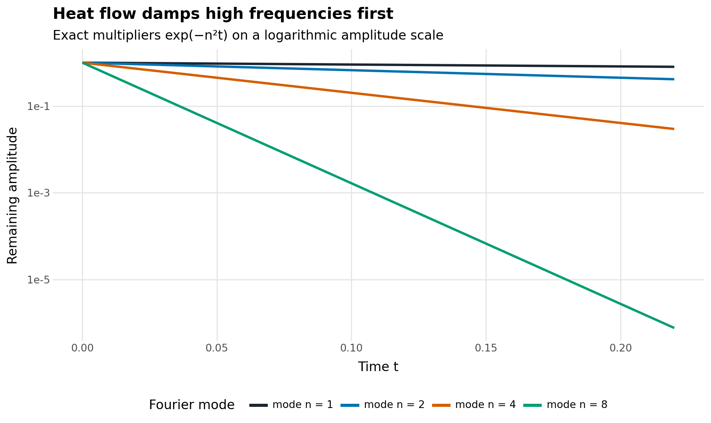

# Semigroups and Evolution Equations {#sec-semigroups}

An ordinary differential equation advances a finite list of numbers through
time. A heat or transport equation advances an entire function. Operator
semigroups provide the common language: the state at time $t$ is obtained by an
operator $T(t)$, and advancing by $s$ then $t$ must agree with advancing by
$s+t$.

We rebuild normed spaces, bounded operators, and derivatives of
function-valued curves as needed. Chapters [sec-banach-pillars](26-banach-pillars.md#sec-banach-pillars) and
[sec-analysis-pde](32-pde.md#sec-analysis-pde) give deeper foundations.

## States and bounded operators

A Banach space $X$ is a vector space with a norm $\|\cdot\|$ in which every
Cauchy sequence converges. Examples are $\mathbb R^n$, the space
$C([0,1])$ with the supremum norm, and $L^2(0,1)$.

A linear map $T:X\to X$ is bounded when

$$
\|Tx\|\le M\|x\|
$$

for some $M$ and every $x$. Its operator norm is the smallest such $M$.
Boundedness is equivalent to continuity.

A **strongly continuous semigroup**, or $C_0$-semigroup, is a family of bounded
operators $T(t)$ for $t\ge0$ such that

$$
T(0)=I,\qquad T(t+s)=T(t)T(s),
$$

and

$$
\lim_{t\downarrow0}\|T(t)x-x\|=0
\quad\text{for every }x\in X.
$$

The last convergence is pointwise in $x$, not necessarily convergence in
operator norm.

For a matrix $A$,

$$
T(t)=e^{tA}=\sum_{n=0}^\infty\frac{t^nA^n}{n!}
$$

is a semigroup. It solves $u'(t)=Au(t)$ with $u(0)=u_0$ by
$u(t)=T(t)u_0$.

## Three foundational examples

**Translation.** On $L^p(\mathbb R)$,

$$
(T(t)f)(x)=f(x+t).
$$

Translation invariance gives $\|T(t)f\|_p=\|f\|_p$, and density of smooth
compactly supported functions proves strong continuity. On
$L^\infty(\mathbb R)$ it is generally not strongly continuous.

**Multiplication.** If $a$ is a bounded measurable function with $a\le0$, then

$$
(T(t)f)(x)=e^{ta(x)}f(x)
$$

is a contraction semigroup.

**Heat flow.** On $L^2(\mathbb R^d)$,

$$
(T(t)f)(x)
=(4\pi t)^{-d/2}
\int_{\mathbb R^d}e^{-|x-y|^2/(4t)}f(y)\,dy
$$

for $t>0$. Gaussian convolution preserves total mass, contracts $L^p$ norms,
and smooths immediately.

## The generator and its domain

The **generator** $A$ of $T(t)$ is

$$
Ax=\lim_{t\downarrow0}\frac{T(t)x-x}{t},
$$

defined only for those $x$ for which the norm limit exists. This set
$D(A)$ is the generator's domain.

For translation on $L^p$, the formal generator is differentiation:
$Af=f'$. Not every $L^p$ function has an $L^p$ derivative, so $D(A)$ is a
Sobolev space rather than all of $L^p$. For the heat semigroup the generator is
the Laplacian, again with a proper domain.

Unboundedness is expected. If differentiation were bounded on $L^2(0,2\pi)$,
the functions $\sin(nx)$ would satisfy

$$
\|n\cos(nx)\|_2\le M\|\sin(nx)\|_2
$$

with one $M$, impossible as $n\to\infty$.

A generator is closed and densely defined. Writing $u'=Au$ without declaring
$D(A)$ suppresses the most important analytic issue.

## Resolvents and generation

For a complex number $\lambda$, the **resolvent** is

$$
R(\lambda,A)=(\lambda I-A)^{-1}
$$

when the inverse exists as a bounded operator on all of $X$. If
$\|T(t)\|\le Me^{\omega t}$ and $\lambda>\omega$, then formally—and under the
theorem's hypotheses—

$$
R(\lambda,A)x
=\int_0^\infty e^{-\lambda t}T(t)x\,dt.
$$

The Laplace transform converts time evolution into an operator equation.

The Hille–Yosida theorem characterises generators through resolvent estimates.
In the contraction case on a Banach space, a densely defined closed $A$
generates a contraction semigroup precisely when every positive
$\lambda$ belongs to the resolvent set and

$$
\|R(\lambda,A)\|\le\frac1\lambda.
$$

The full theorem includes powers of the resolvent in the general growth-bound
case.

On a Hilbert space, $A$ is **dissipative** when

$$
\operatorname{Re}\langle Ax,x\rangle\le0.
$$

The Lumer–Phillips theorem says a densely defined dissipative operator
generates a contraction semigroup when $\lambda I-A$ is onto for some
$\lambda>0$. Energy decay and a range condition replace an explicit formula.

## Classical, strong, and mild solutions

For

$$
u'(t)=Au(t)+f(t),\qquad u(0)=u_0,
$$

a classical solution remains in $D(A)$ and is differentiable in $X$. A mild
solution satisfies the variation-of-constants formula

$$
u(t)=T(t)u_0+\int_0^tT(t-s)f(s)\,ds.
$$

The integral is a Banach-valued integral. It can exist even when $u(t)$ is not
in $D(A)$ at $t=0$. Additional regularity of $u_0$, $f$, and the semigroup can
upgrade a mild solution.

Uniqueness follows directly: the difference of two mild solutions with the
same data is zero. Continuous dependence follows from

$$
\|u(t)-v(t)\|
\le Me^{\omega t}\|u_0-v_0\|
+\int_0^tMe^{\omega(t-s)}\|f(s)-g(s)\|\,ds.
$$

## Heat decay and smoothing

On $(0,\pi)$ with zero boundary values, expand

$$
u_0(x)=\sum_{n=1}^\infty a_n\sin(nx).
$$

The heat solution is

$$
u(t,x)=\sum_{n=1}^\infty
a_ne^{-n^2t}\sin(nx).
$$

Every mode decays, and high frequencies decay fastest. For $t>0$, powers of
$n$ introduced by differentiation are dominated by $e^{-n^2t}$, producing
smoothness even from rough $L^2$ data.

<figure id="fig-semigroup-decay">


<figcaption>

Figure 35.1: Higher spatial frequencies decay more rapidly under the heat semigroup.

</figcaption>
</figure>

[Figure 35.1](#fig-semigroup-decay) is an exact plot of finitely many multipliers
$e^{-n^2t}$. Infinite-series convergence and smoothing require the estimates
above, not visual extrapolation.

Backward heat evolution multiplies mode $n$ by $e^{n^2t}$, so arbitrarily small
high-frequency measurement noise explodes. It is ill posed even though each
finite truncation can be inverted.

## Approximation formulas

The implicit Euler step for $u'=Au$ is

$$
u_{k+1}=(I-hA)^{-1}u_k.
$$

Under generator hypotheses,

$$
T(t)x
=\lim_{n\to\infty}
\left(I-\frac tn A\right)^{-n}x.
$$

This exponential formula constructs continuous evolution from resolvent steps.

If $A$ and $B$ separately generate semigroups, the Lie–Trotter product formula
suggests

$$
e^{t(A+B)}x
=\lim_{n\to\infty}
\left(e^{tA/n}e^{tB/n}\right)^nx.
$$

For unbounded operators this needs domain, stability, and closure hypotheses.
Formal matrix algebra is insufficient.

The Crandall–Liggett theorem extends implicit resolvent stepping to nonlinear
accretive operators. It underlies nonlinear diffusion and conservation-law
evolution. We state it as a vista: maximal accretivity supplies existence and
contraction for the generated nonlinear semigroup.

## A theorem audit

<div class="callout callout-warning">
<p class="callout-title">A family with the semigroup law may still fail</p>

The law $T(t+s)=T(t)T(s)$ does not imply strong continuity. Nor does a formal
differential expression determine its generator: boundary conditions change
the domain, spectrum, and evolution.

</div>

For any claimed evolution, check:

1. the Banach space and norm;
2. boundedness of each $T(t)$;
3. strong continuity at zero;
4. the generator domain and boundary conditions;
5. the solution notion;
6. growth or contraction estimates;
7. whether an approximation converges uniformly on the claimed time interval.

## Evolution calculation and solution laboratory

This laboratory turns the abstract definitions into computations that can be
checked line by line. The recurring question is not merely whether a formula
looks like an evolution, but whether it has the continuity, domain, and stability
properties required of a semigroup on the stated space.

### Repair kit: strong continuity is pointwise in the vector

The statement $T(t)x\to x$ as $t\downarrow0$ is made **after** a particular
$x$ has been fixed. It does not say

$$
\|T(t)-I\|_{\mathcal L(X)}\longrightarrow0.
$$

Translations make the distinction concrete. On $L^p(\mathbb R)$, $1\le p<\infty$,
let $(T(t)f)(x)=f(x+t)$ and take $f=1_{[0,1]}$. For $0<t<1$, the supports of
$f$ and $T(t)f=1_{[-t,1-t]}$ differ on two intervals of total length $2t$.
Therefore

$$
\|T(t)f-f\|_p^p=2t,
\qquad
\|T(t)f-f\|_p=(2t)^{1/p}\longrightarrow0.
$$

Step functions are dense in $L^p$, translations preserve the norm, and this
calculation extends by approximation to every fixed $f\in L^p$. Thus the
translation semigroup is strongly continuous. In $L^\infty$, however, the same
example gives

$$
\|T(t)f-f\|_\infty=1
$$

for every $0<t<1$. Strong continuity fails there. Even on $L^2$ of the circle,
where translations are strongly continuous, they are not continuous in operator
norm: on the Fourier mode $e_n(x)=e^{inx}$,

$$
\|(T(t)-I)e_n\|_2=|e^{int}-1|\,\|e_n\|_2,
$$

and for each small nonzero $t$ one can choose a high frequency for which this
factor stays far from zero. A picture of translated indicator functions should
therefore be read vertically as well as horizontally: the moving slivers shrink
for a fixed function in $L^p$, but the class of all unit vectors still contains
finer oscillations that can detect the shift.

### Generator and resolvent in one dimension

Consider $X=\mathbb R$ and $T(t)x=e^{-3t}x$. The semigroup law follows from
$e^{-3(t+s)}=e^{-3t}e^{-3s}$, and

$$
\frac{T(h)x-x}{h}
=\frac{e^{-3h}-1}{h}x\longrightarrow-3x.
$$

Hence $D(A)=\mathbb R$ and $Ax=-3x$. For $\lambda>-3$,

$$
(\lambda I-A)^{-1}x=\frac{x}{\lambda+3}.
$$

Now verify the Laplace formula rather than merely quoting it:

$$
\int_0^\infty e^{-\lambda t}T(t)x\,dt
=x\int_0^\infty e^{-(\lambda+3)t}\,dt
=\frac{x}{\lambda+3}.
$$

The convergence condition $\lambda+3>0$ matters. It is the scalar form of the
general rule that the Laplace parameter must lie to the right of the semigroup's
growth bound. The resolvent is thus a time-averaged evolution, with large
$\lambda$ putting most weight near time zero.

### Duhamel's formula derived, not guessed

Suppose first that $A$ is bounded and that a differentiable $u$ solves
$u'(s)=Au(s)+f(s)$. Fix $t$ and introduce the deliberately mixed quantity

$$
v(s)=T(t-s)u(s),\qquad 0\le s\le t.
$$

The product rule and $\frac{d}{ds}T(t-s)=-AT(t-s)$ give

$$
\begin{aligned}
v'(s)
&=-AT(t-s)u(s)+T(t-s)u'(s)\\
&=-AT(t-s)u(s)+T(t-s)[Au(s)+f(s)]\\
&=T(t-s)f(s).
\end{aligned}
$$

Integrating from $0$ to $t$ yields

$$
u(t)-T(t)u(0)=\int_0^tT(t-s)f(s)\,ds,
$$

or

$$
u(t)=T(t)u_0+\int_0^tT(t-s)f(s)\,ds.
$$

For an unbounded generator, the formal cancellation is justified first for
vectors in the generator domain and sufficiently regular forcing. The right-hand
side then becomes the *definition* of a mild solution for rougher data. This is
why the formula is useful: it still makes sense when $u'(t)$ or $Au(t)$ does not
exist separately.

As a check, take $A=-3$ and constant forcing $f(s)=6$. Then

$$
u(t)=e^{-3t}u_0+6\int_0^t e^{-3(t-s)}\,ds
=2+(u_0-2)e^{-3t}.
$$

Differentiation gives $u'=-3u+6$, and substitution at $t=0$ gives $u(0)=u_0$.
Both parts of the problem have been verified.

The closed form and the variation-of-constants integral can be evaluated
independently. A finite trapezoidal rule exposes the approximation error instead
of silently identifying quadrature with the Banach-valued theorem.

```python
from math import exp

def forced_scalar_solution(
    initial: float, time: float, panels: int
) -> tuple[float, float]:
    """Compare exact Duhamel evolution with finite trapezoidal quadrature."""
    if time < 0.0:
        raise ValueError("time must be nonnegative")
    if panels <= 0:
        raise ValueError("panels must be positive")
    step = time / panels
    samples = [6.0 * exp(-3.0 * (time - index * step)) for index in range(panels + 1)]
    integral = step * (0.5 * samples[0] + sum(samples[1:-1]) + 0.5 * samples[-1])
    quadrature = exp(-3.0 * time) * initial + integral
    exact = 2.0 + (initial - 2.0) * exp(-3.0 * time)
    return quadrature, exact

for panel_count in (8, 32, 128):
    print(panel_count, forced_scalar_solution(initial=5.0, time=1.0, panels=panel_count))
```

The two numbers converge as the panel count grows. This checks one scalar
forcing formula; existence of a Banach-valued integral and regularity of a mild
solution need the hypotheses stated in the chapter.

### Heat energy and spectral decay

Let $u_t=u_{xx}$ on $(0,\pi)$ with $u(t,0)=u(t,\pi)=0$. For a smooth solution,
multiply by $u$ and integrate:

$$
\frac{d}{dt}\frac12\|u(t)\|_2^2
=\int_0^\pi u u_t\,dx
=\int_0^\pi u u_{xx}\,dx.
$$

Integration by parts produces

$$
\int_0^\pi u u_{xx}\,dx
=[u u_x]_0^\pi-\int_0^\pi|u_x|^2\,dx
=-\|u_x\|_2^2.
$$

The boundary term vanishes specifically because of the Dirichlet conditions.
The Poincaré inequality on $(0,\pi)$ says
$\|u\|_2^2\le\|u_x\|_2^2$, so

$$
\frac{d}{dt}\|u(t)\|_2^2\le-2\|u(t)\|_2^2,
\qquad
\|u(t)\|_2\le e^{-t}\|u(0)\|_2.
$$

This global estimate agrees with the mode picture. If
$u(0,x)=\sin x+\sin(5x)$, then

$$
u(t,x)=e^{-t}\sin x+e^{-25t}\sin(5x).
$$

The fifth mode is at most one thousandth of its initial amplitude when

$$
e^{-25t}\le10^{-3}
\quad\Longleftrightarrow\quad
t\ge\frac{3\log 10}{25}\approx0.2763.
$$

In a time-versus-frequency visual, each mode is a line of slope $-n^2$ on a
log-amplitude scale. The steep high-frequency lines explain both forward
smoothing and backward instability: reversing time multiplies the $n$th mode by
$e^{n^2t}$.

### Resolvent stepping and its exact scalar benchmark

For $u'=-3u$, implicit Euler with step $h$ reads

$$
\frac{u_{k+1}-u_k}{h}=-3u_{k+1},
\qquad
u_{k+1}=\frac{u_k}{1+3h}.
$$

After $n$ steps of size $h=t/n$,

$$
u_n=\left(1+\frac{3t}{n}\right)^{-n}u_0
\longrightarrow e^{-3t}u_0.
$$

Every multiplier lies between zero and one, whatever positive step size is
used. This unconditional decay is the elementary model for resolvent stability.
By contrast, explicit Euler uses $1-3h$; it changes sign when $h>1/3$ and has
absolute value greater than one when $h>2/3$. Convergence as $h\to0$ and
stability for a chosen finite step are separate questions.

The two stepping rules make that distinction directly visible:

```python
from math import exp

def scalar_euler(
    initial: float, time: float, steps: int, *, implicit: bool
) -> float:
    """Advance u' = -3u with a declared number of Euler steps."""
    if time < 0.0:
        raise ValueError("time must be nonnegative")
    if steps <= 0:
        raise ValueError("steps must be positive")
    step = time / steps
    multiplier = 1.0 / (1.0 + 3.0 * step) if implicit else 1.0 - 3.0 * step
    return initial * multiplier**steps

for count in (1, 2, 8, 64):
    explicit = scalar_euler(1.0, 1.0, count, implicit=False)
    implicit = scalar_euler(1.0, 1.0, count, implicit=True)
    print(count, explicit, implicit, exp(-3.0))
```

With one step, explicit Euler has multiplier $-2$ and is unstable, whereas the
implicit value still decays. Both methods approach the exact multiplier as the
time step tends to zero; a finite scalar table does not prove a resolvent product
formula for an unbounded generator.

### Translation generators and boundary conditions

For a smooth compactly supported $f$ on $\mathbb R$, the generator of
$T(t)f(x)=f(x+t)$ can be verified in the norm, not just pointwise. The
fundamental theorem of calculus gives

$$
\frac{f(x+h)-f(x)}{h}
=\int_0^1f'(x+\theta h)\,d\theta.
$$

For $1\le p<\infty$, Minkowski's integral inequality then yields

$$
\left\|\frac{T(h)f-f}{h}-f'\right\|_p
\le\int_0^1\|T(\theta h)f'-f'\|_p\,d\theta.
$$

Translation continuity applied to the fixed function $f'$ makes the right side
tend to zero. Thus $Af=f'$ for these test functions. The full generator domain
is the Sobolev space $W^{1,p}(\mathbb R)$: membership means that the weak
derivative belongs to $L^p$. The domain is not an optional technicality; most
$L^p$ functions do not have such a derivative.

On a bounded interval, the same formula creates different generators when the
boundary rule changes. Define absorbing translation on $L^p(0,1)$ by

$$
(T_{\mathrm{abs}}(t)f)(x)=
\begin{cases}
f(x+t),&x+t\le1,\\
0,&x+t>1.
\end{cases}
$$

Its generator is $f'$ on the domain

$$
D(A_{\mathrm{abs}})=\{f\in W^{1,p}(0,1):f(1)=0\}.
$$

The boundary value at the right inflow endpoint is forced because a strip is
replaced by zero. For periodic translation, values re-enter at $1$ after leaving at
$0$, and the generator is still $f'$ but now

$$
D(A_{\mathrm{per}})=\{f\in W^{1,p}(0,1):f(0)=f(1)\}.
$$

One differential expression has produced two evolutions, spectra, and
resolvents. Stating “the generator is the derivative” without the domain loses
the part that records the boundary physics.

### An unbounded multiplication generator

On $X=L^2(0,\infty)$, define

$$
(T(t)f)(x)=e^{-tx}f(x).
$$

Each multiplier has absolute value at most one, so $T(t)$ is a contraction.
The semigroup law is immediate, and dominated convergence gives
$\|T(t)f-f\|_2\to0$ for every fixed $f$. Formally differentiating suggests
$Af=-xf$. The precise domain is

$$
D(A)=\{f\in L^2(0,\infty):xf(x)\in L^2(0,\infty)\}.
$$

For $f$ in this domain,

$$
\frac{e^{-hx}-1}{h}f(x)\longrightarrow-xf(x)
$$

pointwise, while $|(e^{-hx}-1)/h|\le x$ supplies the square-integrable
dominating function $x|f(x)|$. Hence convergence holds in $L^2$. The function
$f(x)=(1+x)^{-1}$ belongs to $L^2(0,\infty)$, but $xf(x)$ does not; the
semigroup acts on it for every $t\ge0$, although it is not differentiable at
time zero in the $L^2$ norm.

For $\lambda>0$, solving $(\lambda I-A)u=f$ pointwise gives

$$
[(\lambda I-A)^{-1}f](x)=\frac{f(x)}{\lambda+x}.
$$

The multiplier is bounded by $1/\lambda$, so the resolvent is bounded on all of
$L^2$ even though $A$ is not. Direct Laplace integration confirms the same
formula:

$$
\int_0^\infty e^{-\lambda t}e^{-tx}f(x)\,dt
=\frac{f(x)}{\lambda+x}.
$$

This is a useful model for the general pattern: the generator differentiates
only a proper domain, while its resolvent often acts boundedly everywhere.

The Yosida approximation makes this smoothing algebraic. Define

$$
A_\lambda=\lambda A(\lambda I-A)^{-1}.
$$

Here $A_\lambda$ is multiplication by

$$
-\frac{\lambda x}{\lambda+x},
$$

whose magnitude is at most $\lambda$. Thus $A_\lambda$ is bounded. For
$f\in D(A)$, the multipliers converge pointwise to $-x$, and domination by
$x|f(x)|$ gives $A_\lambda f\to Af$ in $L^2$. The approximation clips very
large decay rates at size roughly $\lambda$, a visual explanation of why a
bounded surrogate can converge on the generator domain without converging in
operator norm to an unbounded operator.

On a declared grid, the multiplier bound and its convergence at each fixed
spectral value are literal array operations:

```python
import numpy as np

spectral_points = np.array([0.0, 0.5, 2.0, 10.0, 100.0])
for scale in (1.0, 10.0, 100.0):
    yosida = -scale * spectral_points / (scale + spectral_points)
    print(scale, float(np.max(np.abs(yosida))), yosida)
```

The maximum over this finite array is not the operator norm, although the
analytic multiplier bound proves $\|A_\lambda\|\le\lambda$. Nor can a bounded
array converge in operator norm to an unbounded operator; the valid statement
is strong convergence on $D(A)$.

### Mild need not mean classically differentiable

Take the harmless generator $A=0$ on $X=\mathbb R$ and an integrable forcing
$f(t)=1_{[0,1/2]}(t)$. Duhamel's formula gives

$$
u(t)=u_0+\int_0^tf(s)\,ds
=u_0+\min\{t,1/2\}.
$$

This is a valid mild solution and is absolutely continuous. It satisfies
$u'=f$ almost everywhere, but it is not differentiable at $t=1/2$. Therefore it
is not a classical solution if that term requires a derivative at every time.
Nothing pathological has happened: the solution has exactly the temporal
regularity allowed by the forcing. Any claim that a mild solution is classical
must supply a separate smoothing or data-regularity argument.

### From continuity at zero to a global growth bound

The zero-space case is immediate. Otherwise first prove local operator boundedness. If no such bound held near zero, choose $t_n\downarrow0$ with $\|T(t_n)\|>n$.
For each fixed $x$, strong continuity at zero bounds $T(t_n)x$; the uniform boundedness principle then contradicts the chosen operator norms. On any fixed finite time interval, split every time into the same finite number of sufficiently short equal steps; the semigroup law bounds all operators by a fixed power of the local bound. Now for $h>0$,

$$
T(t+h)x-T(t)x=T(t)[T(h)x-x],
$$

so the norm tends to zero as $h\downarrow0$. Approaching from the left, with
$0<h<t$,

$$
T(t)x-T(t-h)x=T(t-h)[T(h)x-x].
$$

The second factor tends to zero, while the finite-interval operator bound controls
$T(t-h)$. Thus strong continuity at zero propagates to every later time.
See [Chill, Lemmas 8.1–8.2](https://tu-dresden.de/mn/math/analysis/chill/ressourcen/dateien/skripte/FunctionalAnalysisChill.pdf).

For each fixed $x$, the continuous orbit $t\mapsto T(t)x$ is bounded on the
compact interval $[0,1]$. Thus the family
$\{T(t):0\le t\le1\}$ is pointwise bounded. The uniform boundedness principle
upgrades this to an operator bound

$$
M=\sup_{0\le t\le1}\|T(t)\|<\infty.
$$

Because $T(0)=I$, we may take $M\ge1$. Write any $t\ge0$ as $t=n+r$ with
$n$ a nonnegative integer and $0\le r<1$. The semigroup law gives

$$
\|T(t)\|
=\|T(1)^nT(r)\|
\le M^{n+1}
\le M e^{(\log M)t}.
$$

Consequently every strongly continuous semigroup has some exponential growth
bound, even if it is not a contraction. This bound is structural, not an extra
guess added to make the Laplace transform work.

The semigroup law alone does not supply the argument. On any nonzero Banach
space, define $T(0)=I$ and $T(t)=0$ for every $t>0$. The law
$T(t+s)=T(t)T(s)$ holds in all cases, but $T(t)x$ jumps from $x$ to zero at time
zero for every $x\ne0$. This one-line counterexample identifies strong
continuity as an independent hypothesis.

### Theorem-hypothesis audit and exercise clinic

Before invoking a generation or approximation theorem, perform these checks.

- A generator must be densely defined and closed in the standard
  Hille–Yosida setting; a differential formula without its boundary conditions
  is not an operator.
- Resolvent bounds must hold on the required half-line, not at one convenient
  value of $\lambda$.
- A mild solution need not be differentiable. Calling it classical requires
  extra domain and regularity information.
- A product formula for unbounded $A$ and $B$ needs stability and a suitable
  closure of $A+B$; matrix intuition alone supplies no proof.

Exercises 2–5 can now be checked in a short chain. Translation satisfies
$T(t)T(s)f(x)=f(x+t+s)=T(t+s)f(x)$. The indicator calculation above gives both
the $L^p$ continuity and the $L^\infty$ counterexample. For the scalar semigroup,
the difference quotient gives $A=-3I$, and direct integration gives the
resolvent $(\lambda+3)^{-1}I$.

For Exercise 6, the energy calculation proves contraction even before Poincaré
is used: $\frac{d}{dt}\|u\|_2^2=-2\|u_x\|_2^2\le0$. Exercise 7 is the logarithmic
calculation displayed above, and Exercise 8 is the resolvent product limit.
Finally, Exercise 9 has a decisive answer. A finite-mode backward computation
only inverts finitely many numbers. On all of $L^2$, arbitrarily small
high-frequency perturbations are multiplied by arbitrarily large factors
$e^{n^2t}$, so no bounded backward solution operator exists. A successful
truncated plot cannot repair that missing continuity estimate.

## Related results {#fifth-edition-handoff}

The generator in this chapter becomes self-adjoint spectral data in
[sec-unbounded-spectral](44-unbounded-spectral.md#sec-unbounded-spectral), where $e^{itA}$ and $e^{-tA}$ are constructed by
functional calculus. Brownian transition kernels in [sec-stochastic-processes](42-stochastic-processes.md#sec-stochastic-processes)
give a probabilistic realization of heat-style evolution.

<!-- inline-formula-code:start -->
## Formula and finite computation

A useful formula in this chapter is

$$
T(t+s)=T(t)T(s)
$$

Scalar exponential evolution checks the semigroup law on selected times. The following standalone Python block expresses that finite rule with its inputs and stopping conditions visible.

```python
from math import exp

rate, first, second = -0.7, 0.4, 1.2
left = exp(rate * (first + second))
right = exp(rate * first) * exp(rate * second)
print(left, right, left - right)
```

**What the computation establishes.** The output certifies only the declared finite case. The theorem, if one is claimed, still requires the argument developed in the chapter.
<!-- inline-formula-code:end -->

## Summary, exercises, and support

Semigroups encode autonomous time evolution. Their generally unbounded
generators differentiate or diffuse only on proper domains. Resolvents and
dissipativity characterise generation; mild solutions handle rough data;
product and resolvent formulas support stable approximation.

<div class="exercise" id="real_analysis-35-semigroups-ex-1">
<p class="exercise-title"><strong>Exercise 1</strong></p>

Prove $e^{tA}e^{sA}=e^{(t+s)A}$ for one matrix $A$.

</div>

<div class="exercise" id="real_analysis-35-semigroups-ex-2">
<p class="exercise-title"><strong>Exercise 2</strong></p>

Verify the semigroup law for translations.

</div>

<div class="exercise" id="real_analysis-35-semigroups-ex-3">
<p class="exercise-title"><strong>Exercise 3</strong></p>

Give a bounded discontinuous $f$ showing translation is not strongly
continuous in the supremum norm.

</div>

<div class="exercise" id="real_analysis-35-semigroups-ex-4">
<p class="exercise-title"><strong>Exercise 4</strong></p>

Compute the generator of $T(t)x=e^{-3t}x$ on $\mathbb R$.

</div>

<div class="exercise" id="real_analysis-35-semigroups-ex-5">
<p class="exercise-title"><strong>Exercise 5</strong></p>

Derive the Laplace-resolvent formula for that scalar example.

</div>

<div class="exercise" id="real_analysis-35-semigroups-ex-6">
<p class="exercise-title"><strong>Exercise 6</strong></p>

Prove energy contraction for the Dirichlet heat equation.

<details class="hint"><summary>Hint 1</summary>

Pair the heat equation with the solution, integrate by parts using the
Dirichlet trace, and keep the sign of the gradient term visible.

</details>

</div>

<div class="exercise" id="real_analysis-35-semigroups-ex-7">
<p class="exercise-title"><strong>Exercise 7</strong></p>

For initial data $\sin x+\sin(5x)$, find the time when the amplitude of the
fifth mode is at most one thousandth of its initial amplitude.

</div>

<div class="exercise" id="real_analysis-35-semigroups-ex-8">
<p class="exercise-title"><strong>Exercise 8</strong></p>

Derive implicit Euler for a negative scalar generator and compare it with
exact decay.

</div>

<div class="exercise" id="real_analysis-35-semigroups-ex-9">
<p class="exercise-title"><strong>Exercise 9</strong></p>

Explain why reversing a finite-mode heat simulation does not establish
well-posed backward evolution on $L^2$.

</div>

For Exercise 4 the generator is multiplication by $-3$. In Exercise 7 solve
$e^{-25t}\le10^{-3}$. In Exercise 8, one step multiplies by
$(1+3h)^{-1}$.
