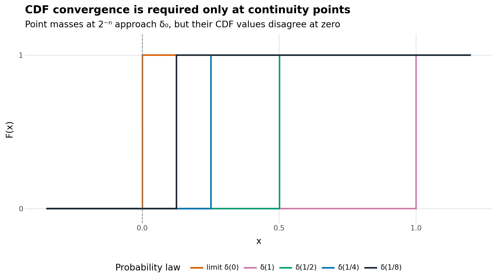

# Weak Convergence of Probability Measures {#sec-weak-probability}

When random variables fluctuate, ordinary pointwise convergence is often the
wrong question. Their distributions may settle even when outcomes never do.
Weak convergence makes “the laws become close” precise by asking whether every
bounded continuous observable has nearly the same average.

This chapter begins with finite probability and distribution functions. No
measure-theory course is assumed, although Chapters [sec-product-probability](22-product-measures-probability.md#sec-product-probability)
and [sec-martingales](30-martingales.md#sec-martingales) provide a longer route.

## Probability repair kit

A probability space consists of outcomes $\Omega$, a sigma-algebra
$\mathcal F$ of events, and a countably additive measure
$\mathbb P$ with $\mathbb P(\Omega)=1$. A real random variable
$X:\Omega\to\mathbb R$ is measurable. Its **law** is the probability measure

$$
\mu_X(B)=\mathbb P(X\in B)
$$

on Borel subsets of $\mathbb R$. Its distribution function is

$$
F_X(x)=\mathbb P(X\le x).
$$

The law forgets which outcome produced a value but retains every probability
that depends only on $X$.

If $g$ is measurable and integrable, the change-of-variables identity is

$$
\mathbb E[g(X)]=\int_{\mathbb R}g\,d\mu_X.
$$

This identity lets us discuss convergence of laws without placing all random
variables on the same outcome space.

## Four convergence modes

For random variables $X_n,X$ on one probability space:

- $X_n\to X$ **almost surely** if
  $\mathbb P(\{\omega:X_n(\omega)\to X(\omega)\})=1$;
- $X_n\to X$ **in probability** if for every $\varepsilon>0$,

  $$
  \mathbb P(|X_n-X|>\varepsilon)\to0;
  $$

- $X_n\to X$ in $L^p$ if
  $\mathbb E|X_n-X|^p\to0$;
- $X_n\Rightarrow X$ **in distribution** if their laws converge weakly.

Almost sure convergence implies convergence in probability; convergence in
probability implies convergence in distribution. $L^p$ convergence implies
convergence in probability by Markov's inequality. Reverse implications fail
without extra hypotheses.

**Counterexample.** Let $X_n$ alternate between two independent variables with
the same standard normal law. Then every $X_n$ has exactly the law of $X_1$, so
$X_n\Rightarrow X_1$, but the sequence need not converge in probability.
Distribution sees marginals, not coupling.

## Weak convergence and Portmanteau

Probability measures $\mu_n$ on a metric space $S$ converge weakly to $\mu$,
written $\mu_n\Rightarrow\mu$, if

$$
\int_S f\,d\mu_n\longrightarrow\int_S f\,d\mu
$$

for every bounded continuous $f:S\to\mathbb R$.

The Portmanteau theorem gives equivalent tests:

$$
\liminf_n\mu_n(G)\ge\mu(G)
\quad\text{for every open }G,
$$

and

$$
\limsup_n\mu_n(F)\le\mu(F)
\quad\text{for every closed }F.
$$

It also gives convergence $\mu_n(A)\to\mu(A)$ for every **continuity set**
$A$, meaning $\mu(\partial A)=0$.

Why not every Borel set? Take $\mu_n=\delta_{1/n}$ and $\mu=\delta_0$.
Then $\mu_n\Rightarrow\mu$, but for $A=\{0\}$,
$\mu_n(A)=0$ while $\mu(A)=1$. The boundary of $A$ contains the limit mass.

On $\mathbb R$, weak convergence is equivalent to

$$
F_n(x)\longrightarrow F(x)
$$

at every continuity point of $F$. Jumps are deliberately excluded.

<figure id="fig-weak-convergence-cdfs">


<figcaption>

Figure 36.1: Distribution functions may converge at every continuity point while disagreeing at a jump.

</figcaption>
</figure>

[Figure 36.1](#fig-weak-convergence-cdfs) depicts $\delta_{2^{-n}}\Rightarrow\delta_0$.
It makes the continuity-point qualifier visible.

## Tightness and subsequences

A family $\mathcal M$ of probability measures on $S$ is **tight** if for every
$\varepsilon>0$ there is compact $K\subseteq S$ such that

$$
\sup_{\mu\in\mathcal M}\mu(S\setminus K)<\varepsilon.
$$

On $\mathbb R$, a uniform moment bound creates tightness. If
$\sup_n\mathbb E|X_n|^p\le C$, then Markov gives

$$
\mathbb P(|X_n|>R)\le\frac C{R^p}.
$$

Choose $R$ large, and $[-R,R]$ captures nearly all mass uniformly.

**Theorem 36.1 (Prokhorov's).** On a Polish space—a complete separable metric
space—a family of probability measures is relatively compact for weak
convergence exactly when it is tight. Thus every sequence in a tight family has
a weakly convergent subsequence.

The limit still has to be identified. Compactness supplies candidates; a
characteristic function, moment problem, or equation usually proves uniqueness.

## Characteristic functions

The characteristic function of a real random variable is

$$
\varphi_X(t)=\mathbb E[e^{itX}].
$$

It always exists because $|e^{itX}|=1$. It determines the law. Independence
turns sums into products:

$$
\varphi_{X+Y}(t)=\varphi_X(t)\varphi_Y(t)
$$

when $X$ and $Y$ are independent.

Lévy's continuity theorem says:

1. if $X_n\Rightarrow X$, then
   $\varphi_{X_n}(t)\to\varphi_X(t)$ for every $t$;
2. if characteristic functions converge pointwise to a function continuous at
   zero, then that function is a characteristic function and the laws converge
   weakly.

Continuity at zero prevents mass from escaping. For a point mass drifting to
infinity, the oscillating characteristic functions do not converge to a
continuous-at-zero characteristic function.

## Central limit architecture

Let $Y_1,Y_2,\ldots$ be independent identically distributed variables with
mean $m$ and variance $\sigma^2\in(0,\infty)$. Set

$$
Z_n=\frac{Y_1+\cdots+Y_n-nm}{\sigma\sqrt n}.
$$

For the centred standardised variable $W=(Y_1-m)/\sigma$, a second-order
expansion at zero gives

$$
\varphi_W(t)=1-\frac{t^2}{2}+o(t^2).
$$

Independence yields

$$
\varphi_{Z_n}(t)
=\left[\varphi_W(t/\sqrt n)\right]^n
\longrightarrow e^{-t^2/2},
$$

the characteristic function of the standard normal law. Lévy's theorem then
gives $Z_n\Rightarrow N(0,1)$.

This proof needs finite variance and identical distribution as stated.
Triangular arrays use Lindeberg or Lyapunov conditions to prevent one summand
from dominating. Heavy-tailed variables may converge under a different
normalisation to stable non-Gaussian laws.

## Mapping and coupling

The continuous mapping theorem says that if $X_n\Rightarrow X$ and
$g$ is continuous at $X$ with probability one, then

$$
g(X_n)\Rightarrow g(X).
$$

Slutsky's theorem combines weak convergence with convergence in probability:
if $X_n\Rightarrow X$ and $Y_n\to c$ in probability, then
$X_n+Y_n\Rightarrow X+c$ and $X_nY_n\Rightarrow cX$.

Skorokhod's representation theorem says that for weakly convergent measures on
a Polish space, one can construct new random variables with those laws that
converge almost surely. It changes the coupling; it does not prove that the
original variables converge almost surely.

Coupling is a design tool. The Wasserstein distance minimises expected transport
cost over all joint distributions with prescribed marginals. Weak convergence
plus suitable moment control can be expressed through Wasserstein convergence.

## Empirical measures

Given observations $X_1,\ldots,X_n$, the empirical measure is

$$
\mu_n=\frac1n\sum_{k=1}^n\delta_{X_k},
$$

and the empirical distribution function is

$$
F_n(x)=\frac1n\sum_{k=1}^n1_{\{X_k\le x\}}.
$$

For independent identically distributed data with CDF $F$, the
Glivenko–Cantelli theorem says

$$
\sup_x|F_n(x)-F(x)|\longrightarrow0
$$

almost surely. This is stronger than pointwise weak convergence.

Histograms add a bin-width choice; empirical CDFs do not. Simulations can show
finite-sample behaviour but cannot replace the independence assumptions or the
limit proof.

<div class="callout callout-warning">
<p class="callout-title">Moments need not determine weak limits</p>

Weak convergence alone does not imply convergence of unbounded moments.
For example, a vanishing amount of mass can move far away and preserve weak
convergence while making second moments diverge. Uniform integrability or
explicit moment bounds repair the inference.

</div>

## Weak-convergence proof and counterexample laboratory

Limit statements in probability are unusually sensitive to exactly what is
being compared. This laboratory separates laws from couplings, bounded tests
from unbounded moments, and continuity points from jump points. Each example is
small enough to recompute without hidden machinery.

### Repair kit: a law is not a coupling

A random variable is a measurable function on a probability space; its law is
only the probability measure it induces on the target space. Weak convergence
uses the laws. Convergence in probability and almost-sure convergence compare
random variables on a common probability space and therefore use the coupling.

For a concrete separation, let $0<p<1$ and let $X_1,X_2,\ldots$ be independent
Bernoulli$(p)$ random variables. Every $X_n$ has exactly the same law, so the
sequence of laws is constant and hence converges weakly to the Bernoulli law.
For $n\ne m$, however,

$$
\mathbb P(|X_n-X_m|>1/2)
=\mathbb P(X_n\ne X_m)
=p(1-p)+(1-p)p
=2p(1-p).
$$

The right-hand side does not approach zero. Thus $(X_n)$ is not Cauchy in
probability and cannot converge in probability. If instead we couple all the
variables by setting $Y_n=X_1$, then the laws are unchanged but $Y_n\to X_1$
almost surely. The marginal distributions alone cannot distinguish these two
constructions. Skorokhod representation is powerful precisely because it
constructs a new, favourable coupling; it says nothing automatic about the
original one.

The independent mismatch probability is a two-line finite enumeration of the
outcomes `(1, 0)` and `(0, 1)`.  Keeping it beside the coupling argument makes
clear which quantity depends on the chosen joint law.

```python
from math import isfinite

def independent_bernoulli_mismatch(probability: float) -> float:
    """Return P(X != Y) for independent Bernoulli(p) variables."""
    if not isfinite(probability) or not 0.0 <= probability <= 1.0:
        raise ValueError("probability must be finite and lie in [0, 1]")
    return 2.0 * probability * (1.0 - probability)

for probability in (0.1, 0.5, 0.9):
    print(probability, independent_bernoulli_mismatch(probability))
```

For every interior probability the output is positive and independent of the
indices $m,n$, so this coupling is not Cauchy in probability.  The calculation
does not say that two Bernoulli variables with these marginals must be
independent; the shared-uniform coupling below proves otherwise.

Coupling can also be optimised explicitly. Let $U$ be uniform on $[0,1]$ and
define

$$
X=1_{\{U\le p\}},
\qquad
Y=1_{\{U\le q\}}.
$$

Then $X$ is Bernoulli$(p)$ and $Y$ is Bernoulli$(q)$, while they differ only
when $U$ lies between $p$ and $q$. Hence

$$
\mathbb E|X-Y|=\mathbb P(X\ne Y)=|p-q|.
$$

No coupling can do better, because

$$
\mathbb E|X-Y|\ge|\mathbb E(X-Y)|=|p-q|.
$$

Thus the shared-uniform construction attains the minimum transport cost for
the distance $|x-y|$. Independent coupling, by contrast, generally pays a
larger mismatch probability. A coupling is therefore a chosen joint model,
and a good choice can expose quantitative convergence hidden by the marginals
alone.

### Point masses and continuity sets, checked directly

Let $\mu_n=\delta_{1/n}$ and $\mu=\delta_0$. For any bounded continuous $f$,

$$
\int f\,d\mu_n=f(1/n)\longrightarrow f(0)=\int f\,d\mu.
$$

Therefore $\delta_{1/n}\Rightarrow\delta_0$. Setwise convergence does not hold
for every Borel set: with $A=\{0\}$, one has $\mu_n(A)=0$ for all $n$ but
$\mu(A)=1$. This does not contradict Portmanteau because $0$ lies on the
boundary of $A$ and $\mu(\partial A)=1$.

For a point mass at zero, a Borel set $A$ is a continuity set exactly when
$0\notin\partial A$. Indeed, $\delta_0(\partial A)$ is either zero or one. Thus
an interval with finite endpoints is a continuity set when neither endpoint is
zero. For the half-line $(-\infty,a]$, the only boundary point is $a$, so it is
a continuity set precisely when $a\ne0$. At $a=0$ the distribution functions
make the failure visible:

$$
F_n(0)=0,
\qquad
F(0)=1.
$$

At every continuity point $a\ne0$, $F_n(a)\to F(a)$. Graphically, the jump of
$F_n$ at $1/n$ slides toward the jump of $F$ at zero. Pointwise convergence is
expected away from the final jump location, not necessarily at it.

### Why distribution functions are tested only at continuity points

Let $F_n(x)=\mu_n(( -\infty,x])$ and suppose $\mu_n\Rightarrow\mu$. The set
$(-\infty,x]$ is closed, so Portmanteau gives

$$
\limsup_nF_n(x)\le F(x).
$$

The open set $(-\infty,x)$ gives

$$
\liminf_n\mu_n(( -\infty,x))
\ge\mu(( -\infty,x))=F(x-),
$$

where $F(x-)$ denotes the left limit. Since
$F_n(x)\ge\mu_n(( -\infty,x))$, we obtain

$$
F(x-)\le\liminf_nF_n(x)
\le\limsup_nF_n(x)\le F(x).
$$

At a continuity point, $F(x-)=F(x)$, and the squeeze proves
$F_n(x)\to F(x)$. At an atom, the gap

$$
F(x)-F(x-)=\mu(\{x\})
$$

leaves room for failure, exactly as in the moving-point-mass example.

For a fair die $X$, this visual is completely explicit:

$$
F_X(x)=
\begin{cases}
0,&x<1,\\
k/6,&k\le x<k+1,\quad k=1,\ldots,5,\\
1,&x\ge6.
\end{cases}
$$

Each jump has height $1/6$, recovering the mass of one face. More generally,
the CDF determines interval probabilities through

$$
\mu((a,b])=F(b)-F(a).
$$

These half-open intervals generate the Borel sets, so equality of CDFs implies
equality of laws. A CDF graph is therefore not merely descriptive: its plateau
differences encode all interval masses and its jump heights identify atoms.

### Tightness from a moment estimate

Suppose real-valued random variables satisfy

$$
\sup_n\mathbb E|X_n|^2\le M<\infty.
$$

For $R>0$, Markov's inequality applied to $|X_n|^2$ gives

$$
\mathbb P(|X_n|>R)
=\mathbb P(|X_n|^2>R^2)
\le\frac{\mathbb E|X_n|^2}{R^2}
\le\frac{M}{R^2}.
$$

Given $\varepsilon>0$, choose $R>\sqrt{M/\varepsilon}$. Then the compact set
$K=[-R,R]$ satisfies

$$
\inf_n\mathbb P(X_n\in K)\ge1-\varepsilon.
$$

This proves tightness. The calculation exposes the roles of the hypotheses:
the common bound makes one $R$ work for every $n$, and finite-dimensional
Euclidean space makes the closed bounded interval compact. In an infinite-
dimensional normed space, closed bounded balls need not be compact, so the same
moment estimate may not establish tightness.

### Escaping mass invisible to bounded tests

Weak convergence cannot by itself control an unbounded function such as
$x\mapsto|x|$. Define probability measures

$$
\mu_n=\left(1-\frac1n\right)\delta_0+\frac1n\delta_{n^2}.
$$

For bounded continuous $f$,

$$
\int f\,d\mu_n
=\left(1-\frac1n\right)f(0)+\frac1n f(n^2).
$$

The second term has absolute value at most $\|f\|_\infty/n$, while the first
tends to $f(0)$. Hence $\mu_n\Rightarrow\delta_0$. Yet

$$
\int |x|\,d\mu_n=n,
$$

so the first moments diverge instead of tending to zero. Only $1/n$ of the mass
escapes, which bounded tests cannot amplify, but its distance is $n^2$, which an
unbounded moment does amplify. Uniform integrability is the repair: it rules out
a persistent contribution from far tails.

There is also a useful distinction between finite and probability measures. The
finite measures $\nu_n=n^{-1}\delta_n$ converge weakly to the zero measure,
because $|\int f\,d\nu_n|\le\|f\|_\infty/n$, while their first moments equal
one. Probability measures cannot converge weakly to the zero measure: testing
with the bounded continuous function $f\equiv1$ would require $1\to0$.

### Characteristic functions and the CLT scaling

If $X$ is Bernoulli$(p)$, its characteristic function is obtained by summing
over its two values:

$$
\varphi_X(t)
=\mathbb E(e^{itX})
=(1-p)e^{it\cdot0}+pe^{it\cdot1}
=1-p+pe^{it}.
$$

If $X$ and $Y$ are independent, boundedness of the complex exponentials and
independence give

$$
\begin{aligned}
\varphi_{X+Y}(t)
&=\mathbb E(e^{itX}e^{itY})\\
&=\mathbb E(e^{itX})\,\mathbb E(e^{itY})
=\varphi_X(t)\varphi_Y(t).
\end{aligned}
$$

Induction yields a product for any finite independent sum. This is why
normalised sums are tractable.

To see the central-limit scaling, let $W$ have mean zero and variance one. The
second-order expansion at the origin is

$$
\varphi_W(h)=1-\frac{h^2}{2}+o(h^2).
$$

The missing linear term is the mean, and the quadratic coefficient is the
variance. For independent copies and
$S_n=(W_1+\cdots+W_n)/\sqrt n$,

$$
\varphi_{S_n}(t)
=\left[\varphi_W\left(\frac{t}{\sqrt n}\right)\right]^n.
$$

Using the continuous branch of the logarithm near $1$,

$$
\begin{aligned}
\log\varphi_{S_n}(t)
&=n\log\left(1-\frac{t^2}{2n}+o(n^{-1})\right)\\
&\longrightarrow-\frac{t^2}{2}.
\end{aligned}
$$

Exponentiation gives $e^{-t^2/2}$, the characteristic function of the standard
normal law. The proof still needs the theorem identifying characteristic-
function limits with weak limits, but the normalisation and limiting shape are
now accounted for rather than appearing by magic.

### The implication ladder proved carefully

The familiar chain

$$
L^p\Longrightarrow\text{probability}\Longrightarrow\text{distribution}
$$

contains two different kinds of argument. The first is quantitative. If
$\mathbb E|X_n-X|^p\to0$, Markov's inequality gives

$$
\mathbb P(|X_n-X|>\varepsilon)
\le\frac{\mathbb E|X_n-X|^p}{\varepsilon^p}
\longrightarrow0.
$$

Almost-sure convergence also implies convergence in probability. For fixed
$\varepsilon>0$, define

$$
E_N=\bigcup_{n\ge N}\{|X_n-X|>\varepsilon\}.
$$

The sets $E_N$ decrease with $N$. Almost-sure convergence says that their
intersection has probability zero, so continuity of probability from above
gives $\mathbb P(E_N)\to0$. Since
$\{|X_n-X|>\varepsilon\}\subset E_N$ whenever $n\ge N$, convergence in
probability follows.

The step from probability to distribution is subtler because a bounded
continuous function on an unbounded space need not be uniformly continuous.
Use a subsequence argument. From any subsequence of a sequence converging in
probability, choose indices $n_k$ so that

$$
\mathbb P(|X_{n_k}-X|>2^{-k})<2^{-k}.
$$

The probabilities are summable. The union bound gives

$$
\mathbb P\left(\bigcup_{k\ge N}
\{|X_{n_k}-X|>2^{-k}\}\right)
\le\sum_{k\ge N}2^{-k}\longrightarrow0.
$$

Therefore, outside a null set, only finitely many of these events occur, and
$X_{n_k}\to X$ almost surely. For bounded continuous $f$, we then have
$f(X_{n_k})\to f(X)$ almost surely and
$|f(X_{n_k})|\le\|f\|_\infty$. Dominated convergence yields

$$
\mathbb Ef(X_{n_k})\longrightarrow\mathbb Ef(X).
$$

If the original expectations failed to converge, one could select a subsequence
staying a fixed distance from the proposed limit; the construction would give a
further subsequence that does converge, a contradiction. Hence
$X_n\Rightarrow X$.

The reverse implications fail. A particularly visual counterexample from
probability to almost-sure convergence is the *typewriter sequence* on
$[0,1)$. In block $k$, let the variables be the indicators of the $2^k$
successive dyadic intervals of length $2^{-k}$. Each variable equals one on a
set of probability $2^{-k}$, so the sequence converges to zero in probability.
Every point, however, lies in exactly one chosen interval during each block.
The values are therefore one infinitely often and zero infinitely often, so
there is no pointwise limit anywhere. The independent Bernoulli construction
earlier shows that constant weak laws need not yield convergence in probability.

There is one important partial converse: if $X_n\Rightarrow c$ for a constant
$c$, then $X_n\to c$ in probability on whatever common space carries them. For
$\varepsilon>0$, the closed set
$F_\varepsilon=\{x:|x-c|\ge\varepsilon\}$ does not contain $c$. Portmanteau
therefore gives

$$
\limsup_n\mathbb P(|X_n-c|\ge\varepsilon)
\le\delta_c(F_\varepsilon)=0.
$$

The constant limit removes the coupling ambiguity: every coupling has the same
fixed target value.

### Mapping failures and theorem-hypothesis audit

Continuity in the continuous mapping theorem cannot be discarded. Let
$X_n=1/n$ and $X=0$ deterministically, so $X_n\Rightarrow X$. For
$g(x)=1_{\{0\}}(x)$,

$$
g(X_n)=0\quad\text{for every }n,
\qquad
g(X)=1.
$$

Thus $g(X_n)$ does not converge weakly to $g(X)$. The only discontinuity of
$g$ is zero, but the limit variable lands there with probability one. By
contrast, $g(x)=x^2$ is continuous everywhere, so $X_n^2\Rightarrow X^2$
whenever $X_n\Rightarrow X$.

Keep the following hypothesis audit beside the main limit theorems.

- Portmanteau gives convergence on $\mu$-continuity sets, not all Borel sets.
- Prokhorov's tightness characterisation is used on Polish spaces; topological
  assumptions are part of the theorem.
- Lévy's continuity theorem requires the proposed pointwise characteristic-
  function limit to be continuous at zero.
- Skorokhod representation constructs new random variables on a new common
  space.
- Weak convergence plus a moment bound does not automatically give moment
  convergence; the appropriate uniform-integrability condition must be checked.

For Exercise 2, the proof is one line after Markov's inequality. If
$\mathbb E|X_n-X|\to0$, then for every $\varepsilon>0$,

$$
\mathbb P(|X_n-X|>\varepsilon)
\le\frac{\mathbb E|X_n-X|}{\varepsilon}\longrightarrow0.
$$

Exercises 3–9 are solved by the point-mass, moment, Bernoulli, product, mapping,
and finite-measure computations above. Notice that every answer names the test
class or probability space being used. That habit prevents most accidental
upgrades from weak convergence to a stronger and unjustified mode.

## Related results {#fifth-edition-handoff}

Weak convergence on Polish spaces supplies the compactness language for
[sec-polish-disintegration](39-polish-disintegration.md#sec-polish-disintegration) and [sec-optimal-transport](40-optimal-transport.md#sec-optimal-transport). Wasserstein convergence
adds moment control, while [sec-stochastic-processes](42-stochastic-processes.md#sec-stochastic-processes) uses finite-dimensional
convergence plus tightness in a path space rather than testing only one random
variable.

<!-- inline-formula-code:start -->
## Formula and finite computation

A useful formula in this chapter is

$$
\mu_n\Rightarrow\mu\iff F_n(x)\to F(x)\text{ at continuity points}
$$

The code computes distribution functions for a declared family and set of points. The following standalone Python block expresses that finite rule with its inputs and stopping conditions visible.

```python
from fractions import Fraction

def shrinking_uniform_cdf(index: int, point: Fraction) -> Fraction:
    """Return the CDF at point for the uniform law on [-1/index,1/index]."""
    if index <= 0:
        raise ValueError("index must be positive")
    radius = Fraction(1, index)
    if point < -radius:
        return Fraction(0)
    if point > radius:
        return Fraction(1)
    return (point + radius) / (2 * radius)

points = (Fraction(-1, 10), Fraction(0), Fraction(1, 10))
for index in (2, 10, 100):
    print(index, [shrinking_uniform_cdf(index, point) for point in points])
```

**What the computation establishes.** The calculation checks a declared finite instance; the surrounding argument explains what is true beyond those inputs.
<!-- inline-formula-code:end -->

## Summary, exercises, and support

Weak convergence compares probability laws through bounded continuous tests.
Portmanteau identifies the correct setwise qualifiers. Tightness gives
subsequences, characteristic functions identify limits, and mapping and
coupling theorems transport convergence.

<div class="exercise" id="real_analysis-36-weak-probability-ex-1">
<p class="exercise-title"><strong>Exercise 1</strong></p>

Compute the law and CDF of a fair die roll.

</div>

<div class="exercise" id="real_analysis-36-weak-probability-ex-2">
<p class="exercise-title"><strong>Exercise 2</strong></p>

Prove that $L^1$ convergence implies convergence in probability.

</div>

<div class="exercise" id="real_analysis-36-weak-probability-ex-3">
<p class="exercise-title"><strong>Exercise 3</strong></p>

Verify directly that $\delta_{1/n}\Rightarrow\delta_0$.

</div>

<div class="exercise" id="real_analysis-36-weak-probability-ex-4">
<p class="exercise-title"><strong>Exercise 4</strong></p>

Identify which intervals are continuity sets for $\delta_0$.

</div>

<div class="exercise" id="real_analysis-36-weak-probability-ex-5">
<p class="exercise-title"><strong>Exercise 5</strong></p>

Use a uniform second-moment bound to prove tightness.

</div>

<div class="exercise" id="real_analysis-36-weak-probability-ex-6">
<p class="exercise-title"><strong>Exercise 6</strong></p>

Compute the characteristic function of a Bernoulli variable.

</div>

<div class="exercise" id="real_analysis-36-weak-probability-ex-7">
<p class="exercise-title"><strong>Exercise 7</strong></p>

Derive the characteristic function of the sum of independent variables.

</div>

<div class="exercise" id="real_analysis-36-weak-probability-ex-8">
<p class="exercise-title"><strong>Exercise 8</strong></p>

Apply the continuous mapping theorem to show
$X_n^2\Rightarrow X^2$.

</div>

<div class="exercise" id="real_analysis-36-weak-probability-ex-9">
<p class="exercise-title"><strong>Exercise 9</strong></p>

Construct measures converging weakly to zero whose first moments do not
converge to zero; explain why probability measures cannot converge weakly
to the zero measure.

<details class="hint"><summary>Hint 1</summary>

Weak convergence alone does not control an unbounded moment. Truncate
$|x|^p$, use bounded continuous approximations, and estimate the removed tails
uniformly.

</details>

</div>

<div class="exercise" id="real_analysis-36-weak-probability-ex-10">
<p class="exercise-title"><strong>Exercise 10</strong></p>

Simulate empirical CDFs with a fixed seed and report the supremum error,
not only a histogram.

</div>

For Exercise 3, bounded continuity gives
$f(1/n)\to f(0)$. For Exercise 6, if
$\mathbb P(X=1)=p$ and $\mathbb P(X=0)=1-p$, then
$\varphi_X(t)=1-p+pe^{it}$. For Exercise 9, use finite measures
$\mu_n=n^{-1}\delta_n$ for the first request.
