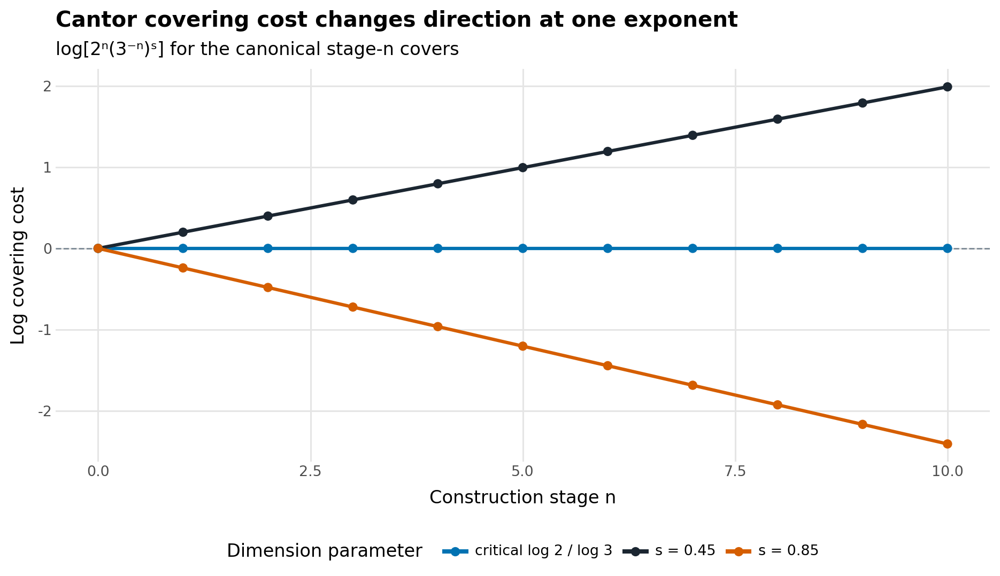

# Geometric Measure Theory {#sec-geometric-measure}

Smooth curves have length and smooth surfaces have area, but what should we
assign to a snowflake boundary, a torn interface, or the jump set of an image?
Geometric measure theory studies size and shape at scales where classical
differential geometry no longer applies.

The chapter begins with diameter covers and ordinary measure. The advanced
theorems are clearly labelled; the examples and core estimates are derived
from definitions.

## Covers measured at a scale

For a set $U$ in a metric space, its diameter is

$$
\operatorname{diam}U=\sup\{d(x,y):x,y\in U\}.
$$

For $s\ge0$ and $\delta>0$, define the scale-restricted cost

$$
\mathcal H_\delta^s(E)
=\inf\left\{
\sum_i(\operatorname{diam}U_i)^s:
E\subseteq\bigcup_iU_i,\
\operatorname{diam}U_i\le\delta
\right\}.
$$

As $\delta$ decreases, fewer covers are allowed, so the value cannot decrease.
The **$s$-dimensional Hausdorff measure** is

$$
\mathcal H^s(E)=\lim_{\delta\downarrow0}\mathcal H_\delta^s(E).
$$

Throughout this chapter, $\mathcal H^s$ uses the raw diameter-sum convention
above. For integer $m\ge0$, put

$$
c_m=\frac{\omega_m}{2^m},
\qquad \omega_0=1,
$$

where $\omega_m$ is the volume of the Euclidean unit $m$-ball. The normalised
geometric measure is $c_m\mathcal H^m$; on $\mathbb R^m$ it equals Lebesgue
measure. In particular, $c_0=c_1=1$ and $c_2=\pi/4$, so
$\mathcal H^2([0,1]^2)=4/\pi$, while $c_2\mathcal H^2([0,1]^2)=1$.
The area, Gauss–Green, and coarea formulas below display these constants
explicitly. Positive normalisation factors change neither null sets nor
Hausdorff dimension; all cover costs and code below retain the raw convention.

When $s=0$, each nonempty set in a sufficiently fine cover costs one, and
$\mathcal H^0$ is counting measure. On a line segment, $\mathcal H^1$ is its
length. A square has infinite $\mathcal H^1$ but finite positive
$\mathcal H^2$.

## Hausdorff dimension

For fixed $E$, there is a critical exponent at which the measure changes from
infinity to zero. Define

$$
\dim_H E
=\inf\{s:\mathcal H^s(E)=0\}
=\sup\{s:\mathcal H^s(E)=\infty\}.
$$

The middle-third Cantor set is the union of two copies scaled by $1/3$.
If a dimension $s$ respects this self-similarity, then

$$
2(1/3)^s=1,
$$

so

$$
s=\frac{\log2}{\log3}.
$$

The upper bound comes from covering the $2^n$ stage-$n$ intervals, each of
diameter $3^{-n}$. A lower bound requires showing no cleverer cover has
arbitrarily smaller total cost; a probability measure assigning mass
$2^{-n}$ to each stage interval provides that estimate.

The **mass distribution principle** applies when $s>0$ and a finite Borel
measure $\mu$ is concentrated on a Borel set $E$, with $0<\mu(E)<\infty$.
Suppose constants $C>0$ and $r_0>0$ satisfy

$$
\mu(B(x,r))\le Cr^s
$$

for every centre $x$ and every $0<r<r_0$. A cover set of positive diameter
$d$ meeting $E$ lies in a ball of radius $2d$. Singleton sets have zero mass
by the growth bound. Enclosing each set of a sufficiently fine cover in such
a ball and summing gives

$$
\mathcal H^s(E)\ge\frac{\mu(E)}{2^sC}>0.
$$

Positive mass is essential: the zero measure satisfies every growth upper
bound but supplies no lower bound for Hausdorff measure.

<figure id="fig-hausdorff-scaling">


<figcaption>

Figure 37.1: Covering cost changes from growth to decay at the critical Hausdorff exponent.

</figcaption>
</figure>

[Figure 37.1](#fig-hausdorff-scaling) plots the canonical covers of the Cantor set. It proves
the upper estimate; the mass-distribution argument supplies the missing lower
estimate.

## Lipschitz maps and dimension

A map $f$ is $L$-Lipschitz if

$$
d(f(x),f(y))\le Ld(x,y).
$$

Every cover of $E$ maps to a cover of $f(E)$ with diameters enlarged by at most
$L$. Hence

$$
\mathcal H^s(f(E))\le L^s\mathcal H^s(E)
$$

and

$$
\dim_H f(E)\le\dim_HE.
$$

A bi-Lipschitz map, whose inverse is also Lipschitz, preserves Hausdorff
dimension. A merely continuous map need not: a space-filling curve maps an
interval continuously onto a square.

## Rectifiability

A set $E\subseteq\mathbb R^n$ is **countably $m$-rectifiable** if, except for
an $\mathcal H^m$-null subset, it is covered by countably many Lipschitz images
of bounded subsets of $\mathbb R^m$. This means it is made from countably many
rough $m$-dimensional patches.

Finite length alone does not guarantee rectifiability. A set is **purely
$m$-unrectifiable** if its intersection with every Lipschitz $m$-surface has
zero $\mathcal H^m$ measure.

For a rectifiable curve $\gamma:[a,b]\to\mathbb R^n$, the length is

$$
\int_a^b|\gamma'(t)|\,dt
$$

when $\gamma$ is Lipschitz, with derivative existing almost everywhere.
For a Lipschitz map $f:\mathbb R^m\to\mathbb R^n$, $1\le m\le n$, and
a Lebesgue-measurable set $A\subseteq\mathbb R^m$, the area formula accounts
for multiplicity:

$$
\int_A J_mf(x)\,dx
=c_m\int_{\mathbb R^n}N(f|_A,y)\,d\mathcal H^m(y).
$$

The left integrates the $m$-dimensional Jacobian; the right counts how many
preimages cover each point.

## Densities and blow-ups

For a Radon measure $\mu$ on $\mathbb R^n$, the $m$-density at $x$ examines

$$
\frac{\mu(B(x,r))}{\omega_m r^m}
\quad\text{as }r\downarrow0,
$$

where $\omega_m$ is the volume of the unit $m$-ball. A smooth
$m$-surface has density one at interior points with its natural area measure,
$c_m\mathcal H^m$ restricted to the surface. Using raw $\mathcal H^m$
instead would give density $1/c_m$. At a transverse crossing of two curves,
the one-dimensional density is two, since $c_1=1$.

Rescale around $x$:

$$
T_{x,r}(y)=\frac{y-x}{r}.
$$

Weak limits of suitably normalised pushforward measures
$(T_{x,r})_\#\mu$ are **tangent measures**. They describe what the measure
looks like under infinite magnification. For a smooth surface, tangents are
flat-plane measures. Existence or flatness of tangents can characterise
rectifiability under precise density assumptions.

## Functions of bounded variation

An integrable function $u$ on an open set $\Omega\subseteq\mathbb R^n$ has
**bounded variation** if its distributional derivative is a finite
vector-valued Radon measure $Du$. Equivalently,

$$
|Du|(\Omega)
=\sup\left\{
\int_\Omega u\,\operatorname{div}\phi\,dx:
\phi\in C_c^1(\Omega;\mathbb R^n),\
\|\phi\|_\infty\le1
\right\}<\infty.
$$

In one dimension, this agrees with classical total variation after choosing a
good representative. The locally BV step function $1_{(0,\infty)}$ has derivative
$\delta_0$ in the distributional sense: its change is concentrated at a jump.

The derivative decomposes into:

$$
Du=\nabla u\,dx+D^ju+D^cu,
$$

an absolutely continuous part, a jump part supported on an
$(n-1)$-dimensional set, and a Cantor part singular to Lebesgue measure but not
concentrated on jumps. The Cantor function shows why the third part is real.

## Sets of finite perimeter

A measurable set $E$ has **finite perimeter** in $\Omega$ when the
distributional derivative of its locally integrable indicator $1_E$ is a
finite vector-valued Radon measure there. If $|E\cap\Omega|<\infty$, this
is equivalent to $1_E\in BV(\Omega)$. Its perimeter is

$$
P(E;\Omega)=|D1_E|(\Omega).
$$

For a smooth domain, this equals surface area of the boundary inside
$\Omega$. For a rough set, the topological boundary may be far too large. The
**reduced boundary** consists of points where a measure-theoretic outward normal
emerges from blow-ups.

De Giorgi's structure theorem says the reduced boundary inside $\Omega$ is
countably $(n-1)$-rectifiable and its normalised measure
$c_{n-1}\mathcal H^{n-1}$ is the perimeter measure there. For
$\phi\in C_c^1(\Omega;\mathbb R^n)$ and the measure-theoretic outward
normal $\nu_E$, the Gauss–Green formula is

$$
\int_{E\cap\Omega}\operatorname{div}\phi\,dx
=c_{n-1}\int_{\partial^\ast E\cap\Omega}\phi\cdot\nu_E\,d\mathcal H^{n-1}.
$$

This is the correct divergence theorem for finite-perimeter sets.

## Coarea and level sets

For Lipschitz $u:\mathbb R^n\to\mathbb R$, the coarea formula states

$$
\int_{\mathbb R^n}g(x)|\nabla u(x)|\,dx
=c_{n-1}\int_{\mathbb R}
\left(\int_{u^{-1}(t)}g\,d\mathcal H^{n-1}\right)dt
$$

for nonnegative measurable $g$. It slices an $n$-dimensional integral into
level surfaces.

For $u(x)=|x|$ and $g=1_{B(0,R)}$, the inner level set is a sphere of radius
$t$, recovering polar integration. For $BV$ functions,

$$
|Du|(\Omega)=\int_{\mathbb R}P(\{u>t\};\Omega)\,dt.
$$

Total variation is the accumulated perimeter of superlevel sets.

## Finite-resolution dimension estimates

The box-counting estimate uses the number $N(\varepsilon)$ of grid boxes of
side $\varepsilon$ meeting a set:

$$
\dim_{\mathrm{box}}E
\approx\frac{\log N(\varepsilon)}{\log(1/\varepsilon)}.
$$

With finitely many scales this is a regression slope, not a Hausdorff
dimension. Pixelation, thresholding, limited scale range, and noise bias the
result. A responsible report includes the scale window, grid offsets,
uncertainty, and a sensitivity analysis.

<div class="callout callout-warning">
<p class="callout-title">A log–log line is not a dimension theorem</p>

Many finite or multiscale objects look linear over a short range. Hausdorff
dimension is defined through arbitrarily fine covers; proving it requires upper
and lower estimates, not only regression.

</div>

## Scale-by-scale calculation and BV laboratory

Geometric measure theory often asks for two logically different estimates: an
efficient cover proves that a set is no larger than a proposed dimension, while
a lower bound proves that no cleverer cover can make it smaller. The examples
below keep those directions visibly separate and then connect them to concrete
distributional derivatives and perimeters.

### An interval measured from both sides

Cover $[0,1]$ by $n$ equal intervals of diameter $1/n$. The total
$s$-dimensional cost is

$$
n\left(\frac1n\right)^s=n^{1-s}.
$$

If $s>1$, this tends to zero. Hence $\mathcal H^s([0,1])=0$ for $s>1$.
At $s=1$ the same covers cost one, giving the upper bound
$\mathcal H^1([0,1])\le1$ under the diameter-sum normalisation.

For the lower bound, take any countable cover $[0,1]\subseteq\bigcup_iU_i$
with $d_i=\operatorname{diam}U_i\le\delta$. Each $U_i\subset\mathbb R$ is
contained in an interval of length $d_i$ (or an arbitrarily larger length if an
endpoint is missing). The elementary outer-length property of an interval gives

$$
\sum_i d_i\ge1.
$$

For $s=1$, every cover therefore costs at least one, so
$\mathcal H^1([0,1])=1$. For $0<s<1$ and $d_i>0$, use $d_i\le\delta$
and the fact that $s-1<0$:

$$
d_i^s=d_i d_i^{s-1}\ge d_i\delta^{s-1}.
$$

Zero-diameter terms satisfy the final inequality directly, with both sides
zero. After summing,

$$
\sum_i d_i^s\ge\delta^{s-1}\sum_i d_i\ge\delta^{s-1},
$$

which tends to infinity as $\delta\downarrow0$. Thus
$\mathcal H^s([0,1])=\infty$ for $s<1$. The critical exponent is exactly one.
This proof is a model audit: equal subintervals supply the upper estimate, while
the unavoidable total length of an arbitrary cover supplies the lower one.

### The Cantor set: cover calculation plus mass calculation

At construction level $n$, the middle-thirds Cantor set $C$ lies in $2^n$
intervals of diameter $3^{-n}$. Its cover cost is

$$
2^n3^{-ns}=(2\,3^{-s})^n.
$$

This tends to zero when $2\,3^{-s}<1$, so

$$
\dim_H C\le\frac{\log2}{\log3}.
$$

That is only half the proof. Put equal mass $2^{-n}$ on each level-$n$ basic
interval, consistently across levels, and call the resulting probability
measure $\mu$. Set $s=\log2/\log3$, so $2^{-n}=3^{-ns}$. Given a small radius
$r$, choose $n$ so that

$$
3^{-(n+1)}<r\le3^{-n}.
$$

An interval of radius $r$ meets at most a fixed number of level-$n$ basic
intervals; four is a safe bound. Consequently

$$
\mu(B(x,r))\le4\,2^{-n}
=4\,3^{-ns}\le8r^s.
$$

If sets $U_i$ cover $C$, enclose each in a comparable ball and sum this growth
bound. Use outer measure $\mu^*$ when a cover set is not measurable. Since
$\mu(C)=1$,

$$
1\le\sum_i\mu^*(U_i)
\le C_0\sum_i(\operatorname{diam}U_i)^s.
$$

Every sufficiently fine cover has cost bounded below by $1/C_0$. Therefore
$\mathcal H^s(C)>0$ and $\dim_HC\ge s$. Together with the cover estimate this
proves

$$
\dim_HC=\frac{\log2}{\log3}.
$$

The measure $\mu$ is not decoration: it certifies that mass cannot be packed
into sets whose total $s$-cost is arbitrarily small. This argument is often
called the mass-distribution method.

The upper-cover calculation can be inspected across levels and dimensions.
The routine below represents a self-similar stage by its number of pieces and
the contraction ratio of each piece.

```python
from math import isfinite, log

def self_similar_cover_costs(
    pieces_per_stage: int,
    contraction_ratio: float,
    dimension: float,
    maximum_level: int,
) -> list[float]:
    """Return finite level costs pieces**n * ratio**(n*dimension)."""
    if pieces_per_stage <= 0 or maximum_level < 0:
        raise ValueError("pieces must be positive and maximum_level nonnegative")
    if not isfinite(contraction_ratio) or not 0.0 < contraction_ratio < 1.0:
        raise ValueError("contraction_ratio must lie strictly between zero and one")
    if not isfinite(dimension) or dimension < 0.0:
        raise ValueError("dimension must be finite and nonnegative")
    return [
        pieces_per_stage**level
        * contraction_ratio ** (level * dimension)
        for level in range(maximum_level + 1)
    ]

critical_dimension = log(2.0) / log(3.0)
below = self_similar_cover_costs(2, 1.0 / 3.0, critical_dimension - 0.1, 8)
critical = self_similar_cover_costs(2, 1.0 / 3.0, critical_dimension, 8)
above = self_similar_cover_costs(2, 1.0 / 3.0, critical_dimension + 0.1, 8)
print(below[-1], critical[-1], above[-1])
```

The three costs respectively grow, stay at one, and shrink through the declared
eight levels.  This is the upper-cover evidence only; the mass-distribution
argument is still required for the lower Hausdorff-dimension bound.

### Lipschitz maps cannot create Hausdorff size

Let $f:E\to\mathbb R^m$ be $L$-Lipschitz. We may take covers
$E\subseteq\bigcup_iU_i$ with $U_i\subseteq E$, by intersecting an
arbitrary cover with $E$. Then $f(E)\subseteq\bigcup_if(U_i)$ and

$$
\operatorname{diam}f(U_i)\le L\operatorname{diam}U_i.
$$

Hence every $\delta$-fine cover of $E$ produces an $L\delta$-fine cover of
$f(E)$ with

$$
\sum_i(\operatorname{diam}f(U_i))^s
\le L^s\sum_i(\operatorname{diam}U_i)^s.
$$

Take the infimum over covers and then let $\delta\downarrow0$ to obtain

$$
\mathcal H^s(f(E))\le L^s\mathcal H^s(E).
$$

In particular, $\dim_Hf(E)\le\dim_HE$. This immediately explains why a
space-filling map from an interval onto a square cannot be Lipschitz: the
interval has zero two-dimensional Hausdorff measure, so its Lipschitz image must
also have zero two-dimensional measure, whereas a square has positive area.
Continuity alone permits space-filling curves; the quantitative Lipschitz bound
forbids them.

### Arc length and multiplicity on a circle

The parametrisation

$$
\gamma(\theta)=(\cos\theta,\sin\theta),
\qquad 0\le\theta\le2\pi,
$$

has speed $|\gamma'(\theta)|=1$. The one-dimensional area formula therefore
recovers the circumference:

$$
\mathcal H^1(S^1)
=\int_0^{2\pi}|\gamma'(\theta)|\,d\theta
=2\pi.
$$

Now use the same formula on $0\le\theta\le4\pi$. The integral is $4\pi$, but
the image is still the same circle of Hausdorff measure $2\pi$. The apparent
contradiction disappears when multiplicity is included: except for the
identified endpoint, every image point has two preimages, so the area formula
counts it twice.

This example is a compact hypothesis audit for parametrised geometry. For an
injective Lipschitz curve, integrating speed gives the Hausdorff measure of the
image. Without injectivity, it gives length with multiplicity. A plotted trace
cannot reveal repeated traversal if the passes lie exactly on top of one
another, but the parametrisation and the preimage count can.

### A jump derivative computed from the definition

Let

$$
u(x)=
\begin{cases}
a,&x<c,\\
b,&x>c.
\end{cases}
$$

The value at $c$ is irrelevant to integration. For
$\phi\in C_c^1(\mathbb R)$, the distributional derivative satisfies

$$
\begin{aligned}
\langle Du,\phi\rangle
&=-\int_{\mathbb R}u\phi'\,dx\\
&=-a\int_{-\infty}^c\phi'\,dx
  -b\int_c^\infty\phi'\,dx\\
&=-a\phi(c)+b\phi(c)
=(b-a)\phi(c).
\end{aligned}
$$

Thus

$$
Du=(b-a)\delta_c,
\qquad
|Du|(\mathbb R)=|b-a|.
$$

The classical derivative is zero away from the jump and does not exist at one
point; it misses the entire change. The measure derivative records both its
location and signed size. This is the simplest example of the jump component of
a locally BV derivative.

### Rectangle perimeter from distributions

Take $E=(0,a)\times(0,b)$ with $a,b>0$. For a smooth compactly supported vector field
$\phi=(\phi_1,\phi_2)$, direct one-dimensional integration gives

$$
\begin{aligned}
\int_E\operatorname{div}\phi\,dx\,dy
&=\int_0^b[\phi_1(a,y)-\phi_1(0,y)]\,dy\\
&\quad+\int_0^a[\phi_2(x,b)-\phi_2(x,0)]\,dx.
\end{aligned}
$$

These four terms are integration against normal components on the four sides.
With the convention
$\langle D1_E,\phi\rangle=-\int_E\operatorname{div}\phi$, the resulting
vector measure is described on every Borel set $A$ by

$$
D1_E(A)=-\int_{A\cap\partial E}\nu_{\mathrm{out}}\,d\mathcal H^1;
$$

the sign changes if an inward normal convention is chosen. Total variation
ignores that convention and yields

$$
P(E)=|D1_E|(\mathbb R^2)=2a+2b.
$$

This agrees with elementary perimeter. The benefit of the $BV$ definition is
that the same quantity remains meaningful after the boundary ceases to be a
smooth curve.

### Coarea checked on radial distance

Let $u(x,y)=\sqrt{x^2+y^2}$ and restrict to $B(0,R)$. Away from the origin,
$|\nabla u|=1$, and the single exceptional point has area zero. Thus the left
side of coarea with $g=1_{B(0,R)}$ is

$$
\int_{B(0,R)}|\nabla u|\,dx\,dy=\pi R^2.
$$

For $0<t<R$, the level set $u^{-1}(t)$ is a circle of
$\mathcal H^1$-measure $2\pi t$; outside that range its contribution vanishes.
The right side is therefore

$$
\int_0^R2\pi t\,dt=\pi R^2.
$$

The equality should be visualised as sweeping concentric circles through the
disk: circumference is accumulated over radial thickness. No polar-coordinate
Jacobian is missing; the factor $2\pi t$ is supplied by the size of the level
set.

### Coarea for a two-level step function

The $BV$ coarea formula can be checked without smooth level curves. On
$\mathbb R$, let

$$
u=2\,1_{(0,1)}+1_{(1,3)}.
$$

This function jumps from $0$ to $2$ at zero, from $2$ to $1$ at one, and from
$1$ to $0$ at three. The step-function calculation gives

$$
Du=2\delta_0-\delta_1-\delta_3,
\qquad
|Du|(\mathbb R)=2+1+1=4.
$$

Now inspect its superlevel sets. For $0<t<1$, $\{u>t\}$ agrees up to the
null set $\{1\}$ with $(0,3)$, whose one-dimensional perimeter is two
because its indicator has one upward and one downward unit jump. For $1<t<2$,
$\{u>t\}=(0,1)$, again of perimeter two. For $t<0$ or $t>2$, the relevant
contribution vanishes; the exceptional levels $t=1,2$ have no effect on the
integral. Therefore

$$
\int_{\mathbb R}P(\{u>t\})\,dt
=\int_0^1 2\,dt+\int_1^2 2\,dt
=4
=|Du|(\mathbb R).
$$

This example explains the layer-cake geometry. Raising the threshold removes
the lower plateau at height one, and each unit of vertical height is charged by
the number of exposed endpoints. Coarea accumulates horizontal boundary size
over vertical level, even when an ordinary gradient is zero almost everywhere.

### Density, corners, and the reduced boundary

Let $E=\{(x,y):y>0\}$. A small ball centred at an interior point eventually lies
inside $E$, so the density ratio

$$
\frac{|E\cap B(x,r)|}{|B(x,r)|}
$$

tends to one. At an exterior point it tends to zero. At a point on the line
$y=0$, exactly half of every centred ball lies in $E$, so the ratio is $1/2$.
Blowing up the set about such a boundary point reproduces a half-plane at every
scale, and its normal is unambiguous.

A rectangle shows why one states boundary structure only almost everywhere. At
the midpoint of a side, the same half-plane picture appears. At a vertex, a
small ball meets a quadrant, so the density is $1/4$, and there is no single
half-plane blow-up. The four vertices are exceptional, but they have
$\mathcal H^1$-measure zero. Removing them changes neither the perimeter
$2a+2b$ nor the side normals almost everywhere. The reduced boundary captures
the points with a measure-theoretic normal and ignores negligible topological
singularities.

### Hausdorff and box dimensions can disagree

Let $D=\mathbb Q\cap[0,1]$, and enumerate it as
$D=\{q_1,q_2,\ldots\}$. Fix $s>0$ and cover $q_j$ by an interval of diameter at
most $\delta2^{-j}$. The total $s$-cost is bounded by

$$
\sum_{j=1}^\infty(\delta2^{-j})^s
=\delta^s\sum_{j=1}^\infty2^{-js}.
$$

The geometric series is finite, and the expression can be made arbitrarily
small by sending $\delta$ to zero. Hence
$\mathcal H^s(D)=0$ for every $s>0$, so $\dim_HD=0$.

Box counting sees something different. Because $D$ is dense in $[0,1]$, every
grid interval that meets $[0,1]$ also meets $D$. At scale $\varepsilon$, the
number of occupied intervals is therefore comparable to $1/\varepsilon$, and

$$
\frac{\log N(\varepsilon)}{\log(1/\varepsilon)}\longrightarrow1.
$$

Thus the box dimension is one. Hausdorff covers may assign a separate tiny
interval to each enumerated point; a fixed grid cannot exploit countability
because it detects the closure. This counterexample is a theorem-hypothesis
audit for numerical dimension claims: a box-counting slope describes the
chosen covering scheme and need not equal Hausdorff dimension.

### Numerical dimension and theorem-status audit

At the exact triadic scales $\varepsilon=3^{-k}$, a grid adapted to the Cantor
construction sees essentially $N(\varepsilon)=2^k$ occupied intervals, so

$$
\frac{\log N(3^{-k})}{\log(3^k)}=\frac{\log2}{\log3}.
$$

At non-triadic scales, endpoint placement and grid offset introduce bounded
oscillations. A regression over only two or three scales may therefore look
convincing while having a biased slope. Report the individual scale pairs,
repeat with shifted grids, and distinguish the observed box-counting slope from
a proved Hausdorff dimension. The proof above required both an explicit family
of covers and a measure-growth lower bound.

Finally, keep theorem status visible. The Lipschitz cover inequality and the
step-function derivative were proved here. The area and coarea formulas require
measurability and multiplicity hypotheses beyond a drawing. De Giorgi's
rectifiability theorem for finite-perimeter sets is a deep structural result,
not a consequence of the rectangle calculation. Exercises 1–7 are resolved by
the calculations in this laboratory; Exercises 8–9 ask for precisely the
finite-scale sensitivity and the separate upper/lower evidence just described.

## Related results {#fifth-edition-handoff}

The measure-and-geometry viewpoint continues in [sec-optimal-transport](40-optimal-transport.md#sec-optimal-transport), where
couplings compare distributions and displacement interpolation creates curves
in Wasserstein space. Lower semicontinuity and compactness remain the decisive
existence engines, although the objects are now probability measures.

<!-- inline-formula-code:start -->
## Formula and finite computation

A useful formula in this chapter is

$$
\mathcal H_\delta^s(E)\le\sum_i(\operatorname{diam}U_i)^s
$$

If the declared diameters come from an actual finite cover and none exceeds $\delta$, their raw diameter-sum cost bounds $\mathcal H_\delta^s(E)$ above. The following standalone Python block computes that cost; it does not construct or verify a cover.

```python
diameters = [0.25, 0.125, 0.125, 0.0625]
dimension = 0.7
content_bound = sum(diameter**dimension for diameter in diameters)
print(content_bound)
```

**What the computation establishes.** The output certifies only the declared finite case. The theorem, if one is claimed, still requires the argument developed in the chapter.
<!-- inline-formula-code:end -->

## Summary, exercises, and support

Hausdorff measure assigns scale-sensitive size and defines dimension.
Lipschitz images build rectifiable sets; densities and blow-ups reveal local
geometry. BV functions and finite-perimeter sets turn derivatives and
boundaries into Radon measures, while coarea connects variation to level sets.

<div class="exercise" id="real_analysis-37-geometric-measure-ex-1">
<p class="exercise-title"><strong>Exercise 1</strong></p>

Compute $\mathcal H_\delta^s$ upper bounds for an interval using equal
subintervals.

</div>

<div class="exercise" id="real_analysis-37-geometric-measure-ex-2">
<p class="exercise-title"><strong>Exercise 2</strong></p>

Derive the candidate exponent from $mr^s=1$ for $m$ copies scaled by
$r$, and explain why dimension equality also needs a matching lower bound.

</div>

<div class="exercise" id="real_analysis-37-geometric-measure-ex-3">
<p class="exercise-title"><strong>Exercise 3</strong></p>

Prove the Lipschitz inequality for Hausdorff measure.

</div>

<div class="exercise" id="real_analysis-37-geometric-measure-ex-4">
<p class="exercise-title"><strong>Exercise 4</strong></p>

Explain why a space-filling curve cannot be Lipschitz.

</div>

<div class="exercise" id="real_analysis-37-geometric-measure-ex-5">
<p class="exercise-title"><strong>Exercise 5</strong></p>

Compute the distributional derivative of a one-dimensional step function.

</div>

<div class="exercise" id="real_analysis-37-geometric-measure-ex-6">
<p class="exercise-title"><strong>Exercise 6</strong></p>

Find the perimeter of a rectangle from the classical and BV viewpoints.

</div>

<div class="exercise" id="real_analysis-37-geometric-measure-ex-7">
<p class="exercise-title"><strong>Exercise 7</strong></p>

Apply coarea to $u(x,y)=\sqrt{x^2+y^2}$ on a disk.

</div>

<div class="exercise" id="real_analysis-37-geometric-measure-ex-8">
<p class="exercise-title"><strong>Exercise 8</strong></p>

Compare box-counting slopes for the Cantor set over two different scale
windows.

</div>

<div class="exercise" id="real_analysis-37-geometric-measure-ex-9">
<p class="exercise-title"><strong>Exercise 9</strong></p>

Give separate evidence needed for the upper and lower Hausdorff-dimension
bounds.

<details class="hint"><summary>Hint 1</summary>

An upper dimension bound comes from an explicit efficient cover. A
lower bound needs a mass-distribution or density estimate preventing all covers
from being too cheap.

</details>

</div>

For Exercise 2 solve $mr^s=1$; this equation alone gives no lower bound when
copies overlap. For Exercise 5 integrate by parts against a compactly supported
test function. For Exercise 7 the level sets are circles
and $|\nabla u|=1$ away from the origin.
