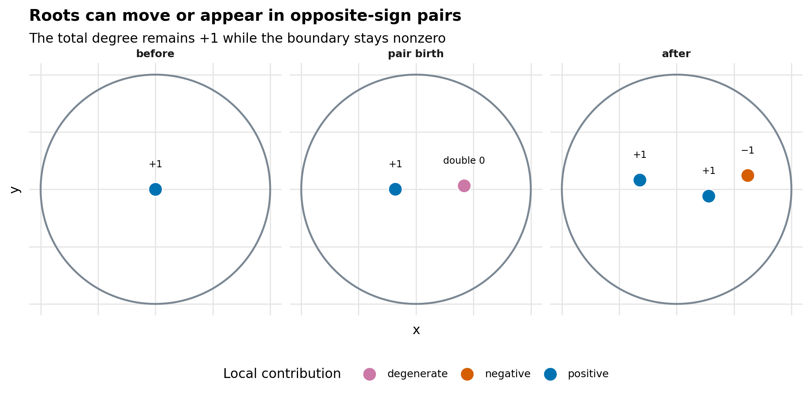

# Nonlinear Functional Analysis and Topological Degree {#sec-nonlinear-degree}

Linear equations can often be solved by inversion. Nonlinear equations may
have no inverse, several solutions, or branches that appear and disappear.
Fixed-point theorems and topological degree prove existence by showing that a
map cannot avoid zero while its boundary behaviour remains unchanged.

This chapter starts with contraction mappings and finite-dimensional winding.
Compactness and the Banach-space extension are then added explicitly.

## Equations as fixed points

An equation $F(x)=0$ can be rewritten in many ways as

$$
x=T(x).
$$

The choice of $T$ matters. For $x^2=a$, Newton's map is

$$
T(x)=\frac12\left(x+\frac ax\right).
$$

A **contraction** on a complete metric space satisfies

$$
d(Tx,Ty)\le q\,d(x,y)
$$

for some $0\le q<1$. Banach's contraction theorem gives a unique fixed point
$x^\ast$ and the quantitative estimate

$$
d(x_n,x^\ast)\le\frac{q^n}{1-q}d(x_1,x_0),
\qquad x_{n+1}=T(x_n).
$$

Existence, uniqueness, and an algorithm arrive together. But many important
maps are not contractions, and existence can survive after uniqueness is lost.

## Compact maps and Schauder

A map $T:X\to Y$ between Banach spaces is **compact** if it sends bounded sets
to relatively compact sets: every sequence in the image has a convergent
subsequence. Integral operators often smooth:

$$
(Tu)(x)=\int_0^1K(x,y)f(y,u(y))\,dy.
$$

If $K$ is continuous and $f$ is controlled on bounded sets, uniform boundedness
and equicontinuity let Arzelà–Ascoli prove compactness in $C([0,1])$.

**Theorem 38.1 (Schauder fixed-point).** If $C$ is a nonempty closed bounded convex
subset of a Banach space and $T:C\to C$ is continuous and compact, then $T$
has a fixed point.

No uniqueness is promised and simple iteration need not converge. In finite
dimensions, bounded closed sets are compact and the result reduces to
Brouwer's theorem for convex sets.

Each hypothesis has a role. A shift-type map on the infinite-dimensional unit ball (Kakutani's example)
can be continuous and map the ball to itself without compactness, while a map
on a nonconvex set can rotate a circle without a fixed point.

## Degree on an interval

Before higher dimensions, consider continuous
$f:[a,b]\to\mathbb R$ with $0\notin\{f(a),f(b)\}$. If the endpoint signs
differ, the intermediate value theorem forces a zero. Assign degree

$$
\deg(f,(a,b),0)=
\frac{\operatorname{sign}f(b)-\operatorname{sign}f(a)}2.
$$

It is $1$, $-1$, or $0$. A nonzero value guarantees a zero, but degree zero
does not guarantee absence: two crossings with opposite orientations cancel.

For a differentiable function with finitely many simple zeros,

$$
\deg(f,(a,b),0)
=\sum_{f(x)=0}\operatorname{sign}f'(x).
$$

This signed count survives continuous deformation so long as zero never
appears on the boundary.

## Brouwer degree

Let $\Omega\subset\mathbb R^n$ be bounded and open, let
$F:\overline\Omega\to\mathbb R^n$ be continuous, and assume
$y\notin F(\partial\Omega)$. The Brouwer degree

$$
\deg(F,\Omega,y)\in\mathbb Z
$$

is characterised by:

1. **normalisation:** $\deg(I,\Omega,y)=1$ when $y\in\Omega$;
2. **additivity:** splitting the preimages among disjoint subdomains adds
   degrees;
3. **homotopy invariance:** the degree stays fixed during a continuous
   deformation that keeps $y$ off the boundary image.

For a smooth map and regular value $y$,

$$
\deg(F,\Omega,y)
=\sum_{x\in F^{-1}(y)}
\operatorname{sign}\det DF(x).
$$

The general definition approximates by smooth maps and proves independence of
the choices.

<figure id="fig-topological-degree">


<figcaption>

Figure 38.1: A homotopy moves roots and creates a positive-negative pair while preserving total degree.

</figcaption>
</figure>

[Figure 38.1](#fig-topological-degree) is a schematic finite-dimensional example. The
boundary-avoidance condition is the certificate that the integer cannot change.

## Brouwer fixed points from degree

Suppose a continuous map $T$ sends the closed unit ball
$\overline B$ into itself and has no fixed point. Then

$$
F(x)=x-T(x)
$$

never vanishes. One can use the ray from $T(x)$ through $x$ to define a
continuous retraction from $\overline B$ onto its boundary sphere. But no such
retraction exists: its restriction to the sphere is the identity, while degree
or homology shows the identity cannot extend through the ball without crossing
the origin. Therefore $T$ has a fixed point.

This proves existence only. The identity map has every point fixed; a rotation
of the disk has only the centre. Brouwer does not choose one or make an
iteration converge.

## Leray–Schauder degree

In an infinite-dimensional Banach space, determinants and finite-dimensional
orientation are unavailable. For maps of the form

$$
F=I-K
$$

with $K$ compact, Leray–Schauder degree extends the Brouwer properties on
bounded open sets when $0\notin F(\partial\Omega)$.

The practical continuation principle is:

1. define a homotopy $F_\lambda=I-K_\lambda$ from an easy equation at
   $\lambda=0$ to the target at $\lambda=1$;
2. prove an **a priori bound** for every solution
   $F_\lambda(u)=0$, uniform in $0\le\lambda\le1$;
3. choose a ball larger than that bound, so no homotopy solution touches its
   boundary;
4. compute the easy degree and carry its nonzero value to the target.

The a priori estimate is usually the hard analytical step. Degree then turns
the estimate into existence.

## Boundary-value case study

Consider

$$
-u''=f(x,u),\qquad u(0)=u(1)=0.
$$

Let $G(x,y)$ be the Dirichlet Green kernel for $-d^2/dx^2$. The equation is
equivalent, for suitable solutions, to

$$
u(x)=\int_0^1G(x,y)f(y,u(y))\,dy.
$$

The right side is a compact operator on $C([0,1])$ when $f$ is continuous and
maps bounded sets to bounded sets. If a sign or growth condition gives
$\|u\|_\infty\le R$ for every solution of the homotopy
$-u''=\lambda f(x,u)$, Leray–Schauder degree yields a solution at
$\lambda=1$.

One possible energy estimate multiplies by $u$:

$$
\int_0^1|u'|^2\,dx
=\lambda\int_0^1f(x,u)u\,dx.
$$

The usefulness depends on the sign and growth of $f$. A numerical shooting
plot may reveal multiple branches, but it neither proves the a priori bound nor
shows that no branch escaped the plotted range.

## Bifurcation and continuation

For $F(\lambda,u)=0$, the implicit function theorem gives a local branch near
$(\lambda_0,u_0)$ if $D_uF$ is invertible. When that derivative loses
invertibility, folds or bifurcations can occur.

The Crandall–Rabinowitz theorem describes a local branch emerging from a
simple eigenvalue under transversality assumptions. Global bifurcation theorems
use degree: a connected branch either becomes unbounded, meets the boundary of
the parameter region, or returns to another singular point.

A plot of solutions against $\lambda$ is a projection. Two branches can cross
in the projection without representing the same state, and numerical
continuation can jump branches near a fold.

## Hypothesis and claim audit

<div class="callout callout-warning">
<p class="callout-title">Existence machinery is not a solver</p>

Schauder and degree may prove at least one solution while providing neither
uniqueness nor a convergent numerical method. Banach contraction is stronger
when it applies, but forcing a noncontractive problem into that theorem leads
to false estimates.

</div>

For a degree argument, record the space, open bounded set, continuity and
compactness, the complete homotopy, the boundary exclusion, and the normalised
starting degree. For a computed branch, additionally record residuals,
discretisation error, and how singular points were detected.

## Fixed-point and degree calculation laboratory

The theorems in this chapter answer different questions. A contraction supplies
a unique point and a convergent iteration. Schauder supplies a point but usually
neither uniqueness nor an iteration. Degree supplies a stable algebraic count
and turns boundary information into existence. The calculations below show
exactly where each conclusion comes from.

### Why the contraction theorem works

Suppose $T$ is a contraction with constant $q<1$, and set
$x_{n+1}=T(x_n)$. Repeated use of the contraction estimate gives

$$
d(x_{n+1},x_n)\le q^n d(x_1,x_0).
$$

If $m>n$, the triangle inequality and the finite geometric sum yield

$$
\begin{aligned}
d(x_m,x_n)
&\le\sum_{k=n}^{m-1}d(x_{k+1},x_k)\\
&\le d(x_1,x_0)\sum_{k=n}^{m-1}q^k\\
&\le\frac{q^n}{1-q}d(x_1,x_0).
\end{aligned}
$$

The last expression tends to zero, so $(x_n)$ is Cauchy. Completeness of the
space supplies a limit $x^*$. A Lipschitz map is continuous, hence

$$
T(x^*)=T\left(\lim_nx_n\right)
=\lim_nT(x_n)=\lim_nx_{n+1}=x^*.
$$

If $y^*$ were another fixed point, then

$$
d(x^*,y^*)=d(Tx^*,Ty^*)\le qd(x^*,y^*),
$$

which forces the distance to be zero. This proves existence and uniqueness,
and the preceding tail estimate proves the advertised error bound. Notice the
exact jobs of the assumptions: contraction gives geometric decay, completeness
prevents the Cauchy sequence from converging outside the space, and invariance
of the chosen set keeps every iterate where the estimate is valid.

### Newton's map for $\sqrt2$, fully certified

For $T(x)=\frac12(x+2/x)$, choose the complete interval $C=[1,2]$. First check
that it is invariant. The derivative

$$
T'(x)=\frac12\left(1-\frac2{x^2}\right)
$$

is negative before $\sqrt2$ and positive after $\sqrt2$. Thus the minimum on
$[1,2]$ is $T(\sqrt2)=\sqrt2$, while both endpoint values equal $3/2$.
Consequently

$$
T([1,2])=[\sqrt2,3/2]\subset[1,2].
$$

On the same interval,

$$
|T'(x)|\le\frac12.
$$

The mean value theorem therefore makes $T$ a contraction with $q=1/2$.
Its unique fixed point satisfies

$$
x=\frac12\left(x+\frac2x\right)
\quad\Longleftrightarrow\quad x^2=2.
$$

Only the positive root lies in $[1,2]$, so the fixed point is $\sqrt2$. Starting
from $x_0=1$ gives

$$
x_1=\frac32,
\qquad
x_2=\frac{17}{12},
\qquad
x_3=\frac{577}{408}\approx1.414215686.
$$

The theorem certifies, before a decimal is printed,

$$
|x_n-\sqrt2|
\le\frac{(1/2)^n}{1-1/2}|x_1-x_0|
=2^{-n}.
$$

This bound is conservative because Newton iteration eventually converges
quadratically, but it is already rigorous from the elementary contraction
estimate. A decimal table without the invariant-interval and derivative checks
would be evidence of good behaviour, not a proof.

### Why convexity cannot be omitted from Schauder

The unit circle

$$
S^1=\{z\in\mathbb C:|z|=1\}
$$

is nonempty, closed, bounded, and compact. The map $T(z)=-z$ is continuous and
maps $S^1$ to itself. A fixed point would satisfy $z=-z$, hence $z=0$, which is
not on the circle. Thus there is no fixed point. The failed Schauder hypothesis
is convexity: the line segment joining $z$ to $-z$ passes through points outside
$S^1$. If the domain is replaced by the closed disk, the missing centre is
restored and is a fixed point, in agreement with Brouwer.

Compactness is separately essential in infinite dimensions. Closed bounded
sets there need not be compact, so continuity of a self-map does not provide the
convergent subsequence used in Schauder's proof. Neither convexity nor
compactness is a stylistic condition; each blocks a distinct counterexample.

### Integral-operator compactness step by step

Work in $C([0,1])$ with the supremum norm and define

$$
(Tu)(x)=\int_0^1K(x,y)f(y,u(y))\,dy,
$$

where $K$ and $f$ are continuous. Fix a bounded ball
$B_R=\{u:\|u\|_\infty\le R\}$. On the compact rectangles involved, set

$$
M_K=\max_{x,y}|K(x,y)|,
\qquad
M_f=\max_{y,|s|\le R}|f(y,s)|.
$$

For every $u\in B_R$,

$$
|Tu(x)|\le\int_0^1M_KM_f\,dy=M_KM_f,
$$

so $T(B_R)$ is uniformly bounded. Moreover,

$$
|Tu(x)-Tu(x')|
\le M_f\int_0^1|K(x,y)-K(x',y)|\,dy.
$$

Uniform continuity of $K$ on $[0,1]^2$ makes the right side tend to zero as
$x'\to x$, uniformly over all $u\in B_R$. Thus $T(B_R)$ is equicontinuous.
Arzelà–Ascoli now says its closure is compact, proving that $T$ maps bounded
sets to relatively compact sets.

Continuity of the operator must also be checked. If $u_n\to u$ uniformly and
all these functions lie in some $B_R$, uniform continuity of $f$ on
$[0,1]\times[-R,R]$ gives

$$
\sup_y|f(y,u_n(y))-f(y,u(y))|\longrightarrow0.
$$

Multiplication by the bounded kernel and integration then show
$\|Tu_n-Tu\|_\infty\to0$. We have proved both continuity and compactness; saying
only that an integral “smooths” would not verify either definition.

### Signed zeros and pair creation

Take $f(x)=x^2-1$ on $(-2,2)$. Since $f(-2)=f(2)=3>0$, the endpoint formula
gives degree zero. The two simple roots explain why:

$$
f'(-1)=-2,
\qquad
f'(1)=2,
$$

so their contributions are $-1$ and $+1$. On a small interval containing only
$-1$, the local degree is $-1$; on one containing only $1$, it is $+1$; on the
whole interval they cancel. Degree zero therefore does not mean “no roots.”

The family

$$
f_\lambda(x)=x^2-\lambda
$$

shows how roots can appear without changing total degree. For $\lambda<0$ there
are no real roots. At $\lambda=0$ there is one nonsimple tangent root. For
$\lambda>0$, the roots $-\sqrt\lambda$ and $\sqrt\lambda$ have opposite
derivative signs. As long as $\lambda<4$, neither crosses the boundary of
$(-2,2)$, and the degree remains zero throughout. In the standard visual, two
crossings are born at tangency and then move apart; arrows at the boundary never
change direction.

For an invertible linear map $F(x)=Ax$ on a ball centred at zero, the only
preimage of zero is zero and its contribution is

$$
\deg(A,B,0)=\operatorname{sign}\det A.
$$

A positive determinant preserves orientation and a negative determinant
reverses it. A nonzero degree guarantees a preimage; the converse fails, as
$x^2-1$ demonstrates. The boundary condition is what makes the count stable:
if a zero is allowed to cross the boundary, the degree inside the chosen region
can change.

The last warning has a one-line model. On $\Omega=(-1,1)$, let

$$
f_s(x)=x-s.
$$

For $-1<s<1$, the unique zero $x=s$ lies inside and has positive derivative, so
$\deg(f_s,\Omega,0)=1$. As $s$ reaches $1$, the zero touches the boundary and
$f_1(1)=0$. For $s>1$, there is no zero in $\Omega$ and the degree is zero.
Homotopy invariance has not failed: its boundary-avoidance hypothesis fails at
the exact parameter where the integer changes. Whenever a continuation proof
asserts constant degree, searching for a possible boundary contact is therefore
the decisive audit.

Degree also distinguishes existence from counting ordinary roots. The integer
is an oriented count, so cancellation is possible; nonsimple roots are handled
by perturbation and homotopy rather than by assigning an arbitrary derivative
sign. A nonzero total cannot cancel completely and hence forces a root, while a
zero total leaves all three possibilities open: no roots, a cancelling pair, or
more complicated zero sets. This is why degree is robust under deformation but
does not normally provide uniqueness.

### Deriving the Dirichlet Green kernel

Fix $y\in(0,1)$ and seek $G(\cdot,y)$ satisfying

$$
-G_{xx}(x,y)=\delta_y,
\qquad
G(0,y)=G(1,y)=0.
$$

Away from $x=y$, the second derivative is zero, so the kernel is linear on each
side. Write

$$
G(x,y)=
\begin{cases}
A x,&x\le y,\\
B(1-x),&x\ge y.
\end{cases}
$$

Continuity at $y$ requires $Ay=B(1-y)$. Integrating the differential equation
across a small interval around $y$ gives the derivative jump

$$
-[G_x(y^+,y)-G_x(y^-,y)]=1,
$$

or $A+B=1$. Solving the two equations gives $A=1-y$ and $B=y$. Therefore

$$
G(x,y)=
\begin{cases}
x(1-y),&x\le y,\\
y(1-x),&x\ge y.
\end{cases}
$$

The piecewise kernel is directly executable, including the domain and symmetry
conditions used later in the integral operator.

```python
from math import isclose

def dirichlet_green_kernel(x_coordinate: float, y_coordinate: float) -> float:
    """Evaluate the Dirichlet Green kernel on the unit interval."""
    if not 0.0 <= x_coordinate <= 1.0 or not 0.0 <= y_coordinate <= 1.0:
        raise ValueError("both coordinates must lie in [0, 1]")
    if x_coordinate <= y_coordinate:
        return x_coordinate * (1.0 - y_coordinate)
    return y_coordinate * (1.0 - x_coordinate)

grid = [index / 20.0 for index in range(21)]
values = [dirichlet_green_kernel(left, right) for left in grid for right in grid]
symmetry_check = all(
    isclose(
        dirichlet_green_kernel(left, right),
        dirichlet_green_kernel(right, left),
        abs_tol=1e-15,
    )
    for left in grid
    for right in grid
)
print(max(values), symmetry_check)
```

The grid finds the exact maximum $1/4$ and confirms symmetry at its sampled
pairs.  The algebraic branches prove those properties everywhere and the
derivative-jump calculation, not the grid, certifies the Green identity.

The kernel is continuous, nonnegative, symmetric in $x,y$, and at most $1/4$.
If $h$ is continuous and
$u(x)=\int_0^1G(x,y)h(y)\,dy$, differentiating on either side of the moving
split verifies $-u''=h$ and the endpoint values vanish. This checks the sign and
normalisation that are easy to lose when the formula is memorised.

### A complete a priori bound and degree continuation

Consider the homotopy problem

$$
-u''=\lambda(1-u^3),
\qquad
u(0)=u(1)=0,
\qquad 0\le\lambda\le1.
$$

At $\lambda=0$, the only solution is $u=0$. Suppose now that $\lambda>0$. If
$u$ had a negative minimum $m<0$, it would occur in the interior because the
boundary values are zero. At that point $u''\ge0$, so $-u''\le0$, whereas

$$
\lambda(1-m^3)>0,
$$

a contradiction. Hence $u\ge0$. If $u$ had a maximum $M>1$, that maximum would
also be interior. There $u''\le0$, so $-u''\ge0$, while
$\lambda(1-M^3)<0$, another contradiction. We have obtained the uniform bound

$$
0\le u(x)\le1
$$

for every solution and every $\lambda\in[0,1]$. This is the missing sign argument
in Exercise 8.

Using the Green kernel, write the equation as

$$
u=K_\lambda(u),
\qquad
K_\lambda(u)(x)
=\lambda\int_0^1G(x,y)[1-u(y)^3]\,dy.
$$

The preceding integral-operator proof shows that $K_\lambda$ is compact on
bounded sets, continuously in $\lambda$. Choose any ball of radius $R>1$ in
$C([0,1])$. The maximum-principle bound says that no solution of
$u-K_\lambda(u)=0$ lies on its boundary. At $\lambda=0$ the map is the identity,
whose degree on this ball at zero is one. Homotopy invariance carries that
nonzero degree to $\lambda=1$, and the existence property supplies at least one
solution of the target problem.

Observe the division of labour. The maximum principle prevents boundary
solutions, compactness makes Leray–Schauder degree available, and topology
transports the starting degree. None of these statements alone completes the
argument, and the final conclusion is existence rather than uniqueness.

### Bifurcation-diagram and theorem-hypothesis audit

A numerical branch plot can suggest that several solutions coexist, that a
turning point is near a parameter value, and that solution norms grow along a
branch. It does not by itself prove that every branch was found, that a displayed
turn is a true singularity rather than discretisation error, or that solutions
remain bounded beyond the plotting window. Residuals test the discretised
equation, mesh refinement tests numerical stability, and spectral information
about $D_uF$ helps locate loss of invertibility; a global theorem still needs its
own hypotheses.

Use this final checklist when reading or writing a degree proof.

1. State the Banach space and the bounded open set on which degree is taken.
2. Express the map as identity minus compact and prove both continuity and
   compactness.
3. Write the entire homotopy, including its parameter range.
4. Establish one uniform a priori bound for all homotopy solutions.
5. Choose the degree domain strictly larger than that bound.
6. Compute the starting degree from normalisation or a regular-value count.
7. Claim only existence from nonzero degree unless a separate argument proves
   uniqueness or convergence of an algorithm.

Exercises 1, 2, 3, 6, 7, 8, and 9 have now been resolved by explicit
calculations. Exercise 5 is the existence property of degree: if there were no
preimage, the degree would be zero. Exercise 10 should be answered in the
three-versus-three form in the preceding audit. For every exercise, the decisive
step is a certified inequality, compactness argument, or boundary exclusion,
not the appearance of a persuasive plot.

## Related results {#fifth-edition-handoff}

Degree controls existence under nonlinear deformation; Part XII shifts from
existence to long-time and operator structure. The invariant-subspace viewpoint
of [sec-ergodic-theory](41-ergodic-theory.md#sec-ergodic-theory) and the spectral-measure viewpoint of
[sec-unbounded-spectral](44-unbounded-spectral.md#sec-unbounded-spectral) are the closest continuations: both replace individual
solutions by stable global information.

<!-- inline-formula-code:start -->
## Formula and finite computation

A useful formula in this chapter is

$$
\deg(f,\Omega,0)=\frac1{2\pi}\Delta\arg(f\circ\gamma)
$$

Angle increments around a polygon approximate the planar winding-number model. The following standalone Python block expresses that finite rule with its inputs and stopping conditions visible.

```python
from math import atan2, pi

points = [(1.0, 0.0), (0.0, 1.0), (-1.0, 0.0), (0.0, -1.0), (1.0, 0.0)]
angles = [atan2(y, x) for x, y in points]
increments = []
for left, right in zip(angles, angles[1:]):
    delta = (right - left + pi) % (2.0 * pi) - pi
    increments.append(delta)
print(sum(increments) / (2.0 * pi))
```

**What the computation establishes.** The output certifies only the declared finite case. The theorem, if one is claimed, still requires the argument developed in the chapter.
<!-- inline-formula-code:end -->

## Summary, exercises, and support

Contractions give a unique computable fixed point. Compact maps support
Schauder existence. Brouwer degree is a homotopy-invariant signed count;
Leray–Schauder extends it to identity-minus-compact equations. Uniform a
priori estimates keep solutions away from the boundary and make continuation
rigorous.

<div class="exercise" id="real_analysis-38-nonlinear-degree-ex-1">
<p class="exercise-title"><strong>Exercise 1</strong></p>

Find an interval on which Newton's map for $\sqrt2$ is a contraction.

</div>

<div class="exercise" id="real_analysis-38-nonlinear-degree-ex-2">
<p class="exercise-title"><strong>Exercise 2</strong></p>

Give a continuous self-map of a circle with no fixed point and identify the
failed Schauder hypothesis.

</div>

<div class="exercise" id="real_analysis-38-nonlinear-degree-ex-3">
<p class="exercise-title"><strong>Exercise 3</strong></p>

Compute the one-dimensional degree of $f(x)=x^2-1$ on
$(-2,2)$ at zero.

</div>

<div class="exercise" id="real_analysis-38-nonlinear-degree-ex-4">
<p class="exercise-title"><strong>Exercise 4</strong></p>

Compute the degree of $F(x)=Ax$ on a ball when $A$ is invertible.

</div>

<div class="exercise" id="real_analysis-38-nonlinear-degree-ex-5">
<p class="exercise-title"><strong>Exercise 5</strong></p>

Explain why nonzero degree guarantees a preimage.

</div>

<div class="exercise" id="real_analysis-38-nonlinear-degree-ex-6">
<p class="exercise-title"><strong>Exercise 6</strong></p>

Prove compactness of an integral operator with continuous kernel using
Arzelà–Ascoli.

</div>

<div class="exercise" id="real_analysis-38-nonlinear-degree-ex-7">
<p class="exercise-title"><strong>Exercise 7</strong></p>

Derive the Green kernel for the one-dimensional Dirichlet problem.

</div>

<div class="exercise" id="real_analysis-38-nonlinear-degree-ex-8">
<p class="exercise-title"><strong>Exercise 8</strong></p>

Propose an a priori estimate for
$-u''=\lambda(1-u^3)$ and state any missing sign argument.

<details class="hint"><summary>Hint 1</summary>

Homotope the map to one whose degree is known, but first prove that no
map in the homotopy vanishes on the boundary.

</details>

</div>

<div class="exercise" id="real_analysis-38-nonlinear-degree-ex-9">
<p class="exercise-title"><strong>Exercise 9</strong></p>

Describe how a positive-negative pair of simple zeros can appear without
changing degree.

</div>

<div class="exercise" id="real_analysis-38-nonlinear-degree-ex-10">
<p class="exercise-title"><strong>Exercise 10</strong></p>

Audit a numerical bifurcation diagram: list three facts it suggests and
three it does not prove.

</div>

For Exercise 3 the two roots contribute opposite signs, so the degree is zero
despite two solutions. For Exercise 4 the degree is
$\operatorname{sign}\det A$. For Exercise 9 use a tangent double root at the
creation parameter.
