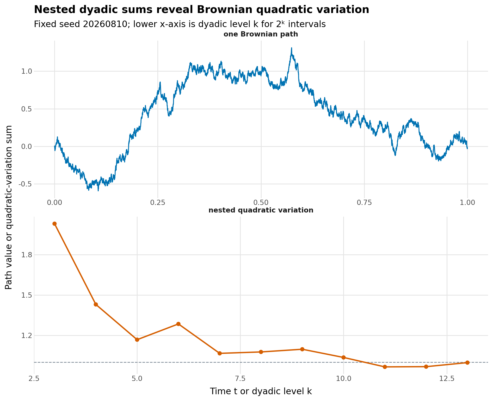

# Stochastic Processes and Brownian Motion {#sec-stochastic-processes}

A random variable gives one uncertain value. A stochastic process gives an
uncertain value at every time, so it can be viewed either as a family
$(X_t)_{t\ge0}$ or as one random path $t\mapsto X_t$. Those viewpoints are not
automatically equivalent: specifying every finite collection of coordinates
constructs a law on a product space, but it does not guarantee continuous
paths. Brownian motion is the central model in which probability, analysis,
heat flow, martingales, and a new quadratic notion of variation meet.

## Preparation from this book

Random variables, independence, and product measures come from
[sec-product-probability](22-product-measures-probability.md#sec-product-probability). Conditional expectation and discrete-time
martingales come from [sec-martingales](30-martingales.md#sec-martingales). Weak laws and characteristic functions
come from [sec-weak-probability](36-weak-probability.md#sec-weak-probability). Polish products, kernels, versions, and path
spaces come from [sec-polish-disintegration](39-polish-disintegration.md#sec-polish-disintegration). Heat semigroups come from
[sec-semigroups](35-semigroups.md#sec-semigroups). The repair sections define Gaussian vectors, filtrations,
finite-dimensional consistency, and adapted step processes before stochastic
integration is used.

## Processes, paths, and versions

A **stochastic process** on an index set $I$ with state space $S$ is a family of
random variables $X_t:\Omega\to S$, $t\in I$. For fixed times
$t_1,\ldots,t_n$, the law of

$$
(X_{t_1},\ldots,X_{t_n})
$$

is a finite-dimensional distribution. These laws must be consistent: deleting
a coordinate gives the corresponding lower-dimensional law, and permuting
times permutes coordinates.

For fixed $\omega$, the map $t\mapsto X_t(\omega)$ is a **sample path**. Two
processes are **modifications** if
$\mathbb P(X_t=Y_t)=1$ for every fixed $t$. They are
**indistinguishable** if

$$
\mathbb P(X_t=Y_t\text{ for every }t)=1.
$$

Indistinguishability is stronger because the quantifier over time lies inside
the probability-one event. For a countable index set, a countable intersection
shows modifications are indistinguishable. For an interval of times, they need
not be.

On the canonical product space $S^I$, the coordinate process is
$X_t(\omega)=\omega(t)$. Cylinder events restrict finitely many coordinates.
Kolmogorov's extension theorem states that consistent finite-dimensional laws
on standard Borel state spaces determine a probability measure on the
coordinate sigma-algebra. The theorem produces a process; it does not assert
that the coordinate path is continuous, bounded, or measurable as a function
of time.

## Gaussian repair kit

A vector $Z\in\mathbb R^n$ is **Gaussian** if every linear combination
$a\cdot Z$ has a one-dimensional normal law. Its mean vector $m$ and covariance
matrix

$$
\Sigma_{ij}=\mathbb E[(Z_i-m_i)(Z_j-m_j)]
$$

determine its law. A covariance matrix must be symmetric and positive
semidefinite because

$$
a^{\mathsf T}\Sigma a
=\operatorname{Var}(a\cdot Z)\ge0.
$$

Conversely, every symmetric positive-semidefinite matrix is a Gaussian
covariance: factor $\Sigma=LL^{\mathsf T}$ and take $Z=m+LG$ for a vector $G$
of independent standard normals. A covariance matrix alone does not determine
a non-Gaussian law.

A process is **Gaussian** when each finite vector of its coordinates is
Gaussian. Thus a mean function and positive-semidefinite covariance kernel
$K(s,t)$ determine all finite-dimensional laws.

For Brownian motion the intended covariance is

$$
K(s,t)=\min(s,t),
\qquad s,t\ge0.
$$

It is positive semidefinite. For times $t_i$ and coefficients $a_i$,

$$
\sum_{i,j}a_ia_j\min(t_i,t_j)
=\int_0^\infty
\left(\sum_i a_i1_{[0,t_i]}(r)\right)^2dr
\ge0.
$$

Therefore consistent centred Gaussian finite-dimensional laws exist.
Kolmogorov extension constructs a coordinate process with those laws.

## Brownian motion

A **standard Brownian motion** $(B_t)_{t\ge0}$ satisfies:

1. $B_0=0$ almost surely;
2. increments over disjoint time intervals are independent;
3. $B_t-B_s\sim N(0,t-s)$ for $0\le s<t$;
4. almost every sample path is continuous.

The Gaussian covariance construction gives the first three properties. For
example, if $0\le s<t\le u<v$, covariance of the increments is

$$
\operatorname{Cov}(B_t-B_s,B_v-B_u)=0.
$$

Gaussian uncorrelated vectors are independent, so disjoint increments are
independent. Continuity requires a separate theorem.

### Kolmogorov continuity repair

A useful form of the continuity criterion says: if for some
$a,b,C>0$,

$$
\mathbb E|X_t-X_s|^a\le C|t-s|^{1+b}
$$

on a bounded interval, then the process has a modification whose paths are
Hölder continuous of every order $\gamma<b/a$. The proof controls increments on
dyadic grids by Markov's inequality, sums the exceptional probabilities, uses
Borel–Cantelli, and extends from dyadic points by completeness. It supplies one
common null set for the whole path.

For a centred Gaussian $G$ of variance $h$,
$\mathbb E|G|^{2m}=c_mh^m$. Taking $m$ arbitrarily large gives Brownian paths
that are locally Hölder of every order below $1/2$. The theorem does not give
order $1/2$, and Brownian paths are in fact almost surely nowhere classically
differentiable.

### How the dyadic continuity argument works

The criterion's countability mechanism is worth seeing. On level $n$, inspect
adjacent dyadic times $k2^{-n}$. Markov's inequality bounds the probability that
one increment exceeds $2^{-n\gamma}$ by

$$
C2^{-n(1+b-a\gamma)}.
$$

There are $2^n$ adjacent increments, so a union bound gives a level probability
at most $C2^{-n(b-a\gamma)}$. If $\gamma<b/a$, these probabilities are
summable. Borel–Cantelli says that outside one null set, all sufficiently fine
dyadic increments obey the Hölder bound. Any two dyadic points can be joined by
a controlled chain across levels, producing

$$
|X_t-X_s|\le C(\omega)|t-s|^\gamma
$$

on the dense dyadic set. Completeness of the state space extends the values to
all times and supplies a continuous modification.

The proof does not intersect events over uncountably many pairs. It proves
countably many grid estimates simultaneously and then uses continuity to fill
the gaps. This is the same countability principle developed in
[sec-polish-disintegration](39-polish-disintegration.md#sec-polish-disintegration).

Brownian scaling follows from its Gaussian laws:

$$
(B_{ct})_{t\ge0}
\quad\text{and}\quad
(\sqrt c B_t)_{t\ge0}
$$

have the same finite-dimensional distributions. Scaling in law is not a
pathwise identity for one fixed realization.

## Filtrations, martingales, and Markov kernels

A **filtration** $(\mathcal F_t)$ is an increasing family of sigma-algebras,
representing information available by time $t$. A process is **adapted** when
$X_t$ is $\mathcal F_t$-measurable. Brownian motion's natural filtration is
generated by $B_s$ for $s\le t$, usually completed by null sets.

Independent centred increments give, for $s<t$,

$$
\mathbb E(B_t\mid\mathcal F_s)
=B_s+\mathbb E(B_t-B_s\mid\mathcal F_s)
=B_s.
$$

Thus Brownian motion is a martingale. It is also Markov: conditional on the
present $B_s=x$, the future increment is independent of the past. Its transition
density is

$$
p_t(x,y)=\frac1{\sqrt{2\pi t}}
\exp\left[-\frac{(y-x)^2}{2t}\right].
$$

Gaussian convolution gives the Chapman–Kolmogorov identity

$$
\int_{\mathbb R}p_s(x,z)p_t(z,y)\,dz=p_{s+t}(x,y).
$$

This is kernel composition from [sec-polish-disintegration](39-polish-disintegration.md#sec-polish-disintegration). The Markov property
does not mean the values $B_s$ and $B_t$ are independent; they have covariance
$s$ when $s<t$.

## Quadratic variation

For the uniform partition of $[0,t]$, define

$$
Q_n(t)=\sum_{k=1}^n
\left(B_{kt/n}-B_{(k-1)t/n}\right)^2.
$$

The increments are independent $N(0,t/n)$ variables. If $G\sim N(0,h)$, then
$\mathbb EG^2=h$ and $\operatorname{Var}(G^2)=2h^2$, because
$\mathbb EG^4=3h^2$. Therefore

$$
\mathbb EQ_n(t)=n\frac tn=t
$$

and, by independence,

$$
\operatorname{Var}(Q_n(t))
=n\,2\left(\frac tn\right)^2
=\frac{2t^2}{n}.
$$

Consequently

$$
\mathbb E|Q_n(t)-t|^2=\frac{2t^2}{n}\longrightarrow0.
$$

This proves $Q_n(t)\to t$ in $L^2$, hence in probability. Along dyadic
partitions, a subsequence argument strengthens the result to almost-sure
convergence. Brownian motion has quadratic variation $t$.

For a differentiable path $x$, increments satisfy
$\Delta x\approx x'\Delta t$, so the sum of squared increments is of order
$n(1/n)^2$ and tends to zero. Brownian increments have size about
$\sqrt{\Delta t}$, so their squares accumulate at order one. This is the scale
that makes ordinary calculus incomplete for Brownian paths.

## The Itô integral

Begin with an adapted step process

$$
H_t=\sum_{k=0}^{n-1}H_k1_{(t_k,t_{k+1}]}(t),
$$

where $H_k$ is $\mathcal F_{t_k}$-measurable and square integrable. Define

$$
\int_0^TH_t\,dB_t
=\sum_{k=0}^{n-1}H_k(B_{t_{k+1}}-B_{t_k}).
$$

The coefficient is chosen using information available before its increment.
This nonanticipation is what makes conditional means vanish. Expanding the
square, cross terms have expectation zero: for $j<k$, condition on
$\mathcal F_{t_k}$ and use the centred independent $k$th increment. Diagonal
terms give

$$
\mathbb E\left|\int_0^TH_t\,dB_t\right|^2
=\sum_k\mathbb E|H_k|^2(t_{k+1}-t_k)
=\mathbb E\int_0^T|H_t|^2\,dt.
$$

This is the **Itô isometry**. It makes the integral map an isometry from adapted
step processes in space-time $L^2$ into $L^2(\Omega)$. Completing that domain
defines the integral for every square-integrable predictable integrand. The
definition is not a pathwise Riemann–Stieltjes integral; Brownian paths have
unbounded variation.

A right-endpoint rule would use future information and generally produce a
different limit. The sampling convention is mathematical content, not a
numerical detail.

### A deterministic integrand benchmark

Take $H_t=t$ on $[0,T]$. Itô isometry predicts

$$
\mathbb E\left|\int_0^Tt\,dB_t\right|^2
=\int_0^Tt^2\,dt=\frac{T^3}{3}.
$$

There is also an integration-by-parts identity. On a partition,

$$
\sum_kt_k(B_{t_{k+1}}-B_{t_k})
=TB_T-\sum_kB_{t_{k+1}}(t_{k+1}-t_k).
$$

Continuity of Brownian paths makes the final sum converge pathwise to
$\int_0^TB_t\,dt$. Therefore

$$
\int_0^Tt\,dB_t=TB_T-\int_0^TB_t\,dt.
$$

This does not turn the general Itô integral into a classical pathwise integral;
it works because the deterministic function $t$ has bounded variation. The
variance $T^3/3$ is a useful exact check for a stochastic-integral simulation.

## Itô's formula

For smooth $f$, Taylor expansion over a small increment gives

$$
\Delta f(B)
=f'(B)\Delta B+\frac12f''(B)(\Delta B)^2+\text{smaller terms}.
$$

Linear increments add to the stochastic integral. Quadratic increments add to
time, while higher powers vanish at the relevant scale. The resulting formula
is

$$
f(B_t)=f(B_0)
+\int_0^tf'(B_s)\,dB_s
+\frac12\int_0^tf''(B_s)\,ds
$$

for suitable $C^2$ functions, with localization when growth is unbounded.

For $f(x)=x^2$, the identity can be derived directly from a partition:

$$
B_t^2-B_0^2
=\sum_k[2B_{t_k}\Delta B_k+(\Delta B_k)^2].
$$

The first sum converges to $2\int_0^tB_s\,dB_s$, and the second to $t$.
Therefore

$$
B_t^2-t=2\int_0^tB_s\,dB_s.
$$

The right side has conditional mean zero, so $B_t^2-t$ is a martingale. Ordinary
chain rule would omit the $t$ correction and give a false conclusion.

## Heat flow and hitting

For bounded continuous $g$, define

$$
u(t,x)=\mathbb E[g(x+B_t)]
=\int_{\mathbb R}g(y)p_t(x,y)\,dy.
$$

Gaussian differentiation for $t>0$ gives

$$
u_t=\frac12u_{xx},
\qquad
u(0,x)=g(x)
$$

in the appropriate limiting sense. Brownian transition kernels are the heat
semigroup with generator $\tfrac12\partial_{xx}$. The Chapman–Kolmogorov
identity becomes the semigroup law.

For $a>0$, let $\tau_a=\inf\{t:B_t=a\}$. The reflection principle pairs a path
that crosses $a$ before time $t$ and ends below $a$ with a reflected path ending
above $a$. It yields

$$
\mathbb P(\tau_a\le t)
=2\mathbb P(B_t\ge a).
$$

This proof uses symmetry and continuity. Optional stopping offers other hitting
calculations, but unbounded stopping times require integrability or localization;
the slogan “a martingale has constant expectation” is not enough.

### Reflection made explicit

On the event $\{\tau_a\le t\}$, leave a path unchanged until its first hit of
$a$ and reflect its later increments across the horizontal line at $a$:

$$
\widetilde B_s=
\begin{cases}
B_s,&s\le\tau_a,\\
2a-B_s,&s>\tau_a.
\end{cases}
$$

Symmetry and the strong Markov property show that this transformation preserves
Brownian path law. It bijects paths that hit $a$ and finish below $a$ with paths
that finish above $a$. Therefore

$$
\begin{aligned}
\mathbb P(\tau_a\le t)
&=\mathbb P(B_t\ge a)
 +\mathbb P(\tau_a\le t,B_t<a)\\
&=2\mathbb P(B_t\ge a).
\end{aligned}
$$

Continuity ensures a path reaching above $a$ has actually hit $a$. For a jump
process, overshoot breaks this exact reflection argument.

### Random walks and the path-space limit

Let $\xi_k$ be i.i.d. real mean-zero variance-one variables. For $n\ge1$, linearly
interpolate for $0\le t<1$ and set $S_n(1)=n^{-1/2}\sum_{k=1}^{n}\xi_k$:

$$
S_n(t)=\frac1{\sqrt n}\left(
\sum_{k=1}^{\lfloor nt\rfloor}\xi_k+(nt-\lfloor nt\rfloor)\xi_{\lfloor nt\rfloor+1}\right).
$$

Under these hypotheses, Donsker's invariance principle states that
$S_n$ converges weakly in $C([0,1])$ to Brownian motion. The ordinary central
limit theorem gives each fixed-time marginal and, by its multivariate version,
all finite-dimensional limits. That is only half the proof. Tightness in path
space prevents oscillations between the inspected times. Moment bounds on
increments and a modulus-of-continuity estimate supply it.

This is a recurring architecture: identify every finite-dimensional candidate,
then prove path-space tightness. A simulation comparing histograms only at
$t=1$ checks neither consistency across times nor tightness. For a possible realization with $n=4$ and increments $(1,-1,1,-1)$, $S_4(1/8)=1/4$ whereas the floor-only sum is zero; the latter is a step path.

### Brownian bridge as a conditioned Gaussian process

Define

$$
\beta_t=B_t-tB_1,
\qquad 0\le t\le1.
$$

This is a centred Gaussian process with $\beta_0=\beta_1=0$. A direct covariance
calculation gives

$$
\mathbb E(\beta_s\beta_t)=\min(s,t)-st.
$$

The same covariance is obtained by conditioning Brownian finite-dimensional
Gaussian vectors on $B_1=0$, so $\beta$ has the law of a Brownian motion pinned
at zero at time one. This conditioning is understood through a regular
conditional distribution, not the ratio
$\mathbb P(\,\cdot\,\cap\{B_1=0\})/\mathbb P(B_1=0)$, whose denominator is zero.

The bridge is not Brownian motion. For instance,
$\operatorname{Var}(\beta_t)=t(1-t)$ rather than $t$, and disjoint increments
are generally correlated because the final pinning couples the entire path.
It is nevertheless continuous because it is a continuous linear combination
of a Brownian path and its endpoint. This example connects disintegration,
Gaussian covariance, and path regularity without introducing a new existence
theorem.

## Reproducible quadratic-variation study

<figure id="fig-brownian-quadratic-variation">


<figcaption>

Figure 42.1: A fixed Brownian path is paired with its nested-partition quadratic variation.

</figcaption>
</figure>

[Figure 42.1](#fig-brownian-quadratic-variation) uses one finest dyadic increment array and
aggregates it for every coarser partition. This ensures every displayed
quadratic variation belongs to the same path. The seed, final time, and
partition levels are fixed in `figures.py`. A path whose values approach one is
illustrative; the expectation-and-variance calculation proves $L^2$
convergence.

## Version and theorem audit

Let $U$ be uniform on $[0,1]$ and set $X_t=1_{\{t=U\}}$. For each fixed $t$,
$X_t=0$ almost surely, so $X$ and the zero process have identical
finite-dimensional laws. Yet every path of $X$ contains one spike and is
discontinuous. The zero process is a continuous modification, but the given
version is not continuous. This is why Kolmogorov's criterion promises a
continuous modification rather than retroactively changing every version.

Audit stochastic claims for:

1. the probability space, filtration, and path space;
2. whether equality is pointwise, almost sure at each time, or indistinguishable;
3. consistency before invoking Kolmogorov extension;
4. a moment exponent strong enough for continuity;
5. adaptedness and square integrability before an Itô integral;
6. partition type and convergence mode for quadratic variation;
7. stopping-time integrability before optional stopping; and
8. whether a fixed-seed simulation is being confused with a probability-one
   result.

<!-- inline-formula-code:start -->
## Formula and finite computation

A useful formula in this chapter is

$$
[B]_T\approx\sum_k(B_{t_{k+1}}-B_{t_k})^2
$$

The program records quadratic variation at a declared mesh. The following standalone Python block expresses that finite rule with its inputs and stopping conditions visible.

```python
import numpy as np
from numpy.typing import NDArray

def brownian_quadratic_variation(
    steps: int, paths: int, seed: int
) -> NDArray[np.float64]:
    """Simulate terminal quadratic variation for independent Brownian paths."""
    if steps <= 0 or paths <= 0:
        raise ValueError("steps and paths must be positive")
    generator = np.random.default_rng(seed)
    increments = generator.normal(0.0, steps ** -0.5, size=(paths, steps))
    return np.sum(increments**2, axis=1)

values = brownian_quadratic_variation(steps=1_000, paths=2_000, seed=20260811)
print(values.mean(), values.std(ddof=1), np.quantile(values, [0.05, 0.95]))
```

**What the computation establishes.** The calculation checks a declared finite instance; the surrounding argument explains what is true beyond those inputs.
<!-- inline-formula-code:end -->

## Summary

Consistent finite-dimensional distributions construct a coordinate process;
moment bounds construct a continuous modification. Brownian increments have
square-root time scale, producing quadratic variation equal to time. The Itô
isometry constructs stochastic integration, and the surviving quadratic term
modifies the chain rule. Gaussian kernels connect Brownian motion to heat flow.

## Exercises

<div class="exercise" id="real_analysis-42-stochastic-processes-ex-1">
<p class="exercise-title"><strong>Exercise 1</strong></p>

Show $K(s,t)=\min(s,t)$ is positive semidefinite using indicator functions.

</div>

<div class="exercise" id="real_analysis-42-stochastic-processes-ex-2">
<p class="exercise-title"><strong>Exercise 2</strong></p>

Derive independence of two disjoint Brownian increments from their
covariance.

</div>

<div class="exercise" id="real_analysis-42-stochastic-processes-ex-3">
<p class="exercise-title"><strong>Exercise 3</strong></p>

Verify Brownian scaling at the level of covariance functions.

</div>

<div class="exercise" id="real_analysis-42-stochastic-processes-ex-4">
<p class="exercise-title"><strong>Exercise 4</strong></p>

Use the fourth Gaussian moment to apply Kolmogorov continuity with a
Hölder exponent below $1/4$.

<details class="hint"><summary>Hint 1</summary>

A centered Gaussian $Z$ satisfies $\mathbb E Z^4=3(\mathbb E Z^2)^2$.
Apply this to $B_t-B_s$, then match the result to Kolmogorov's exponent form.

</details>

</div>

<div class="exercise" id="real_analysis-42-stochastic-processes-ex-5">
<p class="exercise-title"><strong>Exercise 5</strong></p>

Prove Brownian motion is a martingale in its natural filtration.

</div>

<div class="exercise" id="real_analysis-42-stochastic-processes-ex-6">
<p class="exercise-title"><strong>Exercise 6</strong></p>

Verify the Chapman–Kolmogorov identity by completing a Gaussian square.

</div>

<div class="exercise" id="real_analysis-42-stochastic-processes-ex-7">
<p class="exercise-title"><strong>Exercise 7</strong></p>

Reproduce the expectation and variance of $Q_n(t)$.

</div>

<div class="exercise" id="real_analysis-42-stochastic-processes-ex-8">
<p class="exercise-title"><strong>Exercise 8</strong></p>

Prove the Itô isometry for a two-step adapted process.

<details class="hint"><summary>Hint 1</summary>

Expand the square of the two-step sum. Conditional expectation makes
the cross term zero because the later increment has conditional mean zero.

</details>

</div>

<div class="exercise" id="real_analysis-42-stochastic-processes-ex-9">
<p class="exercise-title"><strong>Exercise 9</strong></p>

Derive Itô's formula for $f(x)=x^2$ from partition algebra.

</div>

<div class="exercise" id="real_analysis-42-stochastic-processes-ex-10">
<p class="exercise-title"><strong>Exercise 10</strong></p>

Use Itô's formula to show $e^{\theta B_t-\theta^2t/2}$ is a martingale.

</div>

<div class="exercise" id="real_analysis-42-stochastic-processes-ex-11">
<p class="exercise-title"><strong>Exercise 11</strong></p>

Explain why the spike process is a modification but not indistinguishable
from the zero process.

</div>

<div class="exercise" id="real_analysis-42-stochastic-processes-ex-12">
<p class="exercise-title"><strong>Exercise 12</strong></p>

State three claims a fixed Brownian simulation cannot prove.

</div>

## Selected solutions

### Solution to Exercise 6: Gaussian kernel composition

The product exponent is

$$
\frac{(z-x)^2}{2s}+\frac{(y-z)^2}{2t}.
$$

Completing the square in $z$ gives a normal density with variance
$st/(s+t)$, multiplied by

$$
\frac1{\sqrt{2\pi(s+t)}}
\exp\left[-\frac{(y-x)^2}{2(s+t)}\right].
$$

The normal density integrates to one, leaving $p_{s+t}(x,y)$. Thus independent
Gaussian increments compose exactly as the heat semigroup requires.

### Solution to Exercise 8: two-step Itô isometry

Let $0<t_1<T$ and
$H=H_01_{(0,t_1]}+H_11_{(t_1,T]}$, where $H_0$ is deterministic and
$H_1$ is $\mathcal F_{t_1}$-measurable. Then

$$
I=H_0B_{t_1}+H_1(B_T-B_{t_1}).
$$

The cross term has expectation zero after conditioning on
$\mathcal F_{t_1}$, because the second increment is independent and centred.
The remaining terms are

$$
\mathbb EI^2
=\mathbb EH_0^2t_1
+\mathbb EH_1^2(T-t_1)
=\mathbb E\int_0^T H_t^2\,dt.
$$

This is the full mechanism behind the general step-process proof.

### Solution to Exercise 10: the exponential martingale

Let $f(t,x)=e^{\theta x-\theta^2t/2}$. The time-dependent Itô formula gives

$$
df=(f_t+\tfrac12f_{xx})dt+f_x\,dB_t.
$$

Here
$f_t=-\theta^2f/2$, $f_{xx}=\theta^2f$, and $f_x=\theta f$, so the drift
cancels:

$$
df=\theta f\,dB_t.
$$

After localization, the stochastic integral has conditional mean zero; direct
Gaussian integration also gives $\mathbb Ef(t,B_t)=1$. Hence
$e^{\theta B_t-\theta^2t/2}$ is a martingale. Omitting the Itô correction would
leave a false positive drift.

### Solution to Exercise 7: quadratic variation with all constants

Write $\Delta_kB=B_{kt/n}-B_{(k-1)t/n}$. Each increment has variance
$h=t/n$, so $\mathbb E(\Delta_kB)^2=h$. Its fourth moment is $3h^2$, hence

$$
\operatorname{Var}((\Delta_kB)^2)=3h^2-h^2=2h^2.
$$

Independence removes covariance terms. Consequently

$$
\mathbb EQ_n=nh=t,
\qquad
\operatorname{Var}(Q_n)=n(2h^2)=\frac{2t^2}{n}.
$$

Thus $\|Q_n-t\|_2=\sqrt2t/\sqrt n$. The calculation provides a convergence
mode and a quantitative root-mean-square error, not merely the expected limit.

### Solution to Exercise 11: modification without indistinguishability

For fixed $t$, the event $\{U=t\}$ has probability zero, so
$\mathbb P(X_t=0)=1$. For finitely many times, the union of those singleton
events is still null, proving equality of all finite-dimensional laws with the
zero process. But for every outcome $U=u$ there exists the time $t=u$ at which
$X_t=1$. Hence

$$
\mathbb P(X_t=0\text{ for every }t)=0.
$$

The two processes are modifications but not indistinguishable. Moving “for
every $t$” across the probability statement is the invalid inference.

### Solution to Exercise 4: a first Hölder exponent

For a Brownian increment of length $h$, the fourth moment is $3h^2$. Thus the
continuity criterion applies with $a=4$ and $1+b=2$, so $b=1$. It supplies a
modification Hölder continuous for every

$$
\gamma<\frac{b}{a}=\frac14.
$$

Using only the second moment would give exponent $|t-s|^1$, corresponding to
$b=0$, and no positive Hölder conclusion. Higher even Gaussian moments improve
the result: with moment $2m$, one obtains every
$\gamma<(m-1)/(2m)$, and these exponents approach $1/2$ as $m\to\infty$.
The criterion guarantees existence of a regular version; it does not select a
canonical value on the exceptional null set.
