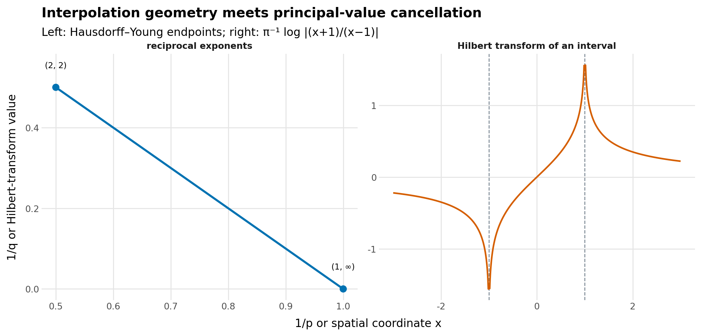

# Interpolation and Singular Integral Operators {#sec-interpolation-singular}

An operator may be easy to control on bounded functions and barely controllable
on integrable functions. Can those endpoint estimates determine its behaviour
between them? Chapter 28 used interpolation to pass from a weak maximal-function
estimate to strong $L^p$ bounds, but deferred the proof. This chapter supplies
that missing calculation and then applies the same architecture to singular
integrals, whose kernels are too singular for ordinary absolute integration.

## Preparation from this book

$L^p$ norms, Hölder, and distribution functions come from
[sec-lp-convergence](21-lp-convergence.md#sec-lp-convergence). Bounded and adjoint operators come from
[sec-banach-pillars](26-banach-pillars.md#sec-banach-pillars). The Hardy–Littlewood maximal theorem comes from
[sec-maximal-differentiation](28-maximal-differentiation.md#sec-maximal-differentiation). Fourier transforms, Plancherel, and multipliers
come from [sec-fourier-distributions](29-fourier-distributions.md#sec-fourier-distributions). The repair sections below derive layer
cake, distinguish strong and weak type, define sublinearity and principal
values, and state exactly how much complex analysis enters Riesz–Thorin.

## Distribution functions and weak spaces

For a measurable $g$, define its distribution function

$$
\lambda_g(t)=\mu\{x:|g(x)|>t\},
\qquad t>0.
$$

Since

$$
|g(x)|^p=\int_0^{|g(x)|}pt^{p-1}\,dt,
$$

Tonelli gives the **layer-cake identity**

$$
\|g\|_p^p
=p\int_0^\infty t^{p-1}\lambda_g(t)\,dt.
$$

This expresses a norm through the sizes of all level sets. It also explains
why a single weak endpoint estimate may fail to integrate.

A map $T$ is of **strong type $(p,q)$** if

$$
\|Tf\|_q\le C\|f\|_p.
$$

It is of **weak type $(p,q)$** if

$$
\mu\{|Tf|>t\}
\le\left(\frac{C\|f\|_p}{t}\right)^q.
$$

Weak type controls the tail without guaranteeing an integrable $q$th power.
Indeed, substituting a $t^{-q}$ tail into layer cake at exponent $q$ produces
$\int t^{-1}dt$, which diverges logarithmically.

The model function $g(x)=1/x$ on $(1,\infty)$ satisfies

$$
\mu\{g>t\}=\max\{t^{-1}-1,0\}.
$$

Thus it lies in weak $L^1$ but not $L^1$. A weak estimate is a genuine endpoint
space, not an imprecise version of a norm bound.

An operator is **sublinear** when

$$
|T(f+g)|\le|Tf|+|Tg|,
\qquad
|T(af)|=|a|\,|Tf|.
$$

The maximal operator is sublinear but not linear. Interpolation below needs
only these inequalities.

### Layer cake proved from indicators

For every number $a\ge0$,

$$
a^p=\int_0^\infty pt^{p-1}1_{\{t<a\}}\,dt.
$$

Substitute $a=|g(x)|$ and integrate in $x$. The integrand on the product space
is nonnegative, so Tonelli applies without assuming in advance that
$g\in L^p$:

$$
\begin{aligned}
\int|g(x)|^p\,d\mu(x)
&=\int\int_0^\infty
pt^{p-1}1_{\{t<|g(x)|\}}\,dt\,d\mu(x)\\
&=p\int_0^\infty t^{p-1}
\mu\{x:|g(x)|>t\}\,dt.
\end{aligned}
$$

The identity is valid with both sides infinite. This detail matters when it is
used to demonstrate endpoint failure.

For counting measure on a finite list, the distribution function is a step
function and layer cake can be integrated exactly between its jump heights:

```python
def discrete_layer_cake(
    values: list[float], exponent: float
) -> tuple[float, float]:
    """Return direct p-power sum and exact finite layer-cake integral."""
    if not values:
        raise ValueError("values must be nonempty")
    if exponent <= 0.0:
        raise ValueError("exponent must be positive")
    amplitudes = [abs(value) for value in values]
    levels = sorted({0.0, *amplitudes})
    integral = 0.0
    for lower, upper in zip(levels, levels[1:]):
        tail_count = sum(amplitude >= upper for amplitude in amplitudes)
        integral += tail_count * (upper**exponent - lower**exponent)
    direct = sum(amplitude**exponent for amplitude in amplitudes)
    return direct, integral

for power in (1.0, 2.0, 3.0):
    print(power, discrete_layer_cake([0.5, -1.0, 2.0, -3.0], power))
```

Equality here is an exact finite identity, not quadrature. Tonelli is still the
reason the continuum order exchange is legal, including when both sides are
infinite.

Define the weak-$L^p$ quantity

$$
\|g\|_{p,\infty}
=\sup_{t>0}t\,\lambda_g(t)^{1/p}.
$$

For $p>1$ it is a quasi-norm; an equivalent norm can be introduced through
averages over measurable sets. If $g\in L^p$, Chebyshev gives
$\|g\|_{p,\infty}\le\|g\|_p$. The reverse inclusion fails, as the $1/x$ model
shows at $p=1$. Interpolation works because it integrates different parts of
the tail against different endpoint information rather than trying to promote
one weak estimate directly.

## Marcinkiewicz interpolation proved

We prove the endpoint form used by the maximal theorem.

**Theorem 43.1.** Suppose $T$ is sublinear, weak type $(1,1)$ with constant $A$, and
strong type $(\infty,\infty)$ with constant $B$. Then for every $1<p<\infty$,

$$
\|Tf\|_p^p
\le
\frac{2Ap(2B)^{p-1}}{p-1}\|f\|_p^p.
$$

If $B=0$ the conclusion is immediate, so assume $B>0$. For a level $t>0$,
split

$$
f=g_t+h_t,
\qquad
g_t=f1_{\{|f|\le t/(2B)\}},
\qquad
h_t=f1_{\{|f|>t/(2B)\}}.
$$

The bounded endpoint gives

$$
\|Tg_t\|_\infty\le B\|g_t\|_\infty\le t/2.
$$

Sublinearity implies that $|Tf|>t$ can occur only where $|Th_t|>t/2$.
The weak endpoint then gives

$$
\lambda_{Tf}(t)
\le\frac{2A}{t}\|h_t\|_1
=\frac{2A}{t}
\int_{\{|f|>t/(2B)\}}|f(x)|\,d\mu(x).
$$

Insert this estimate into layer cake and use Tonelli, whose nonnegative
integrands make the exchange legal:

$$
\begin{aligned}
\|Tf\|_p^p
&\le2Ap\int_0^\infty
t^{p-2}
\int_{\{|f|>t/(2B)\}}|f(x)|\,d\mu(x)\,dt\\
&=2Ap\int |f(x)|
\left[\int_0^{2B|f(x)|}t^{p-2}\,dt\right]d\mu(x)\\
&=\frac{2Ap(2B)^{p-1}}{p-1}\int|f(x)|^p\,d\mu(x).
\end{aligned}
$$

The restriction $p>1$ appears exactly where the inner integral of
$t^{p-2}$ is evaluated. At $p=1$ it diverges, matching endpoint failure rather
than reflecting a loose estimate.

The general Marcinkiewicz theorem interpolates two weak endpoints
$(p_0,q_0)$ and $(p_1,q_1)$ along reciprocal-exponent line segments, with the
appropriate relation between source and target exponents. Its proof uses a
level-dependent decomposition of both the input and output. The complete case
above contains the decisive mechanism needed here.

## The maximal function gap closed

The Hardy–Littlewood maximal operator $M$ satisfies the weak estimate

$$
\mu\{Mf>t\}\le\frac{C_d}{t}\|f\|_1
$$

from [sec-maximal-differentiation](28-maximal-differentiation.md#sec-maximal-differentiation). It also obeys
$\|Mf\|_\infty\le\|f\|_\infty$, since no average exceeds the essential
supremum. Set $A=C_d$ and $B=1$ in the theorem. For $1<p<\infty$,

$$
\|Mf\|_p
\le
\left(\frac{2^pC_dp}{p-1}\right)^{1/p}\|f\|_p.
$$

This proves the assertion previously quoted. The constant grows as
$p\downarrow1$, accurately signalling that $M$ is not bounded on $L^1$.
Sharp constants require different arguments; the present bound certifies the
theorem and its endpoint.

## Riesz–Thorin and the complex repair

For a linear operator, strong endpoint estimates can be interpolated more
directly. If

$$
T:L^{p_0}\to L^{q_0},
\qquad
T:L^{p_1}\to L^{q_1}
$$

have norms $M_0,M_1$, define for $0<\theta<1$

$$
\frac1{p_\theta}=\frac{1-\theta}{p_0}+\frac\theta{p_1},
\qquad
\frac1{q_\theta}=\frac{1-\theta}{q_0}+\frac\theta{q_1}.
$$

The Riesz–Thorin theorem gives

$$
\|T\|_{p_\theta\to q_\theta}
\le M_0^{1-\theta}M_1^\theta.
$$

The reciprocal-exponent arithmetic can be delegated to a small validated
translation:

```python
from math import inf

def interpolate_exponent(left: float, right: float, theta: float) -> float:
    """Interpolate two exponents in reciprocal coordinates."""
    if not 0.0 <= theta <= 1.0:
        raise ValueError("theta must lie in [0, 1]")
    if left < 1.0 or right < 1.0:
        raise ValueError("exponents must be at least one")
    reciprocal = (1.0 - theta) / left + theta / right
    return inf if reciprocal == 0.0 else 1.0 / reciprocal

for weight in (0.0, 0.25, 0.5, 0.75, 1.0):
    source_p = interpolate_exponent(1.0, 2.0, weight)
    target_q = interpolate_exponent(inf, 2.0, weight)
    print(weight, source_p, target_q)
```

The proof introduces complex powers of simple functions and an analytic scalar
function $F(z)=\int (Tf_z)g_z$. Hadamard's three-lines lemma bounds its value in
a vertical strip by its boundary suprema. Hölder handles those boundaries, and
density extends from simple functions.

Only a bounded complex-analysis package is needed: complex modulus, analytic
exponentials, and the three-lines lemma. Proving that lemma from the maximum
modulus principle would require a genuine complex-analysis detour, so it is
stated here with its exact role rather than treated as real-variable algebra.
The same operator must act compatibly on the intersection of the endpoint
spaces; unrelated endpoint maps cannot be interpolated.

### Hausdorff–Young as an interpolation case study

The Fourier transform satisfies

$$
\|\widehat f\|_\infty\le\|f\|_1
$$

by the triangle inequality, and

$$
\|\widehat f\|_2=\|f\|_2
$$

by Plancherel. Interpolate the endpoint pairs
$(1,\infty)$ and $(2,2)$. If

$$
\frac1p=(1-\theta)+\frac\theta2,
$$

then $1/p'=\theta/2$, so the interpolated target exponent is $p'$. For
$1\le p\le2$, Riesz–Thorin gives the **Hausdorff–Young inequality**

$$
\|\widehat f\|_{p'}\le\|f\|_p
$$

under the Fourier normalisation used in this book.

This theorem does not say the transform maps $L^p$ to itself, nor does it extend
by this argument to $p>2$. At $p=1$ the target is $L^\infty$; at $p=2$ it is
$L^2$. Between them, the conjugate exponent records the trade between
integrability and bounded frequency amplitude. The calculation is also an
honest use of the left panel below: reciprocal exponents, rather than raw
exponents, lie on a straight segment.

As with Plancherel, the transform for a general $L^p$ input is obtained by
density from a common test class. One must verify that the $L^{p'}$ limit agrees
with the classical integral whenever both definitions apply. Interpolation
provides the bound; compatibility supplies a single operator.

<figure id="fig-interpolation-singular">


<figcaption>

Figure 43.1: An interpolation segment is paired with the exact Hilbert transform of an interval.

</figcaption>
</figure>

The left panel of [Figure 43.1](#fig-interpolation-singular) encodes affine movement in
$(1/p,1/q)$, not in $(p,q)$. The right panel anticipates why a singular integral
can be well behaved in intermediate $L^p$ spaces while failing at both strong
endpoints.

## Principal values and the Hilbert transform

The Hilbert transform is formally

$$
Hf(x)=\frac1\pi\operatorname{p.v.}
\int_{\mathbb R}\frac{f(y)}{x-y}\,dy.
$$

The principal value is the symmetric limit

$$
H_\varepsilon f(x)
=\frac1\pi\int_{|x-y|>\varepsilon}
\frac{f(y)}{x-y}\,dy,
\qquad
Hf(x)=\lim_{\varepsilon\downarrow0}H_\varepsilon f(x),
$$

when the limit exists. Odd cancellation around $y=x$ can make this limit finite
even though the absolute integral diverges. Principal value is not a typographic
decoration on an ordinary improper integral.

Under the Fourier convention of [sec-fourier-distributions](29-fourier-distributions.md#sec-fourier-distributions),

$$
\widehat{Hf}(\xi)=-i\,\operatorname{sgn}(\xi)\widehat f(\xi)
$$

for Schwartz functions. The multiplier has modulus one away from zero, so
Plancherel gives

$$
\|Hf\|_2=\|f\|_2.
$$

Density extends $H$ to $L^2$. This defines the $L^2$ transform even when a
particular pointwise principal value has not yet been justified.

### Exact interval calculation

Let $f=1_{[-1,1]}$. For $x\ne\pm1$, direct integration, with symmetric
interpretation when $x$ lies inside the interval, gives

$$
\begin{aligned}
Hf(x)
&=\frac1\pi\operatorname{p.v.}\int_{-1}^1\frac{dy}{x-y}\\
&=\frac1\pi\log\left|\frac{x+1}{x-1}\right|.
\end{aligned}
$$

The exact expression is safe to evaluate away from the two endpoints. Pairing it
with the leading tail term reveals the asymptotic claim numerically:

```python
from math import log, pi

def interval_hilbert(point: float) -> float:
    """Evaluate H of the indicator of [-1, 1] away from its endpoints."""
    if point == -1.0 or point == 1.0:
        raise ValueError("the transform diverges at the interval endpoints")
    return log(abs((point + 1.0) / (point - 1.0))) / pi

for point in (0.0, 0.5, 2.0, 10.0, 100.0):
    exact = interval_hilbert(point)
    leading_tail = 0.0 if point == 0.0 else 2.0 / (pi * point)
    print(point, exact, leading_tail, exact - leading_tail)
```

The logarithm diverges at the endpoints, so $H$ does not map this bounded
function to an essentially bounded one. For large $|x|$,

$$
Hf(x)=\frac{2}{\pi x}+O(x^{-3}),
$$

whose absolute integral diverges. Thus $H$ is not strong type $(1,1)$ either.
The logarithmic endpoint singularities themselves are locally integrable; it is
the long $1/x$ tail that defeats $L^1$.

### Why cancellation creates a principal value

For $f\in C_c^1(\mathbb R)$ the pointwise principal value exists at every
$x$, and the proof displays the cancellation directly. Put $h=x-y$. For a
fixed radius $r>0$, split the truncated integral into $|h|<r$ and
$|h|\ge r$. The outer part is an ordinary absolutely convergent integral.
Symmetry gives

$$
\int_{\varepsilon<|h|<r}\frac{f(x)}h\,dh=0,
$$

so the inner part can be rewritten as

$$
\int_{\varepsilon<|h|<r}\frac{f(x-h)-f(x)}h\,dh.
$$

The mean value theorem bounds its integrand by
$\sup_{|u-x|\le r}|f'(u)|$. Dominated convergence therefore permits
$\varepsilon\downarrow0$, proving existence. Notice what was used: symmetric
deletion, one derivative near the singular point, and no absolute
integrability of the original kernel. An asymmetric deletion would leave a
multiple of $f(x)\log(\varepsilon_+ /\varepsilon_-)$ and could change or
destroy the limit.

This argument does not prove an $L^p$ operator estimate. Its majorant depends
on a pointwise derivative, while the desired theorem begins with only
$f\in L^p$. Conversely, the Fourier-multiplier construction proves an $L^2$
bound without immediately identifying a principal value at every point. The
Calderón–Zygmund theorem bridges these two viewpoints: uniformly truncated
operators are bounded, truncations converge in the relevant sense, and
pointwise principal values follow almost everywhere under additional
arguments. Keeping existence, norm bounds, and almost-everywhere convergence
separate prevents three logically different conclusions from being silently
merged.

## Calderón–Zygmund decomposition

Let $f\in L^1(\mathbb R)$ and choose a height $\lambda>0$. Consider dyadic
intervals on which the average of $|f|$ exceeds $\lambda$, and select those
maximal under inclusion. Call them $I_j$. They are disjoint. Their dyadic
parents have average at most $\lambda$, so

$$
\lambda<\frac1{|I_j|}\int_{I_j}|f|
\le2\lambda.
$$

Summing the lower inequalities gives

$$
\sum_j|I_j|\le\frac{\|f\|_1}{\lambda}.
$$

Define

$$
g(x)=
\begin{cases}
f(x),&x\notin\bigcup_jI_j,\\
f_{I_j},&x\in I_j,
\end{cases}
\qquad
b=\sum_jb_j,
\qquad
b_j=(f-f_{I_j})1_{I_j},
$$

where $f_I=|I|^{-1}\int_If$. Dyadic differentiation gives
$|f|\le\lambda$ almost everywhere outside the selected intervals, while
$|f_{I_j}|\le2\lambda$. Hence $\|g\|_\infty\le2\lambda$. Each bad piece has

$$
\int b_j=0,
\qquad
\|b_j\|_1\le2\int_{I_j}|f|.
$$

This is the **Calderón–Zygmund decomposition**. The good part is bounded; the
bad part is localized and has cancellation. A mere truncation by size would not
give zero-mean bad pieces, and singular-kernel estimates need that cancellation.

### A decomposition computed exactly

Take

$$
f=4\,1_{[0,1/4)}
$$

and use the usual dyadic intervals with height $\lambda=1$. The interval
$I=[0,1/2)$ has average two, while its parent $[0,1)$ has average one and is not
selected under the strict inequality. No larger selected dyadic interval
contains $I$, so it is the unique maximal interval. The good function is

$$
g=2\,1_{[0,1/2)},
$$

and the bad function is

$$
b=2\,1_{[0,1/4)}-2\,1_{[1/4,1/2)}.
$$

Check every certificate:

$$
\|g\|_\infty=2\lambda,
\qquad
|I|=\frac12\le\frac{\|f\|_1}{\lambda}=1,
\qquad
\int_Ib=0,
\qquad
\|b\|_1=1.
$$

In the four-cell discretisation, averaging and cancellation are explicit:

```python
def dyadic_good_bad(
    values: list[float], selected_cells: int
) -> tuple[list[float], list[float]]:
    """Replace a selected initial dyadic block by its mean and return f-g."""
    if not values:
        raise ValueError("values must be nonempty")
    if selected_cells <= 0 or selected_cells > len(values):
        raise ValueError("selected_cells must select a nonempty initial block")
    mean = sum(values[:selected_cells]) / selected_cells
    good = [mean] * selected_cells + values[selected_cells:]
    bad = [
        value - approximation
        for value, approximation in zip(values, good, strict=True)
    ]
    return good, bad

function = [4.0, 0.0, 0.0, 0.0]
good, bad = dyadic_good_bad(function, selected_cells=2)
print(good, bad, sum(bad[:2]), sum(abs(value) for value in bad) / 4.0)
```

Cell width is $1/4$, so the final number is the discrete $L^1$ norm $1$.
The routine models the one selected interval already proved above; finding all
maximal dyadic intervals for arbitrary $L^1$ data is a separate decomposition
algorithm, and its continuum theorem uses differentiation almost everywhere.

The bad part is not small pointwise, but its adjacent positive and negative
halves cancel when viewed from far away through a smooth kernel. This example
is the smallest concrete model of the general weak-type proof.

## Calderón–Zygmund operators

A one-dimensional Calderón–Zygmund kernel satisfies, away from the diagonal,

$$
|K(x,y)|\le\frac C{|x-y|}
$$

and a smoothness estimate such as

$$
|K(x,y)-K(x,y')|
\le C\frac{|y-y'|}{|x-y|^2}
$$

when $|x-y|$ dominates $|y-y'|$. Suppose the associated operator is bounded on
$L^2$. Apply the decomposition to $f$ at height $\lambda$. Chebyshev and the
$L^2$ bound control $Tg$. Outside enlarged intervals, cancellation rewrites

$$
Tb_j(x)=\int_{I_j}[K(x,y)-K(x,c_j)]b_j(y)\,dy,
$$

and kernel smoothness makes its integral summable. The enlarged intervals have
total length controlled by $\|f\|_1/\lambda$. These estimates prove weak type
$(1,1)$. Marcinkiewicz then gives strong $L^p$ for $1<p\le2$, and duality gives
$2<p<\infty$.

The Hilbert kernel $1/[\pi(x-y)]$ fits this theory. In higher dimensions, Riesz
transforms connect Fourier multipliers $-i\xi_j/|\xi|$ to gradients of harmonic
and elliptic solutions. Kernel size alone is insufficient: cancellation and
regularity control the effect of subtracting a local average.

### The weak $(1,1)$ estimate with every term exposed

Here is the quantitative skeleton suppressed in the preceding paragraph.
Assume $\|Tu\|_2\le C_2\|u\|_2$ and perform the decomposition at height
$\lambda$. Let

$$
\Omega=\bigcup_j 3I_j,
$$

where $3I_j$ has the same centre and triple length. Then

$$
|\Omega|\le3\sum_j|I_j|
\le\frac{3}{\lambda}\|f\|_1.
$$

For the good part, averaging never increases its $L^1$ bound:
$\|g\|_1\le\|f\|_1$. Since $\|g\|_\infty\le2\lambda$,

$$
\|g\|_2^2
\le\|g\|_\infty\|g\|_1
\le2\lambda\|f\|_1.
$$

Chebyshev and the $L^2$ hypothesis consequently give

$$
\big|\{|Tg|>\lambda/2\}\big|
\le\frac{4}{\lambda^2}\|Tg\|_2^2
\le\frac{8C_2^2}{\lambda}\|f\|_1.
$$

For $x\notin3I_j$ and $y\in I_j$, the distance from $x$ to the centre $c_j$
dominates $|y-c_j|$. Because $\int b_j=0$,

$$
Tb_j(x)
=\int_{I_j}[K(x,y)-K(x,c_j)]b_j(y)\,dy.
$$

Integrate first in $x$ outside $3I_j$. The smoothness bound and the elementary
tail integral $\int_a^\infty r^{-2}\,dr=a^{-1}$ yield a constant $C_K$,
independent of the interval, such that

$$
\int_{(3I_j)^c}|Tb_j(x)|\,dx
\le C_K\|b_j\|_1.
$$

Therefore Tonelli, the triangle inequality, and the bad-piece size estimate
give

$$
\int_{\Omega^c}|Tb(x)|\,dx
\le C_K\sum_j\|b_j\|_1
\le2C_K\|f\|_1.
$$

One more application of Chebyshev shows

$$
\big|\{x\notin\Omega:|Tb(x)|>\lambda/2\}\big|
\le\frac{4C_K}{\lambda}\|f\|_1.
$$

The exceptional set for $Tf=Tg+Tb$ is contained in the union of the three
sets just estimated. Hence

$$
|\{|Tf|>\lambda\}|
\le
\frac{3+8C_2^2+4C_K}{\lambda}\|f\|_1.
$$

Once the decomposition constants have been proved, the final weak-type bound
is an ordinary finite expression. The function names each hypothesis-bearing
quantity instead of hiding them in an unexplained plotting constant.

```python
from math import isfinite

def calderon_zygmund_weak_bound(
    function_l1_norm: float,
    threshold: float,
    l2_operator_bound: float,
    kernel_smoothness_bound: float,
) -> float:
    """Return the proved upper bound for the exceptional-set measure."""
    values = (
        function_l1_norm,
        threshold,
        l2_operator_bound,
        kernel_smoothness_bound,
    )
    if any(not isfinite(value) for value in values):
        raise ValueError("all bound inputs must be finite")
    if function_l1_norm < 0.0 or threshold <= 0.0:
        raise ValueError("require a nonnegative norm and positive threshold")
    if l2_operator_bound < 0.0 or kernel_smoothness_bound < 0.0:
        raise ValueError("operator and kernel constants must be nonnegative")
    coefficient = (
        3.0 + 8.0 * l2_operator_bound**2 + 4.0 * kernel_smoothness_bound
    )
    return coefficient * function_l1_norm / threshold

bound = calderon_zygmund_weak_bound(2.5, 4.0, 1.2, 0.8)
print(bound)
```

The output evaluates the conclusion for declared constants. It is useful only
after the $L^2$ estimate, kernel smoothness, cancellation, and decomposition
bounds have been established; code cannot manufacture those hypotheses.

For infinitely many bad intervals, apply the calculation to finite partial
sums and pass to the limit using the stated $L^2$ construction or uniformly
truncated operators. This bookkeeping explains why all three hypotheses are
indispensable: $L^2$ controls $g$, mean zero permits kernel subtraction, and
kernel smoothness makes the far-field tail integrable. A size estimate alone
would leave an $r^{-1}$ tail and a divergent logarithm.

At endpoints, $H^1$ replaces $L^1$ and BMO replaces $L^\infty$ in refined
theory. Weak $L^p$ and Lorentz spaces record level-set information more finely.
These spaces are stated as destinations; the interval calculation already shows
why ordinary strong endpoints cannot be repaired by a better constant.

### What the endpoint replacements measure

A locally integrable function belongs to BMO when its mean oscillation is
uniformly bounded:

$$
\sup_I\frac1{|I|}\int_I|f-f_I|<\infty.
$$

Adding a constant changes neither this quantity nor the underlying oscillation.
A logarithm can be unbounded yet lie in BMO because its growth is sufficiently
slow when averages are subtracted. This is why the logarithmic Hilbert transform
of an interval points toward BMO rather than $L^\infty$.

Hardy space $H^1$ can be described using atoms: localized integrable functions
with mean zero and controlled size. The zero-mean bad pieces in the
Calderón–Zygmund decomposition resemble scaled atoms. In refined theory the
Hilbert transform maps $H^1$ to $L^1$ and maps $L^\infty$ to BMO. Those
statements require full definitions and decomposition theorems beyond this
chapter, so they are marked as destinations rather than used as black-box
repairs of the endpoint exercises.

Lorentz spaces $L^{p,q}$ retain the entire distribution function, not only its
largest weak-tail value. They make some interpolation conclusions sharper and
distinguish functions whose ordinary $L^p$ exponents agree. The main theorem of
this chapter needs only strong and weak $L^p$, so no later proof depends on
undeveloped Lorentz machinery.

## Numerical and theorem audit

A discretized principal value must state its exclusion radius and symmetric
rule. An asymmetric grid can destroy odd cancellation. FFT implementations
periodize the data, so wraparound produces a periodic Hilbert transform rather
than the real-line operator. Clipping the plotted logarithmic singularity makes
a figure readable but is not an operator bound.

Before invoking interpolation or singular-integral theory, check:

1. linearity or sublinearity of one compatible operator;
2. the exact strong or weak endpoint spaces;
3. density of the initial test class;
4. whether a principal value exists in norm, almost everywhere, or pointwise;
5. kernel size, smoothness, and cancellation;
6. the convergence mode used to remove truncation; and
7. the distinction between a continuum theorem and a periodic finite grid.

<!-- inline-formula-code:start -->
## Formula and finite computation

A useful formula in this chapter is

$$
\|x\|_p\le\|x\|_1^\theta\|x\|_\infty^{1-\theta},\qquad 1/p=\theta
$$

A finite vector provides a transparent interpolation check. The following standalone Python block expresses that finite rule with its inputs and stopping conditions visible.

```python
values = [1.0, -2.0, 3.0, -1.0]
theta = 0.5
exponent = 1.0 / theta
l1_norm = sum(abs(value) for value in values)
linf_norm = max(abs(value) for value in values)
lp_norm = sum(abs(value) ** exponent for value in values) ** (1.0 / exponent)
bound = l1_norm**theta * linf_norm ** (1.0 - theta)
print(lp_norm, bound)
```

**What the computation establishes.** The output certifies only the declared finite case. The theorem, if one is claimed, still requires the argument developed in the chapter.
<!-- inline-formula-code:end -->

## Summary

Layer cake translates norm estimates into level-set estimates. A
level-dependent high/low decomposition proves Marcinkiewicz interpolation and
closes the maximal-function gap. Singular integrals use cancellation rather
than absolute convergence. Calderón–Zygmund decomposition converts rough
$L^1$ data into bounded and localized mean-zero pieces.

## Exercises

<div class="exercise" id="real_analysis-43-interpolation-singular-integrals-ex-1">
<p class="exercise-title"><strong>Exercise 1</strong></p>

Prove the layer-cake identity first for simple functions and then generally.

</div>

<div class="exercise" id="real_analysis-43-interpolation-singular-integrals-ex-2">
<p class="exercise-title"><strong>Exercise 2</strong></p>

Show $1/x$ on $(1,\infty)$ is weak $L^1$ but not $L^1$.

</div>

<div class="exercise" id="real_analysis-43-interpolation-singular-integrals-ex-3">
<p class="exercise-title"><strong>Exercise 3</strong></p>

Verify the maximal operator is sublinear.

</div>

<div class="exercise" id="real_analysis-43-interpolation-singular-integrals-ex-4">
<p class="exercise-title"><strong>Exercise 4</strong></p>

Reproduce every Tonelli step in the Marcinkiewicz proof.

<details class="hint"><summary>Hint 1</summary>

After the level-dependent split, write the entire integrand on
$X\times(0,\infty)$. Its nonnegativity, not an assumed finite target norm,
licenses Tonelli.

</details>

</div>

<div class="exercise" id="real_analysis-43-interpolation-singular-integrals-ex-5">
<p class="exercise-title"><strong>Exercise 5</strong></p>

Derive the displayed strong $L^p$ maximal constant.

</div>

<div class="exercise" id="real_analysis-43-interpolation-singular-integrals-ex-6">
<p class="exercise-title"><strong>Exercise 6</strong></p>

Interpolate the identity map between two identical endpoint spaces using
Riesz–Thorin.

</div>

<div class="exercise" id="real_analysis-43-interpolation-singular-integrals-ex-7">
<p class="exercise-title"><strong>Exercise 7</strong></p>

Compute the principal value of $1/y$ over $[-1,1]$ at zero.

</div>

<div class="exercise" id="real_analysis-43-interpolation-singular-integrals-ex-8">
<p class="exercise-title"><strong>Exercise 8</strong></p>

Derive $H1_{[-1,1]}$ and its large-$x$ expansion.

</div>

<div class="exercise" id="real_analysis-43-interpolation-singular-integrals-ex-9">
<p class="exercise-title"><strong>Exercise 9</strong></p>

Prove the selected dyadic intervals in the Calderón–Zygmund decomposition
are disjoint.

</div>

<div class="exercise" id="real_analysis-43-interpolation-singular-integrals-ex-10">
<p class="exercise-title"><strong>Exercise 10</strong></p>

Verify $\int b_j=0$ and the stated $L^1$ bound.

</div>

<div class="exercise" id="real_analysis-43-interpolation-singular-integrals-ex-11">
<p class="exercise-title"><strong>Exercise 11</strong></p>

Explain exactly where kernel smoothness enters the weak-type proof.

<details class="hint"><summary>Hint 1</summary>

Use $\int b_j=0$ to subtract $K(x,c_j)$. Only then does kernel
smoothness replace the nonintegrable $|x-c_j|^{-1}$ tail by an integrable
$|x-c_j|^{-2}$ tail.

</details>

</div>

<div class="exercise" id="real_analysis-43-interpolation-singular-integrals-ex-12">
<p class="exercise-title"><strong>Exercise 12</strong></p>

List three ways an FFT Hilbert-transform experiment differs from the
real-line principal value.

</div>

## Selected solutions

### Solution to Exercise 2: weak but not strong $L^1$

For $0<t<1$,

$$
\{x>1:1/x>t\}=(1,1/t),
$$

whose length is $t^{-1}-1\le t^{-1}$. For $t\ge1$ the set is empty. Hence
$\sup_{t>0}t\lambda_g(t)\le1$, the weak-$L^1$ bound. But

$$
\int_1^R\frac{dx}{x}=\log R\longrightarrow\infty,
$$

so no strong $L^1$ norm exists. The logarithm is the same endpoint divergence
seen when a weak $t^{-1}$ tail is inserted into layer cake.

### Solution to Exercise 5: maximal interpolation

Chapter 28 gives weak constant $A=C_d$, and averaging gives $B=1$. Substitution
in the proved theorem yields

$$
\|Mf\|_p^p
\le\frac{2C_dp2^{p-1}}{p-1}\|f\|_p^p
=\frac{2^pC_dp}{p-1}\|f\|_p^p.
$$

Taking $p$th roots proves the strong estimate. The factor
$(p-1)^{-1/p}$ diverges as $p\downarrow1$, so this calculation does not claim
the false strong endpoint.

### Solution to Exercise 8: interval transform and tail

An antiderivative of $(x-y)^{-1}$ with respect to $y$ is
$-\log|x-y|$. Therefore

$$
H1_{[-1,1]}(x)
=\frac1\pi[-\log|x-y|]_{y=-1}^{y=1}
=\frac1\pi\log\left|\frac{x+1}{x-1}\right|.
$$

For large $x$, write the logarithm as

$$
\log(1+1/x)-\log(1-1/x)
=\frac2x+O(x^{-3}).
$$

Thus the absolute tail behaves like $2/(\pi|x|)$ and is not integrable. Near an
endpoint the logarithmic blow-up makes the output unbounded but remains locally
integrable. These are two different endpoint failures.

### Solution to Exercise 4: the legal order exchange

After splitting $f=g_t+h_t$, weak type gives

$$
\lambda_{Tf}(t)
\le\frac{2A}{t}
\int |f(x)|1_{\{t<2B|f(x)|\}}\,d\mu(x).
$$

Multiplying by $pt^{p-1}$ and integrating produces a nonnegative function of
$(x,t)$. Tonelli, rather than Fubini based on an unproved
absolute-integrability claim, permits the swap. For fixed $x$, the indicator
restricts the inner integral to $0<t<2B|f(x)|$. Thus

$$
\int_0^{2B|f(x)|}t^{p-2}\,dt
=\frac{(2B|f(x)|)^{p-1}}{p-1}.
$$

Multiplication by the remaining $|f(x)|$ gives an $L^p$ integrand. The factor
$p-1$ in the denominator is both the convergence condition and the endpoint
warning.

### Solution to Exercise 10: cancellation and size

By definition $b_j=(f-f_{I_j})1_{I_j}$, so

$$
\int b_j=\int_{I_j}f-|I_j|f_{I_j}=0.
$$

Also

$$
\|b_j\|_1
\le\int_{I_j}|f|+|f_{I_j}|\,|I_j|
\le2\int_{I_j}|f|.
$$

The first property creates far-field cancellation; the second ensures the sum
of all bad-piece costs is controlled by $\|f\|_1$. Neither conclusion follows
from support localization alone.
