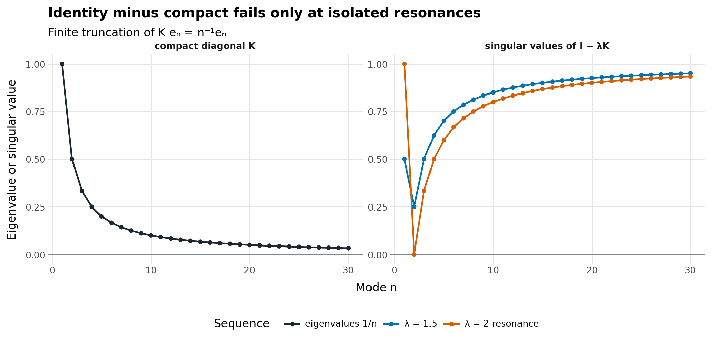

# Fredholm Operators and Compact Perturbations {#sec-fredholm-theory}

Linear equations in infinite-dimensional spaces can fail in more ways than a
square matrix equation: the kernel can be large, the range can be nonclosed,
and approximate solutions can exist without stable exact solutions. Fredholm
theory isolates operators whose failures remain finite-dimensional. Compact
perturbations of invertible operators form the central class, connecting
integral equations, elliptic boundary problems, and spectral theory.

## Preparation from this book

Bounded operators, adjoints, and quotient spaces come from
[sec-banach-pillars](26-banach-pillars.md#sec-banach-pillars). Compact operators and Hilbert-space orthogonality come
from [sec-hilbert-spectral](27-hilbert-spectral.md#sec-hilbert-spectral). Integral kernels and weak formulations come from
[sec-product-probability](22-product-measures-probability.md#sec-product-probability) and [sec-analysis-pde](32-pde.md#sec-analysis-pde). This chapter states every new
finite-dimensional defect explicitly.

## Fredholm operators and index

Let $T:X\to Y$ be bounded between Banach spaces. It is **Fredholm** when

1. $\ker T$ is finite-dimensional;
2. $\operatorname{Ran}T$ is closed; and
3. the cokernel $Y/\operatorname{Ran}T$ is finite-dimensional.

Its **index** is

$$
\operatorname{ind}T
=\dim\ker T-\operatorname{codim}\operatorname{Ran}T.
$$

Injectivity and surjectivity are separate defects. The index records their
difference, not their individual sizes. An invertible operator is Fredholm of
index zero.

On Hilbert spaces,

$$
\operatorname{Ran}T^\perp=\ker T^*.
$$

When the range is closed, its codimension equals $\dim\ker T^*$, so

$$
\operatorname{ind}T=\dim\ker T-\dim\ker T^*.
$$

The unilateral right shift on $\ell^2$,

$$
S(x_1,x_2,\ldots)=(0,x_1,x_2,\ldots),
$$

is injective and has closed range of codimension one. Hence
$\operatorname{ind}S=-1$. Its adjoint is the left shift, whose kernel is
the span of the first coordinate vector.

### Why a finite matrix can conceal the main issue

Every linear map between finite-dimensional spaces is Fredholm because all
kernels and cokernels are finite and all ranges are closed. Singular values
can report the two defect dimensions:

```python
import numpy as np
from numpy.typing import NDArray

def finite_defects(
    matrix: NDArray[np.float64], tolerance: float
) -> tuple[int, int, int]:
    """Return nullity, cokernel dimension, and finite-dimensional index."""
    if matrix.ndim != 2 or tolerance <= 0.0:
        raise ValueError("matrix must be two-dimensional and tolerance positive")
    singular_values = np.linalg.svd(matrix, compute_uv=False)
    rank = int(np.sum(singular_values > tolerance))
    nullity = matrix.shape[1] - rank
    cokernel = matrix.shape[0] - rank
    return nullity, cokernel, nullity - cokernel

example = np.array([[1.0, 0.0, 0.0], [0.0, 1e-10, 0.0]])
for threshold in (1e-8, 1e-12):
    print(threshold, finite_defects(example, threshold))
```

The reported numerical rank changes with tolerance, while the exact index of
any $2$-by-$3$ matrix is $3-2=1$. In infinite dimensions, finite nullity does
not imply closed range, so a matrix rank calculation cannot establish that an
operator is Fredholm.

## Invertibility modulo compact operators

An operator $K:X\to Y$ is compact when it sends bounded sequences to sequences
with convergent image subsequences. Finite-rank operators are compact, and norm
limits of compact operators are compact.

**Theorem 46.1 (Atkinson's).** A bounded $T:X\to Y$ is Fredholm exactly when there is
a bounded $S:Y\to X$ such that

$$
ST-I_X\quad\text{and}\quad TS-I_Y
$$

are compact. Thus a Fredholm operator is invertible after compact errors are
ignored.

For the forward direction, choose complements to the finite kernel and to the
finite-codimensional range. Invert $T$ between the complementary pieces and
define $S$ arbitrarily on the finite defect spaces. The two errors then have
finite rank. For the converse, a bounded sequence in $\ker T$ would be turned
by $ST=I+$ compact into a sequence with a convergent subsequence, forcing the
unit ball of the kernel to be compact and hence the kernel finite-dimensional.
Related estimates yield closed range and finite cokernel.

The theorem is structural rather than a numerical recipe: it quantifies over
the whole unit ball and uses compactness in the ambient norms.

## Stability and index invariance

If $T$ is Fredholm and $K$ compact, then $T+K$ is Fredholm and

$$
\operatorname{ind}(T+K)=\operatorname{ind}T.
$$

Indeed, the same parametrix $S$ works modulo additional compact products.
Index is also locally constant in the operator norm on the open set of
Fredholm operators. Kernels can appear or disappear under perturbation, but
the kernel and cokernel defects change together so their difference remains
fixed.

Compactness cannot simply be replaced by boundedness. For example, the zero
operator is a bounded perturbation of the identity by $-I$, but on an
infinite-dimensional space it has infinite-dimensional kernel and cokernel.
The conclusion fails completely.

<figure id="fig-fredholm-alternative">


<figcaption>

Figure 46.1: Singular values of identity minus a compact diagonal model approach one, while one parameter choice creates a finite-dimensional kernel at resonance.

</figcaption>
</figure>

[Figure 46.1](#fig-fredholm-alternative) uses a finite truncation of a diagonal compact
operator. The tail clustering near one reflects compact perturbation of the
identity. The infinite theorem, rather than the displayed truncation, proves
closed range and finite defect.

## The Riesz–Schauder theorem

Let $K:X\to X$ be compact. Then every nonzero spectral value of $K$ is an
eigenvalue of finite multiplicity, and nonzero eigenvalues can accumulate only
at zero. Consequently

$$
I-\lambda K
$$

is Fredholm of index zero for every scalar $\lambda$. This is the
Riesz–Schauder theorem.

The decisive compactness argument is worth seeing. If
$\ker(I-\lambda K)$ were infinite-dimensional, Riesz's lemma would provide a
bounded sequence of unit vectors separated from one another. On the kernel,
$x=\lambda Kx$, so compactness of $K$ would make that sequence have a
convergent subsequence, a contradiction. Closed range and finite cokernel
follow from analogous quotient arguments and the adjoint relation.

Index zero implies the **Fredholm alternative**:

$$
I-\lambda K\text{ injective}
\quad\Longleftrightarrow\quad
I-\lambda K\text{ surjective}.
$$

Therefore exactly one of these situations occurs:

- the homogeneous equation $x-\lambda Kx=0$ has a nonzero solution; or
- for every $y$, the inhomogeneous equation $x-\lambda Kx=y$ has a unique
  solution.

On a Hilbert space, a particular $y$ lies in the range exactly when

$$
\langle y,z\rangle=0
\quad\text{for every }z\in\ker(I-\overline\lambda K^*).
$$

At resonance, solvability requires compatibility with the adjoint nullspace
and solutions are nonunique up to the original nullspace.

## Neumann series: a stronger easy case

If $\|\lambda K\|<1$, then no compactness is needed. The geometric operator
series converges in norm:

$$
(I-\lambda K)^{-1}
=\sum_{n=0}^\infty(\lambda K)^n.
$$

Multiplication by $I-\lambda K$ telescopes, and the remainder obeys

$$
\left\|
(I-\lambda K)^{-1}
-\sum_{n=0}^{N}(\lambda K)^n
\right\|
\le
\frac{\|\lambda K\|^{N+1}}{1-\|\lambda K\|}.
$$

The norm condition is sufficient, not necessary. An invertible
$I-\lambda K$ may have $\|\lambda K\|\ge1$; then Fredholm theory can still
give solvability even though this series is unavailable.

## Compact integral operators

On $L^2(a,b)$, a kernel $k\in L^2((a,b)^2)$ defines

$$
(Ku)(x)=\int_a^b k(x,y)u(y)\,dy.
$$

Cauchy–Schwarz and Fubini give

$$
\|K\|\le\|k\|_{L^2((a,b)^2)}.
$$

Approximate $k$ in $L^2$ by finite sums
$\sum_{j=1}^m a_j(x)b_j(y)$. Their operators have finite-dimensional range,
and the same estimate controls the operator-norm error. Thus $K$ is compact.

The Fredholm integral equation of the second kind is

$$
u(x)-\lambda\int_a^b k(x,y)u(y)\,dy=f(x).
$$

Away from reciprocal nonzero eigenvalues of $K$, it has a unique solution for
every $f$. At a reciprocal eigenvalue, compatibility with the adjoint
homogeneous equation becomes necessary.

### A bounded Nyström computation

Quadrature turns the integral equation into a weighted matrix equation. The
following routine reports its residual and condition number rather than only
the solution:

```python
import numpy as np
from numpy.typing import NDArray

def nystrom_second_kind(
    grid: NDArray[np.float64], parameter: float
) -> tuple[NDArray[np.float64], float, float]:
    """Solve u - parameter*K*u = 1 for k(x,y)=min(x,y) on [0,1]."""
    if not np.issubdtype(grid.dtype, np.floating):
        raise ValueError("grid must use a real floating-point dtype")
    if grid.ndim != 1 or grid.size < 3 or not np.all(np.isfinite(grid)):
        raise ValueError("grid must contain at least three finite points")
    if grid[0] != 0.0 or grid[-1] != 1.0 or np.any(np.diff(grid) <= 0.0):
        raise ValueError("grid must increase strictly from zero to one")
    if not isinstance(parameter, (int, float, np.integer, np.floating)):
        raise ValueError("parameter must be a finite real number")
    if not np.isfinite(parameter):
        raise ValueError("parameter must be a finite real number")
    widths = np.diff(grid)
    weights = np.empty_like(grid)
    weights[0] = widths[0] / 2.0
    weights[-1] = widths[-1] / 2.0
    weights[1:-1] = (widths[:-1] + widths[1:]) / 2.0
    kernel = np.minimum(grid[:, None], grid[None, :])
    operator = np.eye(grid.size) - parameter * kernel * weights[None, :]
    right_hand_side = np.ones(grid.size)
    solution = np.linalg.solve(operator, right_hand_side)
    residual = float(np.max(np.abs(operator @ solution - right_hand_side)))
    return solution, residual, float(np.linalg.cond(operator))

mesh = np.linspace(0.0, 1.0, 81)
for parameter in (0.5, 2.0):
    solution, residual, condition = nystrom_second_kind(mesh, parameter)
    print(parameter, solution[-1], residual, condition)
```

This solves two finite weighted systems. Its residual is the residual of the
weighted **matrix**, and its condition number uses Euclidean vector norms. Neither
is automatically a bound in the supremum norm for a function on $[0,1]$. The
following worked continuation supplies the missing continuum argument for this
particular kernel. It does not assume that a successful solve has proved the
Fredholm alternative.

## Worked investigation: from a matrix residual to a function error {#sec-fredholm-certificate}

### Predict the exceptional parameter before solving

Work now on $C([0,1])$ with the supremum norm and write

$$
(Ku)(x)=\int_0^x yu(y)\,dy+x\int_x^1u(y)\,dy.
$$

The fundamental theorem of calculus gives

$$
(Ku)'(x)=\int_x^1u(y)\,dy,\qquad (Ku)''=-u,
\qquad (Ku)(0)=0,\quad (Ku)'(1)=0.
$$

This is also a compact operator on the space now being used: a bounded set of
inputs gives uniformly bounded outputs with uniformly bounded first derivatives.
Arzelà–Ascoli from [sec-baire-ascoli](25-baire-ascoli.md#sec-baire-ascoli) therefore supplies uniformly convergent
image subsequences. Compactness on $L^2$ alone would not establish this claim in
the different supremum norm.

Thus a solution of $u-\lambda Ku=1$ is twice continuously differentiable and
satisfies

$$
u''+\lambda u=0,\qquad u(0)=1,\quad u'(1)=0.
$$

Conversely, if these differential and boundary equations hold, then
$w=u-\lambda Ku-1$ has $w''=0$, $w(0)=0$, and $w'(1)=0$, so $w=0$.
This converse is essential: differentiating an integral equation without
recovering its boundary conditions can introduce spurious solutions.

For $\lambda=k^2>0$, solving the two boundary conditions gives

$$
u(x)=\frac{\cos(k(1-x))}{\cos k},\qquad \cos k\ne0.
$$

At $k=\pi/2+n\pi$, $n=0,1,\ldots$, the condition $u'(1)=0$ makes
$u(x)=A\cos(k(1-x))$, whose value at zero is zero rather than one. There is
**no** solution for the stated forcing. This is the adjoint compatibility
condition in concrete form: the homogeneous eigenfunction is $\sin(kx)$,
and $\int_0^1 1\sin(ky)\,dy=1/k\ne0$. If instead the forcing is zero,
every scalar multiple of $\sin(kx)$ solves the homogeneous equation.
The first exceptional parameter is $\lambda=\pi^2/4$, not a threshold chosen
by a linear solver. A discretisation can be invertible at this continuum
resonance; a finite solution then does not solve the continuum equation.

### Prove a stability constant in the required norm

For $0<k<\pi/2$, the Green kernel for
$-v''-k^2v=f$, $v(0)=0$, $v'(1)=0$ is

$$
G_k(x,y)=
\frac{\sin(k\min(x,y))\cos(k(1-\max(x,y)))}{k\cos k}.
$$

To check it, differentiate away from $x=y$, check the two boundary conditions,
and observe that its first derivative jumps by $-1$ there. Then

$$
(I-k^2K)^{-1}f=f+k^2\int_0^1G_k(\cdot,y)f(y)\,dy.
$$

Indeed, the Green equation gives $v''=-f-k^2v$; setting $u=f+k^2v$ yields
$v=Ku$ by the two boundary conditions. Every factor of $G_k$ is nonnegative
in this parameter range. Hence positivity, together with the solution for
$f=1$, proves the **exact** norm identity

$$
\|(I-k^2K)^{-1}\|_{\infty\to\infty}
=\|(I-k^2K)^{-1}1\|_\infty
=\frac1{\cos k}.
$$

The lower bound uses $f=1$; the upper bound follows from
$|Tf|\le T1$ whenever $\|f\|_\infty\le1$ and $T$ is this positive inverse.
The constant diverges as the first resonance is approached. At $\lambda=2$,
an exact rational upper bound avoids certifying a rounded cosine:

$$
\cos\sqrt2
\ge1-\frac2{2!}+\frac{2^2}{4!}-\frac{2^3}{6!}
=\frac7{45}>0,
\qquad
\|(I-2K)^{-1}\|_{\infty\to\infty}\le\frac{45}{7}.
$$

The inequality is the alternating-series remainder bound. It applies because
the subsequent term magnitudes decrease to zero. For $\lambda=1/2$, the simpler
bound $\|K\|_{\infty\to\infty}=1/2$ already gives an inverse bound $4/3$.

### Reconstruct a function and bound its continuum residual

Let $0=x_0<\cdots<x_N=1$, $h_j=x_{j+1}-x_j$, and let $p$ be the continuous
piecewise linear interpolant of **any** nodal values $v_j$. The values need not
solve the discrete system exactly. Let $Q_i$ denote the composite trapezoidal
approximation to $(Kp)(x_i)$, and let

$$
d_i=v_i-\lambda Q_i-1,\qquad R=p-\lambda Kp-1.
$$

The two residuals differ. On a cell to the left of $x_i$, the integrand
$yp(y)$ is quadratic, and direct polynomial integration gives

$$
E_i:=Q_i-(Kp)(x_i)
=\frac16\sum_{j<i}(v_{j+1}-v_j)h_j^2.
$$

On cells to the right, the integrand $x_i p(y)$ is linear and the trapezoidal
rule is exact. Therefore $R(x_i)=d_i+\lambda E_i$. On each open cell,
$R''=\lambda p$. The linear interpolation error bound, proved by comparing
with the parabolas $\pm M(x-x_j)(x_{j+1}-x)/2$ when $|R''|\le M$, now gives

$$
\boxed{
\|R\|_\infty\le B:={}
\max_i|d_i+\lambda E_i|
+\frac{|\lambda|}{8}\max_j|v_j|\max_j h_j^2.
}
$$

At $\lambda=2$, let $u$ be the exact solution derived above. Since
$(I-2K)(p-u)=R$, we obtain the genuine function-error certificate

$$
\boxed{\|p-u\|_\infty\le\frac{45}{7}B.}
$$

Every quantity in $B$ can be rational. A printed decimal here is a display of
an exact fraction, not the source of its guarantee. The estimate controls the
whole interval, including points the matrix never sampled.

### An executable exact certificate

On a uniform grid, the trapezoidal equations imply
$v_{i+1}-2v_i+v_{i-1}=-\lambda h^2v_i$,
$v_0=1$, and $v_{N-1}=(1-\lambda h^2/2)v_N$.
The backward recurrence below solves these equations in rational arithmetic.
Conversely, these relations make the discrete residual have zero second
differences, zero first value, and zero last difference; it must be identically
zero. Thus the recurrence solves every weighted matrix row, rather than merely
a necessary differential approximation.
The second function evaluates $B$ for arbitrary rational nodal data.

```python
from fractions import Fraction

def exact_nystrom(intervals: int, parameter: Fraction) -> tuple[Fraction, ...]:
    """Solve the uniform trapezoidal system for min(x,y) and forcing one."""
    if type(intervals) is not int or intervals < 2:
        raise ValueError("intervals must be an integer of at least two")
    if not isinstance(parameter, Fraction):
        raise TypeError("parameter must be an exact Fraction")
    scaled_parameter = parameter / intervals**2
    coefficients = [Fraction(0) for _ in range(intervals + 1)]
    coefficients[-1] = Fraction(1)
    coefficients[-2] = 1 - scaled_parameter / 2
    for index in range(intervals - 2, -1, -1):
        coefficients[index] = (
            (2 - scaled_parameter) * coefficients[index + 1]
            - coefficients[index + 2]
        )
    if coefficients[0] == 0:
        raise ValueError("this discrete system is singular")
    return tuple(value / coefficients[0] for value in coefficients)

def continuum_residual_bound(
    grid: tuple[Fraction, ...], values: tuple[Fraction, ...], parameter: Fraction
) -> Fraction:
    """Bound ||p - parameter*K*p - 1|| infinity for the linear interpolant."""
    if len(grid) < 3 or len(values) != len(grid):
        raise ValueError("use matching grid and value tuples of length at least three")
    if any(not isinstance(value, Fraction) for value in (*grid, *values, parameter)):
        raise TypeError("grid, values, and parameter must contain exact Fractions")
    if grid[0] != 0 or grid[-1] != 1:
        raise ValueError("grid endpoints must be zero and one")
    widths = tuple(right - left for left, right in zip(grid, grid[1:]))
    if min(widths) <= 0:
        raise ValueError("grid must increase strictly")
    weights = (widths[0] / 2,) + tuple(
        (left + right) / 2 for left, right in zip(widths, widths[1:])
    ) + (widths[-1] / 2,)
    nodal_residuals = []
    quadrature_error = Fraction(0)
    for index, position in enumerate(grid):
        quadrature = sum(
            weight * min(position, point) * value
            for point, weight, value in zip(grid, weights, values)
        )
        discrete_residual = values[index] - parameter * quadrature - 1
        nodal_residuals.append(abs(discrete_residual + parameter * quadrature_error))
        if index < len(widths):
            quadrature_error += (
                (values[index + 1] - values[index]) * widths[index]**2 / 6
            )
    return max(nodal_residuals) + (
        abs(parameter) * max(map(abs, values)) * max(widths)**2 / 8
    )

for count in (8, 16, 32):
    nodes = tuple(Fraction(index, count) for index in range(count + 1))
    nodal_values = exact_nystrom(count, Fraction(2))
    bound = Fraction(45, 7) * continuum_residual_bound(nodes, nodal_values, Fraction(2))
    print(count, "function-error upper bound", bound, "approximately", float(bound))
```

The derivation proves this certificate; successful execution checks the stated
finite rational calculations. It does not certify arbitrary kernels, omitted
endpoints, or a parameter at resonance. For inexact imported values, first
specify the rational values actually being certified, for example their exact
decimal strings; silently converting rounded floats does not recover unknown
unrounded data.

For the three printed runs, rounding **up** to short rational bounds gives:

| Intervals $N$ | Certified whole-function error bound |
|---|---|
| 8 | $\Vert p-u\Vert _\infty<7/20$ |
| 16 | $\Vert p-u\Vert _\infty<9/100$ |
| 32 | $\Vert p-u\Vert _\infty<11/500$ |

All three systems have zero algebraic residual, but they carry different
function-error guarantees. Sixteen intervals suffice to certify error below
$1/10$. The last displayed bound does not certify error below $1/100$; it also
does not prove that the actual error exceeds $1/100$. A failed sufficient
certificate is not a counterexample to the desired accuracy.

### Changed task: replace one boundary condition

Before reading the answer, replace the kernel by
$b(x,y)=\min(x,y)-xy$. For $Bu=\int_0^1b(x,y)u(y)\,dy$:

1. Derive both boundary conditions for $Bu$, and then for $u-\lambda Bu=1$.
2. Predict the first positive resonance. Does the old value $\pi^2/4$ still
   obstruct solvability? At the first new resonance, test compatibility for
   forcing one.
3. Derive the inverse supremum norm below the first new resonance, and give an
   exact rational upper bound at $\lambda=2$.
4. Explain why reusing a matrix condition number from the old kernel would not
   prove your answer.

**Explanation.** Here $(Bu)''=-u$ but $(Bu)(0)=(Bu)(1)=0$.
The new conditions are $u(0)=u(1)=1$, not $u'(1)=0$.
For $0<k<\pi$, the solution is
$u(x)=\cos(k(x-1/2))/\cos(k/2)$. The first resonance is now $k=\pi$,
or $\lambda=\pi^2$; forcing one is incompatible with $\sin(\pi x)$ because
its integral is $2/\pi$. There is no obstruction at the old first resonance.
The Dirichlet Green kernel
$\sin(k\min(x,y))\sin(k(1-\max(x,y)))/(k\sin k)$ is nonnegative for
$0<k<\pi$. The same positivity argument yields inverse norm
$1/\cos(k/2)$. At $\lambda=2$, $\cos(\sqrt2/2)\ge1-(\sqrt2/2)^2/2=3/4$,
so the inverse norm is at most $4/3$, considerably smaller than $45/7$.
This is a change in the continuum boundary problem; it is established by its
Green kernel and norm, not by the conditioning of a different finite matrix.

**Source and scope note.** The integral-equation framework and the importance of
the off-grid interpolant can also be studied in Atkinson and Shampine,
[*Solving Fredholm Integral Equations of the Second Kind in Matlab*](https://homepage.math.uiowa.edu/~atkinson/ftp/Fie_paper.pdf),
Sections 2–4. The boundary-value reduction, rational residual certificate, and
changed task here are derived explicitly for these two kernels. General
Nyström convergence needs the additional hypotheses discussed in that paper.

## Elliptic problems and compact resolvents

Let $A$ be a coercive elliptic operator on a bounded domain. Lax–Milgram often
constructs a bounded inverse from a dual space into a Sobolev space. A compact
Sobolev embedding then makes an associated resolvent compact on $L^2$. Spectral
theory yields discrete eigenvalues of finite multiplicity, while Fredholm
theory gives solvability of lower-order compact perturbations.

The abstract pattern is

$$
L=L_0(I+L_0^{-1}B),
$$

where $L_0$ is invertible and $L_0^{-1}B$ is compact. The second factor is
identity plus compact, so it is Fredholm of index zero. This factorisation does
not prove that every differential perturbation is compact: boundary conditions,
mapping spaces, and the compact embedding must be checked.

## Galerkin and conditioning audit

Finite sections can approximate a Fredholm problem, but three distinct claims
must be separated:

1. **consistency:** the discrete operators approximate the continuum operator;
2. **stability:** inverse norms stay controlled away from resonance; and
3. **convergence:** discrete solutions approach the intended continuum solution.

At resonance, a solver may choose one least-squares solution while hiding a
nullspace. Near resonance, residuals may be tiny even though data error is
strongly amplified. Report the smallest singular value, a nullspace estimate,
and compatibility with the discrete adjoint nullspace.

The analytic Fredholm theorem goes further: for an analytic compact-valued
family $K(z)$, either $I-K(z)$ is nowhere invertible or its inverse is
meromorphic with finite-rank principal parts. This is a destination requiring
complex analysis; it is not inferred from sampling finitely many parameter
values.

## Theorem and computation boundary

- Floating-point SVD estimates the singular values of one finite matrix, with
  numerical rank interpreted at a declared tolerance; it cannot
  prove closed range of an infinite-dimensional operator.
- A compact kernel discretisation needs a collectively compact or comparable
  convergence argument before its spectral conclusions transfer.
- The Fredholm alternative is an exact dichotomy, not the observation that a
  condition number became large.
- Compact-perturbation invariance requires the perturbation itself to be
  compact. An operator-norm limit of finite-rank operators is compact, whereas
  pointwise (strong) convergence is insufficient: the coordinate projections
  $P_N$ on $\ell^2$ converge strongly to $I$, but $I$ is not compact because the
  unit vectors $e_n$ have pairwise distance $\sqrt2$ and no convergent subsequence.
- No bounded finite experiment establishes the analytic Fredholm theorem's
  meromorphic conclusion.

<!-- inline-formula-code:start -->
## Formula and finite computation

When $\|K\|<1$, the Neumann approximation is

$$
x_N=\sum_{n=0}^NK^ny,
\qquad
(I-K)x_N=y-K^{N+1}y.
$$

The residual identity is directly executable for a finite matrix.

```python
import numpy as np
from numpy.typing import NDArray

def neumann_solve(
    operator: NDArray[np.float64], target: NDArray[np.float64], degree: int
) -> tuple[NDArray[np.float64], float]:
    """Return a truncated Neumann solution and its residual norm."""
    if operator.ndim != 2 or operator.shape[0] != operator.shape[1]:
        raise ValueError("operator must be square")
    if target.shape != (operator.shape[0],) or degree < 0:
        raise ValueError("target shape must match and degree be nonnegative")
    term = target.copy()
    approximation = term.copy()
    for _ in range(degree):
        term = operator @ term
        approximation += term
    residual = (np.eye(operator.shape[0]) - operator) @ approximation - target
    return approximation, float(np.linalg.norm(residual))

matrix = np.array([[0.2, 0.1], [0.0, -0.25]])
vector = np.array([1.0, 2.0])
for truncation in (0, 2, 5, 10):
    print(truncation, neumann_solve(matrix, vector, truncation))
```

**What the computation establishes.** The decreasing finite residual checks the
telescoping identity for this matrix. The infinite series requires an
operator-norm bound below one; the Fredholm alternative covers a different,
broader compact-operator regime.
<!-- inline-formula-code:end -->

## Summary

Fredholm operators have finite kernel and cokernel and closed range. Atkinson's
theorem identifies them as invertible modulo compact errors, making the index
stable under compact perturbations. For compact $K$, identity minus
$\lambda K$ has index zero, producing the Fredholm alternative. Neumann series
give an explicit inverse under a stronger norm condition, while integral and
elliptic equations require compactness and stability to connect discretisation
with continuum solvability.

## Exercises

<div class="exercise" id="real_analysis-46-fredholm-theory-ex-1">
<p class="exercise-title"><strong>Exercise 1</strong></p>

Compute the kernel, cokernel, and index of the unilateral right shift.

</div>

<div class="exercise" id="real_analysis-46-fredholm-theory-ex-2">
<p class="exercise-title"><strong>Exercise 2</strong></p>

Show an invertible operator is Fredholm of index zero.

</div>

<div class="exercise" id="real_analysis-46-fredholm-theory-ex-3">
<p class="exercise-title"><strong>Exercise 3</strong></p>

Prove a finite-rank perturbation is compact.

</div>

<div class="exercise" id="real_analysis-46-fredholm-theory-ex-4">
<p class="exercise-title"><strong>Exercise 4</strong></p>

Explain why $I+K$ remains Fredholm when $K$ is compact.

</div>

<div class="exercise" id="real_analysis-46-fredholm-theory-ex-5">
<p class="exercise-title"><strong>Exercise 5</strong></p>

Derive the Neumann remainder identity.

</div>

<div class="exercise" id="real_analysis-46-fredholm-theory-ex-6">
<p class="exercise-title"><strong>Exercise 6</strong></p>

Give an invertible scalar example with $\|\lambda K\|\ge1$.

<details class="hint"><summary>Hint 1</summary>

Try a scalar operator $K=k$ on a one-dimensional space: $I-\lambda K$ is invertible
whenever $\lambda k\ne1$, even if $|\lambda k|\ge1$.

</details>

</div>

<div class="exercise" id="real_analysis-46-fredholm-theory-ex-7">
<p class="exercise-title"><strong>Exercise 7</strong></p>

Prove the Hilbert–Schmidt norm bound for an integral kernel.

</div>

<div class="exercise" id="real_analysis-46-fredholm-theory-ex-8">
<p class="exercise-title"><strong>Exercise 8</strong></p>

For a self-adjoint compact $K$, express the compatibility condition at
resonance using eigenvectors.

</div>

<div class="exercise" id="real_analysis-46-fredholm-theory-ex-9">
<p class="exercise-title"><strong>Exercise 9</strong></p>

Explain why every finite matrix is Fredholm and why this makes finite
evidence insufficient.

</div>

<div class="exercise" id="real_analysis-46-fredholm-theory-ex-10">
<p class="exercise-title"><strong>Exercise 10</strong></p>

State consistency, stability, and convergence separately for a Nyström
method.

</div>

<div class="exercise" id="real_analysis-46-fredholm-theory-ex-11">
<p class="exercise-title"><strong>Exercise 11</strong></p>

Show that the zero operator on an infinite-dimensional space is not
Fredholm.

<details class="hint"><summary>Hint 1</summary>

The kernel of the zero operator is the whole space, and so is its cokernel;
both are infinite-dimensional.

</details>

</div>

<div class="exercise" id="real_analysis-46-fredholm-theory-ex-12">
<p class="exercise-title"><strong>Exercise 12</strong></p>

Identify the compact factor needed in the elliptic factorisation.

</div>

## Selected solutions

For Exercise 1, the kernel is zero and the range consists of sequences with
first coordinate zero, so the index is $-1$. Exercise 5 follows by multiplying
the finite geometric sum by $I-K$. For Exercise 6 take the scalar $K=2$ and
$\lambda=1$: $I-K=-1$ is invertible although $\|K\|=2$. Exercise 7 applies
Cauchy–Schwarz in $y$, integrates in $x$, and then uses Fubini. Exercise 8
has a real, nonzero resonant $\lambda$ because $K$ is self-adjoint, and requires
$f\perp\ker(K-\lambda^{-1}I)$. Nonreal $\lambda$ cannot be resonant here.
Exercise 11 has infinite
kernel and infinite-codimensional range.
