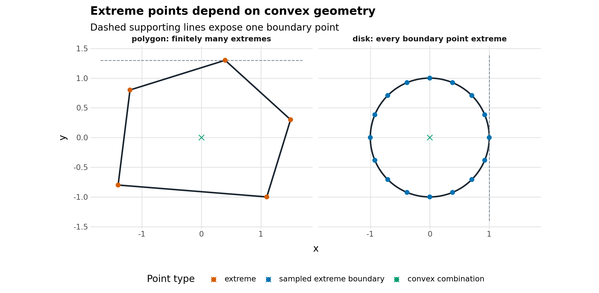

# Extreme Points, Weak Compactness, and Convex Geometry {#sec-extreme-points}

Convexity says that line segments remain inside a set. Extreme-point theory asks
whether an entire compact convex set can be reconstructed from points that
cannot themselves be split along nontrivial segments. In finite dimensions
this is the geometry of vertices and polytopes. In functional analysis the
relevant compactness is often weak or weak-star, and the theorem becomes a
representation principle for functions, measures, and linear functionals.

## Preparation from this book

Convex sets, separation, and subgradients come from [sec-convex-duality](34-convex-duality.md#sec-convex-duality). Weak
and weak-star topologies and Banach–Alaoglu come from [sec-banach-pillars](26-banach-pillars.md#sec-banach-pillars).
Radon measures as functionals on $C(K)$ come from [sec-radon-measures](33-radon-measures.md#sec-radon-measures).
All finite-dimensional linear algebra used below is repaired in the examples.

## Extreme and exposed points

Let $C$ be convex. A point $x\in C$ is **extreme** when

$$
x=(1-t)y+tz,\quad y,z\in C,\quad 0<t<1
$$

forces $y=z=x$. Thus $x$ does not lie in the interior of a nontrivial segment
contained in $C$.

The extreme points of a polygon are its vertices. Every boundary point of a
strictly convex disk is extreme, while the interior of an edge of a square is
not. The closed unit ball of a strictly convex normed space has every unit
vector extreme.

A point $x$ is **exposed** if some continuous linear functional $\phi$ has a
strict maximum there:

$$
\phi(x)>\phi(y)\quad\text{for every }y\in C\setminus\{x\}.
$$

Every exposed point is extreme. The converse can fail: an extreme point can be
a limit of curved and flat boundary pieces without any single supporting
functional isolating it. Optimisation algorithms naturally find exposed faces,
so the distinction matters.

## Finite convex combinations

The convex hull of $A\subset\mathbb R^d$ consists of finite combinations

$$
x=\sum_{j=1}^m\lambda_j a_j,
\qquad
\lambda_j\ge0,\qquad
\sum_{j=1}^m\lambda_j=1.
$$

**Theorem 47.1 (Carathéodory's).** Every point of $\operatorname{conv}A$ in
$\mathbb R^d$ can be represented using at most $d+1$ points of $A$.

If a representation uses more than $d+1$ points, the augmented vectors
$(a_j,1)\in\mathbb R^{d+1}$ are linearly dependent. Choose coefficients
$c_j$, not all zero, with

$$
\sum_jc_ja_j=0,\qquad \sum_jc_j=0.
$$

Replace $\lambda_j$ by $\lambda_j-sc_j$. Choosing the largest $s$ that keeps
all weights nonnegative makes at least one weight zero without changing either
the represented point or total mass. Repeat finitely many times.

### Barycentric coordinates as a certificate

For an affinely independent simplex, a square augmented system finds its unique
barycentric weights:

```python
import numpy as np
from numpy.typing import NDArray

def barycentric_coordinates(
    vertices: NDArray[np.float64], point: NDArray[np.float64]
) -> tuple[NDArray[np.float64], float]:
    """Return simplex weights and reconstruction residual."""
    if vertices.ndim != 2 or point.shape != (vertices.shape[1],):
        raise ValueError("vertices must be rows and point must match their dimension")
    if vertices.shape[0] != vertices.shape[1] + 1:
        raise ValueError("a d-dimensional simplex needs d+1 vertices")
    augmented = np.vstack((vertices.T, np.ones(vertices.shape[0])))
    if np.linalg.matrix_rank(augmented) != augmented.shape[0]:
        raise ValueError("vertices must be affinely independent")
    target = np.append(point, 1.0)
    weights = np.linalg.solve(augmented, target)
    residual = float(np.linalg.norm(weights @ vertices - point))
    return weights, residual

triangle = np.array([[0.0, 0.0], [2.0, 0.0], [0.0, 1.0]])
for target in (np.array([0.5, 0.25]), np.array([2.0, 1.0])):
    print(target, barycentric_coordinates(triangle, target))
```

Weights summing to one reconstruct the affine point; nonnegative weights certify
membership in the triangle. The second target has a negative weight and is
outside. Floating-point signs require a declared tolerance in a numerical
membership test.

<figure id="fig-extreme-points-convexity">


<figcaption>

Figure 47.1: A polygon is reconstructed from its vertices, while every point of a strictly convex disk boundary is extreme and only selected points are exposed by displayed supporting lines.

</figcaption>
</figure>

[Figure 47.1](#fig-extreme-points-convexity) contrasts finite and infinite extreme sets.
Neither picture records which topology supplies compactness; that hypothesis is
the decisive infinite-dimensional issue.

## The Krein–Milman theorem

**Theorem 47.2 (Krein–Milman).** Let $K$ be a nonempty compact convex subset of a
Hausdorff locally convex topological vector space. Then

$$
K=\overline{\operatorname{conv}}(\operatorname{ext}K).
$$

In particular, $K$ has an extreme point. The closure and topology are part of
the statement. In finite dimensions the convex hull of a compact set is compact,
but in infinite dimensions closure cannot be omitted.

The proof combines separation and compactness. If the closed convex hull of the
extreme points missed $x\in K$, a continuous functional would strictly separate
$x$ from that hull. Maximise the functional on $K$; compactness gives a
nonempty compact face of maximisers. A minimal nonempty compact face, obtained
through an inclusion argument, must be a singleton—otherwise local convexity
supplies a functional that cuts it to a smaller face. Its point is extreme in
$K$, contradicting separation.

This is a proof architecture, not a finite algorithm. It uses all continuous
linear functionals and compactness in the declared topology.

### Which compactness?

The closed unit ball of an infinite-dimensional Banach space is never
norm-compact. Krein–Milman becomes useful after changing topology:

- if $X$ is reflexive, its closed unit ball is weakly compact;
- the dual unit ball $B_{X^*}$ is weak-star compact by Banach–Alaoglu; and
- probability measures on a compact Hausdorff space form a weak-star compact
  convex subset of $C(K)^*$.

The topology also determines which linear functionals are continuous and
therefore which separating arguments are available. A set may be compact
weak-star but not weakly or in norm.

The unit ball of $L^1[0,1]$ on a nonatomic measure space has no extreme points.
This does not contradict Krein–Milman because that ball is not weakly compact:
$L^1[0,1]$ is not reflexive. Deleting compactness would make the theorem false.

## Probability measures as a convex set

Let $K$ be compact Hausdorff and let $\mathcal P(K)$ be its Radon probability
measures. Convex combinations mix laws:

$$
[(1-t)\mu+t\nu](A)=(1-t)\mu(A)+t\nu(A).
$$

The extreme points are exactly the Dirac measures $\delta_x$. A Dirac mass
cannot be split: if
$\delta_x=(1-t)\mu+t\nu$, evaluate the complement of every neighbourhood of
$x$ to force both measures to concentrate at $x$.

Conversely, if $\mu$ is not a Dirac mass, there is a measurable set $A$ with
$0<\mu(A)<1$. Normalise the restrictions to $A$ and $A^c$:

$$
\mu=\mu(A)\frac{\mu|_A}{\mu(A)}
+[1-\mu(A)]\frac{\mu|_{A^c}}{1-\mu(A)}.
$$

This is a nontrivial convex decomposition. Krein–Milman says the weak-star
closed convex hull of point masses fills $\mathcal P(K)$. Finite empirical
measures are literal finite convex combinations of those extreme points.

For a continuous $f$,

$$
\int_K f\,d\mu
$$

is the barycentric average of the evaluations $f(x)$. This connects the
abstract representation theorem with ordinary expectation.

### The finite simplex

On a finite set of $m$ outcomes, probability measures form

$$
\Delta_{m-1}
=\{p\in\mathbb R^m:p_i\ge0,\ \sum_i p_i=1\}.
$$

Its extreme points are the coordinate vectors $e_i$, and every
$p=\sum_ip_ie_i$ has a unique decomposition. Uniqueness is special to a
simplex. In a square, the centre is the average of either pair of opposite
vertices, so extreme-point representations need not be unique.

## Choquet representation

Krein–Milman gives closure of convex combinations but does not by itself give
one probability measure representing a point. Let $K$ be a nonempty compact
metrizable convex subset of a Hausdorff locally convex real space, and put
$E=\operatorname{ext}K$. The **Choquet theorem** says that $E$ is Borel and every
$x\in K$ has a Borel probability measure $\nu_x$ on $K$ such that

$$
\nu_x(E)=1,
\qquad
\phi(x)=\int_K\phi(y)\,\nu_x(dy)
\quad\text{for every continuous linear }\phi.
$$

Equivalently, restrict $\nu_x$ to $E$ and integrate there. This is the
metrizable version in [Baggett's Theorem 3.11](https://spot.colorado.edu/~baggett/funcchap3.pdf).
The representing measure need not be unique. A Choquet simplex is a compact
convex set with an appropriate uniqueness property. Proving the general theorem
requires measure representation, metrizability, and approximation arguments
beyond a finite Carathéodory reduction, so no later result in this book silently
depends on it.

### A set of full measure and its closed support {#sec-choquet-support}

For a Borel set $A\subset K$, say that $\mu$ is **carried by $A$** when
$\mu(K\setminus A)=0$. The phrase "supported on $A$" is also often used in
this mass-one sense. It must be distinguished from the **topological support
in $K$**:

$$
\operatorname{supp}_K\mu
=\{z\in K:\mu(U)>0\text{ for every relatively open neighbourhood }U\ni z\}.
$$

This support is closed. In a compact metric space it has full measure: the
complement is a union of open null neighbourhoods, and a countable base reduces
that union to countably many null sets. Compare the explicit distinction in
[Hochman's Section 1.3](https://math.huji.ac.il/~mhochman/courses/fractals-2023/notes.pdf).
If $A$ is closed, being carried by $A$ implies
$\operatorname{supp}_K\mu\subset A$. Without closedness, that inference can
fail. Choquet guarantees $\nu_x(E)=1$; it does not require
$\operatorname{supp}_K\nu_x\subset E$. The following example makes the
difference unavoidable, even for a norm-compact set in a Hilbert space.

### A compact example with a nonclosed extreme boundary {#sec-choquet-support-example}

Work in the real Hilbert space $H=\mathbb R\oplus\ell^2$, with
$\|(s,x)\|^2=s^2+\sum_{n\ge1}x_n^2$. Let

$$
\begin{gathered}
K=\left\{(s,x)\in H:x_n\ge0\ (n\ge1),\quad
 |s|+\sum_{n\ge1}n x_n\le1\right\},\\
a_+=(1,0),\qquad a_-=(-1,0),\qquad a_n=(0,e_n/n)\quad(n\ge1).
\end{gathered}
$$

Here $e_n$ is the $n$th coordinate vector in $\ell^2$. The nonnegative
weighted series in the definition is bounded by one; we are not treating it
as a continuous functional on $H$.

**Compactness must be proved.** The set is convex and closed: it is the
intersection of the closed coordinate constraints and the closed convex sets
$|s|+\sum_{n=1}^N n x_n\le1$ for all $N$. Its tails satisfy the uniform estimate

$$
\|x_{>N}\|_2
\le\sum_{n>N}x_n
\le\frac1{N+1}\sum_{n>N}n x_n
\le\frac1{N+1}.
$$

The first $N$ coordinates and $s$ lie in a bounded finite-dimensional set.
Finite nets for those coordinates, together with this tail bound, make $K$
totally bounded. It is closed in complete $H$, hence norm compact and
metrizable. It is nonempty, since it contains $o=(0,0)$.

**Every extreme point can be identified.** For $z=(s,x)\in K$, set

$$
P=\sum_{n\ge1}n x_n,\qquad
p_n=n x_n,\qquad
p_+=\frac{1-P+s}{2},\qquad
p_-=\frac{1-P-s}{2}.
$$

These weights are nonnegative and sum to one, and

$$
z=p_+a_++p_-a_-+\sum_{n\ge1}p_n a_n.
$$

This is a norm-convergent convex **series**, not necessarily a finite convex
combination: $\sum p_n\|a_n\|=\sum x_n\le P\le1$.
The coordinate functional $x_n$ uniquely exposes $a_n$, and $s$ and $-s$
uniquely expose $a_+$ and $a_-$. If at least two displayed weights are positive,
split off one strictly between zero and one. The normalised remaining weights
give a different point of $K$, so $z$ lies in a nontrivial segment. Consequently

$$
E=\operatorname{ext}K=\{a_+,a_-\}\cup\{a_n:n\ge1\}.
$$

Although every point of $E$ is exposed, $a_n\to o$, and
$o=(a_++a_-)/2$ is not extreme. Thus $E$ is Borel and not closed.
Also $P(a_n)=1$ whereas $P(o)=0$: the weighted sum $P$ is not a continuous
test functional, even on this compact set.

**A representing law whose closed support leaves $E$.** Take

$$
b=\left(0,\left(\frac{2^{-n}}n\right)_{n\ge1}\right),
\qquad
\mu=\sum_{n\ge1}2^{-n}\delta_{a_n}.
$$

The weights sum to one. The absolutely convergent barycentre series gives
$\phi(b)=\int_K\phi\,d\mu$ for every continuous linear functional $\phi$,
and $\mu(E)=1$. This atomic probability is Radon: finite sets of atoms
approximate any Borel-set mass from inside, and excluding finitely many
unwanted atoms gives open supersets with arbitrarily small excess mass.

If $\rho$ is any representing probability carried by $E$, the $n$th coordinate
test forces $\rho(\{a_n\})=n b_n=2^{-n}$. These masses already exhaust one,
so both endpoint masses are zero and $\rho=\mu$. This is uniqueness among
$E$-carried laws. The probability $\delta_b$ also represents $b$ on $K$,
but is not carried by $E$.

For every integer $N\ge1$, use the **open** relative ball about $o$:

$$
\mu\bigl(\{z\in K:\|z-o\|<1/N\}\bigr)
=\sum_{n>N}2^{-n}=2^{-N}>0.
$$

Hence $\mu(\{o\})=0$ but

$$
\operatorname{supp}_K\mu=\{o\}\cup\{a_n:n\ge1\}\not\subset E.
$$

The support is exactly this closure of the positive atoms; points outside it
have a neighbourhood missing every atom. Nor can another representing law have
closed support contained in $E$: support has full measure on compact metric
$K$, so such a law would be $E$-carried and would have to equal $\mu$.

**The closure in Krein–Milman is also visible.** Every finite convex
combination of $E$ has only finitely many nonzero $\ell^2$ coordinates, so
$b\notin\operatorname{conv}E$. Nevertheless

$$
\begin{aligned}
b_N&=\sum_{n=1}^N2^{-n}a_n
 +2^{-(N+1)}a_++2^{-(N+1)}a_-,\\
\|b-b_N\|&\le\frac{2^{-N}}{N+1}\longrightarrow0.
\end{aligned}
$$

The weights of $b_N$ sum to one. Thus
$b\in\overline{\operatorname{conv}}E$ while no finite representation exists.
The infinite probability $\mu$ supplies Choquet's mass-one representation.
Carathéodory applies to each finite-dimensional truncation, not to all of $H$
with one fixed finite dimension. No finite sample of the atoms proves these
infinite-tail statements; the displayed bounds and coordinate arguments do.

## Strict and uniform convexity

A normed space is **strictly convex** when distinct unit vectors have midpoint
of norm less than one. It is **uniformly convex** when for every
$\varepsilon>0$ there is $\delta(\varepsilon)>0$ such that

$$
\|x\|,\|y\|\le1,\quad \|x-y\|\ge\varepsilon
\quad\Longrightarrow\quad
\left\|\frac{x+y}{2}\right\|\le1-\delta(\varepsilon).
$$

Strict convexity gives uniqueness of best approximations when they exist.
Uniform convexity supplies one separation amount that works everywhere on the
unit ball.

In a Hilbert space, the parallelogram law gives

$$
\left\|\frac{x+y}{2}\right\|^2
=\frac{\|x\|^2+\|y\|^2}{2}
-\frac{\|x-y\|^2}{4}
\le1-\frac{\varepsilon^2}{4}.
$$

Thus one may take

$$
\delta_H(\varepsilon)
=1-\sqrt{1-\varepsilon^2/4},
\qquad 0\le\varepsilon\le2.
$$

The Milman–Pettis theorem says every uniformly convex Banach space is
reflexive. In such a space, weak convergence plus convergence of norms implies
norm convergence:

$$
x_n\rightharpoonup x,\quad \|x_n\|\to\|x\|
\quad\Longrightarrow\quad
\|x_n-x\|\to0.
$$

After normalisation, a separated subsequence would have midpoints uniformly
inside the unit ball, while a norming functional for $x$ forces those midpoint
norms back toward one. The contradiction converts weak information into strong
convergence.

### A finite modulus check

The Hilbert modulus formula and midpoint norm are directly comparable:

```python
from math import sqrt

import numpy as np

def hilbert_modulus(distance: float) -> float:
    """Return the Hilbert-space uniform-convexity modulus."""
    if not 0.0 <= distance <= 2.0:
        raise ValueError("distance between unit-ball points lies in [0, 2]")
    return 1.0 - sqrt(1.0 - distance**2 / 4.0)

angles = np.linspace(0.0, np.pi, 6)
for angle in angles:
    first = np.array([1.0, 0.0])
    second = np.array([np.cos(angle), np.sin(angle)])
    distance = float(np.linalg.norm(first - second))
    midpoint_norm = float(np.linalg.norm((first + second) / 2.0))
    print(distance, midpoint_norm, 1.0 - hilbert_modulus(distance))
```

For unit vectors, the last two values agree up to roundoff. The calculation
checks Euclidean geometry; the Milman–Pettis theorem for every uniformly
convex Banach space is not a finite-dimensional consequence.

## Optimisation and representation audit

An affine continuous functional on compact convex $K$ attains its maximum, and
the maximising set is a compact face. Krein–Milman applied to that face shows
that some extreme point maximises the functional. Linear optimisation can
therefore be reduced to extreme points even when the extreme set is infinite.

Three cautions matter:

1. a maximiser need not be unique;
2. an extreme point need not be exposed by one objective; and
3. numerical vertices of a discretised feasible set need not approximate all
   extreme points of an infinite-dimensional set.

For moment problems, finitely many linear constraints often imply that an
extreme feasible measure has finite support. The exact support bound depends on
the number and independence of constraints. It should be derived for the stated
problem, not guessed from a plotted simplex.

## Theorem and computation boundary

- Barycentric weights certify one finite convex combination after a tolerance
  is declared.
- A convex-hull algorithm in $\mathbb R^d$ cannot verify weak or weak-star
  compactness.
- Sampling finitely many functionals cannot prove that a point is extreme,
  because extremality quantifies over every possible decomposition.
- Krein–Milman gives closed convex generation, not a unique representation.
- Choquet gives a representing measure carried by the extreme set. Its ambient
  closed support may contain nonextreme limit points of that set.
- Uniqueness among extreme-carried representing laws is different from
  uniqueness among all probabilities on the compact convex set.

<!-- inline-formula-code:start -->
## Formula and finite computation

Jensen's finite inequality is

$$
f\left(\sum_{j=1}^m\lambda_jx_j\right)
\le\sum_{j=1}^m\lambda_jf(x_j).
$$

The following block computes the barycentre and both sides for
$f(x)=\|x\|_2^2$.

```python
import numpy as np
from numpy.typing import NDArray

def squared_norm_jensen(
    points: NDArray[np.float64], weights: NDArray[np.float64]
) -> tuple[float, float]:
    """Return Jensen's left and right sides for squared Euclidean norm."""
    if points.ndim != 2 or weights.shape != (points.shape[0],):
        raise ValueError("points must be rows with one weight per point")
    if points.shape[0] == 0 or np.any(weights < 0.0):
        raise ValueError("use nonempty points and nonnegative weights")
    if not np.isclose(float(weights.sum()), 1.0):
        raise ValueError("weights must sum to one")
    barycentre = weights @ points
    left = float(barycentre @ barycentre)
    right = float(weights @ np.sum(points**2, axis=1))
    return left, right

cloud = np.array([[0.0, 0.0], [2.0, 0.0], [0.0, 1.0]])
probabilities = np.array([0.2, 0.3, 0.5])
print(squared_norm_jensen(cloud, probabilities))
```

**What the computation establishes.** It verifies one finite Jensen instance.
The closed convex hull in Krein–Milman may require limits of such
combinations, and its existence depends on compactness in the stated topology.
<!-- inline-formula-code:end -->

## Summary

Extreme points are the indecomposable points of a convex set; exposed points
are those isolated by a continuous linear objective. Carathéodory bounds finite
representations in Euclidean space. Krein–Milman reconstructs a compact convex
set as the closed convex hull of its extreme points, with weak and weak-star
compactness supplying the important functional-analytic cases. Probability
measures make point masses extreme, Choquet theory turns convex generation into
barycentric representation, and its mass-one conclusion does not require closed
support inside a nonclosed extreme set. Uniform convexity converts qualitative
roundness into quantitative convergence.

## Exercises

<div class="exercise" id="real_analysis-47-extreme-points-ex-1">
<p class="exercise-title"><strong>Exercise 1</strong></p>

Find the extreme points of an interval, triangle, square, and Euclidean ball.

</div>

<div class="exercise" id="real_analysis-47-extreme-points-ex-2">
<p class="exercise-title"><strong>Exercise 2</strong></p>

Prove every exposed point is extreme.

<details class="solution"><summary>Solution</summary>

For Exercise 2, a nontrivial decomposition of an exposed point would make the
exposing functional's strict maximum equal a proper average of smaller values.

</details>

</div>

<div class="exercise" id="real_analysis-47-extreme-points-ex-3">
<p class="exercise-title"><strong>Exercise 3</strong></p>

Give two different extreme-point decompositions of the centre of a square.

</div>

<div class="exercise" id="real_analysis-47-extreme-points-ex-4">
<p class="exercise-title"><strong>Exercise 4</strong></p>

Carry out one Carathéodory reduction step from an affinely dependent
representation.

<details class="hint"><summary>Hint 1</summary>

Exercise 4 uses a nonzero affine dependence and moves weights until one first
reaches zero.

</details>

</div>

<div class="exercise" id="real_analysis-47-extreme-points-ex-5">
<p class="exercise-title"><strong>Exercise 5</strong></p>

Prove the coordinate vectors are exactly the extreme points of a finite
probability simplex.

<details class="solution"><summary>Solution</summary>

In Exercise 5, any vector with two positive coordinates can move
a small amount of mass between them and is not extreme; coordinate vectors
cannot split.

</details>

</div>

<div class="exercise" id="real_analysis-47-extreme-points-ex-6">
<p class="exercise-title"><strong>Exercise 6</strong></p>

Prove a non-Dirac probability measure admits a nontrivial decomposition.

<details class="hint"><summary>Hint 1</summary>

Exercise 6 normalises restrictions to a set of probability
strictly between zero and one.

</details>

</div>

<div class="exercise" id="real_analysis-47-extreme-points-ex-7">
<p class="exercise-title"><strong>Exercise 7</strong></p>

Explain why norm compactness cannot be used for an infinite-dimensional
closed unit ball.

</div>

<div class="exercise" id="real_analysis-47-extreme-points-ex-8">
<p class="exercise-title"><strong>Exercise 8</strong></p>

Apply Krein–Milman to a weak-star compact dual unit ball.

</div>

<div class="exercise" id="real_analysis-47-extreme-points-ex-9">
<p class="exercise-title"><strong>Exercise 9</strong></p>

Derive the Hilbert modulus from the parallelogram identity.

<details class="hint"><summary>Hint 1</summary>

Exercise 9 substitutes the unit bounds and
distance lower bound into the parallelogram identity.

</details>

</div>

<div class="exercise" id="real_analysis-47-extreme-points-ex-10">
<p class="exercise-title"><strong>Exercise 10</strong></p>

Show uniform convexity implies strict convexity.

</div>

<div class="exercise" id="real_analysis-47-extreme-points-ex-11">
<p class="exercise-title"><strong>Exercise 11</strong></p>

Explain why the nonatomic $L^1$ unit ball does not contradict
Krein–Milman.

<details class="solution"><summary>Solution</summary>

Exercise 11 fails the
compactness hypothesis because nonatomic $L^1$ is not reflexive.

</details>

</div>

<div class="exercise" id="sec-choquet-support-task-exercise">

### Exercise 12: classify a changed representing law {#sec-choquet-support-task}

Distinguish Carathéodory, Krein–Milman, and Choquet conclusions by completing
the [support classification](#sec-choquet-support-task) below.

Use the compact $K$ and extreme set $E$ from the
[worked example](#sec-choquet-support-example), now with an arbitrary
$z=(s,x)\in K$.

1. Determine every probability carried by $E$ that represents $z$. Prove
   existence and uniqueness within that class, and distinguish it from
   uniqueness among all probabilities on $K$.
2. Give necessary and sufficient conditions on $x$ for
   $z\in\operatorname{conv}E$, and for its $E$-carried representing law to have
   $\operatorname{supp}_K\mu_z\subset E$. Justify each direction without
   assuming that $E$ is closed.
3. For
   $$
   z_* =\left(\frac14,
     \left(\frac{2^{-n-1}}n\right)_{n\ge1}\right),
   $$
   find every atom's mass and the full topological support. Decide whether a
   finite extreme-point combination, or any representing law with closed
   support contained in $E$, is possible.
4. Identify the roles of Carathéodory, Krein–Milman and Choquet in these
   conclusions. Does uniqueness for this $K$ contradict the square example?

Try the classification before opening its [hint](#sec-choquet-support-hint)
or [full solution](#sec-choquet-support-solution).

<details class="hint"><summary>Hint 1</summary>

Test each coordinate and then $s$; total probability determines the sum of the
endpoint masses. For support, take the closure in $K$ of the positive atoms.
An infinite subset of the $a_n$ has $o$ as a limit point. The set of positive
atoms need not be the closed support. Return to the
[task](#sec-choquet-support-task) or continue to the
[full solution](#sec-choquet-support-solution).

</details>

<details class="solution"><summary>Solution</summary>

**1. All extreme-carried laws.** With $P=\sum n x_n$, the only possible law is

$$
\mu_z=\frac{1-P+s}{2}\delta_{a_+}
 +\frac{1-P-s}{2}\delta_{a_-}
 +\sum_{n\ge1}n x_n\delta_{a_n}.
$$

The defining inequality for $K$ makes these coefficients nonnegative and their
sum is one. The norm-convergent barycentre series proves the identity for every
continuous linear functional. Coordinate tests force the $a_n$ masses; the
$s$ test gives the difference of endpoint masses, and total mass gives their
sum. This proves uniqueness within the specified class without treating $P$ as
a continuous functional. For a nonextreme $z$, $\delta_z$ is another
representing law on $K$. At $o$, for example, $\delta_o$ and
$(\delta_{a_+}+\delta_{a_-})/2$ are distinct; only the latter is $E$-carried.

**2. The two classifications.** A point is in $\operatorname{conv}E$ exactly
when $I=\{n:x_n>0\}$ is finite. A finite combination has only finitely many
nonzero coordinates; conversely, finite $I$ makes the displayed formula a
finite combination. The support of $\mu_z$ is the closure in $K$ of its positive
atoms. If $I$ is finite, this is a finite subset of $E$; include each endpoint
exactly when its coefficient is positive. If $I$ is infinite, its atoms tend to
$o\notin E$, which therefore belongs to the support. There are no other
accumulation points of $E$. Thus $\operatorname{supp}_K\mu_z\subset E$ also
holds exactly when $I$ is finite. This equivalence is specific to this $K$,
not a general assertion that an extreme-carried law must be finite.

**3. The changed point.** Here $P=1/2$ and $s=1/4$, so

$$
\mu_{z_*}=\frac38\delta_{a_+}+\frac18\delta_{a_-}
 +\sum_{n\ge1}2^{-n-1}\delta_{a_n},
\qquad
\operatorname{supp}_K\mu_{z_*}=E\cup\{o\}.
$$

Every listed atom has positive mass. The infinitely many nonzero coordinates
exclude a finite extreme-point combination. Any representing law with closed
support contained in $E$ would have full mass on $E$ and hence equal this unique
law, whose support contains $o$; it is therefore impossible. The law
$\delta_{z_*}$ represents $z_*$ but has support outside $E$, so does not evade
that conclusion.

**4. Which theorem?** Keeping $s$ and the first $N$ coordinates gives a space
of dimension $N+1$, where Carathéodory bounds finite representations by $N+2$
vertices. The extreme set $E$ spans infinitely many independent coordinate
directions, so the full representation problem has no fixed finite-dimensional
Carathéodory hypothesis. The finite
$b_N\to b$ enact the closure in Krein–Milman; $\mu$ and $\mu_z$ enact the
mass-one assertion in Choquet, without the stronger closed-support assertion.
Uniqueness within the extreme-carried class for this particular $K$ is compatible
with nonuniqueness in a square. Return to the [task](#sec-choquet-support-task)
or review the [worked example](#sec-choquet-support-example).

</details>

</div>

## Selected solutions

For Exercise 2, a nontrivial decomposition of an exposed point would make the
exposing functional's strict maximum equal a proper average of smaller values.
Exercise 4 uses a nonzero affine dependence and moves weights until one first
reaches zero. In Exercise 5, any vector with two positive coordinates can move
a small amount of mass between them and is not extreme; coordinate vectors
cannot split. Exercise 6 normalises restrictions to a set of probability
strictly between zero and one. Exercise 9 substitutes the unit bounds and
distance lower bound into the parallelogram identity. Exercise 11 fails the
compactness hypothesis because nonatomic $L^1$ is not reflexive.

### Exercise 12 — Hint {#sec-choquet-support-hint}

Test each coordinate and then $s$; total probability determines the sum of the
endpoint masses. For support, take the closure in $K$ of the positive atoms.
An infinite subset of the $a_n$ has $o$ as a limit point. The set of positive
atoms need not be the closed support. Return to the
[task](#sec-choquet-support-task) or continue to the
[full solution](#sec-choquet-support-solution).

### Exercise 12 — Full solution {#sec-choquet-support-solution}

**1. All extreme-carried laws.** With $P=\sum n x_n$, the only possible law is

$$
\mu_z=\frac{1-P+s}{2}\delta_{a_+}
 +\frac{1-P-s}{2}\delta_{a_-}
 +\sum_{n\ge1}n x_n\delta_{a_n}.
$$

The defining inequality for $K$ makes these coefficients nonnegative and their
sum is one. The norm-convergent barycentre series proves the identity for every
continuous linear functional. Coordinate tests force the $a_n$ masses; the
$s$ test gives the difference of endpoint masses, and total mass gives their
sum. This proves uniqueness within the specified class without treating $P$ as
a continuous functional. For a nonextreme $z$, $\delta_z$ is another
representing law on $K$. At $o$, for example, $\delta_o$ and
$(\delta_{a_+}+\delta_{a_-})/2$ are distinct; only the latter is $E$-carried.

**2. The two classifications.** A point is in $\operatorname{conv}E$ exactly
when $I=\{n:x_n>0\}$ is finite. A finite combination has only finitely many
nonzero coordinates; conversely, finite $I$ makes the displayed formula a
finite combination. The support of $\mu_z$ is the closure in $K$ of its positive
atoms. If $I$ is finite, this is a finite subset of $E$; include each endpoint
exactly when its coefficient is positive. If $I$ is infinite, its atoms tend to
$o\notin E$, which therefore belongs to the support. There are no other
accumulation points of $E$. Thus $\operatorname{supp}_K\mu_z\subset E$ also
holds exactly when $I$ is finite. This equivalence is specific to this $K$,
not a general assertion that an extreme-carried law must be finite.

**3. The changed point.** Here $P=1/2$ and $s=1/4$, so

$$
\mu_{z_*}=\frac38\delta_{a_+}+\frac18\delta_{a_-}
 +\sum_{n\ge1}2^{-n-1}\delta_{a_n},
\qquad
\operatorname{supp}_K\mu_{z_*}=E\cup\{o\}.
$$

Every listed atom has positive mass. The infinitely many nonzero coordinates
exclude a finite extreme-point combination. Any representing law with closed
support contained in $E$ would have full mass on $E$ and hence equal this unique
law, whose support contains $o$; it is therefore impossible. The law
$\delta_{z_*}$ represents $z_*$ but has support outside $E$, so does not evade
that conclusion.

**4. Which theorem?** Keeping $s$ and the first $N$ coordinates gives a space
of dimension $N+1$, where Carathéodory bounds finite representations by $N+2$
vertices. The extreme set $E$ spans infinitely many independent coordinate
directions, so the full representation problem has no fixed finite-dimensional
Carathéodory hypothesis. The finite
$b_N\to b$ enact the closure in Krein–Milman; $\mu$ and $\mu_z$ enact the
mass-one assertion in Choquet, without the stronger closed-support assertion.
Uniqueness within the extreme-carried class for this particular $K$ is compatible
with nonuniqueness in a square. Return to the [task](#sec-choquet-support-task)
or review the [worked example](#sec-choquet-support-example).
