# Appendix H — Python laboratories for analysis {#sec-analysis-python-laboratory}

Real analysis explains why limiting procedures are legal. Python can make those
procedures visible, but it only manipulates finite data in finite precision.
This appendix teaches that distinction through twenty self-contained programs.
No programming background is assumed: each block imports what it needs, names its
inputs, validates its domain, and can be copied into a fresh Python file or
notebook cell.

The governing question is never merely “What number did the computer print?”
Ask instead: What finite set was inspected? Which norm or error was measured?
What theorem would extend the observation beyond the sample? What failure could
the grid miss?

## Python notation from the beginning

Python's `=` stores a value; mathematical equality is tested with `==`. A
function begins with `def`, receives the named inputs in parentheses, and sends
its result back with `return`. A `for` loop repeats a finite instruction, while
an `if` line selects a case. Indentation shows which statements belong to that
function, loop, or case. A list is a finite ordered sample and a NumPy array is
a finite rectangular table. Neither one is an infinite sequence, a continuum,
or a proof. When syntax is unfamiliar, replace each line by this plain-language
description before following the calculation.

## Lab 1 — Find an $\varepsilon$–$N$ witness

For $a_n=1/n$, solving $1/n<\varepsilon$ algebraically gives a witness. The
program searches as well, then verifies the strict inequality.

```python
from math import floor

def reciprocal_witness(epsilon: float) -> int:
    """Return N such that 1/n < epsilon for every integer n >= N."""
    if epsilon <= 0.0:
        raise ValueError("epsilon must be positive")
    candidate = floor(1.0 / epsilon) + 1
    if not 1.0 / candidate < epsilon:
        candidate += 1
    return candidate

for epsilon in (0.2, 0.01, 1e-6):
    witness = reciprocal_witness(epsilon)
    print(epsilon, witness, 1.0 / witness)
```

The formula, not the finite loop, proves the “for every $n\ge N$” clause. Try an
epsilon whose reciprocal is exactly an integer to see why strict inequality
matters.

## Lab 2 — Diagnose a Cauchy tail

A finite tail diameter approximates
$\sup_{m,n\ge N}|a_m-a_n|$. For a decreasing sequence it is just the first
minus last sampled value, but the generic code computes all pairwise extremes.

```python
from collections.abc import Callable

import numpy as np
from numpy.typing import NDArray

def sampled_tail_diameter(
    sequence: Callable[[NDArray[np.int64]], NDArray[np.float64]],
    start: int,
    stop: int,
) -> float:
    """Return the diameter of sampled terms a_start through a_stop."""
    if start < 1 or stop < start:
        raise ValueError("require 1 <= start <= stop")
    indices = np.arange(start, stop + 1)
    values = sequence(indices)
    return float(values.max() - values.min())

for start in (10, 100, 1_000):
    diameter = sampled_tail_diameter(lambda n: (-1.0) ** n / n, start, 2 * start)
    print(start, diameter)
```

<figure id="fig-code-cauchy-tail-diameter">
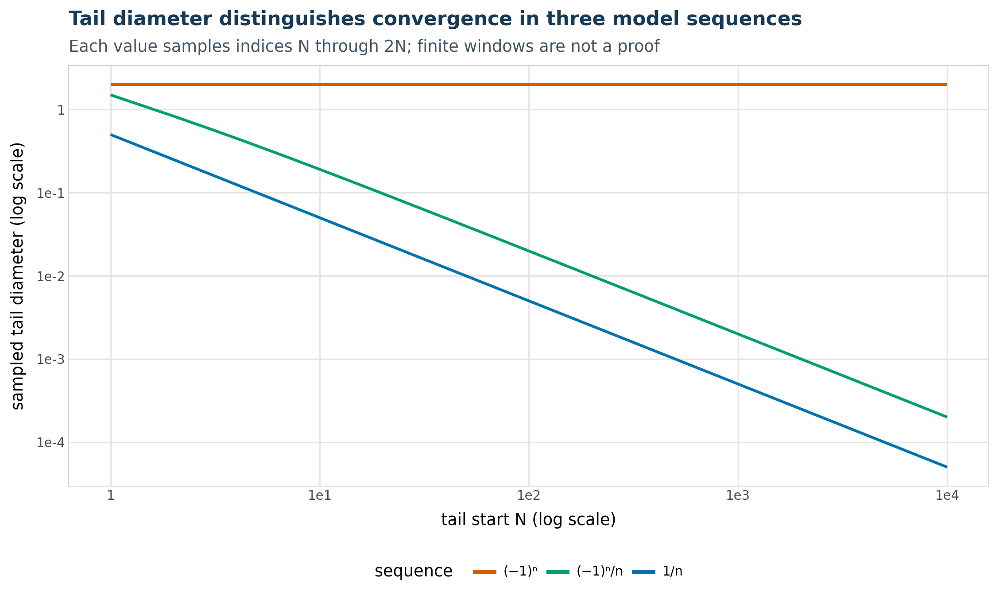

<figcaption>

Figure 50.1: Sampled tail diameters for convergent and nonconvergent sequences.

</figcaption>
</figure>

[Figure 50.1](#fig-code-cauchy-tail-diameter) separates a useful diagnostic from a
proof. A sequence could behave quietly on every sampled window and spike later.

## Lab 3 — Nested intervals with exact rational endpoints

Binary bisection can be recorded using `Fraction`, avoiding floating-point
ambiguity. The example traps $\sqrt2$ using only integer comparisons.

```python
from fractions import Fraction

def sqrt_two_brackets(steps: int) -> list[tuple[Fraction, Fraction]]:
    """Return nested rational brackets containing the positive square root of 2."""
    if steps < 0:
        raise ValueError("steps must be nonnegative")
    left, right = Fraction(1), Fraction(2)
    brackets = [(left, right)]
    for _ in range(steps):
        middle = (left + right) / 2
        if middle * middle < 2:
            left = middle
        else:
            right = middle
        brackets.append((left, right))
    return brackets

for left, right in sqrt_two_brackets(6):
    print(left, right, right - left)
```

Completeness supplies the limiting real number. The code supplies exact finite
brackets and a visible width $2^{-k}$.

## Lab 4 — A grid diagnostic for uniform convergence

For $f_n(x)=x^n$ on $[0,1]$, pointwise convergence holds but uniform
convergence fails. A fixed grid eventually misses the shrinking layer just to
the left of $1$. The moving probe $x_n=1-1/n$ continues to expose an error near
$e^{-1}$.

```python
import numpy as np
from numpy.typing import NDArray

def convergence_diagnostics(power: int) -> tuple[float, float]:
    """Return a fixed-grid error and a moving boundary-layer lower bound."""
    if power <= 0:
        raise ValueError("power must be positive")
    x = np.linspace(0.0, 1.0, 1_001)
    limit = np.where(x < 1.0, 0.0, 1.0)
    fixed_grid_error = float(np.max(np.abs(x**power - limit)))
    moving_point = 1.0 - 1.0 / max(power, 2)
    moving_lower_bound = moving_point**power
    return fixed_grid_error, moving_lower_bound

for power in (10, 1_000, 100_000):
    print(power, convergence_diagnostics(power))
```

<figure id="fig-code-uniform-grid-audit">
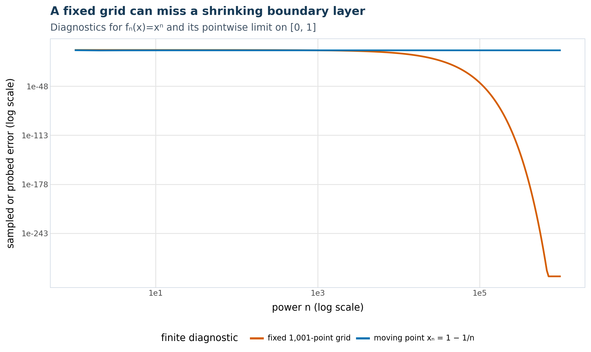

<figcaption>

Figure 50.2: Sampled supremum errors for x to the n under endpoint-aware and endpoint-missing grids.

</figcaption>
</figure>

The discrepancy in [Figure 50.2](#fig-code-uniform-grid-audit) is a sampling warning, not an
argument against computation. It shows why a finite grid cannot silently replace
a supremum over a continuum.

## Lab 5 — Upper and lower sums for an increasing function

For $f(x)=x^2$ on $[0,1]$, the right endpoints give an upper sum and the left
endpoints give a lower sum. Their difference is a rigorous enclosure width.

```python
def square_darboux_bounds(panels: int) -> tuple[float, float]:
    """Return lower and upper equal-mesh Darboux sums for x squared on [0, 1]."""
    if panels <= 0:
        raise ValueError("panels must be positive")
    lower = sum((index / panels) ** 2 for index in range(panels)) / panels
    upper = sum(((index + 1) / panels) ** 2 for index in range(panels)) / panels
    return lower, upper

for panels in (4, 16, 64):
    lower, upper = square_darboux_bounds(panels)
    print(panels, lower, 1.0 / 3.0, upper, upper - lower)
```

Unlike a lone quadrature decimal, the pair brackets the integral because
monotonicity proves which endpoints are infima and suprema.

## Lab 6 — Monotone convergence as a finite table

Let $f_n(k)=\min(k,n)$ on the finite weighted space with mass $2^{-k}$ at
$k=1,2,\ldots$. The truncated calculation shows the increasing integral and a
separate tail bound.

```python
def truncated_monotone_integral(level: int, cutoff: int) -> tuple[float, float]:
    """Return a finite integral and a bound for omitted weighted tail mass."""
    if level <= 0 or cutoff <= 0:
        raise ValueError("level and cutoff must be positive")
    subtotal = sum(min(k, level) * 2.0 ** (-k) for k in range(1, cutoff + 1))
    tail_bound = level * 2.0 ** (-cutoff)
    return subtotal, tail_bound

for level in (1, 2, 4, 8):
    subtotal, tail = truncated_monotone_integral(level, cutoff=40)
    print(level, subtotal, tail)
```

The tail bound makes the truncation visible. The Monotone Convergence Theorem
justifies passing to the infinite measure space; the program does not.

## Lab 7 — Mollification with a normalized discrete kernel

Convolution smooths a jump, but a finite array also introduces boundary rules.
This example pads by constant endpoint values and checks that the kernel weights
sum to one.

```python
import numpy as np
from numpy.typing import NDArray

def gaussian_mollify(
    values: NDArray[np.float64], sigma_cells: float
) -> NDArray[np.float64]:
    """Return a one-dimensional Gaussian-smoothed copy of sampled values."""
    if values.ndim != 1 or values.size < 3 or sigma_cells <= 0.0:
        raise ValueError("use a one-dimensional sample and positive scale")
    radius = max(1, int(4.0 * sigma_cells))
    offsets = np.arange(-radius, radius + 1, dtype=float)
    weights = np.exp(-(offsets**2) / (2.0 * sigma_cells**2))
    weights /= weights.sum()
    padded = np.pad(values.astype(float), radius, mode="edge")
    return np.convolve(padded, weights, mode="valid")

x = np.linspace(-1.0, 1.0, 401)
jump = np.where(x < 0.0, 0.0, 1.0)
smoothed = gaussian_mollify(jump, sigma_cells=8.0)
print(smoothed.min(), smoothed.max(), smoothed[200])
```

<figure id="fig-code-mollifier-scale">
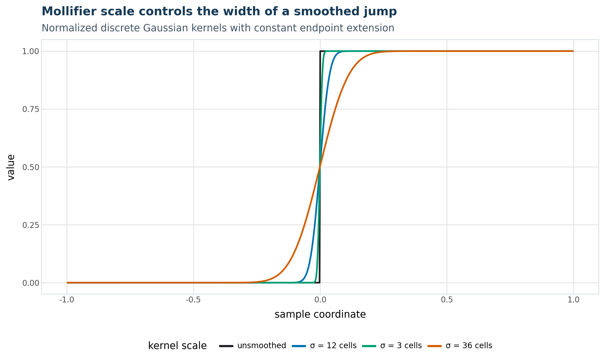

<figcaption>

Figure 50.3: A sampled step function convolved at several kernel scales.

</figcaption>
</figure>

[Figure 50.3](#fig-code-mollifier-scale) shows scale versus smoothness. Boundary
extension and grid spacing are part of the numerical model, not properties of
abstract convolution on $\mathbb R$.

## Lab 8 — Contraction iteration with an a posteriori bound

For $T(x)=\cos x$ on a suitable interval, the observed increment can bound the
remaining error when a contraction constant $q<1$ is known.

```python
from math import cos

def contraction_fixed_point(
    initial: float, contraction_bound: float, tolerance: float = 1e-12
) -> tuple[float, int, float]:
    """Iterate cos(x) and return value, steps, and an a posteriori error bound."""
    if not 0.0 < contraction_bound < 1.0 or tolerance <= 0.0:
        raise ValueError("require 0 < contraction_bound < 1 and positive tolerance")
    previous = initial
    for step in range(1, 10_001):
        current = cos(previous)
        bound = contraction_bound * abs(current - previous) / (
            1.0 - contraction_bound
        )
        if bound <= tolerance:
            return current, step, bound
        previous = current
    raise RuntimeError("iteration did not meet the requested bound")

value, steps, bound = contraction_fixed_point(0.5, contraction_bound=0.85)
print(value, steps, bound, value - cos(value))
```

The certificate is valid only if the declared contraction bound has been proved
on an invariant complete set.

## Lab 9 — A law-of-large-numbers experiment

Running means reveal fluctuation at multiple sample sizes. A fixed seed makes
the displayed experiment reproducible without suggesting that its path is
canonical.

```python
import numpy as np
from numpy.typing import NDArray

def running_bernoulli_means(
    samples: int, probability: float, seed: int
) -> NDArray[np.float64]:
    """Return running means of independent Bernoulli trials."""
    if samples <= 0 or not 0.0 <= probability <= 1.0:
        raise ValueError("samples must be positive and probability in [0, 1]")
    generator = np.random.default_rng(seed)
    draws = generator.random(samples) < probability
    return np.cumsum(draws) / np.arange(1, samples + 1)

means = running_bernoulli_means(10_000, probability=0.3, seed=20260811)
print(means[9], means[99], means[999], means[-1])
```

One path approaching $0.3$ does not prove almost-sure convergence. Chapter 41
connects long-time averages to measure-preserving dynamics.

## Lab 10 — Brownian quadratic variation

On a uniform partition of $[0,1]$, Brownian increments have variance
$\Delta t$. Their squared sum should fluctuate around $1$ as the mesh refines.

```python
import numpy as np
from numpy.typing import NDArray

def brownian_quadratic_variation(
    steps: int, paths: int, seed: int
) -> NDArray[np.float64]:
    """Simulate terminal quadratic variation for independent Brownian paths."""
    if steps <= 0 or paths <= 0:
        raise ValueError("steps and paths must be positive")
    generator = np.random.default_rng(seed)
    increments = generator.normal(0.0, steps ** -0.5, size=(paths, steps))
    return np.sum(increments**2, axis=1)

values = brownian_quadratic_variation(steps=1_000, paths=2_000, seed=20260811)
print(values.mean(), values.std(ddof=1), np.quantile(values, [0.05, 0.95]))
```

<figure id="fig-code-brownian-qv-distribution">
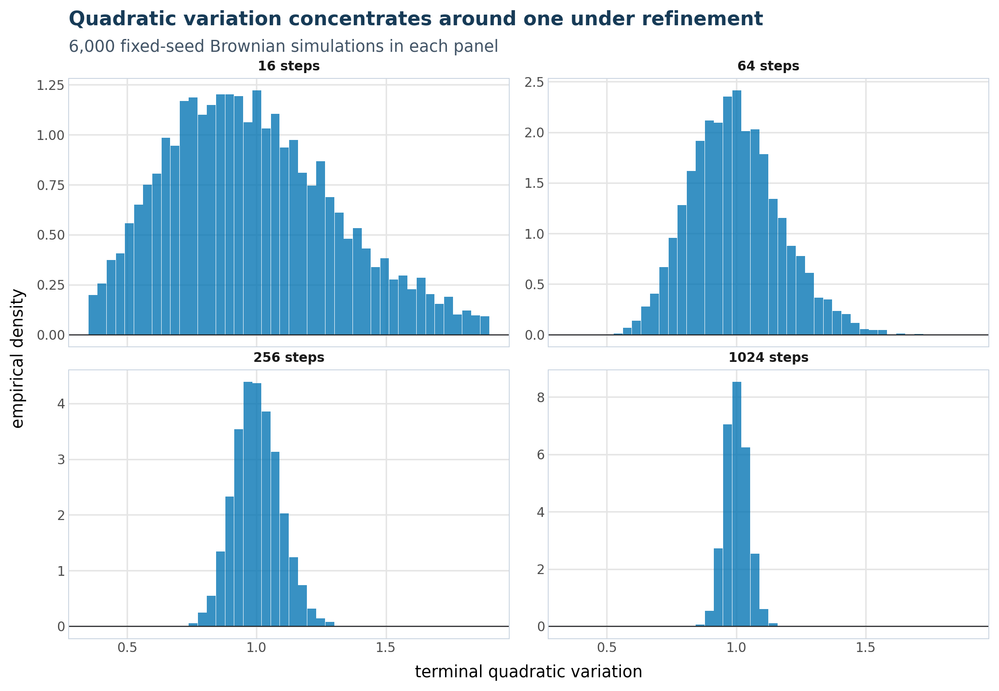

<figcaption>

Figure 50.4: Distributions of Brownian quadratic variation concentrate around one as partitions refine.

</figcaption>
</figure>

[Figure 50.4](#fig-code-brownian-qv-distribution) is a simulation of a theorem whose
$L^2$ proof appears in [Chapter 42](42-stochastic-processes.md). It does not
establish pathwise convergence from finitely many paths.

## Lab 11 — Turn an $\varepsilon$ request into a $\delta$ witness

For $f(x)=x^2$ at a point $a$, factorization gives
$|x^2-a^2|=|x-a||x+a|$. If $|x-a|<1$, then
$|x+a|<2|a|+1$. The function below returns the smaller of the two restrictions,
so the returned number is a proof witness rather than a fitted grid parameter.

```python
def square_delta(point: float, epsilon: float) -> float:
    """Return a valid delta for x squared at point and tolerance epsilon."""
    if epsilon <= 0.0:
        raise ValueError("epsilon must be positive")
    return min(1.0, epsilon / (2.0 * abs(point) + 1.0))

for epsilon in (1.0, 0.1, 1e-6):
    delta = square_delta(point=2.0, epsilon=epsilon)
    boundary_error = abs((2.0 + 0.999 * delta) ** 2 - 4.0)
    print(epsilon, delta, boundary_error, boundary_error < epsilon)
```

The sampled boundary check is useful for catching transcription errors. The
factorization, not the sample, proves the statement for every
$0<|x-a|<\delta$.

<figure id="fig-code-epsilon-delta-envelope">
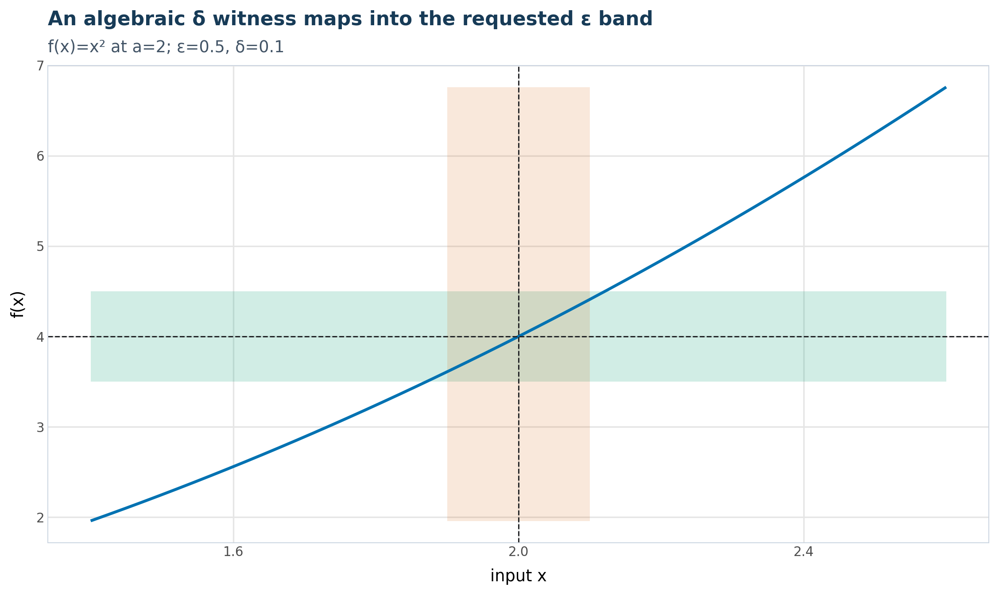

<figcaption>

Figure 50.5: An algebraic delta interval sits inside the requested epsilon band for the square function.

</figcaption>
</figure>

## Lab 12 — Pointwise convergence without integral convergence

Define $f_n(x)=n$ on $0<x<1/n$ and $0$ elsewhere. For every fixed $x$, the
value eventually becomes zero, yet the exact area of the spike remains $1$.
This is the standard warning that pointwise convergence alone does not justify
passing a limit through an integral.

```python
def concentration_spike(point: float, index: int) -> float:
    """Evaluate n times the indicator of the open interval (0, 1/n)."""
    if index <= 0:
        raise ValueError("index must be positive")
    return float(index) if 0.0 < point < 1.0 / index else 0.0

sample_points = (0.0, 0.001, 0.01, 0.1, 0.5)
for index in (2, 10, 100, 1_000):
    values = [concentration_spike(point, index) for point in sample_points]
    exact_area = index * (1.0 / index)
    print(index, values, exact_area)
```

There is no single integrable upper envelope for these ever-taller spikes. That
missing hypothesis is exactly what the dominated convergence theorem would
need.

<figure id="fig-code-concentration-counterexample">
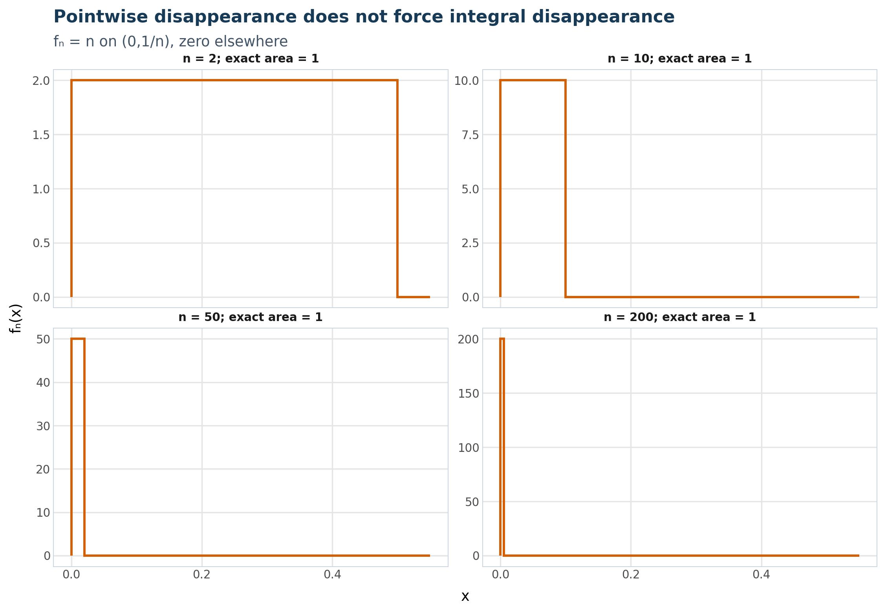

<figcaption>

Figure 50.6: A concentration sequence becomes narrower and taller while preserving unit area.

</figcaption>
</figure>

## Lab 13 — Fourier partial sums and the Gibbs overshoot

The odd sine series of a square wave can be summed at a finite number of
frequencies. Increasing that number sharpens the jump, but the overshoot near
the discontinuity does not simply disappear in height.

```python
import numpy as np
from numpy.typing import NDArray

def square_wave_partial_sum(
    points: NDArray[np.float64], odd_terms: int
) -> NDArray[np.float64]:
    """Return a finite odd-harmonic Fourier sum for a square wave."""
    if odd_terms <= 0:
        raise ValueError("odd_terms must be positive")
    total = np.zeros_like(points)
    for position in range(odd_terms):
        harmonic = 2 * position + 1
        total += np.sin(harmonic * points) / harmonic
    return (4.0 / np.pi) * total

grid = np.linspace(-np.pi, np.pi, 4_001)
for terms in (1, 5, 25, 100):
    approximation = square_wave_partial_sum(grid, terms)
    print(terms, float(approximation.max()), float(approximation.min()))
```

The computation is a finite trigonometric polynomial. The convergence theorem
and the analysis of the limiting overshoot require the estimates developed in
the Fourier chapters.

<figure id="fig-code-fourier-gibbs">
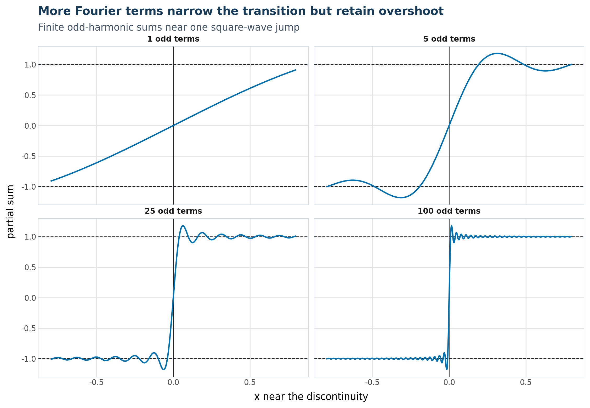

<figcaption>

Figure 50.7: Finite Fourier sums sharpen a square-wave jump while retaining a localized overshoot.

</figcaption>
</figure>

## Lab 14 — Compare finite-measure $L^p$ norms

On a sampled interval with cell width $\Delta x$, the quantity
$(\sum |f_i|^p\Delta x)^{1/p}$ is a discrete integral norm. The cell width is
part of the approximation and must not be silently omitted.

```python
def sampled_lp_norm(values: list[float], exponent: float, cell_width: float) -> float:
    """Return a weighted finite L-p norm for a uniform grid."""
    if not values:
        raise ValueError("values must be nonempty")
    if exponent < 1.0 or cell_width <= 0.0:
        raise ValueError("exponent must be at least one and width positive")
    integral = sum(abs(value) ** exponent for value in values) * cell_width
    return integral ** (1.0 / exponent)

samples = [0.0, 0.5, 1.0, 1.5, 2.0]
for exponent in (1.0, 2.0, 4.0, 8.0):
    print(exponent, sampled_lp_norm(samples, exponent, cell_width=0.25))
```

Changing the interval length changes norm-comparison constants. The finite
array therefore illustrates the formula but does not erase the measure-space
hypotheses in [Chapter 21](21-lp-convergence.md).

## Lab 15 — Audit equicontinuity by comparing two families

The functions $g_n(x)=\sin(nx)/n$ all have derivative bounded by $1$; the
functions $h_n(x)=\sin(nx)$ have derivative bounds growing like $n$. A fine
grid can estimate those slopes from below and reveal the contrast, although it
cannot prove a continuum supremum by itself.

```python
import numpy as np
from numpy.typing import NDArray

def adjacent_slope_bound(
    points: NDArray[np.float64], values: NDArray[np.float64]
) -> float:
    """Return the largest adjacent difference quotient on a strict grid."""
    if points.ndim != 1 or values.shape != points.shape or len(points) < 2:
        raise ValueError("points and values must be matching one-dimensional arrays")
    spacings = np.diff(points)
    if np.any(spacings <= 0.0):
        raise ValueError("points must be strictly increasing")
    return float(np.max(np.abs(np.diff(values) / spacings)))

grid = np.linspace(0.0, 2.0 * np.pi, 20_001)
for frequency in (1, 4, 16, 64):
    scaled = np.sin(frequency * grid) / frequency
    unscaled = np.sin(frequency * grid)
    print(
        frequency,
        adjacent_slope_bound(grid, scaled),
        adjacent_slope_bound(grid, unscaled),
    )
```

<figure id="fig-code-equicontinuity-audit">
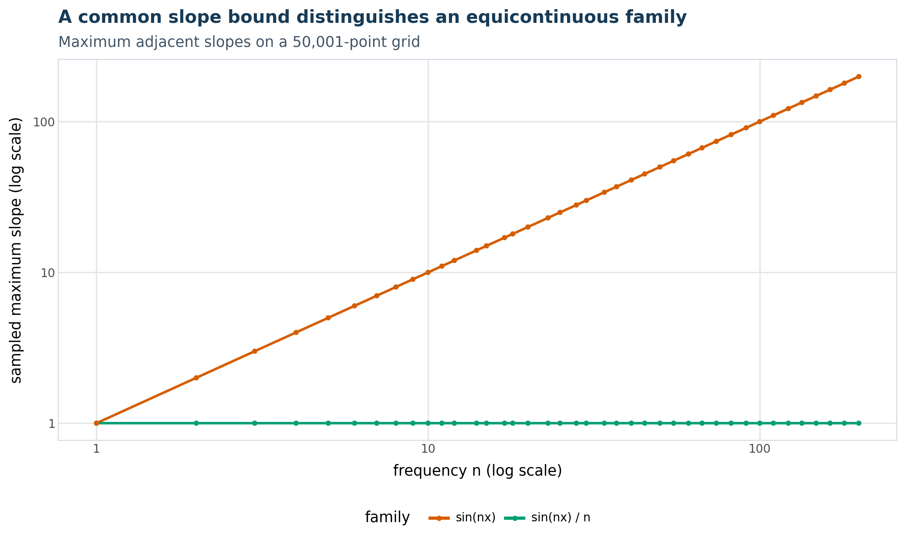

<figcaption>

Figure 50.8: Scaled oscillations share a common slope bound while unscaled oscillations become progressively steeper.

</figcaption>
</figure>

The analytic derivative bounds establish equicontinuity for the first family.
The plot is an interpretable diagnostic that points toward the correct proof.

## Lab 16 — Construct nested rational bounds for $\sqrt2$

Completeness says that compatible nested intervals whose lengths approach zero
determine a real number. Bisection makes such intervals explicit for $x^2=2$.
`Fraction` ensures that every endpoint comparison is exact.

```python
from fractions import Fraction

def square_root_two_bounds(steps: int) -> list[tuple[Fraction, Fraction]]:
    """Return nested rational intervals that trap the positive square root of two."""
    if steps < 0:
        raise ValueError("steps must be nonnegative")
    lower = Fraction(1)
    upper = Fraction(2)
    bounds: list[tuple[Fraction, Fraction]] = []
    for _ in range(steps + 1):
        bounds.append((lower, upper))
        middle = (lower + upper) / 2
        if middle * middle < 2:
            lower = middle
        else:
            upper = middle
    return bounds

for step, (lower, upper) in enumerate(square_root_two_bounds(8)):
    print(step, lower, upper, upper - lower, lower * lower < 2 < upper * upper)
```

The invariant in the last column and the exact width $2^{-n}$ explain the
construction. The program generates any requested finite prefix; the
completeness theorem in [Chapter 2](02-real-numbers.md) supplies the real limit.

<figure id="fig-code-bisection-completeness">
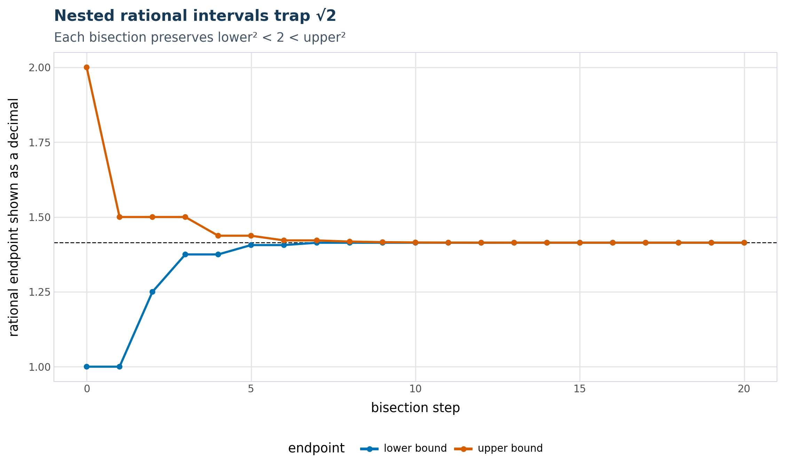

<figcaption>

Figure 50.9: Nested lower and upper bounds converge toward the square root of two.

</figcaption>
</figure>

## Lab 17 — Evaluate the Bernstein approximation formula

For a continuous function $f$ on $[0,1]$, its degree-$n$ Bernstein polynomial
is

$$
B_nf(x)=\sum_{k=0}^{n}f(k/n)\binom nk x^k(1-x)^{n-k}.
$$

The formula is already an algorithm once its finite sum and input checks are
made explicit.

```python
from collections.abc import Callable
from math import comb

def bernstein_value(
    function: Callable[[float], float], degree: int, point: float
) -> float:
    """Evaluate one Bernstein polynomial on the closed unit interval."""
    if degree <= 0 or not 0.0 <= point <= 1.0:
        raise ValueError("use a positive degree and a point in [0, 1]")
    return sum(
        function(index / degree)
        * comb(degree, index)
        * point**index
        * (1.0 - point) ** (degree - index)
        for index in range(degree + 1)
    )

target = lambda x: abs(x - 0.35)
grid = [index / 1_000 for index in range(1_001)]
for degree in (4, 16, 64):
    error = max(abs(bernstein_value(target, degree, x) - target(x)) for x in grid)
    print(degree, error)
```

The maximum is over 1,001 sampled points, not the continuum. Bernstein's proof
controls the true supremum by probability and uniform continuity; the code
merely exposes the constructive polynomial and a resolution-dependent audit.

<figure id="fig-code-bernstein-error">
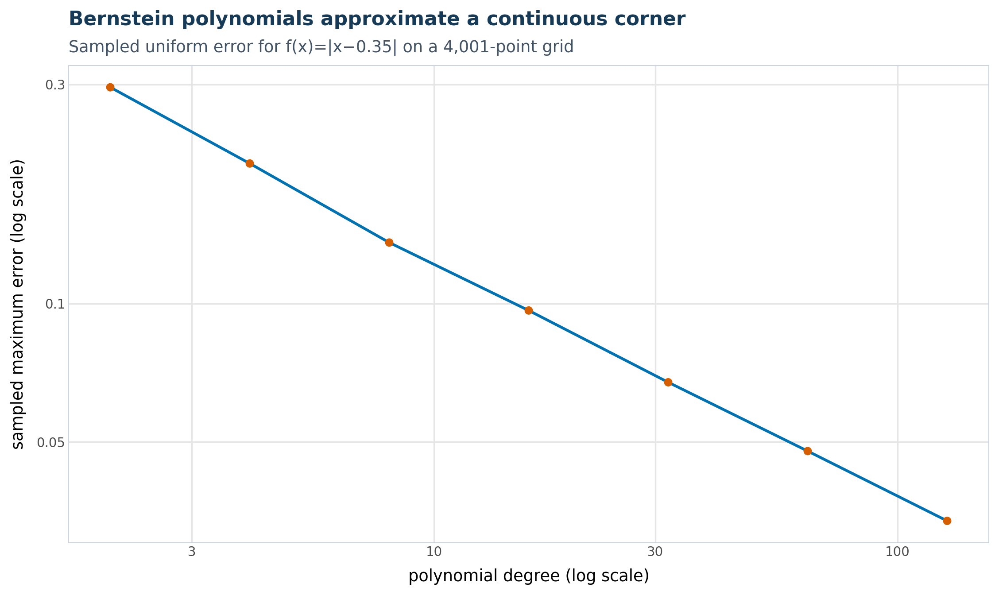

<figcaption>

Figure 50.10: Sampled Bernstein approximation error decreases with polynomial degree.

</figcaption>
</figure>

## Lab 18 — Read the Cantor function from ternary digits

The Cantor function replaces ternary digits $0$ and $2$ by binary digits $0$
and $1$ until a middle-third digit $1$ makes the finite-stage value constant.
Exact fractions keep boundary cases visible.

```python
from fractions import Fraction

def cantor_stage(point: Fraction, digits: int) -> Fraction:
    """Return a finite-digit Cantor-function approximation on [0, 1]."""
    if point < 0 or point > 1 or digits <= 0:
        raise ValueError("point must lie in [0,1] and digits must be positive")
    if point == 1:
        return Fraction(1)
    working = point
    value = Fraction(0)
    weight = Fraction(1, 2)
    for _ in range(digits):
        scaled = 3 * working
        if scaled < 1:
            working = scaled
        elif scaled >= 2:
            value += weight
            working = scaled - 2
        else:
            return value + weight
        weight /= 2
    return value

for point in (Fraction(1, 4), Fraction(1, 3), Fraction(1, 2), Fraction(3, 4)):
    print(point, [cantor_stage(point, digits) for digits in (1, 2, 4, 8)])
```

This finite digit rule illustrates how a continuous function can be constant on
many intervals yet increase overall. Continuity and the almost-everywhere
derivative statement require the measure arguments in the main text.

<figure id="fig-code-cantor-approximants">
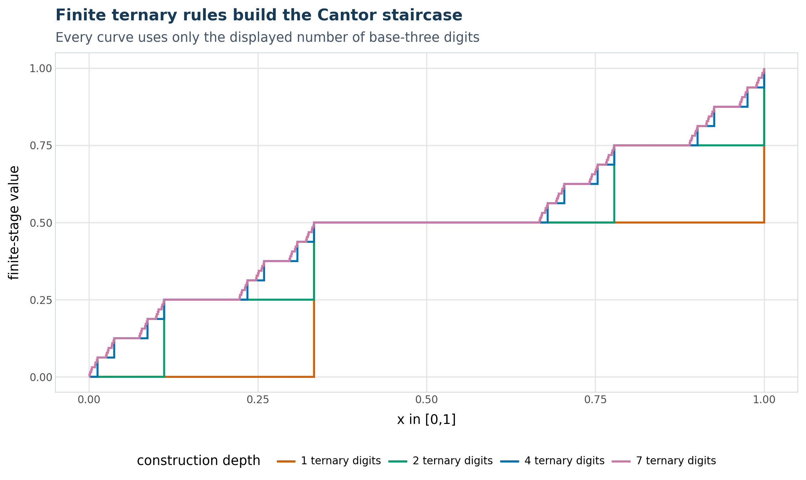

<figcaption>

Figure 50.11: Finite ternary constructions approach the Cantor staircase.

</figcaption>
</figure>

## Lab 19 — Separate pointwise convergence from domination

On $[0,1]$, $f_n(x)=x^n$ is bounded by the integrable function $1$ and has
integral $1/(n+1)$. The spike $g_n=n\mathbf1_{[0,1/n]}$ also tends to zero at
every positive $x$, but every integral equals $1$ and no single integrable
function dominates all its peaks.

```python
from fractions import Fraction

def power_integral(index: int) -> Fraction:
    """Return the exact integral of x**index over [0,1]."""
    if index < 0:
        raise ValueError("index must be nonnegative")
    return Fraction(1, index + 1)

def spike_value(index: int, point: Fraction) -> int:
    """Evaluate index times the indicator of [0,1/index] at a rational point."""
    if index <= 0 or point < 0 or point > 1:
        raise ValueError("use a positive index and a point in [0,1]")
    return index if point <= Fraction(1, index) else 0

for index in (2, 10, 100, 1_000):
    print(index, power_integral(index), spike_value(index, Fraction(1, 2)), 1)
```

The final `1` is the exact spike integral: height times width. The computation
pinpoints the missing domination hypothesis but does not prove the dominated
convergence theorem.

<figure id="fig-code-dominated-convergence">
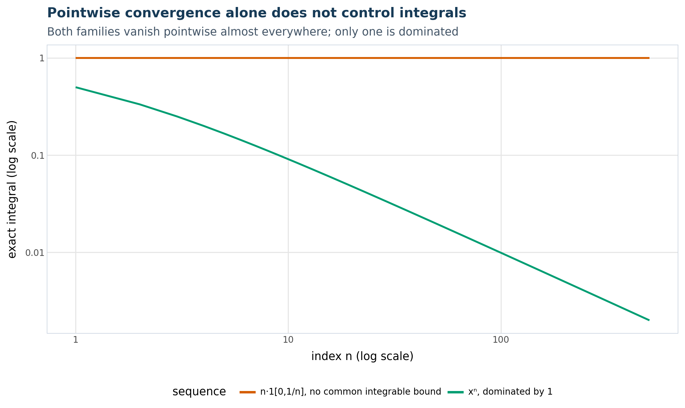

<figcaption>

Figure 50.12: A dominated sequence has shrinking integrals while an undominated spike sequence retains integral one.

</figcaption>
</figure>

## Lab 20 — Compute a weak limit through distribution functions

Let $\mu_n$ be uniform on $[-1/n,1/n]$. These measures converge weakly to a
point mass at zero. The CDF formula has three cases and can be evaluated exactly
at rational points.

```python
from fractions import Fraction

def shrinking_uniform_cdf(index: int, point: Fraction) -> Fraction:
    """Return the CDF at point for the uniform law on [-1/index,1/index]."""
    if index <= 0:
        raise ValueError("index must be positive")
    radius = Fraction(1, index)
    if point < -radius:
        return Fraction(0)
    if point > radius:
        return Fraction(1)
    return (point + radius) / (2 * radius)

points = (Fraction(-1, 10), Fraction(0), Fraction(1, 10))
for index in (2, 10, 100):
    print(index, [shrinking_uniform_cdf(index, point) for point in points])
```

At zero every approximating CDF equals $1/2$, whereas the usual right-
continuous CDF of the point mass equals $1$. This is not a contradiction:
weak convergence asks for CDF convergence only at continuity points of the
limit CDF.

<figure id="fig-code-weak-cdf-limit">
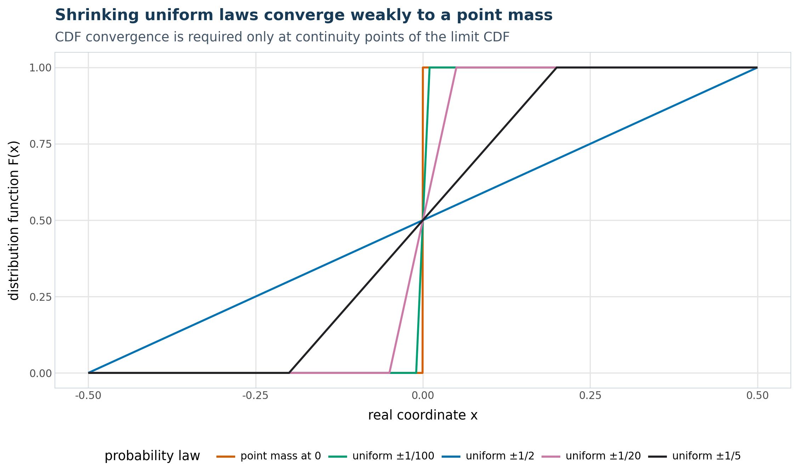

<figcaption>

Figure 50.13: Uniform distribution functions narrow toward the jump of a point mass.

</figcaption>
</figure>

## A responsible analysis workflow

Before interpreting a numerical limit, declare the domain, mesh, norm, and
precision. Repeat at several resolutions. Compare a quantity with an exact
bound or invariant whenever one exists. Try an adversarial example: a narrow
spike, a late sequence excursion, a discontinuity between grid points, or a
high-frequency oscillation. Never replace a supremum over a continuum by a
grid maximum without naming the replacement.

The collection validator parses and executes every Python block above. Public
functions carry type information and boundary checks; random examples have
fixed seeds; loops have finite limits; and no example downloads data or hides a
failure. The thirteen accompanying visuals are generated deterministically with
Plotnine by `figures.py`.

Use Labs 1–4 with [sequences](03-sequences.md), [real
numbers](02-real-numbers.md), and [modes of
convergence](09-function-sequences.md).
Labs 5–7 support [integration](08-riemann.md), [measure](11-measure.md), and
[Sobolev approximation](23-sobolev.md). Labs 8–10 connect to [fixed-point
methods](10-metric-spaces.md), [ergodic theory](41-ergodic-theory.md),
and [stochastic processes](42-stochastic-processes.md).
Labs 11–12 return to [continuity](06-continuity.md) and the hypotheses behind
[Lebesgue convergence](21-lp-convergence.md). Labs 13–15 connect to [Fourier
analysis](12-fourier.md), [$L^p$ convergence](21-lp-convergence.md), and the
[Arzelà–Ascoli theorem](25-baire-ascoli.md).
Labs 16–20 return to [completeness](02-real-numbers.md), [uniform
approximation](09-function-sequences.md), [singular functions](11-measure.md),
[Lebesgue convergence](21-lp-convergence.md), and [weak probability
convergence](36-weak-probability.md). Each one turns a displayed formula into
finite operations while retaining the theorem hypothesis that makes the limit
rigorous.
