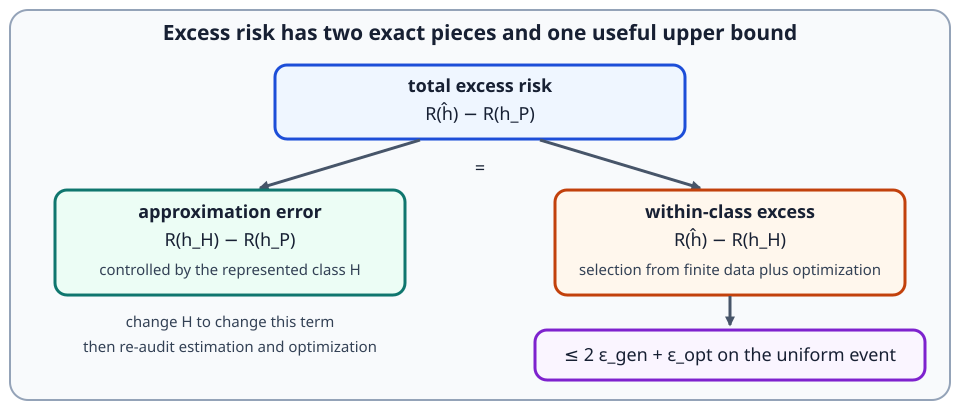

# Approximation, Estimation, and Optimization

Every learning guarantee is a statement about excess risk: how much worse is the returned predictor than the best possible predictor for the problem? This chapter decomposes excess risk into three sources, each tied to a different component of the learning tuple. The decomposition is elementary, but it organizes the entire field: approximation theory studies the hypothesis class, statistical learning theory studies the sample, and optimization theory studies the algorithm.

## The decomposition

Let $h_{P}$ be a predictor that minimizes risk over all measurable predictors allowed by the decision problem. Let

$$h_{H} \in \operatorname{argmin}_{h \in H} R(h)$$

be a risk minimizer over the hypothesis class $H$. For the displayed decomposition, assume both minima are attained. If either infimum is not attained, the argument still works: choose predictors within $\eta$ of the relevant infimum, and carry the corresponding $\eta$ terms.

Let the algorithm return $\hat{h}$ whose empirical risk is within $\varepsilon_{\text{opt}}$ of the empirical minimum:

$$\hat{R}(\hat{h}) \le \inf_{h \in H} \hat{R}(h) + \varepsilon_{\text{opt}}.$$

Then the excess risk over the unrestricted target decomposes as

$$R(\hat{h}) - R(h_{P}) = [R(h_{H}) - R(h_{P})] + [R(\hat{h}) - R(h_{H})].$$

The first bracket is **approximation error**: the price of restricting to $H$. The second bracket is **estimation error** (plus optimization error): the price of learning from finite data with an imperfect optimizer.

To bound the second term, add and subtract empirical risks. On the event where

$$\sup_{h \in H} |R(h) - \hat{R}(h)| \le \varepsilon_{\text{gen}},$$

we obtain

$$R(\hat{h}) - R(h_{H}) \le 2\varepsilon_{\text{gen}} + \varepsilon_{\text{opt}}.$$

**Proof.** Replace $R(\hat{h})$ by $\hat{R}(\hat{h}) + \varepsilon_{\text{gen}}$. By approximate empirical optimality,

$$\hat{R}(\hat{h}) \le \hat{R}(h_{H}) + \varepsilon_{\text{opt}}.$$

Replace $\hat{R}(h_{H})$ by $R(h_{H}) + \varepsilon_{\text{gen}}$. Combining,

$$R(\hat{h}) \le \hat{R}(\hat{h}) + \varepsilon_{\text{gen}} \le \hat{R}(h_{H}) + \varepsilon_{\text{opt}} + \varepsilon_{\text{gen}} \le R(h_{H}) + 2\varepsilon_{\text{gen}} + \varepsilon_{\text{opt}}.$$

This argument separates three remedies. A richer class $H$ may reduce approximation error but enlarge estimation error because the uniform deviation $\varepsilon_{\text{gen}}$ grows with class complexity. More data can reduce estimation error. A better solver can reduce $\varepsilon_{\text{opt}}$. None of these guarantees the others improve.

## Approximation error

Approximation error depends on the hypothesis class and the target distribution, but not on the sample size or the algorithm. It asks: if we had infinite data and a perfect optimizer, how close could we get to $h_{P}$ within $H$?

For parametric classes, approximation error is typically zero when the true predictor lies in the class, and positive otherwise. For nonparametric classes such as neural networks or kernel methods, approximation error can decrease as the class grows. Universal approximation theorems state that certain classes can approximate any continuous function on compact sets arbitrarily well, but they do not say how much data or computation is required to achieve that approximation in practice.

A common misconception is that a universal approximator guarantees learning. Approximation is only one term in the decomposition. A class that can approximate anything may need enormous amounts of data to estimate its parameters, or may be computationally intractable to optimize.

## Estimation error and uniform convergence

Estimation error arises because the empirical risk $\hat{R}_{S}(h)$ is a random variable. Even for a fixed $h$, $\hat{R}_{S}(h)$ fluctuates around $R(h)$. For the empirical minimizer $\hat{h}$, the fluctuation is worse because the algorithm selects the predictor that looks best on the sample.

The key tool is uniform convergence: a bound on

$$\sup_{h \in H} |R(h) - \hat{R}_{S}(h)|$$

that holds with high probability. If this supremum is small, then every predictor in $H$ has empirical risk close to population risk, and the empirical minimizer is nearly as good as the population minimizer.

The size of this supremum depends on the complexity of $H$. For finite classes, the union bound gives a logarithmic dependence on class size. For infinite classes, combinatorial dimensions such as VC dimension or metric entropies control the complexity. The next two chapters develop these tools.

## Optimization error

Optimization error $\varepsilon_{\text{opt}}$ measures how close the algorithm comes to minimizing empirical risk. For convex problems, gradient descent and its variants can achieve $\varepsilon_{\text{opt}} \to 0$ at known rates. For nonconvex problems such as neural network training, we may only reach a stationary point or a local minimum, and the gap to the global empirical minimum may be large.

In deep learning, it is common to observe that training reaches near-zero training error, suggesting $\varepsilon_{\text{opt}} \approx 0$. But this does not imply small estimation error or small approximation error. The decomposition reminds us that all three terms matter.

## Worked example: an exact approximation comparison

Let $X$ be uniform on $[-1,1]$ and $Y=X^2+\varepsilon$, where $\mathbb E[\varepsilon\mid X]=0$ and $\mathbb E[\varepsilon^2]<\infty$. Compare the nested polynomial classes $H_0\subset H_1\subset H_2$ of degrees at most $0,1,2$ under squared loss.

The unrestricted regression function is $h_P(x)=x^2$. Symmetry makes $X$ orthogonal to both $1$ and $X^2$, so the best constant and best affine predictors are both $h(x)=\mathbb E[X^2]=1/3$. Their approximation error is

$$\mathbb E[(X^2-1/3)^2]=\mathbb E[X^4]-\mathbb E[X^2]^2=\frac15-\frac19=\frac4{45}.$$

The quadratic class contains $x^2$, so its approximation error is zero. This exact calculation establishes only the approximation term. Estimation depends on the sample, the chosen coefficient constraints or tail assumptions, and the learning rule; ordinary least squares has zero optimization error when the empirical minimum is computed exactly. Without specifying those ingredients, there is no justified numerical claim about which degree minimizes total risk.

## Common errors

- **Ignoring approximation error.** A researcher compares two algorithms on the same class and concludes the better one is "optimal." If the class itself is poor, both algorithms suffer large approximation error.
- **Assuming zero optimization error.** In nonconvex training, early stopping or suboptimal convergence may leave $\varepsilon_{\text{opt}}$ large, but this is hidden if only training loss is reported.
- **Confounding terms.** Adding more data reduces estimation error but does not change approximation error. Enlarging the class reduces approximation error but may increase estimation error.

## Infima avoid an unnecessary existence assumption

Population or empirical minima need not be attained, even in a simple one-parameter family. Let the outcome be zero, use squared loss and allow only strictly positive constant predictions. Risk has infimum zero but every permitted predictor has positive risk. Calling a nonexistent minimizing predictor h star would make a displayed proof formally incomplete.

The excess-risk comparison can instead be written entirely with infima. Suppose the selected rule has empirical risk at most the empirical infimum plus eta, with eta nonnegative. For any positive a, choose a population comparator within a of the population infimum; such a comparator exists by the definition of a finite infimum. On a uniform deviation event, the same three inequalities give selected population risk at most the population infimum plus a plus twice the deviation plus eta. Let a decrease to zero. This proves the comparator bound without assuming attainment. A measurable approximate selection is still required when the algorithm is defined; infimum notation does not settle that issue.

If risks can be infinite, a finite comparator and integrable losses must first be supplied before subtracting risk values. Expressions such as infinity minus infinity are not an excess-risk decomposition. Bounded-loss results avoid this problem, which is one reason their assumptions appear repeatedly in the first learning bounds.

## Three sources do not always form three nonnegative observed terms

Approximation error is a nonnegative population difference between the class infimum and unrestricted infimum. The empirical objective gap is also nonnegative. But a population comparison between an imperfect optimizer and an exact empirical optimizer need not be nonnegative. The latter optimizer can fit a misleading sample more successfully.

For example, consider constant binary predictors and one observed label zero, while the population label-one probability is nine tenths. The empirical optimum predicts zero, with population error nine tenths. A rule predicting one has empirical objective gap one yet population error one tenth. Its population improvement over the exact empirical optimum is eight tenths. This example does not invalidate the bound with the nonnegative objective gap; that bound is a worst-case implication of uniform control, not an assertion that every extra optimization step improves realized population risk.

Similarly, a uniform deviation is a certificate controlling within-class excess, rather than an observed decomposition of that excess into known pieces. Replacing a conservative certificate by the reported train-assessment gap changes the mathematical quantity. The latter is a random diagnostic influenced by both samples, selection and possible distribution mismatch.

### Worked example: a larger class can increase expected risk

Let labels be Bernoulli with success probability one quarter, independent of a constant input, and take one training observation. The smaller class contains only the constant-zero predictor. Its risk is one quarter. The larger class adds the constant-one predictor and uses exact empirical minimization. It predicts the observed label: zero with probability three quarters, one with probability one quarter. Its expected population risk is three quarters times one quarter plus one quarter times three quarters, equal to three eighths.

Both classes contain a Bayes classifier, so both approximation errors are zero. The larger class has zero empirical optimization error but strictly worse expected risk at this sample size. The difference is a genuine estimation effect, not merely an increase of an upper bound. With many independent observations this particular finite family becomes learnable; the example makes a finite-sample comparison and does not claim that the larger class is inconsistent.

## A complete consistency theorem for finite sieves

Let H k be predetermined finite nonempty classes, and suppose their approximation errors relative to a finite unrestricted risk infimum tend to zero as k increases. Assume losses lie in the unit interval and observations are iid from the fixed target law. Choose a deterministic class index k n tending to infinity and empirical near-minimizers with gaps eta n tending to zero. Suppose
$$\frac{\log|H_{k_n}|+\log(n+1)}n\longrightarrow0.$$
Then the selected risks converge almost surely to the unrestricted infimum.

To prove this, apply the finite-class concentration theorem with failure probability one divided by the square of n plus one. The resulting simultaneous risk radius tends to zero by the assumed complexity condition. These failure probabilities have finite sum, so the first Borel–Cantelli lemma says only finitely many failures occur almost surely; it does not require independence of those events. Eventually the excess-risk certificate is bounded by the class approximation error plus twice the radius plus eta n. Every term tends to zero. Nonnegativity of excess risk completes the almost-sure convergence proof.

The theorem makes the approximation-estimation exchange explicit: class richness must increase slowly enough relative to sample size, and approximation must improve for the actual target distribution. An architecture's ability to approximate some family does not establish the theorem for every probability law or every choice of weights. The deterministic class schedule also differs from a data-selected schedule; a model-selection penalty or another simultaneous argument is needed for the latter.

### Worked example: a finite grid of regression histograms

Let inputs be uniform on the unit interval, outcomes lie between zero and one, and the conditional mean m be L-Lipschitz. Split the interval into k equal bins. Let H k contain the step functions whose bin values belong to the grid zero, one over k, through one. This is a finite class of size k plus one raised to the power k, and every squared loss lies between zero and one.

Approximate m in each bin by rounding its value at the bin's left endpoint to the nearest available grid value. The rounding discrepancy is at most one over k and the within-bin change is at most L over k. The squared prediction discrepancy is therefore at most $(L+1)^2/k^2$. By the conditional-mean square-loss identity, that bounds approximation error. Choosing k as the integer part of n to any fixed power strictly between zero and one makes log class size divided by n vanish, while approximation also vanishes. The sieve theorem gives consistency with an exact empirical optimizer.

Balancing this particular global uniform certificate suggests k of order n over log n to the one-fifth power, giving a risk upper-bound order of log n over n to the two-fifths power. This is an upper certificate from the displayed counting proof, not a minimax rate claim. More localized variance arguments can improve rates in smooth regression; they are not obtained merely by relabeling this conservative global bound as optimal.

## Optimization effort is a statistical design choice

Suppose an algorithm supplies a proved empirical gap guarantee eta after a declared amount of computation. The generalization certificate adds that gap to the statistical terms. Making eta vastly smaller than a conservative statistical radius need not substantially improve this particular guarantee, although it can matter for other numerical or scientific goals. Conversely, reporting a stopped solver without an empirical gap theorem does not establish a small eta.

A method's stopping rule also affects its returned predictor, so a stability argument must analyze that actual stopping rule. Fixed iterations, data-dependent early stopping and a search over many trained models are different algorithms. The optimization chapter later proves results under convexity and gradient assumptions; those should be inserted as stated hypotheses rather than assumed for every neural-network fit. The current decomposition is deliberately algorithm-agnostic: it accepts a valid objective guarantee, but does not manufacture one.

The same separation applies to representation. Adding inputs, basis functions or model parameters enlarges a formal class only if the old predictors remain representable under the new constraints. A different normalization, penalty or preprocessing can alter the class rather than create a simple nesting. Check that set inclusion before claiming approximation error must decrease.

## Practice exercises

### Exercise 1

Prove that under the uniform event with deviation $\varepsilon$ and exact empirical risk minimization ($\varepsilon_{\text{opt}} = 0$), the excess risk satisfies $R(\hat{h}) - R(h_{H}) \le 2\varepsilon$.

Hint 1

Insert empirical risks for the output and a population comparator.

Hint 2

Both deviations are bounded on the same uniform event.

Full solution

On the uniform event, $|R(h) - \hat{R}(h)| \le \varepsilon$ for all $h \in H$. Since $\hat{h}$ is an exact empirical minimizer, $\hat{R}(\hat{h}) \le \hat{R}(h_{H})$. Then

$$R(\hat{h}) \le \hat{R}(\hat{h}) + \varepsilon \le \hat{R}(h_{H}) + \varepsilon \le R(h_{H}) + 2\varepsilon.$$

Rearranging gives $R(\hat{h}) - R(h_{H}) \le 2\varepsilon$.

### Exercise 2

Suppose $H_{1} \subset H_{2}$. Show that approximation error is no larger for $H_{2}$ than for $H_{1}$, but the uniform deviation bound can be larger.

Hint 1

Compare infima and suprema over nested sets.

Hint 2

A larger feasible set lowers an infimum but raises a supremum.

Full solution

Since $H_{1} \subset H_{2}$, any predictor in $H_{1}$ is available in $H_{2}$, so

$$\inf_{h \in H_{2}} R(h) \le \inf_{h \in H_{1}} R(h).$$

Thus $R(h_{H_{2}}) - R(h_{P}) \le R(h_{H_{1}}) - R(h_{P})$. For the uniform deviation, the supremum over a larger set is at least as large as the supremum over a subset:

$$\sup_{h \in H_{2}} |R(h) - \hat{R}(h)| \ge \sup_{h \in H_{1}} |R(h) - \hat{R}(h)|.$$

Therefore estimation error can increase when the class grows.

### Exercise 3

A researcher trains a neural network with $10^{6}$ parameters on $n = 10^{4}$ examples. The training loss is near zero and the test loss is high. Which term in the decomposition is likely dominant, and what remedies are suggested?

Hint 1

A gap between two reported numbers does not identify a unique cause.

Hint 2

The assessment law and the selection history are part of the diagnosis.

Full solution

The observed train--test gap is evidence of an estimation or assessment problem, but it does not by itself identify the cause. Possible contributors include selection over the test set, distribution shift, and a high-variance fitted procedure. Near-zero training loss shows only that the class and optimizer interpolate this sample; it does not establish low population approximation error. Remedies must follow diagnosis: preserve an independent assessment, check the sampling match, regularize or restrict the procedure, and collect relevant data.

### Exercise 4

For the one-observation binary example, compute expected excess risk of the larger empirical-minimization class.

Hint 1

Its population risk is three eighths.

Hint 2

The Bayes risk is one quarter.

Full solution

The expected excess is $3/8-1/4=1/8$. The smaller class has zero excess. Both approximation errors are zero, and the larger empirical optimizer has objective gap zero, so this is a concrete finite-sample estimation effect.

### Exercise 5

Give a nonattainment example and show how an empirical eta-minimizer can still exist.

Hint 1

Use positive constants with deterministic zero outcomes.

Hint 2

Choose a positive constant small enough for its square to be below eta.

Full solution

For $H=\{h_a:a>0\}$ and squared loss with Y always zero, empirical and population infima are zero but no member attains them. For every positive eta, choosing any $0<a\le\sqrt\eta$ gives an eta-minimizer. With eta equal to zero an exact minimizer does not exist.

### Exercise 6

Prove the histogram approximation bound in the worked example.

Hint 1

Compare the conditional mean with its value at a bin endpoint.

Hint 2

Add the rounding discrepancy and use the squared-loss identity.

Full solution

Within a bin, Lipschitz continuity gives a discrepancy at most L divided by k. The grid rounding adds at most one divided by k. Thus pointwise prediction error is at most $(L+1)/k$, and its squared expectation is at most $(L+1)^2/k^2$. This is exactly the excess squared risk over the conditional mean by orthogonality.

### Exercise 7

Why does the sieve consistency proof use Borel–Cantelli rather than require independent failure events?

Hint 1

The first Borel–Cantelli implication only uses summable probabilities.

Hint 2

Bound the probability of any failure after time N by a tail sum.

Full solution

The probability of at least one failure after N is bounded by the sum of the failure probabilities after N, which tends to zero. Hence the probability of infinitely many failures is zero. Dependence between the nested training samples and their deviation events does not invalidate this argument.

### Exercise 8

Does zero empirical optimization error force zero approximation error?

Hint 1

Empirical optimality compares only members of the supplied class.

Hint 2

A singleton class can be wrong for the target.

Full solution

No. If the class contains only the constant-one rule while the outcome is always zero under binary loss, the empirical optimizer is exact for every sample but has population error one. The unrestricted Bayes risk is zero, so approximation error is one. The algorithm cannot correct an excluded representation by optimizing within the singleton.

### Exercise 9

Show why increasing a uniform upper bound does not prove that actual estimation error increases.

Hint 1

A bound can be loose for both classes.

Hint 2

Compare the logic of a possible value with a realized value.

Full solution

An inequality permits every smaller value. A larger-class complexity certificate can increase while the actual selected rule remains unchanged or performs better. Proving an increase requires an explicit distribution and algorithm comparison, such as the one-observation binary example, rather than monotonicity of an upper bound alone.

### Exercise 10

A penalized or preprocessed model is called an enlargement of an earlier model. What mathematical fact must be established before concluding approximation error decreases?

Hint 1

Compare the represented predictor sets after all constraints.

Hint 2

Parameter counts alone do not prove set inclusion.

Full solution

Every earlier predictor must remain representable in the new feasible class under the same loss and target distribution. Only then does taking an infimum over the larger set give a value no greater than the old infimum. A changed penalty constraint, normalization or preprocessing can exclude old functions despite a larger parameter count, so the claimed nesting needs an explicit map or set argument.

## Looking backward and forward

This chapter built on "The Learning Problem Is a Tuple" by showing how the tuple components map to distinct sources of error. The next chapter, "Uniform Convergence for a Finite Class," develops the first concrete bound on $\varepsilon_{\text{gen}}$ using Hoeffding's inequality and the union bound.
