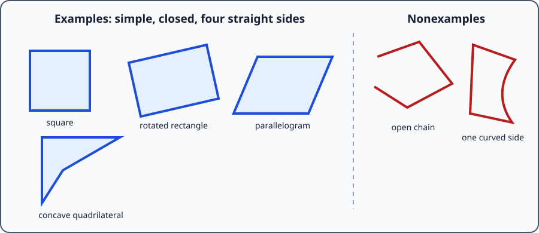

# Examples define the conceptual boundary

## Why one example is never enough

A single example shows that something is possible. It does not show what is necessary, what is impossible, or where the boundaries lie. If every example of a quadrilateral shown to learners is upright, convex, and regular-looking, learners may treat orientation, convexity, or equal side lengths as defining properties rather than incidental features. The set of examples, not any single example, teaches the concept.

This chapter examines how to design example sets that make defining properties salient and non-defining properties variable. It introduces the pedagogical principle of *variation*: hold the structural target constant while varying superficial features, then vary one structural feature at a time to test boundaries.

## A designed set for "quadrilateral"

To teach the concept "quadrilateral," first declare the convention: here it means a **simple closed polygon with four straight sides**. “Simple” excludes self-intersection; some curricula separately discuss crossed quadrilaterals. Under this convention, consider the following sequence:

1. **Square:** four equal sides, four right angles, convex, upright.
2. **Long non-square rectangle:** four right angles, opposite sides equal, convex, elongated.
3. **Slanted parallelogram:** opposite sides parallel, no right angles, convex, rotated.
4. **Concave dart:** four straight sides, one interior angle greater than $180^{\circ}$, concave.
5. **Open four-segment chain:** four straight segments, not closed. *(Nonexample)*
6. **Shape with one curved side:** four sides, but one is curved. *(Nonexample)*

The first four examples vary orientation, angle measure, and convexity while preserving the defining properties: four straight sides and closed. The nonexamples test whether learners attend to closure and straightness. If the teacher shows only squares and rectangles, learners may overgeneralise to "four right angles" as a defining property.

The coordinate descriptions in the figure make the classification reproducible: each positive example is a simple closed four-segment polygon, while the open chain lacks its closing edge and the curved shape violates the straight-side condition.

## Variation in algebra

The same principle applies to algebraic structure. To teach the distributive property $a(b+c)=ab+ac$, a productive sequence might be:

1. $3(4+5)$: numerical, positive, simple.
2. $7(x+2)$: one variable, positive coefficient.
3. $-2(x-3)$: negative coefficient, subtraction inside parentheses.
4. $(a+b)c$: general form, variables on the left.
5. $3(4\cdot 5)$: nonexample where distributing would not preserve value.

Steps 1--4 hold the structural target---multiplication over addition---while varying numerical context, sign, and symbolic form. Step 5 varies the operation inside the parentheses, testing whether learners distinguish between addition and multiplication. Distributing in step 5 is inconsistent with the stated structural condition. It could reflect a remembered surface pattern, a misread operation, or a slip. Ask for the operation being used and a numerical check before inferring the cause.

## The role of nonexamples

Nonexamples are not merely "wrong answers" to be rejected. They are deliberate boundary probes. A good nonexample is close to the concept in some respects but violates a defining property. The concave quadrilateral above is a **positive example**: its reflex interior angle varies a non-defining feature, and its four interior angles still sum to $360^{\circ}$ when that reflex angle is measured in the interior. By contrast, the open chain has four segments but violates closure, and the curved shape violates straightness.

For a known nonexample, ask which defining property fails and what change would make it an example. During classification, first ask whether it is a quadrilateral and require a reason; asking “why is this not one?” prematurely supplies the classification and would mislead for the concave positive example. These prompts are design proposals for eliciting attention to defining properties, not guarantees about what a learner will notice.

## Systematic variation: Watson and Mason's framework

Watson and Mason develop example generation through dimensions of possible variation and corresponding ranges of permissible change. The instructional idea used here is that learners attend to what changes and what stays fixed. If a teacher varies too many features at once, the intended property may be obscured; if too few vary, learners may overgeneralise from accidental features.

For teaching the concept of "factor," a systematic variation might be:

- $6=2\times 3$: standard factorisation.
- $6=1\times 6$: trivial factorisation, testing whether $1$ is accepted.
- $7=1\times 7$: prime number, no non-trivial factors.
- $12=2\times 2\times 3$: repeated factor.
- $1=1\times 1$: unit, testing boundary.
- $0=0\times 5$: zero, testing whether factorisation is defined.

Each example varies one feature---primality, repetition, unity, zero---while holding the concept of factorisation constant.

## Common errors in example selection

**The prototype trap.** A teacher shows only equilateral triangles. Learners may think "triangle" means "equilateral triangle" and reject scalene or obtuse triangles. The repair is to include a wide range of examples early, before the prototype solidifies.

**The difficulty trap.** A teacher sequences examples from easy to hard without varying the structural features. Learners may master the easy cases but fail to recognise the same structure in a harder context. The repair is to interleave variation in difficulty with variation in surface form.

**The nonexample neglect.** A teacher shows only correct examples, fearing that errors will confuse learners. Without nonexamples, learners have no opportunity to test boundaries. The repair is to include at least one nonexample for every concept, and to treat it as an object of inquiry rather than a mistake to avoid.

## Worked boundary investigation: divisibility and the status of one

Declare an integer convention: an integer $a$ divides an integer $b$ when some integer $k$ satisfies $b=ak$. Under this convention, five divides zero because zero is five times zero. Zero does not divide five because zero times every integer is zero. Zero does divide zero, witnessed by any integer multiplier. Some school definitions restrict the word “divisor” to nonzero integers; that is a different convention and should be named rather than silently applied to only one case. No division by zero is being performed when we use the existential definition.

Now define a prime as a positive integer greater than one having exactly two positive divisors. Two and seven are primes; four is not because one, two, and four are distinct positive divisors. One is not prime: its only positive divisor is one, not two distinct divisors. Negative seven has the same divisibility pattern up to sign as seven but is not a prime under this positive-integer definition. In ring theory, prime elements are treated up to units in a different formulation; mixing that usage into this first definition without explanation obscures the target.

The exclusion of one also supports a precise uniqueness statement. If one were admitted as a prime factor, any displayed prime factorisation could acquire arbitrarily many factors of one. The usual theorem asserts uniqueness of the multiset of prime factors, so the modified convention would require reformulating it by ignoring units. This does not prove the fundamental theorem of arithmetic, but it explains why the convention is mathematically useful rather than an arbitrary dislike of one.

A fictional classroom task presents the ordered list zero divides zero, zero divides six, three divides zero, and negative three divides six. Ask for a witness or an impossibility argument in each case. The first, third, and fourth hold, with multipliers zero, zero, and negative two respectively; the second fails because every multiple of zero is zero. A learner who rejects the first may be remembering a nonzero-divisor convention, not failing to reason. State the convention before using the response diagnostically.

This boundary set varies sign and zero while keeping the definition fixed. It is stronger mathematically than presenting several ordinary products, because each classification can be checked against the same quantified condition. The suggested teaching use is a conjecture: these contrasts may help a particular group coordinate definition and examples, but no learning outcome has been measured here.

## Worked boundary investigation: functions, inverse relations, and domains

Consider the square rule. On all real inputs it sends both two and negative two to four, so it is not injective and has no inverse function recovering every original input. The equation $x^2=4$ has two real solutions. A response that writes only two may be confusing the principal square-root operation with solving the equation, but that is a hypothesis to investigate rather than a diagnosis supplied by the answer alone.

Restrict the square function to nonnegative real inputs and retain nonnegative outputs. It is then injective: if nonnegative $a$ and $b$ have equal squares, factorisation gives $(a-b)(a+b)=0$. If their sum is positive, the difference is zero; if their sum is zero, both are zero. It is surjective onto the nonnegative reals by the existence of nonnegative square roots. Its inverse is the principal square-root function. Thus the same formula has different invertibility properties when its domain changes.

Restricting instead to nonpositive inputs also gives a bijection onto the nonnegative reals, but its inverse sends an output to the negative of its principal square root. Merely saying “restrict the domain” is insufficient: the chosen restriction determines the inverse. On the original full real domain, the principal-root-after-square composite gives absolute value, not the identity. For a negative input, the output has lost the original sign, and the principal root cannot reconstruct it.

A useful contrast set contains square root of nine, solutions of the equation square equals nine, and square root of the square of negative three. The answers are respectively three; negative three and three; and three. These are not contradictory answers to the same question. Each expression or equation asks for a different object. A verbal answer, a graph reflection, or symbolic substitutions can show the distinction if the allowed domain and meaning of the radical sign remain explicit.

In a fictional discussion, one learner says that a square root “always has plus or minus.” Ask the learner whether the radical denotes one function value or the complete solution set of an equation. Then ask for the domain restriction that makes squaring invertible. This investigation targets the boundary between function evaluation and equation solving. It does not treat one incorrect sign as evidence of a general inability with radicals.

## Worked boundary investigation: necessity, sufficiency, and a geometric family

Use the inclusive definition of rectangle: a simple quadrilateral with four right angles. A square is a rectangle with all four sides equal. Consequently being a rectangle is necessary for being a square, and being a square is sufficient for being a rectangle. The reverse implication fails: a two-by-three rectangle has unequal adjacent sides. The counterexample must satisfy the premise and fail the conclusion; a nonrectangular rhombus cannot refute “every rectangle is a square,” because it fails the premise.

Now investigate the condition “diagonals have equal length.” Every rectangle satisfies it by the Pythagorean theorem: each diagonal has squared length equal to the sum of the squares of the side lengths. But equal diagonals alone do not force a simple quadrilateral to be a rectangle. An isosceles trapezoid with vertices negative two comma zero, two comma zero, one comma one, and negative one comma one has diagonals of equal squared length ten. Its adjacent lower side and sloping side are not perpendicular, so it is not a rectangle. The coordinates provide an exact witness independent of a drawing's apparent angles.

Add the premise that the quadrilateral is a parallelogram. Represent adjacent side vectors by $u$ and $v$. The diagonal vectors are $u+v$ and $u-v$. Equality of their squared lengths gives four times their dot product equal to zero. Thus the adjacent vectors are perpendicular, making the parallelogram a rectangle. The sufficient condition is therefore equal diagonals together with the parallelogram premise, not equal diagonals alone. Nondegenerate adjacent vectors and a genuine simple parallelogram are understood; a collapsed figure is outside the family.

For teaching, contrast the two-by-three rectangle, the isosceles trapezoid, and a nonrectangular parallelogram. Ask which implication each can refute and which family premise changes the theorem. The activity makes “give a counterexample” a logical task rather than a search for anything unusual. It also shows why examples should be checked mathematically: a rough sketch can suggest a property that its coordinates do not satisfy.

## An example set is not an exhaustive definition

A finite display cannot in general settle membership for every unshown object. The display needs a criterion whose application transfers beyond the displayed cases. For integer parity, the criterion is an integer multiplier of two. For divisibility, it is an integer witness. For a rectangle, it is the declared conjunction of geometric properties. A learner may classify the original display correctly by a different rule that happens to agree there, so a new boundary case is evidence about transfer rather than a mere repetition.

When constructing a set, first name the intended distinction. Next verify each proposed positive example and identify the exact failed condition in each nonexample. Then look for an unintended rule fitting the whole display, such as “all positives are drawn upright.” Vary that accidental feature if it matters to the target. Finally ask learners to generate their own examples under constraints. Generation can expose which conditions they are coordinating, but a failure to draw a figure may also reflect drawing access or motor demands. Offer coordinate descriptions or selecting among specified objects when construction itself is not the goal.

This process gives a rationale for example design without claiming that every contrast produces the same psychological response. A learner can notice an unintended feature, misunderstand a convention, or already know the boundary. Use explanations and follow-up cases to investigate those possibilities. The evidence remains a response to a particular task under specified conditions.

## Practice exercises

### Exercise 1

Design an example set for teaching “isosceles triangle” that includes a boundary pair for each potential misconception: (a) the base must be horizontal and the apex must point up, (b) the triangle must be acute, and (c) exactly two, rather than at least two, sides must be equal.

**Hint 1.** Declare whether the definition is inclusive.

**Hint 2.** Vary orientation and angle type independently of side equality.

**Solution.**

(a) Orientation: Pair a conventional upright isosceles triangle with a rotated isosceles triangle whose base is vertical and whose apex points sideways. Both are examples; orientation is irrelevant.

(b) Angle type: Pair an acute isosceles triangle with an obtuse isosceles triangle whose vertex angle is $120^{\circ}$. Both satisfy the side-length definition.

(c) Inclusive definition: Pair an equilateral example with a scalene nonexample. Under the convention “at least two equal sides,” the equilateral triangle is isosceles; the scalene triangle is not.

### Exercise 2

A learner says, "Every rectangle is a square because it has four sides and four right angles." Use the variation framework to design a response that repairs the misconception without simply stating the definition.

**Hint 1.** A rectangle can have unequal adjacent sides.

**Hint 2.** State which conjunction defines a square.

**Solution.** Present a sequence of rectangles: a square, a long thin rectangle, and a rectangle with sides $2$ and $3$. Ask the learner to measure the diagonals. In the square, diagonals are equal and bisect at $90^{\circ}$. In the long thin rectangle, diagonals are equal but do not bisect at $90^{\circ}$. Ask: "If every rectangle were a square, would this difference be possible?" Then present a rhombus with equal sides but non-right angles. Ask: "This has four equal sides. Is it a square? What is missing?" The sequence varies side equality and angle equality separately, making the conjunction "four equal sides AND four right angles" salient.

### Exercise 3

Design a sequence of five expressions for teaching the difference between $(a+b)^{2}$ and $a^{2}+b^{2}$. Include examples and nonexamples.

**Hint 1.** Expand before comparing.

**Hint 2.** Find when the cross term vanishes over the reals.

**Solution.**

1. $(3+4)^{2}=49$ versus $3^{2}+4^{2}=25$. Numerical counterexample.
2. $(x+2)^{2}=x^{2}+4x+4$ versus $x^{2}+4$. Algebraic expansion shows the missing middle term.
3. $(a+b)^{2}=a^{2}+2ab+b^{2}$. General identity.
4. $a^{2}+b^{2}$. Nonexample: this is not equal to $(a+b)^{2}$ unless $ab=0$.
5. $(5+0)^{2}=25$ and $5^{2}+0^{2}=25$. Boundary case where the equality holds because one term is zero.

### Exercise 4

Explain why the set $\{2,4,6,8,10\}$ is a poor example set for teaching "even number," and propose a better one.

**Hint 1.** Evenness is defined for integers by a factor of two.

**Hint 2.** Include zero, a negative integer, and a noninteger.

**Solution.** The set varies only magnitude, not structure. All examples are positive, greater than $1$, and less than $11$. A learner might overgeneralise that even numbers are positive counting numbers ending in $2,4,6,8,0$. A better set includes: $2$ (smallest positive even), $0$ (boundary), $-4$ (negative), $14$ (two digits), $1$ (nonexample, odd), and $3.5$ (nonexample, not an integer). The improved set tests sign, magnitude, and integer status.

### Exercise 5 {#examples-define-boundaries-exercise-5}

Under the integer definition that $a$ divides $b$ if $b=ak$ for some integer $k$, classify zero divides zero, zero divides seven, and negative two divides six. Give witnesses or impossibility arguments.

**Hint 1.** Do not replace the definition by division.

**Hint 2.** Every product with a zero factor is zero.

**Solution.** Zero divides zero, with multiplier zero or indeed any integer. Zero does not divide seven because zero times any integer remains zero. Negative two divides six with multiplier negative three. This use of “divides” involves an existential multiplication statement, so it defines no quotient by zero. If an exercise instead excludes zero as a divisor by convention, its first classification changes; a fair task must state which definition is being used. The response cannot be interpreted independently of that convention.

### Exercise 6 {#examples-define-boundaries-exercise-6}

Explain why one is not prime under the positive-integer definition. Give an example set separating “odd,” “prime,” and “greater than one.”

**Hint 1.** Count distinct positive divisors of one.

**Hint 2.** Include two, an odd composite, and one.

**Solution.** One has only one positive divisor, so it fails the requirement of exactly two distinct positive divisors. Two is prime but not odd. Nine is odd and greater than one but not prime, since three is an additional divisor. One is odd but neither greater than one nor prime. Five supplies an odd prime. These cases refute identifying primality with oddness or with simply exceeding one. Negative five can additionally probe whether the positive domain has been retained, but its role should be explained rather than silently judged by a different ring-theoretic convention.

### Exercise 7 {#examples-define-boundaries-exercise-7}

Classify the statements “the principal square root of sixteen is four” and “the equation $x^2=16$ has only four as a real solution.” Repair the false statement and explain the distinction.

**Hint 1.** A principal root is nonnegative.

**Hint 2.** Substitution can check both signs in the equation.

**Solution.** The first is true by the definition of the principal square root. The second is false: both four and negative four have square sixteen. Factorisation as $(x-4)(x+4)=0$ shows these are all real solutions. The radical names a single function value; solving the equation asks for its complete solution set on the given domain. If the domain were restricted to nonnegative reals, four would be the only solution. The example set should therefore vary the requested object and state the domain explicitly.

### Exercise 8 {#examples-define-boundaries-exercise-8}

Give a counterexample to “every quadrilateral with equal diagonals is a rectangle,” verifying equal diagonals exactly. State an added family premise under which the implication is true.

**Hint 1.** Use a symmetric trapezoid rather than a parallelogram.

**Hint 2.** Compare squared coordinate distances.

**Solution.** The vertices $(-2,0),(2,0),(1,1),(-1,1)$ form a simple trapezoid. Each diagonal has squared length ten, but a lower horizontal edge meets a sloping edge at a nonright angle. Thus it is not a rectangle. Within nondegenerate parallelograms, equal diagonals do imply a rectangle: for adjacent vectors $u,v$, equality of the squared lengths of $u+v$ and $u-v$ forces their dot product to be zero. The added premise changes the logical family; the trapezoid is excluded because it is not a parallelogram.

### Exercise 9 {#examples-define-boundaries-exercise-9}

A learner proposes a scalene triangle as a counterexample to “every square is a rectangle.” Explain why it is not a counterexample and why no counterexample exists under the inclusive definitions.

**Hint 1.** A counterexample must satisfy the premise.

**Hint 2.** Compare the defining conditions of square and rectangle.

**Solution.** A scalene triangle is not a square, so it cannot refute an implication whose premise requires being a square. Every square is a simple quadrilateral with four right angles, which is exactly the rectangle condition plus additional equal-side information. The implication is therefore true by these definitions. A non-square rectangle instead refutes the converse. Asking which premise a proposed object satisfies can distinguish the direction of implication without treating an unusual object as automatically a valid counterexample.

### Exercise 10 {#examples-define-boundaries-exercise-10}

Design a three-object boundary set for the statement “a real number equals its absolute value.” Explain the complete classification and one limitation of the finite set.

**Hint 1.** Include a positive input, zero, and a negative input.

**Hint 2.** Use the piecewise definition for the general result.

**Solution.** Use three, zero, and negative three. The first two equal their absolute values; the third does not. In general absolute value equals the input for nonnegative inputs, and equals its opposite for negative inputs. A negative input cannot equal its opposite unless it is zero, which contradicts negativity. Thus the exact boundary is nonnegativity. The three cases illustrate that boundary but do not alone prove the universal classification; the piecewise definition supplies the exhaustive reasoning. A learner's correct labels on those three examples still need an explanation before general understanding is inferred.

## Looking backward and forward

The previous chapter, *Representations are tools, not decorations*, showed that the form in which mathematics is presented shapes what learners see. Examples are the content carried by those representations. The next chapter, *A misconception is not just a wrong answer*, examines what happens when learners overgeneralise from example sets: they develop systematic misconceptions that require more than correction to repair.
