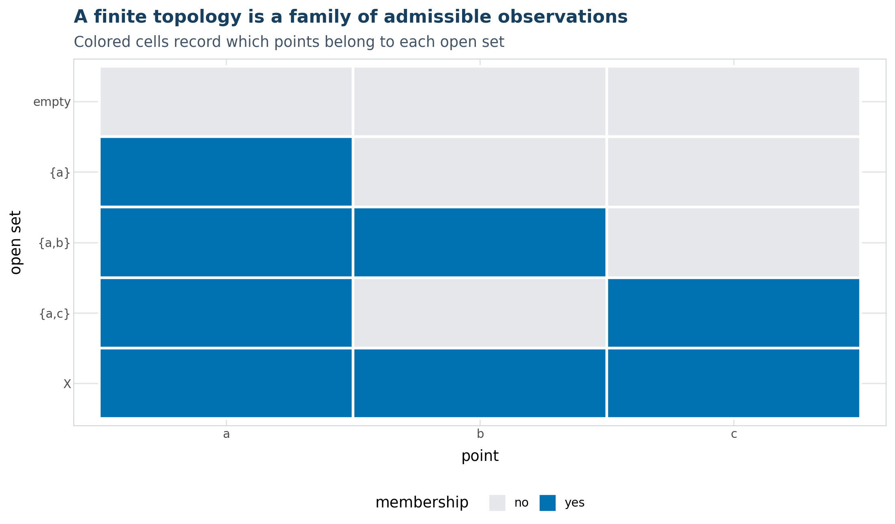

# Sets, Maps, and Equivalence {#sec-topology-sets-maps}

Topology begins before open sets: it begins with the discipline of saying what
the objects are and how maps act on them. A continuous map will be defined by
inverse images, a quotient by equivalence classes, and an invariant by what a
map preserves. This chapter makes those operations reliable in finite examples
and proves the identities that remain valid for arbitrary sets.

## Preparation from this book

The [concise toolkit](00i-topology-bridge.md#sec-topology-set-toolkit) reviews
membership, unions, intersections, functions, and quantifiers. No other
preparation is required.

## Images and inverse images

For $f:X\to Y$ and $A\subseteq X$, the image is
$f(A)=\{f(x):x\in A\}$. For $B\subseteq Y$, the inverse image is
$f^{-1}(B)=\{x:f(x)\in B\}$. Inverse image is not an inverse function: it is
available for every map.

Inverse images obey exact Boolean rules:

$$
f^{-1}\left(\bigcup_iB_i\right)=\bigcup_i f^{-1}(B_i),
\qquad
f^{-1}(Y\setminus B)=X\setminus f^{-1}(B).
$$

For the union identity, an arbitrary $x$ belongs to the left side exactly when
$f(x)$ belongs to at least one $B_i$, exactly when $x$ belongs to at least one
inverse image. This element-by-element proof works for infinite families.
Images preserve unions but not generally intersections: two different inputs
can collapse to one output.

A map is injective, surjective, or bijective as reviewed in the toolkit.
Composition preserves injectivity and surjectivity in the expected direction,
and a bijection has a two-sided inverse.

## Relations and quotients

An equivalence relation partitions $X$: every point lies in its class, two
classes that meet are equal, and different classes are disjoint. Conversely,
any partition defines an equivalence relation by declaring points equivalent
when they lie in the same block.

The quotient map $q:X\to X/{\sim}$ sends $x$ to $[x]$. A function
$f:X\to Y$ descends to a well-defined function on the quotient exactly when

$$
x\sim x'\quad\Longrightarrow\quad f(x)=f(x').
$$

This “constant on classes” test will reappear for quotient topology and
covering constructions.

## Cardinal comparison

Finite size is counted by a natural number. Infinite sets are compared through
injections and bijections. The integers and rational numbers are countable:
their elements can be placed in a sequence. The real interval $[0,1]$ is
uncountable by Cantor's diagonal argument.

Cantor's theorem states that no map $f:X\to\mathcal P(X)$ is surjective.
Given any proposed $f$, form

$$
D=\{x\in X:x\notin f(x)\}.
$$

If $D=f(d)$, then $d\in D$ exactly when $d\notin D$, a contradiction. This
proof applies to finite and infinite $X$; a program can check only a chosen
finite instance.

**Nonexample.** A long list of distinct real numbers does not show that the
reals are countable. Countability requires one list containing every real, and
the diagonal argument defeats each proposed list.

<figure id="fig-sets-incidence">


<figcaption>

Figure 1.1: A family of subsets can be read as a membership relation between points and admissible observations.

</figcaption>
</figure>

The figure is not yet a topology theorem. It is a finite representation of a
set family, the raw object on which later axioms can be checked.

<!-- inline-formula-code:start -->
## Formula and finite computation

For a finite map, the inverse-image rule

$$
f^{-1}(B)=\{x\in X:f(x)\in B\}
$$

is a direct comprehension:

```python
def inverse_image(mapping: dict[str, int], target: set[int]) -> set[str]:
    if not set(mapping.values()).intersection(target) and target:
        return set()
    return {point for point, value in mapping.items() if value in target}

mapping = {"a": 0, "b": 1, "c": 1, "d": 2}
left = inverse_image(mapping, {1, 2})
right = inverse_image(mapping, {1}) | inverse_image(mapping, {2})
print(left, right, left == right)
```

**What the computation establishes.** Equality is checked exactly for one
finite map and two target subsets. The proof above, not this output, establishes
the inverse-image union law for every map and arbitrary indexed family.
<!-- inline-formula-code:end -->

## Summary

Images follow points forward; inverse images pull subsets backward and preserve
all Boolean operations. Equivalence relations and partitions encode the same
data, and maps descend through quotients precisely when they are constant on
classes. Injections and bijections compare cardinalities, while Cantor's
diagonal set proves every power set is strictly larger than its source.

## Exercises

<div class="exercise" id="topology-01-sets-maps-ex-1">
<p class="exercise-title"><strong>Exercise 1</strong></p>

Prove the inverse-image intersection and complement rules.

</div>

<div class="exercise" id="topology-01-sets-maps-ex-2">
<p class="exercise-title"><strong>Exercise 2</strong></p>

Give a map for which $f(A\cap B)\ne f(A)\cap f(B)$.

<details class="solution"><summary>Solution</summary>

For Exercise 2, let $f(0)=f(1)=a$, $A=\{0\}$, and $B=\{1\}$. Then
$A\cap B=\varnothing$, so its image is empty, while
$f(A)\cap f(B)=\{a\}$. The failure is caused by noninjectivity.

</details>

</div>

<div class="exercise" id="topology-01-sets-maps-ex-3">
<p class="exercise-title"><strong>Exercise 3</strong></p>

Prove that equivalence classes either coincide or are disjoint.

</div>

<div class="exercise" id="topology-01-sets-maps-ex-4">
<p class="exercise-title"><strong>Exercise 4</strong></p>

List the classes of congruence modulo $3$ on $\{0,\ldots,8\}$.

</div>

<div class="exercise" id="topology-01-sets-maps-ex-5">
<p class="exercise-title"><strong>Exercise 5</strong></p>

Decide whether $f(n)=n^2$ descends from integers modulo $5$ to residues
modulo $5$.

</div>

<div class="exercise" id="topology-01-sets-maps-ex-6">
<p class="exercise-title"><strong>Exercise 6</strong></p>

Apply Cantor's construction to a proposed enumeration of subsets of
$\{a,b,c\}$.

</div>

### Selected solution

For Exercise 2, let $f(0)=f(1)=a$, $A=\{0\}$, and $B=\{1\}$. Then
$A\cap B=\varnothing$, so its image is empty, while
$f(A)\cap f(B)=\{a\}$. The failure is caused by noninjectivity.
