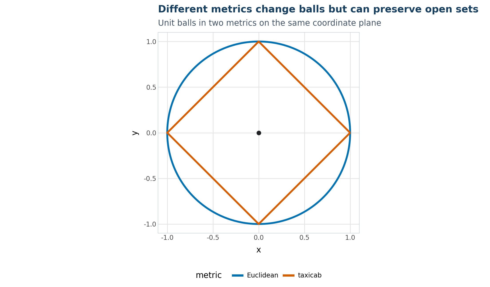

# Metric Spaces {#sec-topology-metrics}

A metric turns “near” into a number. Topology will later retain only which
sets count as neighborhoods, but the numerical layer remains valuable for
convergence rates, completeness, approximation, and computation.

## Preparation from this book

Use the distance and coordinate review in
[the concise toolkit](00i-topology-bridge.md#sec-topology-metric-toolkit).
Chapter 1 is needed only for its language of functions and inverse images.

## Metric axioms and examples

A metric $d:X\times X\to[0,\infty)$ satisfies positivity,
$d(x,y)=0$ exactly when $x=y$, symmetry, and the triangle inequality

$$
d(x,z)\le d(x,y)+d(y,z).
$$

Euclidean, taxicab, and maximum distance are metrics on $\mathbb R^n$. The
discrete metric is zero on equal points and one otherwise. On strings, edit
distance counts insertions, deletions, and substitutions. A weighted Euclidean
formula fails to be a metric if a weight is negative or zero in a direction.

An open ball is $B_r(x)=\{y:d(x,y)<r\}$. A set is metric-open when every point
inside has some ball still inside. Distinct metrics can generate the same open
sets. On finite-dimensional $\mathbb R^n$,

$$
\begin{gathered}
\|v\|_\infty\le\|v\|_2,\\
\|v\|_2\le\sqrt n\,\|v\|_\infty,
\end{gathered}
$$

so balls in either norm contain suitably rescaled balls in the other.

For one finite vector, the comparison is a direct reduction over its
coordinates. Returning the two sides separately makes the dimension-dependent
constant visible.

```python
from math import isfinite, sqrt

def norm_comparison(vector: tuple[float, ...]) -> tuple[float, float, float]:
    """Return infinity norm, Euclidean norm, and sqrt(n) times infinity norm."""
    if not vector or not all(isfinite(coordinate) for coordinate in vector):
        raise ValueError("vector must be nonempty and have finite coordinates")
    infinity_norm = max(abs(coordinate) for coordinate in vector)
    euclidean_norm = sqrt(sum(coordinate * coordinate for coordinate in vector))
    upper_bound = sqrt(len(vector)) * infinity_norm
    return infinity_norm, euclidean_norm, upper_bound

lower, middle, upper = norm_comparison((1.0, -2.0, 2.0))
if not lower <= middle <= upper:
    raise RuntimeError("the finite vector violated the norm comparison")
print(lower, middle, upper)
```

This checks $2\le3\le2\sqrt3$ for one vector. The general inequalities follow
from coordinate bounds and Cauchy–Schwarz; sampled vectors cannot establish
that the two norms generate the same topology.

<figure id="fig-metric-balls">


<figcaption>

Figure 2.1: Euclidean and taxicab metrics give different unit-ball geometry while supporting the same usual topology on the plane.

</figcaption>
</figure>

The shapes affect nearest points and numerical cost. Their common open sets
mean continuity and connectedness agree.

## Sequences and completeness

A sequence $x_n$ converges to $x$ when for every $\varepsilon>0$, eventually
$d(x_n,x)<\varepsilon$. Limits in a metric space are unique. A **Cauchy
sequence** has late terms close to one another:

$$
\begin{gathered}
\text{for every }\varepsilon>0\\
\text{there is }N\text{ such that}\\
m,n\ge N\Longrightarrow d(x_m,x_n)<\varepsilon.
\end{gathered}
$$

Every convergent sequence is Cauchy. A space is **complete** when every Cauchy
sequence converges in the space. The rationals are not complete: rational
approximations to $\sqrt2$ are Cauchy but have no rational limit. Completeness
depends on both distance and which points the space contains.

The diameter of $A$ is
$\operatorname{diam}(A)=\sup\{d(x,y):x,y\in A\}$. Boundedness does not imply
compactness in every metric space, and completeness alone does not imply
boundedness.

## Lipschitz maps and contractions

A map $f:X\to Y$ between metric spaces is Lipschitz with constant $L\ge0$ when

$$
d_Y(f(x),f(y))\le Ld_X(x,y).
$$

It is uniformly continuous. The **Banach fixed-point theorem** applies to a
**nonempty complete** metric space $(X,d)$ and a **self-map** $f:X\to X$
satisfying the Lipschitz inequality in that same metric with $0\le L<1$.
It gives a unique fixed point, and the iteration $x_{n+1}=f(x_n)$ converges to
it from every starting point $x_0\in X$. This is an imported theorem; see
[Lebl, *Basic Analysis I*, version 6.3, Theorem 7.6.2 and its proof, pages 296–297](https://www.jirka.org/ra/realanal.pdf).

The self-map condition ensures that every iterate remains in the domain.
A general Lipschitz map $X\to Y$ need not have this property, so the
Lipschitz inequality alone does not supply repeated iteration.

Completeness cannot be dropped: $f(x)=(x+1)/2$ maps the open interval $(0,1)$
into itself and is a contraction, but its fixed point $1$ is missing.

**Nonexample.** The square of an arbitrary “distance-like” metric need not be a
metric. On the line, $d(0,2)^2=4$ exceeds
$d(0,1)^2+d(1,2)^2=2$.

<!-- inline-formula-code:start -->
## Formula and finite computation

Euclidean distance is

$$
d(x,y)=\sqrt{\sum_{i=1}^n(x_i-y_i)^2}.
$$

```python
from math import sqrt

def euclidean(left: tuple[float, ...], right: tuple[float, ...]) -> float:
    if len(left) == 0 or len(left) != len(right):
        raise ValueError("points must have equal positive dimension")
    return sqrt(sum((x - y) ** 2 for x, y in zip(left, right, strict=True)))

x, y, z = (0.0, 0.0), (1.0, 2.0), (3.0, 1.0)
print(euclidean(x, z), euclidean(x, y) + euclidean(y, z))
```

**What the computation establishes.** The printed inequality audits one
triangle in $\mathbb R^2$. The general triangle inequality requires the
Cauchy–Schwarz argument and cannot be proved by finitely many sampled triples.
<!-- inline-formula-code:end -->

## Summary

Metrics quantify nearness through four axioms. Balls generate open sets;
equivalent norm bounds can make different metrics topologically equivalent.
Sequences distinguish convergence from Cauchy behavior, and completeness
ensures limits remain inside. Lipschitz constants add quantitative control that
topology alone deliberately forgets.

## Exercises

<div class="exercise" id="topology-02-metric-spaces-ex-1">
<p class="exercise-title"><strong>Exercise 1</strong></p>

Verify the discrete metric axioms.

</div>

<div class="exercise" id="topology-02-metric-spaces-ex-2">
<p class="exercise-title"><strong>Exercise 2</strong></p>

Compare Euclidean, taxicab, and maximum distance for two chosen points.

</div>

<div class="exercise" id="topology-02-metric-spaces-ex-3">
<p class="exercise-title"><strong>Exercise 3</strong></p>

Prove limits are unique in a metric space.

<details class="solution"><summary>Solution</summary>

For Exercise 3, if $x_n\to x$ and $x_n\to y$, choose $N$ so both
$d(x_n,x)$ and $d(x_n,y)$ are below $\varepsilon/2$. Then
$d(x,y)<\varepsilon$. Since this holds for every positive $\varepsilon$,
$d(x,y)=0$ and $x=y$.

</details>

</div>

<div class="exercise" id="topology-02-metric-spaces-ex-4">
<p class="exercise-title"><strong>Exercise 4</strong></p>

Show every convergent sequence is Cauchy.

</div>

<div class="exercise" id="topology-02-metric-spaces-ex-5">
<p class="exercise-title"><strong>Exercise 5</strong></p>

Show the displayed norm inequalities in $\mathbb R^n$.

</div>

<div class="exercise" id="topology-02-metric-spaces-ex-6">
<p class="exercise-title"><strong>Exercise 6</strong></p>

Find the fixed point and error bound for $f(x)=(x+2)/3$.

</div>

<div class="exercise" id="topology-02-metric-spaces-ex-7">
<p class="exercise-title"><strong>Exercise 7</strong></p>

With the usual distance, let $I=[0,1]$ and define $f_a:I\to\mathbb R$
by $f_a(x)=(x+a)/2$ for $a\in\mathbb R$. Find the exact range $f_a(I)$
and determine when this
formula defines a self-map of $I$. In those cases, find its fixed point
and derive the signed iterate and absolute error for $x_0\in I$ and
$n\ge0$. Include the boundary cases $a=0,1$. What fails when $a=3$?
Compare with using $\mathbb R$ as the domain.

<details class="solution"><summary>Solution</summary>

For Exercise 7, $f_a$ is increasing and has Lipschitz constant $1/2$.
Its exact range is

$$
f_a([0,1])=\left[\frac a2,\frac{a+1}{2}\right].
$$

This lies in $[0,1]$ exactly when $a\ge0$ and $a+1\le2$, or
$0\le a\le1$. For these parameters, the nonempty complete space $I$
is invariant. Solving $x=(x+a)/2$ gives the unique fixed point $a$.
Direct subtraction and induction give

$$
\begin{gathered}
x_{n+1}-a=(x_n-a)/2,\\
x_n-a=2^{-n}(x_0-a),\\
|x_n-a|=2^{-n}|x_0-a|.
\end{gathered}
$$

Thus the error tends to zero. This directly proves the special case rather
than proving the general Banach theorem. At $a=0$ and $a=1$, the fixed point
is the corresponding endpoint; every iterate still lies in $I$.

When $a=3$, the restricted map $f_3:I\to\mathbb R$ has range $[3/2,2]$.
After one application, $x_1$ lies outside $I$, so $f_3(x_1)$ is undefined.
The algebraic fixed-point equation gives $3$, which is not in $I$;
the Lipschitz constant $1/2$ does not repair this failure of domain invariance.

Continuing the formula on $\mathbb R$ uses a separately defined extension
$\widetilde f_a:\mathbb R\to\mathbb R$ given by
$\widetilde f_a(x)=(x+a)/2$. For every real $a$, this extension is a self-map
of a nonempty complete space. Its fixed point is $a$, and the same exact
iterate formula proves convergence for every $x_0\in\mathbb R$.

</details>

</div>

### Selected solutions

For Exercise 3, if $x_n\to x$ and $x_n\to y$, choose $N$ so both
$d(x_n,x)$ and $d(x_n,y)$ are below $\varepsilon/2$. Then
$d(x,y)<\varepsilon$. Since this holds for every positive $\varepsilon$,
$d(x,y)=0$ and $x=y$.

For Exercise 7, $f_a$ is increasing and has Lipschitz constant $1/2$.
Its exact range is

$$
f_a([0,1])=\left[\frac a2,\frac{a+1}{2}\right].
$$

This lies in $[0,1]$ exactly when $a\ge0$ and $a+1\le2$, or
$0\le a\le1$. For these parameters, the nonempty complete space $I$
is invariant. Solving $x=(x+a)/2$ gives the unique fixed point $a$.
Direct subtraction and induction give

$$
\begin{gathered}
x_{n+1}-a=(x_n-a)/2,\\
x_n-a=2^{-n}(x_0-a),\\
|x_n-a|=2^{-n}|x_0-a|.
\end{gathered}
$$

Thus the error tends to zero. This directly proves the special case rather
than proving the general Banach theorem. At $a=0$ and $a=1$, the fixed point
is the corresponding endpoint; every iterate still lies in $I$.

When $a=3$, the restricted map $f_3:I\to\mathbb R$ has range $[3/2,2]$.
After one application, $x_1$ lies outside $I$, so $f_3(x_1)$ is undefined.
The algebraic fixed-point equation gives $3$, which is not in $I$;
the Lipschitz constant $1/2$ does not repair this failure of domain invariance.

Continuing the formula on $\mathbb R$ uses a separately defined extension
$\widetilde f_a:\mathbb R\to\mathbb R$ given by
$\widetilde f_a(x)=(x+a)/2$. For every real $a$, this extension is a self-map
of a nonempty complete space. Its fixed point is $a$, and the same exact
iterate formula proves convergence for every $x_0\in\mathbb R$.
