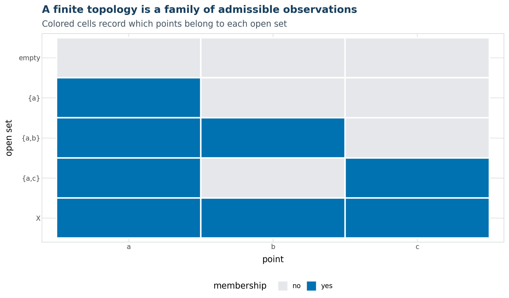

# Topological Spaces {#sec-topological-spaces}

A topology records which observations are local without requiring a numerical
distance. This abstraction includes metric spaces, ordered spaces, quotients,
function spaces, and finite information systems in one language.

## Preparation from this book

Read Chapters 1–2, or use the set and distance sections of the
[concise toolkit](00i-topology-bridge.md). The only proof technique assumed is
showing equality of sets by two containments.

## Open-set axioms

A **topology** $\mathcal T$ on $X$ is a family of subsets such that

1. $\varnothing,X\in\mathcal T$;
2. every union of members of $\mathcal T$ belongs to $\mathcal T$; and
3. every finite intersection of members belongs to $\mathcal T$.

The pair $(X,\mathcal T)$ is a topological space. Members of $\mathcal T$ are
open. Complements of open sets are closed, so arbitrary intersections and
finite unions of closed sets are closed.

The indiscrete topology $\{\varnothing,X\}$ carries minimal information; the
discrete topology $\mathcal P(X)$ carries maximal information. Every metric
generates a topology through its balls.

Why only finite intersections? In $\mathbb R$, every
$(-1/n,1/n)$ is open, but their intersection is $\{0\}$, which is not open.

## Interior, closure, and boundary

The interior $A^\circ$ is the union of all open subsets of $A$. The closure
$\overline A$ is the intersection of all closed supersets of $A$. Equivalently,
$x\in\overline A$ when every neighborhood of $x$ meets $A$. The boundary is

$$
\partial A=\overline A\setminus A^\circ
=\overline A\cap\overline{X\setminus A}.
$$

A set is dense when its closure is $X$. The rationals and irrationals are both
dense in the real line, showing that two disjoint sets can each meet every open
interval.

A **neighborhood** of $x$ is a set containing an open set that contains $x$.
The neighborhood itself need not be open. Definitions stated using
neighborhoods often transfer directly beyond metric spaces.

<figure id="fig-finite-topology">


<figcaption>

Figure 3.1: The incidence grid encodes a genuine topology on three points; the open sets are closed under unions and finite intersections.

</figcaption>
</figure>

In this finite example, point $a$ has the smallest neighborhood $\{a\}$ while
$b$ and $c$ cannot be observed without $a$. Finite topologies need not be
metric: metric spaces separate distinct points more strongly.

**Nonexample.** On $X=\{a,b,c\}$, the family
$\{\varnothing,X,\{a,b\},\{b,c\}\}$ is not a topology because the intersection
$\{b\}$ is missing.

## A closure proof pattern

Closure is monotone: $A\subseteq B$ implies
$\overline A\subseteq\overline B$. Indeed, every closed set containing $B$
also contains $A$, but the neighborhood characterization is even quicker:
every neighborhood meeting $A$ also meets $B$.

Kuratowski's closure rules say
$\overline\varnothing=\varnothing$, $A\subseteq\overline A$,
$\overline{\overline A}=\overline A$, and
$\overline{A\cup B}=\overline A\cup\overline B$. These rules can alternatively
be used to specify a topology.

<!-- inline-formula-code:start -->
## Formula and finite computation

For finite $X$, the topology axioms are decidable:

$$
\varnothing,X\in\mathcal T,\qquad
U,V\in\mathcal T\Longrightarrow U\cap V,U\cup V\in\mathcal T.
$$

Arbitrary unions reduce to finite unions because $\mathcal T$ itself is finite.

```python
from itertools import combinations

def is_finite_topology(points: frozenset[str], opens: set[frozenset[str]]) -> bool:
    if any(not open_set <= points for open_set in opens):
        raise ValueError("every declared open set must lie in the point set")
    if frozenset() not in opens or points not in opens:
        return False
    return all(
        left | right in opens and left & right in opens
        for left, right in combinations(opens, 2)
    )

space = frozenset({"a", "b", "c"})
topology = {frozenset(), frozenset({"a"}), frozenset({"a", "b"}), frozenset({"a", "c"}), space}
print(is_finite_topology(space, topology))
```

**What the computation establishes.** The function decides the axioms for the
declared finite family. Infinite topologies cannot be validated by enumerating
all unions, and the code does not prove properties of arbitrary spaces.
<!-- inline-formula-code:end -->

## Summary

Open sets obey union and finite-intersection axioms; closed sets obey the dual
rules. Interior is the largest open part, closure the smallest closed envelope,
and boundary where a set and its complement are both locally visible. Finite
topologies provide exact computational models while revealing behavior that
metrics cannot express.

## Exercises

<div class="exercise" id="topology-03-topological-spaces-ex-1">
<p class="exercise-title"><strong>Exercise 1</strong></p>

List all topologies on a two-point labeled set.

</div>

<div class="exercise" id="topology-03-topological-spaces-ex-2">
<p class="exercise-title"><strong>Exercise 2</strong></p>

Prove arbitrary intersections of closed sets are closed.

</div>

<div class="exercise" id="topology-03-topological-spaces-ex-3">
<p class="exercise-title"><strong>Exercise 3</strong></p>

Compute interiors, closures, and boundaries in the displayed finite topology.

</div>

<div class="exercise" id="topology-03-topological-spaces-ex-4">
<p class="exercise-title"><strong>Exercise 4</strong></p>

Prove $\overline{A\cup B}=\overline A\cup\overline B$.

</div>

<div class="exercise" id="topology-03-topological-spaces-ex-5">
<p class="exercise-title"><strong>Exercise 5</strong></p>

Show the rationals are dense in $\mathbb R$.

</div>

<div class="exercise" id="topology-03-topological-spaces-ex-6">
<p class="exercise-title"><strong>Exercise 6</strong></p>

Give a countable intersection of open real sets that is not open.

<details class="solution"><summary>Solution</summary>

For Exercise 6, the sets $(-1/n,1/n)$ are open for positive integers $n$.
Their intersection contains exactly zero: any nonzero $x$ is excluded once
$1/n<|x|$. A singleton is not open in the usual real topology.

</details>

</div>

### Selected solution

For Exercise 6, the sets $(-1/n,1/n)$ are open for positive integers $n$.
Their intersection contains exactly zero: any nonzero $x$ is excluded once
$1/n<|x|$. A singleton is not open in the usual real topology.
