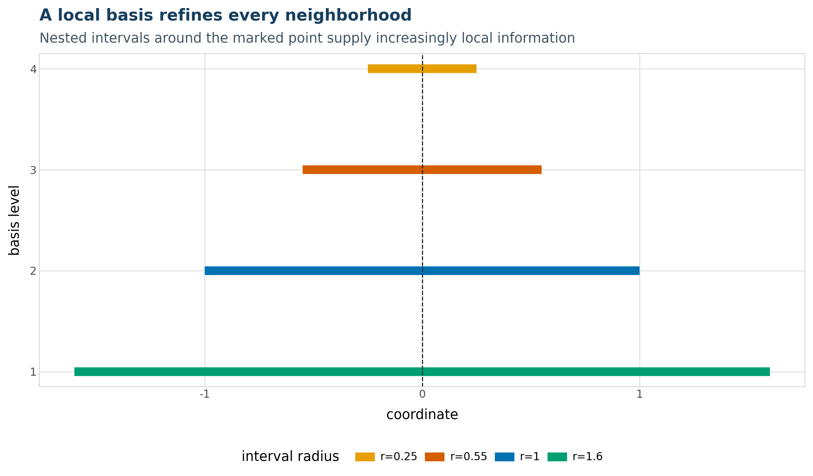

# Bases and Subbases {#sec-topology-bases}

Listing every open set is usually impossible. A **basis** supplies reusable
local pieces from which all opens are assembled. It is the topological analogue
of specifying coordinates, generators, or vocabulary rather than every
possible sentence.

## Preparation from this book

Chapter 3 supplies the open-set axioms. Review Chapter 1 if inverse images or
indexed unions are unfamiliar; no countability theory is assumed.

## Basis criterion

A family $\mathcal B$ of subsets of $X$ is a basis when:

1. every $x\in X$ lies in some $B\in\mathcal B$; and
2. if $x\in B_1\cap B_2$, there is $B_3\in\mathcal B$ with
   $x\in B_3\subseteq B_1\cap B_2$.

The generated topology consists of all unions of basis members. Equivalently,
$U$ is open when every $x\in U$ lies in a basis member
$B$ with $x\in B\subseteq U$.

Open balls form a basis for a metric topology. On $\mathbb R$, intervals with
rational endpoints already form a countable basis: between $x$ and the
endpoints of any open interval, rational endpoints can be inserted.

<figure id="fig-basis-refinement">


<figcaption>

Figure 4.1: Nested intervals illustrate a local basis: every neighborhood of the marked point contains a sufficiently small basis interval.

</figcaption>
</figure>

A **local basis** at $x$ need only refine neighborhoods of that point.
First countability asks for a countable local basis at every point; second
countability asks for one countable basis for the entire topology.

## Subbases and generated structure

A **subbasis** $\mathcal S$ covers $X$. Finite intersections of subbasic sets
form a basis, and arbitrary unions then form the generated topology. For a
product $X\times Y$, sets
$U\times Y$ and $X\times V$ form a subbasis; their finite intersections are
rectangles $U\times V$.

The order topology on a linearly ordered set has open intervals and appropriate
endpoint rays as basis elements. This creates familiar topology on $\mathbb R$
but different behavior on orders with gaps or immediate successors.

Two bases generate the same topology exactly when each basis member of either
one can be locally refined by a member of the other. This criterion proves that
open balls and rational balls generate the same Euclidean topology.

**Nonexample.** Merely covering $X$ does not make a family a basis. On
$\{a,b,c\}$, the sets $\{a,b\}$ and $\{b,c\}$ cover $X$, but at $b$ their
intersection has no smaller listed member containing $b$.

## Why bases matter computationally

Continuity can be checked on a basis of the target, compactness on basic covers
in suitable arguments, and convergence through local bases. In finite spaces,
generating a topology from a subbasis is exact. In infinite spaces, a program
must represent a rule for basis elements rather than list them all.

<!-- inline-formula-code:start -->
## Formula and finite computation

The topology generated by a finite basis is

$$
\mathcal T=\left\{\bigcup\mathcal A:\mathcal A\subseteq\mathcal B\right\}.
$$

```python
from itertools import combinations

def generated_topology(basis: set[frozenset[str]]) -> set[frozenset[str]]:
    pieces = list(basis)
    opens: set[frozenset[str]] = {frozenset()}
    for size in range(1, len(pieces) + 1):
        for selection in combinations(pieces, size):
            opens.add(frozenset().union(*selection))
    return opens

basis = {frozenset({"a"}), frozenset({"a", "b"}), frozenset({"a", "c"})}
print(sorted(map(sorted, generated_topology(basis)), key=lambda item: (len(item), item)))
```

**What the computation establishes.** Every union of this three-member finite
basis is enumerated. The exponential method is not a representation of an
uncountable basis, and basis validity still requires the local intersection
criterion.
<!-- inline-formula-code:end -->

## Summary

A basis encodes every open set by local refinements and unions. A subbasis
requires finite intersections first. Countable bases control sequences,
separability, and metrizability, while product and order subbases build new
spaces economically. Finite generation is executable; infinite bases are
handled through definitions and proofs.

## Exercises

<div class="exercise" id="topology-04-bases-subbases-ex-1">
<p class="exercise-title"><strong>Exercise 1</strong></p>

Prove open balls satisfy the basis criterion.

</div>

<div class="exercise" id="topology-04-bases-subbases-ex-2">
<p class="exercise-title"><strong>Exercise 2</strong></p>

Show rational-endpoint intervals form a countable basis for $\mathbb R$.

</div>

<div class="exercise" id="topology-04-bases-subbases-ex-3">
<p class="exercise-title"><strong>Exercise 3</strong></p>

Generate the topology from $\{\{a,b\},\{b,c\}\}$ as a subbasis.

<details class="solution"><summary>Solution</summary>

For Exercise 3, finite intersections add
$\{b\}$, together with the original two sets and $X$ if the empty
intersection is allowed. Their unions yield
$\varnothing,\{b\},\{a,b\},\{b,c\},X$. This is a topology.

</details>

</div>

<div class="exercise" id="topology-04-bases-subbases-ex-4">
<p class="exercise-title"><strong>Exercise 4</strong></p>

Give two different bases for the discrete topology on a finite set.

</div>

<div class="exercise" id="topology-04-bases-subbases-ex-5">
<p class="exercise-title"><strong>Exercise 5</strong></p>

Prove the mutual local-refinement criterion for equal generated topologies.

</div>

<div class="exercise" id="topology-04-bases-subbases-ex-6">
<p class="exercise-title"><strong>Exercise 6</strong></p>

Describe a local basis at an endpoint of $[0,1]$ in its subspace topology.

</div>

### Selected solution

For Exercise 3, finite intersections add
$\{b\}$, together with the original two sets and $X$ if the empty
intersection is allowed. Their unions yield
$\varnothing,\{b\},\{a,b\},\{b,c\},X$. This is a topology.
