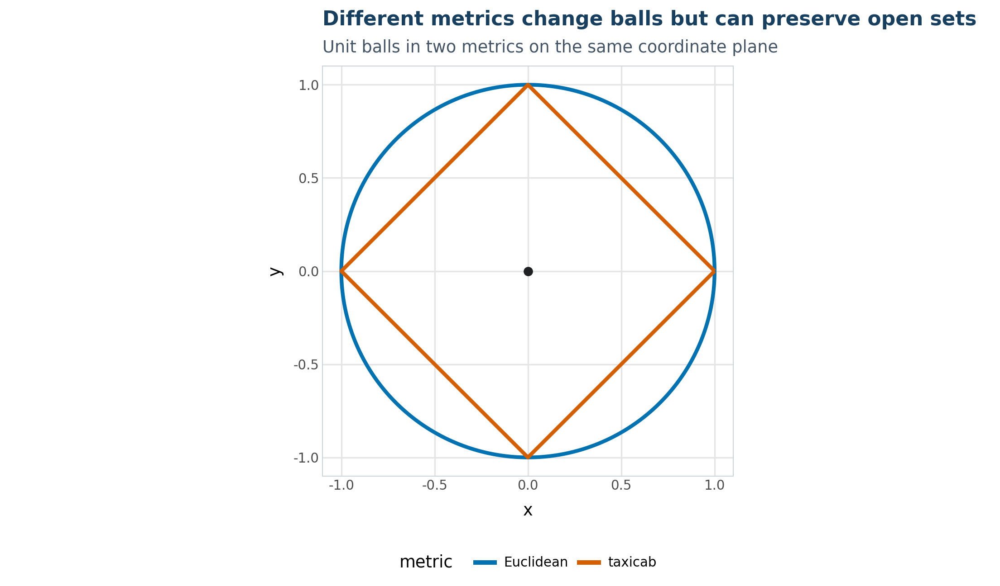

# Continuity and Homeomorphism {#sec-topology-continuity}

Calculus often defines continuity by limits or epsilon–delta estimates.
Topology isolates the invariant content: a map is continuous when pulling an
open observation backward produces an open observation.

## Preparation from this book

Read Chapters 1, 3, and 4 for inverse images, open sets, and basis checks.
Metric epsilon–delta continuity is recalled below, so a calculus course is not
required.

## Global and local definitions

A map $f:X\to Y$ is continuous when

$$
V\text{ open in }Y\quad\Longrightarrow\quad f^{-1}(V)\text{ open in }X.
$$

It is enough to check a basis of $Y$. In metric spaces this is equivalent to
the epsilon–delta statement: for every $x$ and $\varepsilon>0$, some
$\delta>0$ ensures $d_X(x,x')<\delta$ implies
$d_Y(f(x),f(x'))<\varepsilon$.

The inverse-image laws make compositions continuous immediately:
$(g\circ f)^{-1}(W)=f^{-1}(g^{-1}(W))$. Restrictions of continuous maps are
continuous. The pasting lemma joins continuous maps on finitely many closed
pieces when they agree on overlaps; an infinite closed pasting needs additional
conditions.

## Homeomorphisms and embeddings

A **homeomorphism** is a bijective continuous map with continuous inverse.
Homeomorphic spaces are the same for topological questions. A continuous
bijection need not be a homeomorphism: the inverse may fail to be continuous.
However, a continuous bijection from a compact space to a Hausdorff space is a
homeomorphism, a powerful result proved after those properties are developed.

An **embedding** $f:X\to Y$ is a homeomorphism from $X$ onto its image with the
subspace topology. It records a copy of $X$ inside $Y$. An immersion in
differential geometry is a local derivative condition and can self-intersect;
it is not automatically an embedding.

Connectedness, compactness, separation properties, and algebraic invariants are
preserved by homeomorphism. Length, angle, area, and curvature are not purely
topological.

<figure id="fig-homeomorphic-metrics">


<figcaption>

Figure 5.1: The circular and diamond unit balls differ geometrically, yet the identity map between their metric descriptions is a homeomorphism.

</figcaption>
</figure>

The norm inequalities from [sec-topology-metrics](02-metric-spaces.md#sec-topology-metrics) make the identity continuous
in both directions. A picture alone would not establish that every open set is
preserved.

## Initial and quotient tests

If a topology on $X$ is generated by maps $f_i:X\to Y_i$, it is the coarsest
topology making all $f_i$ continuous. Product topology has this property for
coordinate projections.

For a quotient map $q:X\to Q$, a function $g:Q\to Y$ is continuous exactly
when $g\circ q$ is continuous, provided $g$ is well defined. This universal
test lets continuity be checked before identified points are collapsed.

**Nonexample.** Continuity does not mean open sets map to open sets. The
constant map is continuous because inverse images of opens are empty or all of
$X$, but the image of a nonempty open set is a singleton, often not open.

<!-- inline-formula-code:start -->
## Formula and finite computation

For finite spaces, continuity is the preimage condition

$$
f\text{ continuous}\iff
f^{-1}(V)\in\mathcal T_X\text{ for every }V\in\mathcal T_Y.
$$

```python
def is_continuous(
    mapping: dict[str, str],
    source_opens: set[frozenset[str]],
    target_opens: set[frozenset[str]],
) -> bool:
    if not source_opens or not target_opens:
        raise ValueError("each topology must contain at least one open set")
    source_points = set().union(*source_opens)
    target_points = set().union(*target_opens)
    if set(mapping) != source_points:
        raise ValueError("mapping domain must equal the source space")
    if not set(mapping.values()) <= target_points:
        raise ValueError("every mapped value must lie in the target space")
    return all(
        frozenset(point for point, value in mapping.items() if value in target_open)
        in source_opens
        for target_open in target_opens
    )

source = {frozenset(), frozenset({"a"}), frozenset({"a", "b"})}
target = {frozenset(), frozenset({"x"}), frozenset({"x", "y"})}
print(is_continuous({"a": "x", "b": "y"}, source, target))
```

**What the computation establishes.** Every target open is checked for these
two finite spaces. The algorithm cannot enumerate an arbitrary infinite
topology, and it does not prove the general equivalence with epsilon–delta
continuity.
<!-- inline-formula-code:end -->

## Summary

Continuity is preservation of open structure under inverse image. Basis checks,
composition, restriction, and pasting make it modular. Homeomorphisms preserve
topological structure in both directions; embeddings place a space faithfully
inside another. Openness of a map, continuity of a map, and bijectivity are
distinct properties.

## Exercises

<div class="exercise" id="topology-05-continuity-homeomorphism-ex-1">
<p class="exercise-title"><strong>Exercise 1</strong></p>

Prove a map to an indiscrete space is always continuous.

<details class="solution"><summary>Solution</summary>

For Exercise 1, the only target opens are empty and the whole target. Their
inverse images are empty and the whole source, which belong to every topology.
No other condition remains.

</details>

</div>

<div class="exercise" id="topology-05-continuity-homeomorphism-ex-2">
<p class="exercise-title"><strong>Exercise 2</strong></p>

Characterize continuous maps from a discrete space.

</div>

<div class="exercise" id="topology-05-continuity-homeomorphism-ex-3">
<p class="exercise-title"><strong>Exercise 3</strong></p>

Prove composition of continuous maps is continuous.

</div>

<div class="exercise" id="topology-05-continuity-homeomorphism-ex-4">
<p class="exercise-title"><strong>Exercise 4</strong></p>

Give a continuous bijection whose inverse is not continuous.

</div>

<div class="exercise" id="topology-05-continuity-homeomorphism-ex-5">
<p class="exercise-title"><strong>Exercise 5</strong></p>

Show $x\mapsto x/(1+|x|)$ is a homeomorphism from $\mathbb R$ to $(-1,1)$.

</div>

<div class="exercise" id="topology-05-continuity-homeomorphism-ex-6">
<p class="exercise-title"><strong>Exercise 6</strong></p>

Check continuity of all maps between two chosen two-point topologies.

</div>

### Selected solution

For Exercise 1, the only target opens are empty and the whole target. Their
inverse images are empty and the whole source, which belong to every topology.
No other condition remains.
