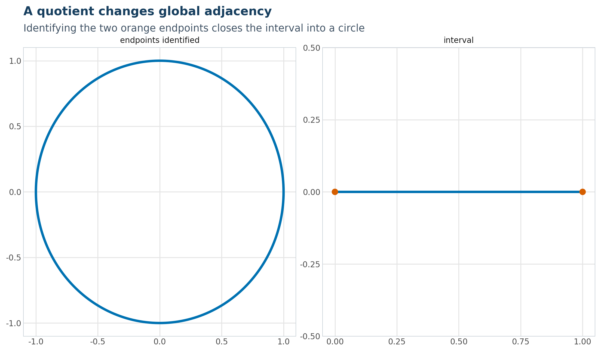

# Subspaces, Products, and Quotients {#sec-topology-constructions}

Topology becomes useful when spaces can be assembled and transformed. Three
constructions recur everywhere: restrict attention to a subset, combine
independent coordinates, and identify points that should count as one.

## Preparation from this book

Chapters 3–5 provide subspace opens, basis rectangles, and continuity. The
equivalence-class test from Chapter 1 is the only quotient prerequisite.
The worked homeomorphism checks also import Heine–Borel and the
compact-to-Hausdorff facts introduced in Chapter 8; their hypotheses are
checked where they are applied here.

## Subspaces and sums

For $A\subseteq X$, the **subspace topology** consists of
$A\cap U$ with $U$ open in $X$. A set can be open in $A$ without being open in
$X$: $[0,1)$ is open in the subspace $[0,2]$ because it is
$[0,2]\cap(-1,1)$.

The disjoint union or topological sum $\coprod_iX_i$ declares a subset open
exactly when its intersection with each component is open. Each component is
both open and closed. A map out of a sum is continuous exactly when each
restriction is continuous.

## Products

The product topology on $X\times Y$ has basis

$$
\{U\times V:U\text{ open in }X,\ V\text{ open in }Y\}.
$$

It is the coarsest topology making both coordinate projections continuous.
For finitely many metric spaces, common product metrics generate this topology.
For infinitely many factors, product topology controls only finitely many
coordinates at a time and is generally weaker than a uniform-box topology.

The graph of $f:X\to Y$ is
$\{(x,f(x)):x\in X\}$. When $Y$ is Hausdorff and $f$ continuous, the graph is
closed in $X\times Y$. The Hausdorff hypothesis keeps unequal values in
disjoint neighborhoods.

## Quotients

Given an equivalence relation on $X$, the quotient topology on
$Q=X/{\sim}$ declares $U\subseteq Q$ open when $q^{-1}(U)$ is open in $X$.
It is the finest topology making the quotient map $q$ continuous.

Identifying the endpoints of $[0,1]$ produces a circle. Collapsing the boundary
of a disk to one point produces a sphere. Identifying a cylinder's circular
ends by a rotation produces a torus. A Möbius band instead identifies a
rectangle's opposite interval edges with a reversal, as the worked examples
below specify. The topology depends on the identification, not on how the
result is sketched.

<figure id="fig-quotient-circle">


<figcaption>

Figure 6.1: Identifying the endpoints of an interval changes its global adjacency and produces a circle.

</figcaption>
</figure>

**Nonexample.** A quotient of a Hausdorff space need not be Hausdorff. If an
equivalence relation glues points along a nonclosed pattern, distinct classes
may be impossible to separate. Nice source geometry does not automatically
survive arbitrary identification.

## Universal properties

Products and quotients can be characterized by maps. A map
$h:Z\to X\times Y$ is continuous exactly when both projections
$\pi_Xh$ and $\pi_Yh$ are continuous. A class-constant continuous
$f:X\to Y$ factors uniquely as $f=\bar f\circ q$ through the quotient. These
properties determine the constructions up to homeomorphism and prepare the
categorical language of Chapter 20.

## Worked gluing: circular ends and interval ends

Write $I=[0,1]$ and $S^1=\{z\in\mathbb C:|z|=1\}$. Here
$e^{i\theta}=\cos\theta+i\sin\theta$, so multiplication by
$e^{i\alpha}$ is rotation through the fixed real angle $\alpha$. The cylinder
$S^1\times I$ has circular ends. Form its quotient $T_\alpha$ by the
identifications

$$
(z,0)\sim_\alpha(e^{i\alpha}z,1).
$$

Let $T_0$ denote the identity-end quotient, and write $[z,t]_\alpha$ for a
point of $T_\alpha$. The cylinder homeomorphism and its inverse are

$$
\begin{gathered}
h(z,t)=(e^{-i\alpha t}z,t),\\
h^{-1}(w,t)=(e^{i\alpha t}w,t).
\end{gathered}
$$

Both maps are continuous. They respect the complete gluing rules: for every
$z\in S^1$,

$$
\begin{gathered}
h(z,0)=(z,0),\\
h(e^{i\alpha}z,1)=(z,1).
\end{gathered}
$$

Thus $h$ sends each rotation-glued pair to an identity-glued pair. Its inverse
sends $(w,0)$ and $(w,1)$ to a rotation-glued pair. The quotient universal
property therefore gives continuous maps

$$
\begin{gathered}
\bar h:T_\alpha\longrightarrow T_0,\\
\bar h([z,t]_\alpha)=[e^{-i\alpha t}z,t]_0,\\
\bar h^{-1}([w,t]_0)=[e^{i\alpha t}w,t]_\alpha.
\end{gathered}
$$

Their compositions are the identity on every class. Hence
$T_\alpha\cong T_0$ by an explicit homeomorphism, for every real $\alpha$.

To identify $T_0$ as the torus $S^1\times S^1$, use

$$
\begin{gathered}
\Phi:T_0\longrightarrow S^1\times S^1,\\
\Phi([z,t]_0)=(z,e^{2\pi it}).
\end{gathered}
$$

The cylinder map $(z,t)\mapsto(z,e^{2\pi it})$ is continuous and agrees on
the identified ends, so $\Phi$ is continuous by the quotient property. It is
surjective because every point of the second circle has an angle representative
$t\in[0,1]$, and its first coordinate is an arbitrary $z\in S^1$. It is
injective because equality of the second coordinates for $s,t\in I$ means
$s=t$ or the endpoint pair $\{s,t\}=\{0,1\}$, exactly the remaining
identification when the first coordinates also agree.

This continuous bijection is a homeomorphism by the **compact-to-Hausdorff
criterion**. Here are its hypotheses and the reason for the criterion. The
cylinder is a closed bounded subset of $\mathbb R^3$, hence compact by
**Heine–Borel**; its continuous quotient $T_0$ is compact. The target torus,
as a subspace of $\mathbb R^4$, is Hausdorff. Any closed subset of $T_0$ is
compact, and its image under $\Phi$ is compact and therefore closed in that
Hausdorff target. Consequently $\Phi$ is a closed bijection, so its inverse
is continuous. Heine–Borel and these compactness facts are imported from
Chapter 8. This verifies the homeomorphism without surface classification or
homology.

Now change the gluing space. Let $A$ and $M$ be quotients of the rectangle
$I\times[-1,1]$ using the respective rules

$$
\begin{gathered}
A:\quad(0,u)\sim(1,u),\\
M:\quad(0,u)\sim(1,-u).
\end{gathered}
$$

For $A$, the map

$$
[s,u]\longmapsto(e^{2\pi is},u)
$$

is a continuous bijection onto $S^1\times[-1,1]$. The rectangle is compact
and the target is Hausdorff, so the same criterion makes it a homeomorphism.
Thus $A$ is an annulus, also called a cylinder. The reflected interval-end
quotient $M$ is the standard **Möbius band**. Compare
[Hatcher, *Vector Bundles and K-Theory*, Section 1.1, Example (2), page 6](https://pi.math.cornell.edu/~hatcher/VBKT/VB.pdf):
that example uses the relation $(0,u)\sim(1,-u)$ on $I\times\mathbb R$;
restricting the fiber to $[-1,1]$ gives the closed band used here.

Both rectangle quotients are Hausdorff. Their equivalence relations, viewed
as subsets of the product of two rectangles, are the diagonal together with
the two graphs of the edge gluing and its inverse. Each graph is compact,
being the continuous image of $[-1,1]$, and hence closed in that Euclidean
product. Their finite union is closed. The **compact-Hausdorff quotient
theorem** says that a compact Hausdorff space modulo a closed equivalence
relation has a Hausdorff quotient; its hypotheses hold here. This additional
theorem is imported, rather than inferred from the gluing picture. See
[Lurie, *Math 131: Final Exam Solutions*, Problem 1](https://people.math.harvard.edu/~lurie/131notes/finalsolutions.pdf).

Before tracing boundary curves, check the local topology. A rectangle-interior
point has a disk neighborhood. At a glued vertical-edge point with $|u|<1$,
two half-disk neighborhoods join to give a disk, for either gluing rule. Along
a horizontal edge, a half-disk remains; at a glued corner pair, two quarter
disks join to give a half-disk. Thus the surface boundary is exactly the
image of the two horizontal edges. Their abstract quotient is compact, and its
induced map to this Hausdorff boundary subset is a continuous bijection; the
compact-to-Hausdorff criterion identifies their topologies. Exercise 7 traces
that quotient; merely
checking a finite list of endpoint pairs would not establish these local
neighborhood facts or the preceding homeomorphisms.

<!-- inline-formula-code:start -->
## Formula and finite computation

Equivalence classes are

$$
[x]=\{y\in X:y\sim x\}.
$$

```python
def equivalence_classes(
    points: set[str], relation: set[tuple[str, str]]
) -> set[frozenset[str]]:
    if any(left not in points or right not in points for left, right in relation):
        raise ValueError("relation pairs must use declared points")
    for point in points:
        if (point, point) not in relation:
            raise ValueError("relation is not reflexive")
    if any((right, left) not in relation for left, right in relation):
        raise ValueError("relation is not symmetric")
    if any(
        (left, end) not in relation
        for left, middle in relation
        for start, end in relation
        if middle == start
    ):
        raise ValueError("relation is not transitive")
    return {frozenset(y for y in points if (x, y) in relation) for x in points}

points = {"0", "1", "2", "3"}
relation = {(x, y) for x in points for y in points if (int(x) - int(y)) % 2 == 0}
print(equivalence_classes(points, relation))
```

**What the computation establishes.** The finite relation is validated and its
two classes are returned exactly. It does not decide quotient separation or
continuity for an infinite identification.
<!-- inline-formula-code:end -->

## Summary

Subspaces inherit relative opens, products coordinate simultaneous
observations, sums keep components separate, and quotients encode
identification. Their universal mapping tests are often more useful than raw
open-set lists and lead directly to categorical formulations.

## Exercises

<div class="exercise" id="topology-06-subspace-product-quotient-ex-1">
<p class="exercise-title"><strong>Exercise 1</strong></p>

Describe the subspace topology on the integers inside $\mathbb R$.

<details class="solution"><summary>Solution</summary>

For Exercise 1, for each integer $n$, the singleton $\{n\}$ equals
$\mathbb Z\cap(n-\tfrac12,n+\tfrac12)$, so every singleton is open in the
subspace. Unions of singletons show the induced topology on $\mathbb Z$ is
discrete.

</details>

</div>

<div class="exercise" id="topology-06-subspace-product-quotient-ex-2">
<p class="exercise-title"><strong>Exercise 2</strong></p>

Prove product projections are continuous and open.

</div>

<div class="exercise" id="topology-06-subspace-product-quotient-ex-3">
<p class="exercise-title"><strong>Exercise 3</strong></p>

Compare product and discrete topologies on two finite discrete spaces.

</div>

<div class="exercise" id="topology-06-subspace-product-quotient-ex-4">
<p class="exercise-title"><strong>Exercise 4</strong></p>

Construct an explicit homeomorphism from an endpoint quotient to the circle.

</div>

<div class="exercise" id="topology-06-subspace-product-quotient-ex-5">
<p class="exercise-title"><strong>Exercise 5</strong></p>

Show a class-constant map factors uniquely through its quotient.

</div>

<div class="exercise" id="topology-06-subspace-product-quotient-ex-6">
<p class="exercise-title"><strong>Exercise 6</strong></p>

Explain why collapsing a closed disk boundary creates a sphere.

</div>

<div class="exercise" id="topology-06-subspace-product-quotient-ex-7">
<p class="exercise-title"><strong>Exercise 7</strong></p>

**Change the edge identification.** For the rectangle quotients $A$ and $M$
above, trace the horizontal edges $u=1$ and $u=-1$ under each gluing rule.
How many boundary circles result? Give the endpoint identifications and use
the disk/half-disk neighborhood check to explain why the glued vertical
edges do not form additional boundary curves. Why is rotating and gluing
the circular ends of $S^1\times I$ a different construction?

<details class="solution"><summary>Solution</summary>

For Exercise 7, identity gluing identifies the two endpoints of the top edge
with each other, and likewise for the bottom edge. No class joins a top-edge
point to a bottom-edge point. Each edge therefore gives an interval with its
endpoints identified, hence a circle: $A$ has two boundary circles.

For the reflection rule,

$$
\begin{gathered}
(0,1)\sim(1,-1),\\
(1,1)\sim(0,-1).
\end{gathered}
$$

Follow the top edge from left to right, then the bottom edge from left to
right; the second relation joins the two portions, and the first closes the
route. They form one circle, the boundary of $M$. More explicitly, traverse
the top edge for $0\le t\le1$ and the bottom edge for $1\le t\le2$.
After identifying $0$ with $2$, this gives a continuous bijection from a
circle onto the horizontal-edge quotient, whose Hausdorff property and
boundary-subspace topology were checked above. The compact-to-Hausdorff
criterion makes this a homeomorphism. Equivalently, the boundary is the
two-interval circle obtained by those endpoint identifications.

The local neighborhood check in the text shows that these curves constitute
the entire boundary: the glued vertical-edge interiors have disk, rather than
half-disk, neighborhoods. For a cylinder's circular-end rotation quotient,
the gluing identifies complete circles instead of interval edges. The maps
$\bar h$ and $\Phi$ already prove that quotient is a torus, so it does not
produce the Möbius band constructed from the reflected rectangle.

</details>

</div>

### Selected solutions

For Exercise 1, for each integer $n$, the singleton $\{n\}$ equals
$\mathbb Z\cap(n-\tfrac12,n+\tfrac12)$, so every singleton is open in the
subspace. Unions of singletons show the induced topology on $\mathbb Z$ is
discrete.

For Exercise 7, identity gluing identifies the two endpoints of the top edge
with each other, and likewise for the bottom edge. No class joins a top-edge
point to a bottom-edge point. Each edge therefore gives an interval with its
endpoints identified, hence a circle: $A$ has two boundary circles.

For the reflection rule,

$$
\begin{gathered}
(0,1)\sim(1,-1),\\
(1,1)\sim(0,-1).
\end{gathered}
$$

Follow the top edge from left to right, then the bottom edge from left to
right; the second relation joins the two portions, and the first closes the
route. They form one circle, the boundary of $M$. More explicitly, traverse
the top edge for $0\le t\le1$ and the bottom edge for $1\le t\le2$.
After identifying $0$ with $2$, this gives a continuous bijection from a
circle onto the horizontal-edge quotient, whose Hausdorff property and
boundary-subspace topology were checked above. The compact-to-Hausdorff
criterion makes this a homeomorphism. Equivalently, the boundary is the
two-interval circle obtained by those endpoint identifications.

The local neighborhood check in the text shows that these curves constitute
the entire boundary: the glued vertical-edge interiors have disk, rather than
half-disk, neighborhoods. For a cylinder's circular-end rotation quotient,
the gluing identifies complete circles instead of interval edges. The maps
$\bar h$ and $\Phi$ already prove that quotient is a torus, so it does not
produce the Möbius band constructed from the reflected rectangle.
