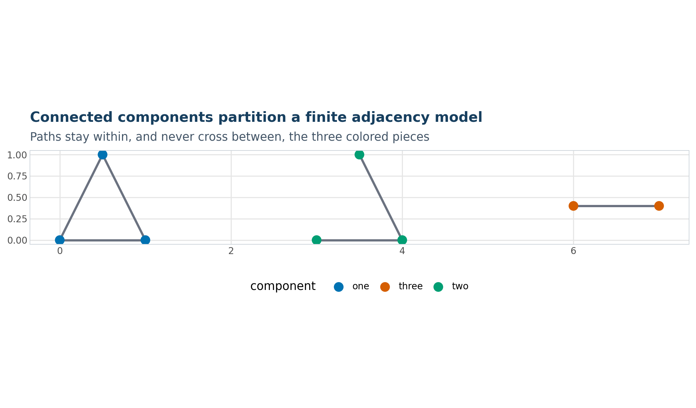

# Connectedness and Paths {#sec-topology-connectedness}

Connectedness formalizes being in one piece without measuring distances.
Path connectedness asks for explicit continuous routes. They agree in many
familiar spaces but are not the same definition.

## Preparation from this book

Read Chapters 3 and 5 for open sets and continuous images. Chapter 2 is useful
for metric examples but is not logically required.

## Separations and connected spaces

A **separation** of $X$ is a pair of disjoint nonempty open sets whose union is
$X$. The space is connected when it has no separation. Equivalently, the only
sets both open and closed are $\varnothing$ and $X$.

The continuous image of a connected space is connected. If
$f:X\to Y$ and $f(X)=A\cup B$ were separated, their inverse images would
separate $X$. The Intermediate Value Theorem is this result applied to a real
interval: connected subsets of $\mathbb R$ are exactly intervals.

A **path** from $x$ to $y$ is a continuous
$\gamma:[0,1]\to X$ with prescribed endpoints. Path connected implies
connected because the interval and its image are connected. The converse can
fail: the topologist's sine curve is connected but not path connected.

<figure id="fig-connected-components">


<figcaption>

Figure 7.1: Finite adjacency components provide a computable model of maximal path-connected pieces.

</figcaption>
</figure>

Graph paths are discrete analogues, not continuous paths in every topology.
The geometric realization of a graph does turn each edge into an interval and
makes the correspondence precise.

## Components and local connectedness

A connected component is a maximal connected subset. Components are always
closed; they need not be open. Path components are maximal path-connected
subsets and can be smaller.

A space is **locally connected** when every point has a basis of connected
neighborhoods, and locally path connected similarly. In a locally path-connected
space, path components are open and coincide with connected components. This
hypothesis explains why components behave so cleanly in manifolds and graphs.

Products of connected spaces are connected. Unions are connected when all
members are connected and share a common point. This common-point lemma builds
large connected sets from manageable pieces.

**Nonexample.** A union of connected sets need not be connected if they do not
intersect. The intervals $[0,1]$ and $[2,3]$ are connected separately but their
union has a gap and a separation.

<!-- inline-formula-code:start -->
## Formula and finite computation

In a finite undirected graph, the component of $v$ is

$$
C(v)=\{w:\text{there is an edge path from }v\text{ to }w\}.
$$

```python
def components(
    vertices: set[str], edges: set[frozenset[str]]
) -> list[set[str]]:
    if any(len(edge) != 2 or not edge <= vertices for edge in edges):
        raise ValueError("every edge must join two declared vertices")
    remaining = set(vertices)
    result: list[set[str]] = []
    while remaining:
        start = min(remaining)
        reached = {start}
        frontier = [start]
        while frontier:
            current = frontier.pop()
            neighbors = {
                next(iter(edge - {current}))
                for edge in edges
                if current in edge
            }
            new = neighbors - reached
            reached |= new
            frontier.extend(sorted(new))
        result.append(reached)
        remaining -= reached
    return result

vertices = set("ABCDEFGH")
edges = {frozenset(edge) for edge in ("AB", "BC", "CA", "DE", "EF", "GH")}
print(components(vertices, edges))
```

**What the computation establishes.** Exhaustive finite reachability finds the
components of this graph. It does not decide connectedness of a continuum from
a sampled proximity graph or prove the general topological theorems.
<!-- inline-formula-code:end -->

## Summary

Connected spaces admit no separation; path-connected spaces provide explicit
routes. Continuous images preserve connectedness, yielding the Intermediate
Value Theorem. Components are maximal connected pieces, while local
connectedness determines whether those pieces are open and manageable.

## Exercises

<div class="exercise" id="topology-07-connectedness-ex-1">
<p class="exercise-title"><strong>Exercise 1</strong></p>

Prove connectedness is equivalent to having only trivial clopen sets.

</div>

<div class="exercise" id="topology-07-connectedness-ex-2">
<p class="exercise-title"><strong>Exercise 2</strong></p>

Prove continuous images of connected spaces are connected.

</div>

<div class="exercise" id="topology-07-connectedness-ex-3">
<p class="exercise-title"><strong>Exercise 3</strong></p>

Classify connected subsets of a finite discrete space.

</div>

<div class="exercise" id="topology-07-connectedness-ex-4">
<p class="exercise-title"><strong>Exercise 4</strong></p>

Show every convex subset of $\mathbb R^n$ is path connected.

<details class="solution"><summary>Solution</summary>

For Exercise 4, if $x,y$ lie in convex $C$, the path
$\gamma(t)=(1-t)x+ty$ remains in $C$ by convexity and is continuous. Thus every
pair of points is joined by a path.

</details>

</div>

<div class="exercise" id="topology-07-connectedness-ex-5">
<p class="exercise-title"><strong>Exercise 5</strong></p>

Prove a union of connected sets with a common point is connected.

</div>

<div class="exercise" id="topology-07-connectedness-ex-6">
<p class="exercise-title"><strong>Exercise 6</strong></p>

Compare graph components under two different distance thresholds.

</div>

### Selected solution

For Exercise 4, if $x,y$ lie in convex $C$, the path
$\gamma(t)=(1-t)x+ty$ remains in $C$ by convexity and is continuous. Thus every
pair of points is joined by a path.
