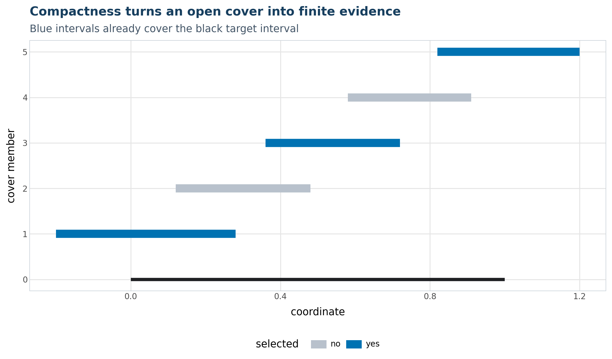

# Compactness {#sec-topology-compactness}

Compactness converts infinitely stated local information into finite control.
It underlies maxima and minima, uniform continuity, convergent subsequences,
finite coordinate reductions, and existence arguments across mathematics.

## Preparation from this book

Chapters 2–5 supply metric sequences, open covers, and continuity. The
product construction referenced near the end comes from Chapter 6.

## Open-cover definition

An open cover of $K$ is a family $\{U_i\}_{i\in I}$ with
$K\subseteq\bigcup_iU_i$. The set $K$ is compact when every open cover has a
finite subcover.

<figure id="fig-compactness-subcover">


<figcaption>

Figure 8.1: Three selected intervals form a finite subcover of the target interval even though a larger cover was offered.

</figcaption>
</figure>

The picture illustrates one cover. Compactness quantifies over every open cover,
so no finite gallery proves the property.

Continuous images of compact spaces are compact. Closed subsets of compact
spaces are compact. Compact subsets of Hausdorff spaces are closed. Combining
compactness with real order proves the Extreme Value Theorem: the image of a
nonempty compact space under a continuous real function is nonempty and compact,
and hence contains its finite supremum and infimum.

## Metric characterizations

In metric spaces, compactness is equivalent to sequential compactness: every
sequence has a convergent subsequence. It is also equivalent to completeness
plus total boundedness. Total boundedness requires finitely many
$\varepsilon$-balls for every positive $\varepsilon$; ordinary boundedness only
fits the set in one large ball.

Heine–Borel says a subset of $\mathbb R^n$ is compact exactly when closed and
bounded. This is not a definition and fails in general metric spaces. The
closed unit ball of an infinite-dimensional normed space is never compact (Riesz's lemma).

Compactness upgrades pointwise continuity to uniform continuity for maps from a
compact metric space. A finite subcover of local delta-neighborhoods supplies a
global delta through a Lebesgue-number argument.

## Products and local compactness

Tychonoff's theorem states that an arbitrary product of compact spaces is
compact in the product topology. Its full proof uses a choice principle and is
far beyond finite-grid evidence. For finite products, tube and cover arguments
are more elementary.

A space is locally compact when points have compact neighborhoods in a standard
Hausdorff setting. Euclidean spaces are locally compact but not compact.
One-point compactification adds an infinity point whose neighborhoods have
compact complements; it turns $\mathbb R$ into a circle topologically.

**Nonexample.** The interval $(0,1)$ is bounded but not compact. The cover
$U_n=(1/n,1)$ has no finite subcover, and the sequence $1/(n+1)$ has no limit inside
the space.

<!-- inline-formula-code:start -->
## Formula and finite computation

For a finite target, a subcover is a finite selection satisfying

$$
K\subseteq U_{i_1}\cup\cdots\cup U_{i_m}.
$$

```python
from itertools import combinations

def smallest_subcover(
    target: set[int], cover: list[set[int]]
) -> tuple[int, ...] | None:
    if not target:
        return ()
    if not cover:
        return None
    if not target <= set().union(*cover):
        return None
    for size in range(1, len(cover) + 1):
        for indices in combinations(range(len(cover)), size):
            if target <= set().union(*(cover[index] for index in indices)):
                return indices
    return None

target = set(range(6))
cover = [{0, 1, 2}, {2, 3}, {3, 4, 5}, {0, 5}]
print(smallest_subcover(target, cover))
```

**What the computation establishes.** Brute force finds a smallest subcover of
one finite cover. Every finite space is compact, but this search cannot verify
the universal open-cover condition for an arbitrary infinite space.
<!-- inline-formula-code:end -->

## Summary

Compactness is the finite-subcover property. In metric spaces it matches
subsequence compactness and completeness plus total boundedness. It preserves
closedness, extrema, and uniform control under appropriate hypotheses.
Heine–Borel is Euclidean, whereas products and compactifications reveal the
broader topological idea.

## Exercises

<div class="exercise" id="topology-08-compactness-ex-1">
<p class="exercise-title"><strong>Exercise 1</strong></p>

Prove finite spaces are compact.

<details class="solution"><summary>Solution</summary>

For Exercise 1, choose from the cover one open set containing each point.
There are only finitely many points, so the chosen sets form a finite subcover.
No separation or metric hypothesis is needed.

</details>

</div>

<div class="exercise" id="topology-08-compactness-ex-2">
<p class="exercise-title"><strong>Exercise 2</strong></p>

Prove continuous images of compact spaces are compact.

</div>

<div class="exercise" id="topology-08-compactness-ex-3">
<p class="exercise-title"><strong>Exercise 3</strong></p>

Show closed subsets of compact spaces are compact.

</div>

<div class="exercise" id="topology-08-compactness-ex-4">
<p class="exercise-title"><strong>Exercise 4</strong></p>

Exhibit a cover proving $(0,1)$ is not compact.

</div>

<div class="exercise" id="topology-08-compactness-ex-5">
<p class="exercise-title"><strong>Exercise 5</strong></p>

Show $\{0\}\cup\{1/n:n\ge1\}$ is compact in $\mathbb R$.

</div>

<div class="exercise" id="topology-08-compactness-ex-6">
<p class="exercise-title"><strong>Exercise 6</strong></p>

Contrast boundedness and total boundedness in a discrete metric space.

</div>

### Selected solution

For Exercise 1, choose from the cover one open set containing each point.
There are only finitely many points, so the chosen sets form a finite subcover.
No separation or metric hypothesis is needed.
