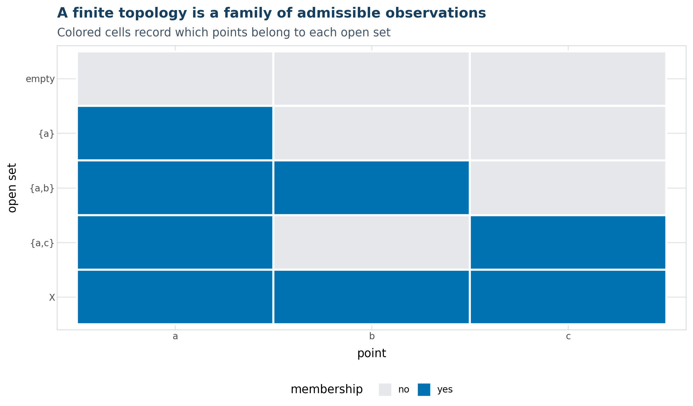

# Separation and Countability {#sec-topology-separation}

Topology permits spaces in which distinct points cannot be told apart.
Separation axioms measure how reliably points and closed sets can be isolated;
countability axioms control how much local information is needed.

## Preparation from this book

Read Chapters 3–5 and 8 for neighborhoods, bases, continuity, and compactness.
The chapter states the metrization theorem precisely but does not require its
construction as prior knowledge.

## The separation ladder

A space is $T_0$ when distinct points have different open-neighborhood
signatures. It is $T_1$ when each singleton is closed. It is Hausdorff or
$T_2$ when distinct points have disjoint neighborhoods.

Hausdorff spaces have unique net and sequence limits. A compact subset of a
Hausdorff space is closed, and a continuous bijection from compact to Hausdorff
is a homeomorphism. These familiar conclusions are not valid in arbitrary
topologies.

A regular space separates a point from a disjoint closed set; a normal space
separates two disjoint closed sets. Standard definitions include $T_1$.
Metric spaces are normal: distance to closed sets helps build disjoint
neighborhoods. Urysohn's lemma then constructs a continuous function taking
values zero and one on two disjoint closed sets.

The finite topology in [Figure 3.1](03-topological-spaces.md#fig-finite-topology) is $T_0$: points have distinct
open-set membership columns. It is not $T_1$, because $\{a\}$ is not closed:
its closure is $X$.

<figure id="fig-separation-signatures">


<figcaption>

Figure 9.1: Membership columns act as finite observation signatures; distinct columns certify the T0 property.

</figcaption>
</figure>

## Countability properties

First countability means each point has a countable local basis. Second
countability means the whole topology has a countable basis. Second countability
implies first countability and separability; in metric spaces, separability
implies second countability.

A space is separable when it has a countable dense subset. It is Lindelöf when
every open cover has a countable subcover. Second countability implies Lindelöf.
These implications can fail in reverse outside metric or additional settings.

The Urysohn metrization theorem states that every regular second-countable
space is metrizable. The theorem is a construction, not a finite checklist for
an arbitrary presented space.

**Nonexample.** $T_1$ does not imply Hausdorff. The cofinite topology on an
infinite set makes every singleton closed, but any two nonempty open sets
intersect, so distinct points cannot have disjoint neighborhoods.

<!-- inline-formula-code:start -->
## Formula and finite computation

The finite $T_0$ condition is

$$
x\ne y\Longrightarrow
\{U\in\mathcal T:x\in U\}\ne
\{U\in\mathcal T:y\in U\}.
$$

```python
def is_t0(points: set[str], opens: set[frozenset[str]]) -> bool:
    signatures = {
        point: frozenset(index for index, open_set in enumerate(opens) if point in open_set)
        for point in points
    }
    return len(set(signatures.values())) == len(points)

points = {"a", "b", "c"}
opens = {frozenset(), frozenset({"a"}), frozenset({"a", "b"}), frozenset({"a", "c"}), frozenset(points)}
print(is_t0(points, opens))
```

**What the computation establishes.** Distinct signatures decide $T_0$ for
this finite topology. The arbitrary order assigned to set enumeration does not
affect equality. Infinite separation properties require quantified proofs.
<!-- inline-formula-code:end -->

## Summary

$T_0$, $T_1$, Hausdorff, regular, and normal axioms progressively improve
distinguishability. First and second countability control local and global
bases; separability and Lindelöfness control dense sets and covers.
Metrization theorems show when open-set information can be recovered from a
distance.

## Exercises

<div class="exercise" id="topology-09-separation-countability-ex-1">
<p class="exercise-title"><strong>Exercise 1</strong></p>

Prove Hausdorff implies $T_1$.

<details class="solution"><summary>Solution</summary>

For Exercise 1, fix $x$. For each $y\ne x$, choose disjoint neighborhoods of
$x$ and $y$; the neighborhood of $y$ lies in $X\setminus\{x\}$. Their union
over all $y\ne x$ is exactly that complement, so it is open and $\{x\}$ is
closed.

</details>

</div>

<div class="exercise" id="topology-09-separation-countability-ex-2">
<p class="exercise-title"><strong>Exercise 2</strong></p>

Show limits are unique in a Hausdorff space.

</div>

<div class="exercise" id="topology-09-separation-countability-ex-3">
<p class="exercise-title"><strong>Exercise 3</strong></p>

Analyze the separation axioms of the Sierpiński two-point space.

</div>

<div class="exercise" id="topology-09-separation-countability-ex-4">
<p class="exercise-title"><strong>Exercise 4</strong></p>

Prove second countability implies separability.

</div>

<div class="exercise" id="topology-09-separation-countability-ex-5">
<p class="exercise-title"><strong>Exercise 5</strong></p>

Prove second countability implies Lindelöf.

</div>

<div class="exercise" id="topology-09-separation-countability-ex-6">
<p class="exercise-title"><strong>Exercise 6</strong></p>

Show the cofinite topology on an infinite set is $T_1$ but not Hausdorff.

</div>

### Selected solution

For Exercise 1, fix $x$. For each $y\ne x$, choose disjoint neighborhoods of
$x$ and $y$; the neighborhood of $y$ lies in $X\setminus\{x\}$. Their union
over all $y\ne x$ is exactly that complement, so it is open and $\{x\}$ is
closed.
