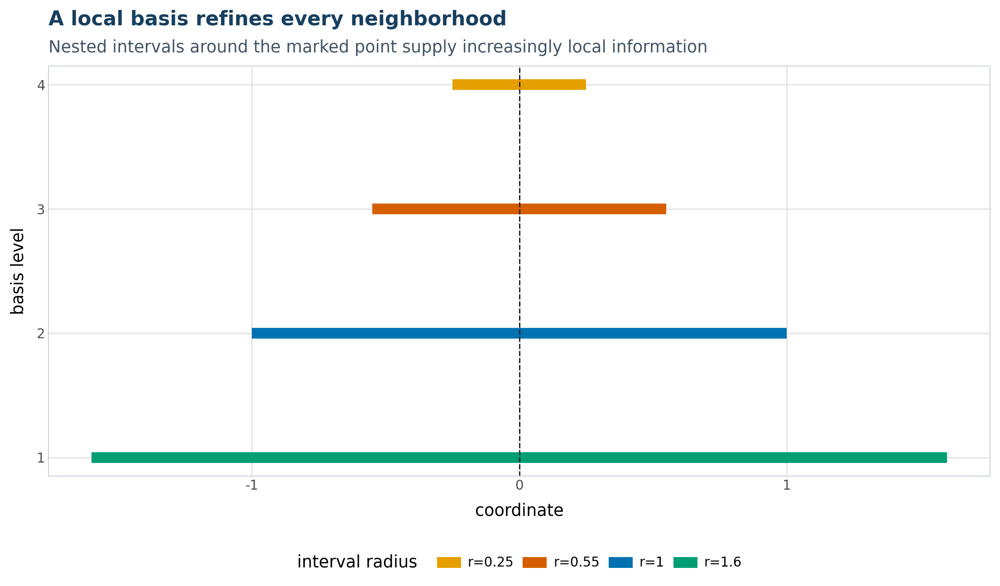

# Nets, Filters, and Function Spaces {#sec-topology-nets}

Sequences are ideal in metric and first-countable spaces. General topological
spaces can have too many independent neighborhood requirements for one natural
number index. Nets and filters restore a convergence language that detects the
full topology.

## Preparation from this book

Chapters 2–5 introduce metric convergence, neighborhoods, local bases, and
continuity. Compactness from Chapter 8 is used only in clearly marked theorem
statements.

For the worked case, also recall countability and the uncountability of
$\mathbb R$ from Chapter 1, discrete spaces and closure from Chapter 3, local
bases and first countability from Chapter 4, finite-coordinate product
neighborhoods from Chapter 6, and countability terminology from Chapter 9.
We use the set fact that a countable union of finite sets is countable.

## Sequence convergence

A sequence $x_n$ converges to $x$ when every neighborhood of $x$ contains all
sufficiently late terms. In first-countable spaces, closure can be tested by
sequences: $x\in\overline A$ exactly when some sequence in $A$ converges to
$x$. Without first countability this can fail.

For example, certain uncountable products and ordinal spaces have closure
points unreachable by sequences drawn from the subset. The failure is not that
the definition of sequence convergence changed; the index set is too narrow.

## Directed sets and nets

A directed set $(D,\preceq)$ is a nonempty preordered set in which every pair has a common
upper bound. A **net** is a map $x:D\to X$. It converges to $p$ when

$$
\text{for every neighborhood }U\text{ of }p
\text{ there is }d_0
\text{ such that }d\succeq d_0\Longrightarrow x_d\in U.
$$

Sequences are nets indexed by natural numbers. Neighborhoods themselves form a
directed set ordered by reverse inclusion; choosing a point of
$A\cap U$ for each neighborhood proves that every closure point is a net limit
from $A$.

A function is continuous exactly when it preserves limits of all nets.
A space is compact exactly when every net has a convergent subnet. These
statements work without countability assumptions.

### Worked case: Finite observations beyond sequences {#finite-coordinate-worked-case}

Let $I=\mathbb R$ and give $X_I=\{0,1\}^{I}$ the product topology of discrete
two-point spaces. Its points are **all** functions $g:I\to\{0,1\}$. Here $I$
is only a coordinate index set; no continuity on the usual real line is
required. Define the active coordinate set by

$$
S(g)=\{i\in I:g(i)=1\}.
$$

For $F\subseteq I$, let $\mathbf 1_F$ be its indicator: it is one on $F$ and
zero elsewhere. Let $A_I$ be the set of $\mathbf 1_F$ for all finite
$F\subseteq I$, and put $p=\mathbf 1_I$, the all-one function. Thus every
member of $A_I$ has a finite active coordinate set.

For each finite $E\subseteq I$, define the cylinder

$$
U_E=\{g\in X_I:g(i)=1\text{ for all }i\in E\}.
$$

These cylinders form a local base at $p$. A product-basic neighborhood
restricts only finitely many coordinates; at $p$, each restriction contains
the open singleton $\{1\}$ in its discrete factor, so it contains a suitable
$U_E$. Each $U_E$ is itself open and contains $p$. The empty condition is
allowed: $U_\varnothing=X_I$.

**Predict.** Every finite observation of $p$ can be matched by one of these
finite-active-coordinate functions. Can a single sequence of them eventually
match every such observation?

**Closure.** For every finite $E$, the function $\mathbf 1_E$ lies in
$A_I\cap U_E$. This also covers $E=\varnothing$, using the all-zero function.
Every neighborhood of $p$ contains a $U_E$, hence meets $A_I$. Therefore
$p\in\overline{A_I}$.

**No sequence reaches $p$.** Let $(a_n)_{n\ge1}$ be any sequence in $A_I$.
Each $S(a_n)$ is finite, so

$$
C=\bigcup_{n\ge1}S(a_n)
$$

is countable. Since $I=\mathbb R$ is uncountable, there is $i\in I\setminus C$.
Every term has $a_n(i)=0$. The neighborhood $U_{\{i\}}$ of $p$ therefore
contains no term, so this sequence cannot converge to $p$. The argument
applies to every sequence in $A_I$.

**An explicit net reaches $p$.** Let $D_I$ be the set of all finite subsets
of $I$, ordered by inclusion. The index set $D_I$ is nonempty because
$\varnothing\in D_I$; the empty subset is an index, not an empty index set.
Inclusion is reflexive and transitive, and $F\cup G$ is an upper bound for
$F$ and $G$. Define $x_F=\mathbf 1_F$ for $F\in D_I$. Given $U_E$, choose the
threshold $F_0=E$. Every $F\supseteq E$ satisfies $x_F\in U_E$. For
$E=\varnothing$, every index works. Since the $U_E$ form a local base,
$x_F\to p$.

The product is Hausdorff: two distinct functions differ at some coordinate,
and the cylinders fixing that coordinate to their respective values are
disjoint open neighborhoods. If $X_I$ were first-countable, the closure
criterion above would give a sequence in $A_I$ converging to $p$, a
contradiction. Thus $X_I$ is not first-countable.

This classical indicator-net construction appears in
[Schervish, Seidenfeld, Stern, and Kadane, Online Resource, Section 1.2,
Example 1](https://www.cmu.edu/dietrich/philosophy/docs/seidenfeld/what-finite-additivity-can-add-to-decision-theory.pdf#page=29),
printed page 2 (combined PDF page 29). The arguments here spell out its
finite-coordinate tests.

## Filters

A filter is a nonempty family of subsets closed upward and under finite intersections,
excluding the empty set. It represents which sets are “eventually large.”
The tail sets of a net generate a filter; a filter converges to $p$ when it
contains every neighborhood of $p$.

Ultrafilters make maximal consistent choices. A space is compact exactly when
every ultrafilter converges. This formulation is powerful for products but is
not usually the first computational representation.

## Function-space topologies

For maps $X\to Y$, different topologies answer different questions.
Pointwise convergence is product-topology convergence:

$$
f_n(x)\longrightarrow f(x)\quad\text{for each fixed }x.
$$

Uniform convergence in a metric target requires one index working for every
$x$:

$$
\sup_{x\in X}d(f_n(x),f(x))\longrightarrow0.
$$

The compact-open topology is generated by conditions
$[K,U]=\{f:f(K)\subseteq U\}$ for compact $K$ and open $U$. It supports
composition and homotopy naturally in suitable spaces.

<figure id="fig-net-neighborhoods">


<figcaption>

Figure 10.1: A local basis shows the nested neighborhood obligations that a convergent net must eventually satisfy.

</figcaption>
</figure>

**Nonexample.** Pointwise convergence does not preserve continuity. On
$[0,1]$, $f_n(x)=x^n$ converges pointwise to a function discontinuous at one.
Uniform convergence of continuous functions would preserve continuity.

<!-- inline-formula-code:start -->
## Formula and finite computation

For a displayed finite prefix, an eventual-neighborhood audit asks

$$
\text{tail}_N\subseteq U\quad\text{for every declared neighborhood }U.
$$

```python
def tail_audit(
    sequence: list[str], neighborhoods: set[frozenset[str]], start: int
) -> bool:
    if not 0 <= start <= len(sequence):
        raise ValueError("start must index the finite sequence")
    tail = set(sequence[start:])
    return all(tail <= neighborhood for neighborhood in neighborhoods)

sequence = ["b", "c", "a", "a", "a"]
neighborhoods_of_a = {frozenset({"a"}), frozenset({"a", "b"}), frozenset({"a", "c"}), frozenset({"a", "b", "c"})}
print(tail_audit(sequence, neighborhoods_of_a, 2))
```

**What the computation establishes.** The terms after index two lie in every
listed neighborhood. A finite prefix cannot prove an infinite sequence is
eventually inside anything unless an eventually constant or other tail rule is
also proved.
<!-- inline-formula-code:end -->

## Summary

Sequences characterize convergence in first-countable settings. Nets replace
natural-number order by arbitrary directed refinement and recover closure,
continuity, and compactness in every topology. Filters express the same
eventual structure through sets. Function spaces demonstrate why pointwise,
uniform, and compact-open topologies must remain distinct.

## Exercises

<div class="exercise" id="topology-10-convergence-nets-function-spaces-ex-1">
<p class="exercise-title"><strong>Exercise 1</strong></p>

Treat a sequence as a net and translate both convergence definitions.

</div>

<div class="exercise" id="topology-10-convergence-nets-function-spaces-ex-2">
<p class="exercise-title"><strong>Exercise 2</strong></p>

Direct the neighborhoods of a point by reverse inclusion.

</div>

<div class="exercise" id="topology-10-convergence-nets-function-spaces-ex-3">
<p class="exercise-title"><strong>Exercise 3</strong></p>

Construct a net in $A$ converging to a chosen closure point.

</div>

<div class="exercise" id="topology-10-convergence-nets-function-spaces-ex-4">
<p class="exercise-title"><strong>Exercise 4</strong></p>

Show continuous maps preserve net convergence.

</div>

<div class="exercise" id="topology-10-convergence-nets-function-spaces-ex-5">
<p class="exercise-title"><strong>Exercise 5</strong></p>

Compare pointwise and uniform limits of $x^n$ on $[0,1]$.

</div>

<div class="exercise" id="topology-10-convergence-nets-function-spaces-ex-6">
<p class="exercise-title"><strong>Exercise 6</strong></p>

Explain why uniform convergence implies pointwise convergence.

<details class="solution"><summary>Solution</summary>

For Exercise 6, given $x$ and $\varepsilon>0$, uniform convergence supplies
one $N$ such that for every $n\ge N$ and every input,
$d(f_n(x),f(x))<\varepsilon$. In particular the inequality holds at the chosen
$x$, which is pointwise convergence.

</details>

</div>

### Selected solution

For Exercise 6, given $x$ and $\varepsilon>0$, uniform convergence supplies
one $N$ such that for every $n\ge N$ and every input,
$d(f_n(x),f(x))<\varepsilon$. In particular the inequality holds at the chosen
$x$, which is pointwise convergence.

<div class="exercise" id="finite-coordinate-task-exercise">

### Exercise 7: Change the coordinate index set {#finite-coordinate-task}

Replace only the coordinate index set in the worked case by the positive
integers $I=\{1,2,\ldots\}$, keeping the definitions of $X_I$, $A_I$, $p$,
$D_I$, and $U_E$. Predict whether $p\in\overline{A_I}$, whether some sequence
in $A_I$ converges to $p$, and whether $X_I$ is first-countable. Justify each
decision with a construction or proof.

Use the prefixes $F_n=\{1,\ldots,n\}$, $n\ge1$. Prove that they are cofinal
in $D_I$, meaning that every finite $E\subseteq I$ is contained in some
$F_n$. Construct a countable local base at **every** $q\in X_I$, and
identify the step of the uncountable-index obstruction that fails.
Include the case $E=\varnothing$.

<details class="hint"><summary>Hint 1</summary>

A product-basic neighborhood tests only finitely many coordinates. For a
nonempty finite $E$, compare $\max E$ with the prefix index. The empty
coordinate condition imposes no restriction. At a general point $q$, fix
its values on a prefix rather than requiring all values to be one.

</details>

<details class="solution"><summary>Solution</summary>

All three answers are affirmative: $p\in\overline{A_I}$, a sequence from
$A_I$ does converge to $p$, and $X_I$ is first-countable.

Closure follows as before: $\mathbf 1_E\in A_I\cap U_E$ for every finite
$E$, including the empty set. For a convergent sequence, set
$a_n=\mathbf 1_{F_n}$. If $E$ is nonempty and finite, then every
$n\ge\max E$ satisfies $E\subseteq F_n$ and hence $a_n\in U_E$.
If $E=\varnothing$, every $n\ge1$ works because $U_E=X_I$.
Every neighborhood of $p$ contains such a $U_E$, so $a_n\to p$.

The same argument proves cofinality: take $n=\max E$ for nonempty $E$,
and take $n=1$ for $E=\varnothing$. Thus each finite coordinate test
appears within a prefix. In the uncountable-index argument, the combined
active set of a sequence was countable and therefore missed a coordinate.
Here it can fill all of $I$: for this sequence,
$\bigcup_{n\ge1}S(a_n)=I$.

At $p$, the countable family $(U_{F_n})_{n\ge1}$ is a local base.
For an arbitrary $q\in X_I$, let $V_n(q)$ consist of all $g\in X_I$
satisfying $g(i)=q(i)$ for $1\le i\le n$. Each $V_n(q)$ is an open
neighborhood of $q$. Any neighborhood of $q$ contains a cylinder that
agrees with $q$ on some finite $E$. If $E$ is nonempty, choose
$n\ge\max E$; if it is empty, choose $n=1$. Then $V_n(q)$ is contained
in that cylinder and hence in the given neighborhood. This proves that
$(V_n(q))_{n\ge1}$ is a countable local base at every $q$, so $X_I$
is first-countable.

</details>

</div>

### Hint for Exercise 7 {#finite-coordinate-hint}

A product-basic neighborhood tests only finitely many coordinates. For a
nonempty finite $E$, compare $\max E$ with the prefix index. The empty
coordinate condition imposes no restriction. At a general point $q$, fix
its values on a prefix rather than requiring all values to be one.

### Solution to Exercise 7 {#finite-coordinate-answer}

All three answers are affirmative: $p\in\overline{A_I}$, a sequence from
$A_I$ does converge to $p$, and $X_I$ is first-countable.

Closure follows as before: $\mathbf 1_E\in A_I\cap U_E$ for every finite
$E$, including the empty set. For a convergent sequence, set
$a_n=\mathbf 1_{F_n}$. If $E$ is nonempty and finite, then every
$n\ge\max E$ satisfies $E\subseteq F_n$ and hence $a_n\in U_E$.
If $E=\varnothing$, every $n\ge1$ works because $U_E=X_I$.
Every neighborhood of $p$ contains such a $U_E$, so $a_n\to p$.

The same argument proves cofinality: take $n=\max E$ for nonempty $E$,
and take $n=1$ for $E=\varnothing$. Thus each finite coordinate test
appears within a prefix. In the uncountable-index argument, the combined
active set of a sequence was countable and therefore missed a coordinate.
Here it can fill all of $I$: for this sequence,
$\bigcup_{n\ge1}S(a_n)=I$.

At $p$, the countable family $(U_{F_n})_{n\ge1}$ is a local base.
For an arbitrary $q\in X_I$, let $V_n(q)$ consist of all $g\in X_I$
satisfying $g(i)=q(i)$ for $1\le i\le n$. Each $V_n(q)$ is an open
neighborhood of $q$. Any neighborhood of $q$ contains a cylinder that
agrees with $q$ on some finite $E$. If $E$ is nonempty, choose
$n\ge\max E$; if it is empty, choose $n=1$. Then $V_n(q)$ is contained
in that cylinder and hence in the given neighborhood. This proves that
$(V_n(q))_{n\ge1}$ is a countable local base at every $q$, so $X_I$
is first-countable.
