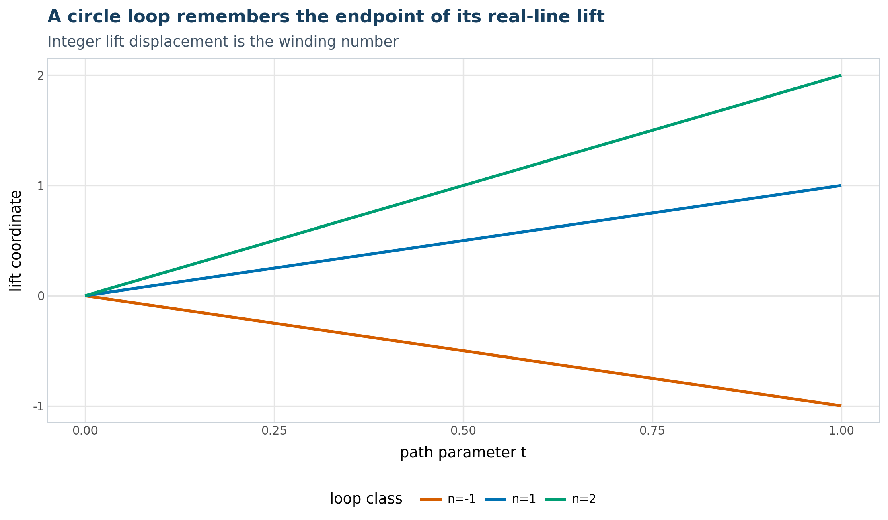

# Homotopy and the Fundamental Group {#sec-topology-homotopy}

For the primary Atlas route, see [Fundamental Group and Basepoints](#/books/algebraic-topology-chains-spaces/fundamental-group-and-basepoints).
This chapter provides a companion viewpoint with the hypotheses stated below.

Homeomorphism asks for an exact continuous relabelling. Homotopy asks whether
one map can be continuously deformed into another while staying inside its
specified target. The fundamental group records based loops up to such a
deformation. A missing point in a plane is a useful first example; later
examples show that the group contains more information than a count of holes.

## Preparation from this book

Read Chapters 5–8 for continuity, products, quotients, paths, and compactness.
Write $I=[0,1]$. In a formula $H(t,s)$ for a moving path, $t$ runs along the
path and $s$ runs through the deformation. Group multiplication is introduced
here through loop concatenation; no prior abstract-algebra course is assumed.
The circle calculation uses a path- and homotopy-lifting fact whose proof is
supplied in [Chapter 12](12-covering-spaces.md).

## Homotopies and the conditions that stay fixed

Maps $f,g:X\to Y$ are **homotopic**, written $f\simeq g$, when a continuous map

$$
H:X\times I\to Y,\qquad H(x,0)=f(x),\quad H(x,1)=g(x)
$$

connects them. The entire map on the product must be continuous: a collection
of continuous pictures, without continuity in the deformation parameter, is
not enough. Every intermediate value must lie in $Y$.

For maps into a convex set $C\subseteq\mathbb R^n$, the straight-line formula
$H(x,s)=(1-s)f(x)+sg(x)$ works because the segment between two points of $C$
stays in $C$. The same formula needs a new check for a nonconvex target. For
example, interpolating between $z$ and $-z$ in $\mathbb R^2\setminus\{0\}$
passes through the forbidden origin at $s=1/2$.

A **homotopy relative to $A\subseteq X$** also requires
$H(a,s)=f(a)=g(a)$ for every $a\in A$ and every $s$. The words “relative to”
state exactly which source points must have stationary images.

**Worked example: contracting a disk loop.** Let $D^2=\{z:|z|\leq1\}$,
choose a base point $b\in D^2$, and let $\gamma:I\to D^2$ be a loop with
$\gamma(0)=\gamma(1)=b$. Then

$$
H(t,s)=(1-s)\gamma(t)+sb
$$

starts at $\gamma$, ends at the constant loop at $b$, and stays in the disk
by convexity. Moreover $H(0,s)=H(1,s)=b$. Thus it is a contraction **through
based loops**. Contracting toward an unrelated point instead would move the
base point and would not supply this relative-endpoint homotopy.

**Pause and check.** Does the same formula contract the boundary loop
$\gamma(t)=e^{2\pi it}$ in the punctured plane when $b=1$? At $t=s=1/2$ it
has value zero, so this proposed homotopy leaves the target. A failed formula
alone does not prove that every possible contraction fails; winding will
supply that obstruction below.

## Homotopy equivalence and deformation retracts

A **homotopy equivalence** consists of continuous maps $f:X\to Y$ and
$g:Y\to X$ with $gf\simeq\operatorname{id}_X$ and
$fg\simeq\operatorname{id}_Y$. The inverse conditions hold up to homotopy,
so these maps need not be bijections. A **contractible** space is homotopy
equivalent to a point, equivalently its identity map is homotopic to a
constant map. For instance, $(1-s)x$ contracts $\mathbb R^n$ to zero.

For a subspace $A\subseteq X$, a **retraction** is a continuous
$r:X\to A$ satisfying $r(a)=a$. In this book a **deformation retraction**
also supplies a homotopy $D:X\times I\to X$ with

$$
D(x,0)=x,\qquad D(x,1)=r(x),\qquad D(a,s)=a.
$$

The last condition is sometimes emphasized by saying “strong deformation
retraction.” If $i:A\hookrightarrow X$ is inclusion, then
$ri=\operatorname{id}_A$ and $ir\simeq\operatorname{id}_X$, so a deformation
retraction gives a homotopy equivalence. A retraction alone does not: the
constant map $S^1\to\{1\}$ is a retraction, but the circle will turn out not
to be contractible.

**Worked example: the punctured plane.** For $z\ne0$, set

$$
r(z)=\frac{z}{|z|},\qquad
D(z,s)=\left(1-s+\frac{s}{|z|}\right)z.
$$

The coefficient is positive, so $D(z,s)$ never reaches zero. The formula is
continuous on $(\mathbb R^2\setminus\{0\})\times I$, starts at $z$, ends at
$r(z)$, and fixes every $z$ with $|z|=1$. It is therefore a deformation
retraction onto $S^1$, with all three conditions checked. The punctured plane
and circle have the same homotopy type even though one is noncompact and the
other compact, so they are not homeomorphic.

## Based loops and the fundamental group

Fix $x_0\in X$. A **based loop** is a continuous $\alpha:I\to X$ with
$\alpha(0)=\alpha(1)=x_0$. Two such loops represent the same class when a
homotopy between them satisfies

$$
H(0,s)=H(1,s)=x_0\quad\text{for all }s\in I.
$$

Self-intersections and retracing are allowed. The constraint is continuity in
$X$ with a fixed base point; an embedded rubber band is not the definition.

We traverse the left factor first. Concatenation is

$$
(\alpha*\beta)(t)=
\begin{cases}
\alpha(2t),&0\leq t\leq1/2,\\
\beta(2t-1),&1/2\leq t\leq1.
\end{cases}
\qquad [\alpha][\beta]=[\alpha*\beta].
$$

The pieces meet at $x_0$. Concatenating endpoint-fixed homotopies shows that
the operation depends only on the classes. Different parenthesizations spend
different amounts of time on the three paths, but moving the break times gives
an endpoint-fixed reparametrization homotopy; hence the operation is
associative on classes. The constant loop $e(t)=x_0$ is the identity, since an
extra stationary interval can be removed continuously. Reversal
$\overline\alpha(t)=\alpha(1-t)$ is the inverse: the excursion along $\alpha$
and back can be shortened continuously to its starting point. The resulting
group is $\pi_1(X,x_0)$.

A path $c$ from $x_0$ to $x_1$ transports a loop $\alpha$ at $x_0$ to
$\overline c*\alpha*c$ at $x_1$. This gives an isomorphism between the two
fundamental groups; different choices of $c$ may give different isomorphisms.
A path-connected space has a well-defined fundamental group up to isomorphism,
without a preferred identification between every base point.

A path-connected space is **simply connected** when its fundamental group is
trivial. The disk example proves $\pi_1(D^2,b)$ is trivial. Later, $S^2$ will
provide a simply connected space that is not contractible: the fundamental
group probes loops, rather than every higher-dimensional deformation.

## The circle and winding: the classification proof

Identify $S^1$ with the complex numbers of modulus one and use base point $1$.
The map $p(u)=e^{2\pi iu}$ sends the real line onto the circle. A **lift** of
$\gamma$ is a continuous real path $\widetilde\gamma$ satisfying
$p(\widetilde\gamma(t))=\gamma(t)$. We use the following lifting facts: every circle path has a unique continuous lift after
its starting value is fixed, and a homotopy of paths lifts continuously after
an initial lift is chosen. Chapter 12 proves these from local inverse branches
and compactness; neither statement is inferred from a sampled picture.

Let $\gamma:I\to S^1$ be a based loop and choose its lift
$\widetilde\gamma(0)=0$. Since $\gamma(1)=1$, its endpoint is an integer:

$$
n=\widetilde\gamma(1)\in\mathbb Z.
$$

This integer is the **winding number**. For another starting lift $k\in\mathbb Z$,
it is the same endpoint displacement
$\widetilde\gamma(1)-\widetilde\gamma(0)$.

**Step 1: homotopy cannot change $n$.** Lift a based homotopy with initial
lift chosen as above. The lifted edge over $t=0$ is constantly zero. Over
$t=1$ the lift lies in $\mathbb Z$ and depends continuously on $s$. A continuous
integer-valued function on a connected interval is constant, so all the loops
have the same winding number.

**Step 2: the integer determines the class.** Compare the lift to the straight
path $t\mapsto nt$. Their interpolation descends to

$$
K(t,s)=\exp\left(2\pi i\big((1-s)\widetilde\gamma(t)+snt\big)\right).
$$

At $t=0$ it is $1$; at $t=1$ it is $e^{2\pi in}=1$. Thus this is a based
homotopy from $\gamma$ to $\omega_n(t)=e^{2\pi int}$. Every integer occurs,
and two different integers cannot give homotopic based loops by Step 1.

**Step 3: concatenation adds.** If lifts of $\alpha$ and $\beta$ start at zero
and end at $m$ and $n$, lift $\alpha*\beta$ by following the first lift and then
the second lift translated upward by $m$. Its final value is $m+n$. Winding
therefore preserves multiplication, with addition as the integer-group law:

$$
\pi_1(S^1,1)\cong\mathbb Z.
$$

<figure id="fig-winding-lifts">


<figcaption>

Figure 11.1: Circle loops with winding minus one, one, and two lift to real paths with the corresponding integer endpoint displacement.

</figcaption>
</figure>

The graph shows selected lifts; Step 2 explains why these straight paths
represent every loop class, and Step 1 proves that their distinct endpoints
cannot be joined by a based loop homotopy. A picture alone establishes neither.

The radial deformation retraction transfers this calculation to the punctured
plane. In particular its once-around loop cannot contract there, since its
radial image in the circle has winding one, whereas a constant loop has zero.
The failed straight-line contraction now has a proof-level obstruction.

## Induced maps, an obstruction, and a second example

A continuous base-point-preserving map $f:(X,x_0)\to(Y,y_0)$ sends a loop to
$f\circ\alpha$. Composing a homotopy with $f$ preserves its endpoint conditions,
so this defines a homomorphism
$f_*:\pi_1(X,x_0)\to\pi_1(Y,y_0)$. Composition of maps gives composition of
homomorphisms, and the identity map induces the identity homomorphism.

**No retraction of a disk onto its boundary.** Suppose
$r:D^2\to S^1$ restricted to the identity on $S^1$. For boundary inclusion
$i:S^1\hookrightarrow D^2$, we would have $r i=\operatorname{id}_{S^1}$.
Hence $r_*i_*$ would be the identity on $\mathbb Z$. But $i_*$ lands in the
trivial disk group, so that composite sends every integer to zero. This
contradiction proves no such retraction exists. In particular radial
projection cannot be continuously filled in at the center.

For a second calculation, the two-set form of the **Seifert–van Kampen
theorem** applies when $X=U\cup V$, the sets $U,V$ are open and path connected,
and $U\cap V$ is nonempty and path connected with base point chosen in it. It
combines the two loop groups and identifies the two images of each loop in
the intersection. The theorem is being used here; a general proof is beyond
this first calculation.

For a figure-eight, choose open neighborhoods in the figure-eight that
retract onto its respective circles, overlapping in a small contractible
neighborhood of their common vertex. The intersection contributes no loop
relations. Consequently the group is the **free group** on two generators
$a,b$: words in $a,a^{-1},b,b^{-1}$ reduce by cancelling adjacent inverse pairs.
The words $ab$ and $ba$ are different. Their counts around each circle agree,
so a list of winding counts cannot replace the fundamental group of a general
space.

<!-- inline-formula-code:start -->
## Formula and finite computation

Finite vertices do not determine an unknown continuous loop: between two
samples it can make extra turns. We instead specify the path to be the
**straight-edged polygon** through the given vertices. Integer coordinates let
us check exactly whether an edge hits the omitted origin, then count oriented
crossings of the positive horizontal ray without angle rounding.

Write $v_j=(x_j,y_j)$, with $v_N=v_0$, and put
$d_j=x_jy_{j+1}-x_{j+1}y_j$. For a polygon avoiding zero,

$$
\operatorname{wind}(v)=\sum_{j=0}^{N-1}
\begin{cases}
1,&y_j\leq0<y_{j+1}\text{ and }d_j>0,\\
-1,&y_{j+1}\leq0<y_j\text{ and }d_j<0,\\
0,&\text{otherwise}.
\end{cases}
$$

The half-open height tests count a crossing at a shared vertex only once.
For an upward crossing, $d_j>0$ puts the crossing to the right of zero; for a
downward crossing, $d_j<0$ does the same. An edge contains the origin exactly
when its endpoint vectors are collinear and point in opposite directions or
one endpoint is zero: $d_j=0$ and $v_j\mathbin{\cdot}v_{j+1}\leq0$.

```python
def winding_number(points: list[tuple[int, int]]) -> int:
    if len(points) < 2 or points[0] != points[-1]:
        raise ValueError("a polygonal loop must close and contain at least two points")
    for point in points:
        if len(point) != 2 or any(type(coordinate) is not int for coordinate in point):
            raise ValueError("each vertex must have two integer coordinates")

    winding = 0
    for (left_x, left_y), (right_x, right_y) in zip(points, points[1:]):
        determinant = left_x * right_y - right_x * left_y
        dot_product = left_x * right_x + left_y * right_y
        if determinant == 0 and dot_product <= 0:
            raise ValueError("every polygon edge must avoid the origin")
        if left_y <= 0 < right_y and determinant > 0:
            winding += 1
        elif right_y <= 0 < left_y and determinant < 0:
            winding -= 1
    return winding

square_loop = [(1, 0), (0, 1), (-1, 0), (0, -1), (1, 0)]
print(winding_number(square_loop))
print(winding_number(list(reversed(square_loop))))
```

**What the computation establishes.** These two specified polygons have winding
one and minus one. Integer arithmetic makes the edge tests and crossing counts
exact, including very large coordinates; zero-length edges away from the
origin do not change the result. A constant polygon away from zero has winding
zero, while an edge through zero is rejected even if neither endpoint is zero.
This evaluates a declared finite path, not the winding of every continuous
curve through its vertices. Homotopy invariance and the classification of all
circle loops require the lifting proof above.
<!-- inline-formula-code:end -->

## Pitfall clinic

- A homotopy between two maps uses the same source and target throughout. An
  intermediate point in a missing region invalidates the proposed formula.
- A based loop homotopy fixes its base point at every stage. A freely moving
  loop is a different equivalence problem.
- A retraction supplies a map; a deformation retraction also supplies a
  relative homotopy. The terms are not interchangeable.
- A failed attempted contraction is not itself a proof of noncontractibility.
  Winding or another invariant must exclude all allowable contractions.
- Trivial fundamental group does not imply contractibility, and one integer
  per visible circle does not describe every fundamental group.

## Summary

Homotopy compares maps through a jointly continuous deformation in a fixed
target; relative homotopy states which images remain stationary. Deformation
retracts give homotopy equivalences with explicit maps and homotopies. Based
loop classes form the fundamental group. Lift endpoint displacement classifies
circle loops and adds under concatenation, giving $\mathbb Z$. Induced maps
turn that calculation into a no-retraction theorem for the disk, while the
figure-eight introduces a noncommutative loop group.

## Exercises

<div class="exercise" id="topology-11-homotopy-fundamental-group-ex-1">
<p class="exercise-title"><strong>Exercise 1</strong></p>

Write an explicit contraction of $\mathbb R^n$ to the origin and check its
domain, target, and two endpoint maps.

<details class="solution"><summary>Solution</summary>

**1.** Use $H(x,s)=(1-s)x$. This is a continuous map
$\mathbb R^n\times I\to\mathbb R^n$, equal to the identity at $s=0$ and the
constant zero map at $s=1$.

</details>

</div>

<div class="exercise" id="topology-11-homotopy-fundamental-group-ex-2">
<p class="exercise-title"><strong>Exercise 2</strong></p>

Prove homotopy of maps is an equivalence relation. For transitivity, give
the two formulas on the halves of $I$ and explain why they agree at the join.

</div>

<div class="exercise" id="topology-11-homotopy-fundamental-group-ex-3">
<p class="exercise-title"><strong>Exercise 3</strong></p>

Check winding additivity for two closed integer-coordinate polygonal loops
based at the same nonzero vertex. What happens under reversal?

</div>

<div class="exercise" id="topology-11-homotopy-fundamental-group-ex-4">
<p class="exercise-title"><strong>Exercise 4</strong></p>

Give a deformation retraction of the annulus $1\leq|z|\leq2$ onto its inner
circle, checking that every intermediate radius remains in the annulus.

<details class="solution"><summary>Solution</summary>

**4.** Use $D(z,s)=(1-s+s/|z|)z$. Its radius is
$(1-s)|z|+s$, which belongs to $[1,2]$ when $|z|\in[1,2]$. The radius is one
at $s=1$, and a point already on the inner circle remains fixed.

</details>

</div>

<div class="exercise" id="topology-11-homotopy-fundamental-group-ex-5">
<p class="exercise-title"><strong>Exercise 5</strong></p>

Use convexity to contract a disk loop to its chosen base point. Explain
which equation verifies the endpoint-relative condition.

</div>

<div class="exercise" id="topology-11-homotopy-fundamental-group-ex-6">
<p class="exercise-title"><strong>Exercise 6</strong></p>

Describe generators for a figure-eight group. Why do the words $ab$ and
$ba$ have the same winding counts but different loop classes?

</div>

<div class="exercise" id="topology-11-homotopy-fundamental-group-ex-7">
<p class="exercise-title"><strong>Exercise 7</strong></p>

A reader contracts $e^{2\pi it}$ by $(1-s)e^{2\pi it}+s$. Locate the failed
point in the punctured plane, then give a separate argument excluding every
possible based contraction.

<details class="solution"><summary>Solution</summary>

**7.** At $t=s=1/2$ the proposed formula gives zero. To exclude all based
contractions, radially project any proposed homotopy to the circle. Its first
loop has winding one and its last has winding zero, contradicting winding
invariance. This second argument, not the failed formula, proves impossibility.

</details>

</div>

<div class="exercise" id="topology-11-homotopy-fundamental-group-ex-8">
<p class="exercise-title"><strong>Exercise 8</strong></p>

Show $r_*i_*=\operatorname{id}$ for any retraction with compatible base
points. Conclude that inclusion $i$ induces an injective homomorphism.

</div>

<div class="exercise" id="topology-11-homotopy-fundamental-group-ex-9">
<p class="exercise-title"><strong>Exercise 9</strong></p>

Explain why the code must reject $[(1,0),(-1,0),(1,0)]$. Which condition is
missed if one checks only whether the vertices are nonzero?

<details class="solution"><summary>Solution</summary>

**9.** The first edge passes through zero, where the radial projection and
winding are undefined. Its determinant is zero and dot product is $-1$, so
the exact edge test rejects it. Vertex-only checking would miss the problem.

</details>

</div>

<div class="exercise" id="topology-11-homotopy-fundamental-group-ex-10">
<p class="exercise-title"><strong>Exercise 10</strong></p>

Two observations of a circle-valued path are both $1$. Construct paths
between them with winding zero, one, and any chosen integer. What extra
information would make an angle-unwrapping experiment meaningful?

<details class="solution"><summary>Solution</summary>

**10.** On $I$, the paths $\omega_n(t)=e^{2\pi int}$ all have the same endpoint
observations. Their windings are the distinct integers $n$. Recovering a
continuous path from samples needs an additional model or a justified bound
on its intervening angular changes.

</details>

</div>

<div class="exercise" id="topology-11-homotopy-fundamental-group-ex-11">
<p class="exercise-title"><strong>Exercise 11</strong></p>

If $f:S^1\to S^1$ is $f(z)=z^k$ for an integer $k$, determine $f_*$ by
composing with $\omega_n$. Include $k=0$ and negative $k$.

<details class="solution"><summary>Solution</summary>

**11.** The composite $f\circ\omega_n$ is $\omega_{kn}$, so $f_*$ is
multiplication by $k$ on $\mathbb Z$. The zero power is constant and a negative
power reverses the orientation as well as multiplying the number of turns.

</details>

</div>

<div class="exercise" id="topology-11-homotopy-fundamental-group-ex-12">
<p class="exercise-title"><strong>Exercise 12</strong></p>

Give spaces that are homotopy equivalent but not homeomorphic, and identify
the topological property that rules out homeomorphism in your example.

</div>

### Selected solutions

**1.** Use $H(x,s)=(1-s)x$. This is a continuous map
$\mathbb R^n\times I\to\mathbb R^n$, equal to the identity at $s=0$ and the
constant zero map at $s=1$.

**4.** Use $D(z,s)=(1-s+s/|z|)z$. Its radius is
$(1-s)|z|+s$, which belongs to $[1,2]$ when $|z|\in[1,2]$. The radius is one
at $s=1$, and a point already on the inner circle remains fixed.

**7.** At $t=s=1/2$ the proposed formula gives zero. To exclude all based
contractions, radially project any proposed homotopy to the circle. Its first
loop has winding one and its last has winding zero, contradicting winding
invariance. This second argument, not the failed formula, proves impossibility.

**9.** The first edge passes through zero, where the radial projection and
winding are undefined. Its determinant is zero and dot product is $-1$, so
the exact edge test rejects it. Vertex-only checking would miss the problem.

**10.** On $I$, the paths $\omega_n(t)=e^{2\pi int}$ all have the same endpoint
observations. Their windings are the distinct integers $n$. Recovering a
continuous path from samples needs an additional model or a justified bound
on its intervening angular changes.

**11.** The composite $f\circ\omega_n$ is $\omega_{kn}$, so $f_*$ is
multiplication by $k$ on $\mathbb Z$. The zero power is constant and a negative
power reverses the orientation as well as multiplying the number of turns.

## Further reading and source boundary

The definitions and the circle calculation can be checked against
[Allen Hatcher's freely available *Algebraic Topology*](https://pi.math.cornell.edu/~hatcher/AT/AT.pdf),
Chapter 0 and Sections 1.1–1.3, especially Theorem 1.7 and the lifting
properties. The exposition and finite polygon example here are original.
The general van Kampen and covering-classification proofs need a longer
algebraic-topology course; the specific circle argument states its lifting
dependency explicitly.
