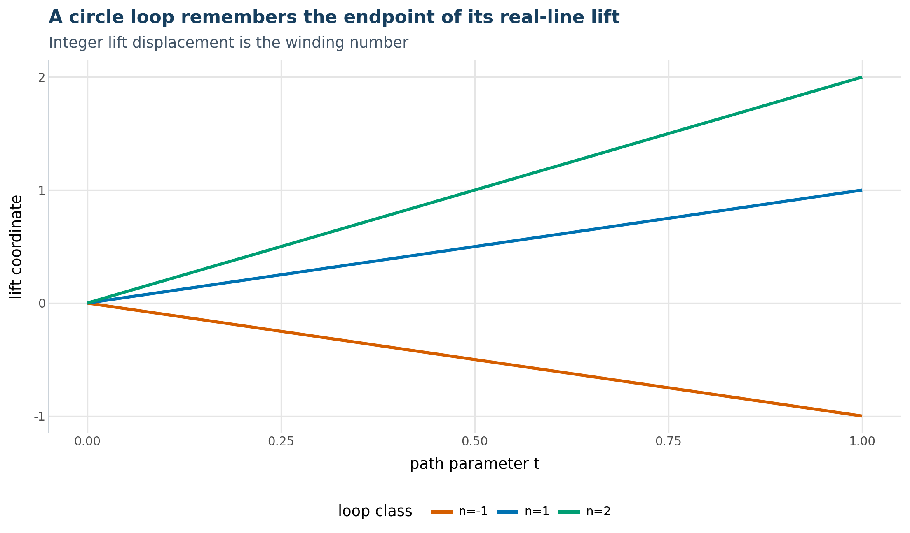

# Covering Spaces and Lifting {#sec-topology-coverings}

For the primary Atlas route, see [Coverings and Monodromy](#/books/algebraic-topology-chains-spaces/coverings-and-monodromy).
This chapter provides a companion viewpoint with the hypotheses stated below.

A covering space replaces a space with a locally identical but globally
unwrapped one. It turns loop questions into endpoint questions and links the
fundamental group to symmetries of a larger space.

## Preparation from this book

Read Chapters 6, 7, and 11 for quotient maps, paths, homotopies, and the
fundamental group. The compactness argument used in lifting comes from Chapter
8.

## Evenly covered neighborhoods

A map $p:E\to B$ is a covering map when every $b\in B$ has a neighborhood
$U$ such that

$$
p^{-1}(U)=\coprod_{\alpha}V_\alpha,
$$

with each restriction $p:V_\alpha\to U$ a homeomorphism. The pieces
$V_\alpha$ are sheets over $U$. Covering is a local condition with global
consequences.

The exponential map

$$
p:\mathbb R\to S^1,\qquad p(t)=e^{2\pi it}
$$

is a covering. Short arcs lift to disjoint intervals; the whole circle does
not have a single inverse because angles differ by integers.

## Path and homotopy lifting

Given a path $\gamma:[0,1]\to B$ and a chosen $e_0$ over $\gamma(0)$, there is
a unique lift $\widetilde\gamma$ with
$p\widetilde\gamma=\gamma$ and $\widetilde\gamma(0)=e_0$. Compactness of the
interval lets the path be divided into finitely many pieces lying in evenly
covered neighborhoods; uniqueness glues the local inverse branches.

Homotopies lift as well after an initial lift is chosen. Consequently,
homotopic based loops have lifts with the same endpoint. For the circle cover,
that endpoint is the winding number.

## Why paths and homotopies lift

Here is the compactness argument used by the circle proof in Chapter 11. A
**lift** of a map $F$ through $p$ is a continuous map $\widetilde F$ with
$p\circ\widetilde F=F$. For a path, one starting value is prescribed. For a
homotopy of paths, the entire initial path lift is prescribed.

**The small-piece fact.** Pull back the evenly covered neighborhoods along a
continuous map from $I$ or $I^2$. This gives an open cover of that compact
interval or square. There is a mesh small enough that each closed interval or
square in the mesh lies in one pulled-back neighborhood. To see why, for each
point choose a small ball whose doubled radius still lies in some member of
the cover. Finitely many of the smaller balls cover the compact domain. A
positive number smaller than all their radii then ensures that any sufficiently
small set meeting one of those smaller balls lies inside its doubled ball.
This is the compact metric **Lebesgue-number argument**, not a claim that a
fixed mesh works for every continuous path.

**Path existence.** Divide $I$ into finitely many intervals so that the image
of each lies in an evenly covered neighborhood $U$. On the first interval,
choose the sheet over $U$ containing the prescribed starting point and apply
the inverse of $p$ on that sheet. On the next interval, choose the sheet
containing the endpoint just obtained. Continue a finite number of times. The
formulas agree at the dividing points, so the pasting lemma gives a continuous
lift of the whole path.

**Path uniqueness.** A lift of one of the small intervals has connected image
inside $p^{-1}(U)$, a disjoint union of open sheets. It must remain in one
sheet. Its starting point chooses that sheet, whose inverse branch then
chooses every value. Inducting over the intervals proves uniqueness. In
particular a constant path has a constant lift.

**Square existence.** Let $H:I\times I\to B$ be a homotopy of paths, with $t$
horizontal and deformation time $s$ vertical. Suppose a lift is given on the
bottom edge $s=0$. First lift the left edge $t=0$, starting at the bottom-left
value; this uses path existence. Choose a square grid fine enough that each
closed cell maps into an evenly covered neighborhood.

Fill the cells from left to right in the lowest row, then the next row, and
so on. When a cell is reached, its bottom and left edges already have lifts.
Their union is connected and maps into the inverse image of one evenly
covered neighborhood, so their lifted images lie in the single sheet selected
by their shared corner. Apply that sheet's inverse branch to $H$ on the whole
cell. It agrees with both previously lifted edges. The finite pasting lemma
therefore gives a continuous lift on the entire square. There is no need to
make one inverse branch work on the whole base space.

**Square uniqueness and the fixed endpoints.** Any other lift agreeing on the
bottom edge first agrees on the left edge by path uniqueness. In each grid
cell it must use the same sheet selected by the corner, so row-by-row it is
the lift just constructed. If $H(0,s)=b_0$ and $H(1,s)=b_1$ for every $s$,
the two vertical edges are constant paths. Their lifts are constant as well.
Thus an endpoint-fixed homotopy lifts to an endpoint-fixed homotopy. For a
circle loop based at $1$, a lift starting at zero ends at one integer, and that
integer cannot change during a based homotopy. This is the lifting assertion
used in the proof of $\pi_1(S^1)\cong\mathbb Z$.

<figure id="fig-covering-lifts">


<figcaption>

Figure 12.1: Real-line lifts turn closed circle loops into paths whose integer endpoint records the covering sheet reached.

</figcaption>
</figure>

The induced map $p_*:\pi_1(E,e_0)\to\pi_1(B,b_0)$ is injective. A based loop in
$B$ lifts to a loop in $E$ exactly when its class lies in the subgroup
$p_*\pi_1(E,e_0)$.

## Universal covers and deck transformations

A simply connected covering space is universal under standard local
hypotheses. The real line universally covers the circle; the sphere covers the
real projective plane by identifying antipodal points.

A **deck transformation** of $p:E\to B$ is a **homeomorphism** $h:E\to E$
satisfying $p\circ h=p$. These transformations form a group under composition.
The commuting equation alone does not impose continuity or invertibility;
Exercise 7 separates those requirements. See
[Hatcher, *Algebraic Topology*, Chapter 1, pages 67 and 70](https://pi.math.cornell.edu/~hatcher/AT/ATch1.pdf)
for covering-space isomorphisms and deck transformations.

Integer translations are deck transformations of the line-to-circle cover. For a well-behaved
universal cover, deck transformations reflect the base fundamental group,
though left/right action conventions must be stated.

A space is **semilocally simply connected** when every point $b$ has an open
neighborhood $U$ such that every loop in $U$ based at $b$ is null-homotopic
in the whole space. Its contraction need not stay in $U$. A basis of
contractible open neighborhoods is a sufficient condition. This is the
ambient-space condition in
[Hatcher, printed page 63](https://pi.math.cornell.edu/~hatcher/AT/ATch1.pdf#page=43).

Connected coverings of a path-connected, locally path-connected,
semilocally simply connected space correspond to conjugacy classes of
subgroups of its fundamental group. These hypotheses exclude spaces with
arbitrarily small essential loops, where classical covering theory becomes
less complete.

**Nonexample.** The map $z\mapsto z^2$ from the complex plane to itself is not
a covering at zero. Away from zero it has two local sheets, but the sheets
merge at the branch point.

**Change only the source.** A **local homeomorphism** has, around every
source point, an open neighborhood mapped homeomorphically onto an open
subset of the target. This supplies one inverse branch at a time. A covering
requires the entire inverse image of one base neighborhood to split into
full sheets. Exercise 8 restricts the real-line exponential to the positive
half-line. Even surjectivity, equal countably infinite fibers, and a simply
connected source do not replace that sheet condition. Check that a proposed
map is a covering before applying the lifting theorem.

<!-- inline-formula-code:start -->
## Formula and finite computation

Successive phase differences lift by choosing the representative nearest the
previous phase:

$$
\widetilde\theta_{j+1}
=\widetilde\theta_j+
\operatorname{unwrap}(\theta_{j+1}-\theta_j).
$$

```python
from math import isfinite, pi

def lift_phases(phases: list[float]) -> list[float]:
    if not phases:
        raise ValueError("at least one phase is required")
    if any(not isfinite(phase) for phase in phases):
        raise ValueError("phases must be finite real numbers")
    lifted = [phases[0]]
    for phase in phases[1:]:
        change = (phase - lifted[-1] + pi) % (2.0 * pi) - pi
        lifted.append(lifted[-1] + change)
    return lifted

phases = [0.0, 0.45 * pi, 0.95 * pi, -0.55 * pi, -0.05 * pi, 0.0]
lift = lift_phases(phases)
print([round(value / (2.0 * pi), 3) for value in lift])
```

**What the computation establishes.** A chosen finite phase sequence is
unwrapped consistently under a half-turn resolution assumption. Path-lifting
existence and uniqueness for arbitrary coverings require the evenly covered
neighborhood proof.
<!-- inline-formula-code:end -->

## Summary

Covering maps are locally disjoint copies of the base. Paths and homotopies lift
uniquely after one starting point is fixed, converting loop classes into sheet
endpoints. Universal covers remove fundamental-group loops, while deck
transformations and subgroup classification encode how the base is recovered.

## Exercises

<div class="exercise" id="topology-12-covering-spaces-ex-1">
<p class="exercise-title"><strong>Exercise 1</strong></p>

Exhibit evenly covered arcs for $\mathbb R\to S^1$.

</div>

<div class="exercise" id="topology-12-covering-spaces-ex-2">
<p class="exercise-title"><strong>Exercise 2</strong></p>

Lift a twice-winding circle loop from starting point zero.

</div>

<div class="exercise" id="topology-12-covering-spaces-ex-3">
<p class="exercise-title"><strong>Exercise 3</strong></p>

Decide which circle loops lift closed to the double cover of the circle.

<details class="solution"><summary>Solution</summary>

For Exercise 3, the double cover induces multiplication by two on fundamental
groups. A base loop lifts closed exactly when its winding belongs to
$2\mathbb Z$, so precisely the even-winding loops close upstairs.

</details>

</div>

<div class="exercise" id="topology-12-covering-spaces-ex-4">
<p class="exercise-title"><strong>Exercise 4</strong></p>

Show integer translations are deck transformations.

</div>

<div class="exercise" id="topology-12-covering-spaces-ex-5">
<p class="exercise-title"><strong>Exercise 5</strong></p>

Explain the branching failure of $z\mapsto z^2$ at zero.

</div>

<div class="exercise" id="topology-12-covering-spaces-ex-6">
<p class="exercise-title"><strong>Exercise 6</strong></p>

Describe the antipodal two-sheeted cover of projective space.

</div>

<div class="exercise" id="topology-12-covering-spaces-ex-7">
<p class="exercise-title"><strong>Exercise 7</strong></p>

Let $D=\{0,1\}$ have the discrete topology and let
$E=[0,1]\times D$ have the product topology. For $p(t,i)=t$, verify that
$p:E\to[0,1]$ is a two-sheeted cover. Classify every **continuous** map
$h:E\to E$ satisfying $p\circ h=p$, then determine which are deck
transformations and identify their group. Give a continuous map satisfying
the equation that is not a deck transformation.

<details class="hint"><summary>Hint 1</summary>

**Hint for Exercise 7.** The commuting equation fixes the first coordinate.
On each interval $[0,1]\times\{i\}$, consider the continuous second
coordinate of $h$. What does connectedness imply for a map into the discrete
space $D$?

</details>

<details class="solution"><summary>Solution</summary>

For Exercise 7, the two sets $[0,1]\times\{i\}$ are disjoint open sheets
covering $E$, and $p$ restricts to a homeomorphism from either onto $[0,1]$.
Thus even the whole base is evenly covered.

Assume $h$ is continuous and $p\circ h=p$. The equation forces
$h(t,i)=(t,\eta_i(t))$. Projection to $D$ shows that each
$\eta_i:[0,1]\to D$ is continuous. Its image is connected, hence a singleton
because $D$ is discrete. Therefore

$$
h(t,i)=(t,\sigma(i))
$$

for a function $\sigma:D\to D$. Conversely, every such $\sigma$ is
continuous because $D$ is discrete, so the displayed formula defines a
continuous map over $p$. Continuity was assumed here; it was not inferred
from the commuting equation.

There are four possibilities for the pair $(\sigma(0),\sigma(1))$.
The pair $(0,1)$ gives the identity, and $(1,0)$ gives the sheet swap
$s(t,i)=(t,1-i)$. Both are homeomorphisms and each is its own inverse.
The pairs $(0,0)$ and $(1,1)$ collapse both sheets onto one, so neither is
injective or a homeomorphism. In particular, the continuous map
$h(t,i)=(t,0)$ satisfies $p\circ h=p$ but is not a deck transformation.
Exactly the identity and swap are deck transformations; since
$s^2=\operatorname{id}$, their group is $S_2$.

</details>

</div>

<div class="exercise" id="half-line-covering-task-exercise">

### Exercise 8: Change the source {#half-line-covering-task}

Keep the exponential formula and target, but restrict its source:

$$
q:(0,\infty)\longrightarrow S^1,\qquad q(t)=e^{2\pi it}.
$$

Both spaces have their usual topologies. For $0\leq\theta<1$, determine
$q^{-1}(e^{2\pi i\theta})$. Show that $q$ is surjective and has a local inverse
around every source point. Compare its fiber cardinalities with those of the
full real-line map $p$ above.

For the based loop $\gamma(s)=e^{-2\pi is}$, $s\in I$, decide separately
whether a continuous lift through $q$ exists from starting value 1 and from
starting value 2. Prove that the answers are forced without assuming $q$ is a
covering. What does the path-lifting theorem then imply about $q$?

Check the definition directly as well. For $0<\delta<1/2$, let

$$
U_\delta=\{e^{2\pi ir}:-\delta<r<\delta\}.
$$

List every component of $q^{-1}(U_\delta)$ and prove that **no** open
neighborhood of 1 is evenly covered. Finally restore source $\mathbb R$ and
exhibit the complete sheets. Explain why a simply connected source and the
circle's good local properties did not certify $q$ as a covering.

<details class="hint"><summary>Hint 1</summary>

Around $t>0$, try radius $\min(t/2,1/4)$. For a proposed lift $u$, examine the
continuous integer-valued function $u(s)+s$. For the direct check, inspect
the inverse-image component next to the omitted endpoint 0. A sheet
homeomorphic to the connected arc $U_\delta$ must be connected. If a larger
neighborhood were evenly covered, restrict its sheets to $U_\delta$.

</details>

<details class="solution"><summary>Solution</summary>

**Fibers and local inverses.** Exponential values agree precisely when the
parameters differ by an integer, so

$$
q^{-1}(e^{2\pi i\theta})=(\theta+\mathbb Z)\cap(0,\infty).
$$

For $\theta=0$ this is $\{1,2,\ldots\}$; for $0<\theta<1$ it is
$\{\theta,\theta+1,\ldots\}$. Thus $q$ is surjective and every fiber is
countably infinite, just as the full map's fibers $\theta+\mathbb Z$ are.

For $t>0$, put $\varepsilon=\min(t/2,1/4)$. The interval
$J_t=(t-\varepsilon,t+\varepsilon)$ stays positive and has length at most
$1/2<1$. The same inverse-arc construction as for $p$ maps $J_t$
homeomorphically onto a proper open arc. Thus $q$ is a local homeomorphism.

The positive half-line is convex: $H(t,v)=(1-v)t+v$ contracts it to 1 while
remaining positive. It is path connected, locally path connected and simply
connected. The circle is path connected and has a basis of contractible open
arcs, hence is locally path connected and semilocally simply connected.
These space hypotheses do not establish the covering condition for an
arbitrary proposed map.

**The two starting lifts.** Suppose a continuous $u:I\to(0,\infty)$ satisfies
$q(u(s))=\gamma(s)$. Then $u(s)+s$ is integer-valued and continuous on the
connected interval $I$, hence constant. If $u(0)=a$, every possible lift is
therefore forced to have the formula

$$
u(s)=a-s.
$$

Starting at 1 forces $u(1)=0$, outside the source, so no lift exists on all
of $I$. Starting at 2 gives $u(s)=2-s$, positive throughout $I$ and ending
at 1, so this lift exists and is unique. Both starting values lie over
$\gamma(0)=1$. This argument did not assume a covering. Now apply the
necessary consequence of the chapter's theorem: a covering lifts every
path from every prescribed starting point over its start. The failure
from 1 proves that $q$ is not a covering, even though the lift from 2 works.

**Every neighborhood fails at 1.** The complete inverse image of the short
arc is

$$
\begin{aligned}
q^{-1}(U_\delta)
  &=(0,\delta)\sqcup\bigsqcup_{k\geq1}I_k,\\
I_k&=(k-\delta,k+\delta).
\end{aligned}
$$

These disjoint intervals are exactly its connected components. Each $I_k$
maps homeomorphically onto $U_\delta$. The extra component $(0,\delta)$
maps only to the arc with parameter $0<r<\delta$; it misses 1 and the other
half of $U_\delta$.

If $U_\delta$ were evenly covered, a sheet containing a point of
$(0,\delta)$ would be connected, since it is homeomorphic to the connected
arc $U_\delta$. It would therefore lie inside this component and could not
map onto the whole arc. Joining it to a distant interval cannot repair the
failure: that union would be disconnected.

Every open neighborhood $U$ of 1 contains some $U_\delta$. If $U$ were
evenly covered, restricting each sheet homeomorphism over $U$ to the inverse
image of $U_\delta$ would give disjoint open sheets over $U_\delta$. This
contradicts the preceding argument. Thus **no** open neighborhood of 1 is
evenly covered.

**Restoring the full source.** For the original real-line map,

$$
p^{-1}(U_\delta)=
\bigsqcup_{k\in\mathbb Z}(k-\delta,k+\delta).
$$

Each restriction is a homeomorphism onto the whole arc; there is no truncated
component. Translating the angular coordinate gives the same sheets around
every circle point, proving that $p$ is a covering. Both $1-s$ and $2-s$ are
allowed lifts in $\mathbb R$. The simply connected **covering** $p$ is the
universal cover. The simply connected domain of $q$ alone did not make $q$
a covering.

</details>

</div>

### Hint for Exercise 8 {#half-line-covering-hint}

Around $t>0$, try radius $\min(t/2,1/4)$. For a proposed lift $u$, examine the
continuous integer-valued function $u(s)+s$. For the direct check, inspect
the inverse-image component next to the omitted endpoint 0. A sheet
homeomorphic to the connected arc $U_\delta$ must be connected. If a larger
neighborhood were evenly covered, restrict its sheets to $U_\delta$.

### Selected solutions

For Exercise 3, the double cover induces multiplication by two on fundamental
groups. A base loop lifts closed exactly when its winding belongs to
$2\mathbb Z$, so precisely the even-winding loops close upstairs.

For Exercise 7, the two sets $[0,1]\times\{i\}$ are disjoint open sheets
covering $E$, and $p$ restricts to a homeomorphism from either onto $[0,1]$.
Thus even the whole base is evenly covered.

Assume $h$ is continuous and $p\circ h=p$. The equation forces
$h(t,i)=(t,\eta_i(t))$. Projection to $D$ shows that each
$\eta_i:[0,1]\to D$ is continuous. Its image is connected, hence a singleton
because $D$ is discrete. Therefore

$$
h(t,i)=(t,\sigma(i))
$$

for a function $\sigma:D\to D$. Conversely, every such $\sigma$ is
continuous because $D$ is discrete, so the displayed formula defines a
continuous map over $p$. Continuity was assumed here; it was not inferred
from the commuting equation.

There are four possibilities for the pair $(\sigma(0),\sigma(1))$.
The pair $(0,1)$ gives the identity, and $(1,0)$ gives the sheet swap
$s(t,i)=(t,1-i)$. Both are homeomorphisms and each is its own inverse.
The pairs $(0,0)$ and $(1,1)$ collapse both sheets onto one, so neither is
injective or a homeomorphism. In particular, the continuous map
$h(t,i)=(t,0)$ satisfies $p\circ h=p$ but is not a deck transformation.
Exactly the identity and swap are deck transformations; since
$s^2=\operatorname{id}$, their group is $S_2$.

### Solution to Exercise 8 {#half-line-covering-answer}

**Fibers and local inverses.** Exponential values agree precisely when the
parameters differ by an integer, so

$$
q^{-1}(e^{2\pi i\theta})=(\theta+\mathbb Z)\cap(0,\infty).
$$

For $\theta=0$ this is $\{1,2,\ldots\}$; for $0<\theta<1$ it is
$\{\theta,\theta+1,\ldots\}$. Thus $q$ is surjective and every fiber is
countably infinite, just as the full map's fibers $\theta+\mathbb Z$ are.

For $t>0$, put $\varepsilon=\min(t/2,1/4)$. The interval
$J_t=(t-\varepsilon,t+\varepsilon)$ stays positive and has length at most
$1/2<1$. The same inverse-arc construction as for $p$ maps $J_t$
homeomorphically onto a proper open arc. Thus $q$ is a local homeomorphism.

The positive half-line is convex: $H(t,v)=(1-v)t+v$ contracts it to 1 while
remaining positive. It is path connected, locally path connected and simply
connected. The circle is path connected and has a basis of contractible open
arcs, hence is locally path connected and semilocally simply connected.
These space hypotheses do not establish the covering condition for an
arbitrary proposed map.

**The two starting lifts.** Suppose a continuous $u:I\to(0,\infty)$ satisfies
$q(u(s))=\gamma(s)$. Then $u(s)+s$ is integer-valued and continuous on the
connected interval $I$, hence constant. If $u(0)=a$, every possible lift is
therefore forced to have the formula

$$
u(s)=a-s.
$$

Starting at 1 forces $u(1)=0$, outside the source, so no lift exists on all
of $I$. Starting at 2 gives $u(s)=2-s$, positive throughout $I$ and ending
at 1, so this lift exists and is unique. Both starting values lie over
$\gamma(0)=1$. This argument did not assume a covering. Now apply the
necessary consequence of the chapter's theorem: a covering lifts every
path from every prescribed starting point over its start. The failure
from 1 proves that $q$ is not a covering, even though the lift from 2 works.

**Every neighborhood fails at 1.** The complete inverse image of the short
arc is

$$
\begin{aligned}
q^{-1}(U_\delta)
  &=(0,\delta)\sqcup\bigsqcup_{k\geq1}I_k,\\
I_k&=(k-\delta,k+\delta).
\end{aligned}
$$

These disjoint intervals are exactly its connected components. Each $I_k$
maps homeomorphically onto $U_\delta$. The extra component $(0,\delta)$
maps only to the arc with parameter $0<r<\delta$; it misses 1 and the other
half of $U_\delta$.

If $U_\delta$ were evenly covered, a sheet containing a point of
$(0,\delta)$ would be connected, since it is homeomorphic to the connected
arc $U_\delta$. It would therefore lie inside this component and could not
map onto the whole arc. Joining it to a distant interval cannot repair the
failure: that union would be disconnected.

Every open neighborhood $U$ of 1 contains some $U_\delta$. If $U$ were
evenly covered, restricting each sheet homeomorphism over $U$ to the inverse
image of $U_\delta$ would give disjoint open sheets over $U_\delta$. This
contradicts the preceding argument. Thus **no** open neighborhood of 1 is
evenly covered.

**Restoring the full source.** For the original real-line map,

$$
p^{-1}(U_\delta)=
\bigsqcup_{k\in\mathbb Z}(k-\delta,k+\delta).
$$

Each restriction is a homeomorphism onto the whole arc; there is no truncated
component. Translating the angular coordinate gives the same sheets around
every circle point, proving that $p$ is a covering. Both $1-s$ and $2-s$ are
allowed lifts in $\mathbb R$. The simply connected **covering** $p$ is the
universal cover. The simply connected domain of $q$ alone did not make $q$
a covering.

## Further reading

The path- and homotopy-lifting statements and their role in covering theory
can be compared with Section 1.3 of
[Allen Hatcher, *Algebraic Topology*](https://pi.math.cornell.edu/~hatcher/AT/AT.pdf),
especially Proposition 1.30. The finite-grid proof above is included to make
the circle calculation in this book self-contained at the level of paths and
homotopies of paths. Classification of all connected coverings needs the
additional local hypotheses and theory stated earlier in this chapter.

For the distinction between pointwise local inverses and simultaneous
sheets, compare
[David R. Wilkins, *Examples concerning Local Homeomorphisms and Covering Maps*, page 2](https://www.maths.tcd.ie/~dwilkins/Courses/MAU34201/MAU34201_Mich2020_Disquisitions/DisquisitionOnCoveringMapExamples.pdf#page=2):
his finite-interval restriction has truncated inverse-image components.
The half-line problem here is a derived variant with countably infinite
fibers everywhere. Hatcher's printed pages 56 and 60 supply the covering
definition and the path-lifting consequence used in its answer.
