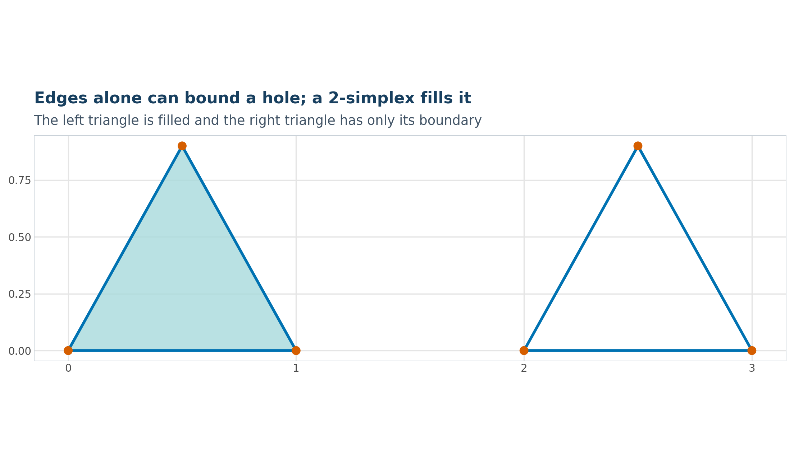

# Simplicial and CW Complexes {#sec-topology-complexes}

For the primary Atlas route, see [Computations with Cells](#/books/algebraic-topology-chains-spaces/computations-with-cells).
This chapter provides a companion viewpoint with the hypotheses stated below.

Algebraic topology needs spaces built from pieces whose boundaries can be
recorded. Simplicial complexes use vertices, edges, triangles, and higher
simplices. CW complexes attach disks more flexibly while retaining an
inductive skeleton.

## Preparation from this book

Chapters 1 and 6 provide finite sets, quotients, and attaching maps. Read
Chapter 11 before the homotopy claims; the orientation signs require only
integer arithmetic.

## Simplices and faces

An abstract simplicial complex $K$ is a collection of nonempty finite vertex
sets closed under taking nonempty subsets. A $k$-simplex has $k+1$ vertices.
Its geometric realization uses barycentric combinations

$$
\sum_{i=0}^k\lambda_iv_i,\qquad
\lambda_i\ge0,\quad\sum_i\lambda_i=1.
$$

Closure under faces is essential: a filled triangle includes its three edges
and vertices. Two simplices may meet only in a common face in a geometric
simplicial complex.

<figure id="fig-simplicial-complex">


<figcaption>

Figure 13.1: A filled triangle kills its boundary loop, while an unfilled triangle retains a one-dimensional hole.

</figcaption>
</figure>

The drawing previews homology. Both complexes have identical vertices and
edge cycles, but only the left cycle is the boundary of a two-simplex.

## Oriented boundaries

Choose an orientation $[v_0,\ldots,v_k]$. Its boundary is

$$
\partial_k[v_0,\ldots,v_k]
=\sum_{i=0}^k(-1)^i
[v_0,\ldots,\widehat v_i,\ldots,v_k].
$$

Applying the boundary twice gives zero. Every codimension-two face appears
twice with opposite signs. This identity, $\partial_{k-1}\partial_k=0$, makes
every boundary a cycle and is the algebraic hinge of homology.

Over the field with two elements, signs disappear and repeated faces cancel
modulo two. This simplifies computation but loses orientation and odd-torsion
information.

## Subdivision and approximation

Barycentric subdivision replaces simplices by smaller ones without changing
the realization's homeomorphism type. The simplicial approximation theorem says
that, after enough subdivision under suitable conditions, a continuous map
between realizations is homotopic to a simplicial map. This creates the bridge
from continuous topology to finite combinatorics.

A point cloud plus a distance threshold can generate a Vietoris–Rips complex:
a finite set spans a simplex when every pair is close. This is a model chosen
from data, not a triangulation theorem about the unknown source.

## CW complexes

A CW complex starts with points and attaches $n$-disks along maps from their
boundary spheres into the $(n-1)$-skeleton. A circle has one zero-cell and one
one-cell whose endpoints attach to that point. A sphere has one zero-cell and
one $n$-cell attached by the constant boundary map.

CW complexes can use far fewer cells than triangulations. Their attaching maps
carry essential information, so cell counts alone do not determine topology.

**Nonexample.** A family containing triangle $\{a,b,c\}$ but omitting edge
$\{a,b\}$ is not a simplicial complex. A data structure that silently inserts
faces changes the declared input and should report doing so.

<!-- inline-formula-code:start -->
## Formula and finite computation

Over two elements, the boundary of a simplex is the symmetric collection of
codimension-one faces:

$$
\partial\{v_0,\ldots,v_k\}
=\sum_{i=0}^k\{v_0,\ldots,\widehat v_i,\ldots,v_k\}.
$$

```python
def boundary_mod2(chain: set[frozenset[str]]) -> set[frozenset[str]]:
    if any(not simplex for simplex in chain):
        raise ValueError("simplices must be nonempty")
    result: set[frozenset[str]] = set()
    for simplex in chain:
        if len(simplex) <= 1:
            continue
        for vertex in simplex:
            face = simplex - {vertex}
            if face in result:
                result.remove(face)
            else:
                result.add(face)
    return result

triangle = {frozenset({"a", "b", "c"})}
edges = boundary_mod2(triangle)
print(edges, boundary_mod2(edges))
```

**What the computation establishes.** For one two-simplex over the two-element
field, its three-edge boundary has zero boundary. The general signed identity
and its validity in all dimensions require the cancellation proof.
<!-- inline-formula-code:end -->

## Summary

Simplicial complexes encode spaces through face-closed finite pieces.
Orientations define boundary maps whose square is zero. Subdivision and
simplicial approximation connect continuous maps to finite models. CW complexes
attach disks more economically and prepare cellular homology.

## Exercises

<div class="exercise" id="topology-13-simplicial-cw-complexes-ex-1">
<p class="exercise-title"><strong>Exercise 1</strong></p>

List every face of a tetrahedron.

</div>

<div class="exercise" id="topology-13-simplicial-cw-complexes-ex-2">
<p class="exercise-title"><strong>Exercise 2</strong></p>

Check the signed boundary of an oriented triangle.

</div>

<div class="exercise" id="topology-13-simplicial-cw-complexes-ex-3">
<p class="exercise-title"><strong>Exercise 3</strong></p>

Prove $\partial^2=0$ for a triangle and tetrahedron.

</div>

<div class="exercise" id="topology-13-simplicial-cw-complexes-ex-4">
<p class="exercise-title"><strong>Exercise 4</strong></p>

Compute the Euler characteristic of the two complexes in the figure.

<details class="solution"><summary>Solution</summary>

For Exercise 4, the filled triangle has $3-3+1=1$. The boundary-only triangle
has $3-3=0$. Euler characteristic already distinguishes their contractible
versus loop behavior.

</details>

</div>

<div class="exercise" id="topology-13-simplicial-cw-complexes-ex-5">
<p class="exercise-title"><strong>Exercise 5</strong></p>

Build a Rips complex on four points at two thresholds.

</div>

<div class="exercise" id="topology-13-simplicial-cw-complexes-ex-6">
<p class="exercise-title"><strong>Exercise 6</strong></p>

Give one-cell CW descriptions of a circle and a figure-eight.

</div>

### Selected solution

For Exercise 4, the filled triangle has $3-3+1=1$. The boundary-only triangle
has $3-3=0$. Euler characteristic already distinguishes their contractible
versus loop behavior.
