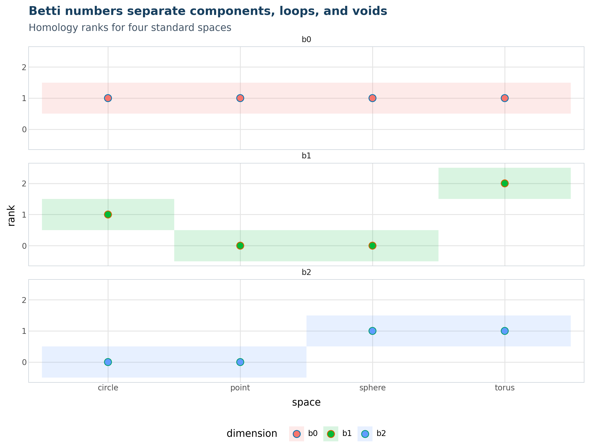

# Homology {#sec-topology-homology}

For the primary Atlas route, see [Chain Complexes and Homology](#/books/algebraic-topology-chains-spaces/chain-complexes-and-homology).
This chapter provides a companion viewpoint with the hypotheses stated below.

Homology turns geometric holes into quotient vector spaces or abelian groups.
A cycle has no boundary; it represents a hole only when it is not itself the
boundary of a higher-dimensional piece.

## Preparation from this book

Chapter 13 supplies simplices, orientations, boundary maps, and
$\partial^2=0$. Appendix A repairs kernel, image, rank, and quotient-space
language as needed. The loop comparison uses Chapter 11's based fundamental
group and circle calculation; the general comparison theorems are named below.

## Chains, cycles, and boundaries

For a simplicial complex, $C_k$ is the free abelian group generated by oriented
$k$-simplices. Boundary maps form a chain complex:

$$
\begin{gathered}
\cdots\longrightarrow C_{k+1}\xrightarrow{\partial_{k+1}}C_k,\\
C_k\xrightarrow{\partial_k}C_{k-1}\longrightarrow\cdots,\\
\partial_k\partial_{k+1}=0.
\end{gathered}
$$

The repeated $C_k$ joins consecutive rows of the same chain complex.

Cycles are $Z_k=\ker\partial_k$ and boundaries are
$B_k=\operatorname{im}\partial_{k+1}$. Since $B_k\subseteq Z_k$, define

$$
H_k=Z_k/B_k.
$$

Two cycles represent the same class when their difference bounds a
$(k+1)$-chain.

For a simplicial complex, $H_0$ has one copy of $\mathbb Z$ per connected
component of its geometric realization. These components are also path
connected. For an arbitrary topological space, the precise singular-homology
statement uses **path components**, which need not coincide with connected
components: $H_0(X;\mathbb Z)$ has one copy of $\mathbb Z$ per path component.
Chapter 7 explains this distinction. $H_1$ records loops modulo filled
boundaries. For a sphere, $H_2$ records its fundamental two-dimensional shell.
Over a field, the Betti number is $b_k=\dim H_k$.

<figure id="fig-homology-betti">


<figcaption>

Figure 14.1: Betti-number signatures distinguish components, loops, and two-dimensional voids in a point, circle, sphere, and torus.

</figcaption>
</figure>

For a finite complex over a field,

$$
\begin{gathered}
b_k=\dim C_k\\
-\bigl(\operatorname{rank}\partial_k
+\operatorname{rank}\partial_{k+1}\bigr).
\end{gathered}
$$

This is rank–nullity followed by quotient dimension.

## Functoriality and invariance

A continuous map induces homomorphisms on homology after a simplicial or
singular-chain construction. Homotopic maps induce the same homomorphism, so
homotopy-equivalent spaces have isomorphic homology.

For an arbitrary space $X$, **integral singular homology** uses chains generated
by all continuous maps $\Delta^k\to X$, called singular simplices. Write
$H_k^\Delta(K;\mathbb Z)$ for the homology of the oriented-simplex chains of
a simplicial complex $K$ above. The natural **simplicial–singular comparison
theorem** identifies

$$
\begin{gathered}
H_k^\Delta(K;\mathbb Z)\\
\xrightarrow{\cong}H_k(|K|;\mathbb Z),
\end{gathered}
$$

where $|K|$ is its geometric realization and the right side is singular
homology. This theorem, including compatibility with inclusions of
subcomplexes, is imported; see
[Hatcher, Theorem 2.27, page 128](https://pi.math.cornell.edu/~hatcher/AT/ATch2.pdf).
It justifies using finite simplicial calculations to determine the topological
groups in Exercise 7.

Homology is easier to compute than the fundamental group but loses information.
Choose a base point $x_0$ in $X$. A based loop $\gamma:I\to X$ is a singular
one-cycle, since its boundary is
$\gamma(1)-\gamma(0)=x_0-x_0=0$. Sending its based homotopy class to its
singular-cycle homology class gives the natural loop-to-cycle homomorphism

$$
h:\pi_1(X,x_0)\longrightarrow H_1(X;\mathbb Z).
$$

If $X$ is **path connected**, the **degree-one Hurewicz theorem** says that
$h$ is surjective and its kernel is the commutator subgroup. That subgroup is
generated by products $aba^{-1}b^{-1}$ of group elements. Dividing by it makes
the group abelian; this quotient is written $\pi_1(X,x_0)^{\mathrm{ab}}$.
Thus, under the path-connectedness hypothesis,

$$
\begin{gathered}
\pi_1(X,x_0)^{\mathrm{ab}}\\
\xrightarrow{\cong}H_1(X;\mathbb Z).
\end{gathered}
$$

This is a theorem about **integral singular homology of a path-connected
space**, not a conclusion of a finite boundary-rank check. Naturality means
that composing loops with a based continuous map and then taking their homology
classes gives the same result as first applying $h$ and then the induced
homology map. See
[Hatcher, Theorem 2A.1, page 166](https://pi.math.cornell.edu/~hatcher/AT/ATch2.pdf).

More generally, singular homology splits over the path components
$X_\lambda$ of any space $X$:

$$
\begin{gathered}
H_k(X;\mathbb Z)\\
\cong\bigoplus_\lambda H_k(X_\lambda;\mathbb Z).
\end{gathered}
$$

Every singular simplex has path-connected image. Thus singular chains split
into componentwise chains, and boundaries preserve that splitting; taking
homology gives the direct sum. This is
[Hatcher's Proposition 2.6, page 109](https://pi.math.cornell.edu/~hatcher/AT/ATch2.pdf).
Loops based at $x_0$ stay in its path component, so their cycle classes only
contribute to that summand. A single based fundamental group need not recover
the first homology of all components. Spaces can also share all homology
groups without being homotopy equivalent.

With integer coefficients, finitely generated homology separates a free part
and torsion. Projective plane homology contains two-torsion. Field coefficients
make linear algebra simple but coefficient choice changes what is visible.

Euler characteristic satisfies

$$
\begin{gathered}
\chi(K)=\sum_k(-1)^k\dim C_k,\\
\chi(K)=\sum_k(-1)^kb_k
\end{gathered}
$$

over a field. The equality follows by cancelling ranks of adjacent boundary
maps.

Both alternating sums are finite checksums for a finite complex. Keeping one
function for either list emphasizes that Euler characteristic forgets how the
ranks are distributed across degrees.

```python
def alternating_rank_sum(ranks: list[int]) -> int:
    """Return sum (-1)**degree * rank[degree] for finite nonnegative ranks."""
    if any(rank < 0 for rank in ranks):
        raise ValueError("ranks must be nonnegative")
    return sum((-1) ** degree * rank for degree, rank in enumerate(ranks))

boundary_triangle_chains = [3, 3]
boundary_triangle_betti = [1, 1]
chain_euler = alternating_rank_sum(boundary_triangle_chains)
homology_euler = alternating_rank_sum(boundary_triangle_betti)
if chain_euler != homology_euler:
    raise RuntimeError("chain and homology Euler characteristics disagree")
print(chain_euler, homology_euler)
```

The output verifies $3-3=1-1=0$ for the boundary-only triangle. Equality for
every finite chain complex follows from rank–nullity and adjacent
cancellation, not from this example.

**Nonexample.** Counting geometric-looking loops in a drawing is not homology.
Loops can be dependent, can bound combinations of faces, or can be artifacts of
a projection.

<!-- inline-formula-code:start -->
## Formula and finite computation

Over the two-element field, Betti numbers follow from boundary ranks:

$$
b_k=n_k-r_k-r_{k+1}.
$$

```python
def rank_mod2(matrix: list[list[int]]) -> int:
    if not matrix:
        return 0
    width = len(matrix[0])
    if any(len(row) != width for row in matrix):
        raise ValueError("matrix must be rectangular")
    rows = [[value % 2 for value in row] for row in matrix]
    rank = 0
    for column in range(width):
        pivot = next((row for row in range(rank, len(rows)) if rows[row][column]), None)
        if pivot is None:
            continue
        rows[rank], rows[pivot] = rows[pivot], rows[rank]
        for row in range(len(rows)):
            if row != rank and rows[row][column]:
                rows[row] = [a ^ b for a, b in zip(rows[row], rows[rank], strict=True)]
        rank += 1
    return rank

# Boundary-only triangle: three vertices, three edges, no faces.
d1 = [[1, 0, 1], [1, 1, 0], [0, 1, 1]]
b0 = 3 - rank_mod2(d1)
b1 = 3 - rank_mod2(d1) - 0
print(b0, b1)
```

**What the computation establishes.** The finite boundary matrix gives one
component and one loop over the two-element field. It does not prove
triangulation invariance or reveal torsion hidden by these coefficients.
<!-- inline-formula-code:end -->

## Summary

Boundary maps form a chain complex. Homology quotients cycles by boundaries,
leaving components, loops, and higher voids. Matrix ranks compute Betti numbers
for finite complexes, while functoriality and homotopy invariance justify their
topological meaning. Coefficients control which torsion information survives.

## Exercises

<div class="exercise" id="topology-14-homology-ex-1">
<p class="exercise-title"><strong>Exercise 1</strong></p>

Compute $H_0$ for a graph with three components.

</div>

<div class="exercise" id="topology-14-homology-ex-2">
<p class="exercise-title"><strong>Exercise 2</strong></p>

Compute mod-two homology of a filled triangle.

<details class="solution"><summary>Solution</summary>

For Exercise 2, the edge cycle is the boundary of the triangle's two-simplex,
so $H_1=0$. The complex is connected, giving $H_0$ of rank one, and it has no
closed two-cycle, so $H_2=0$.

</details>

</div>

<div class="exercise" id="topology-14-homology-ex-3">
<p class="exercise-title"><strong>Exercise 3</strong></p>

Compute homology of the boundary of a tetrahedron.

</div>

<div class="exercise" id="topology-14-homology-ex-4">
<p class="exercise-title"><strong>Exercise 4</strong></p>

Derive the Betti-rank formula.

</div>

<div class="exercise" id="topology-14-homology-ex-5">
<p class="exercise-title"><strong>Exercise 5</strong></p>

Prove Euler characteristic agrees for chains and homology.

<details class="solution"><summary>Solution</summary>

Over a field, write
$\dim C_k=\dim B_{k-1}+\dim H_k+\dim B_k$ using cycles and rank–nullity.
In the alternating sum, every boundary dimension appears twice with opposite
sign. What remains is $\sum_k(-1)^k\dim H_k$.

</details>

</div>

<div class="exercise" id="topology-14-homology-ex-6">
<p class="exercise-title"><strong>Exercise 6</strong></p>

Explain why field coefficients can hide torsion.

</div>

<div class="exercise" id="topology-14-homology-ex-7">
<p class="exercise-title"><strong>Exercise 7</strong></p>

**Change the number of components.** Let $K$ consist of two disjoint
boundary-only triangles, with vertices $(a,b,c)$ and $(d,e,f)$. Orient the
edges cyclically: $a\to b$, $b\to c$, $c\to a$ and
$d\to e$, $e\to f$, $f\to d$. There are no two-simplices. Use integral
simplicial chains, with these edge and vertex orders, to write
$\partial_1^\Delta$ as a block diagonal matrix. Determine its exact integer
kernel and $H_1^\Delta(K;\mathbb Z)$. Now choose the base point $x_0=a$
in $|K|$. Compute $\pi_1(|K|,x_0)^{\mathrm{ab}}$, the image of its
loop-to-cycle map, and the image on $H_1$ of the first component's
inclusion. Which hypothesis of the degree-one Hurewicz theorem fails for
$|K|$, and which theorem connects the finite-chain answer with singular
homology?

<details class="solution"><summary>Solution</summary>

For Exercise 7, with the prescribed cyclic edge and vertex orders, each
triangle has boundary matrix

$$
B=\begin{pmatrix}
-1&0&1\\
1&-1&0\\
0&1&-1
\end{pmatrix}.
$$

Consequently the integral simplicial chain groups and boundary are

$$
\begin{gathered}
C_1^\Delta(K;\mathbb Z)\cong\mathbb Z^6,\\
C_0^\Delta(K;\mathbb Z)\cong\mathbb Z^6,\\
\partial_1^\Delta=\begin{pmatrix}B&0\\0&B\end{pmatrix},\\
C_2^\Delta(K;\mathbb Z)=0.
\end{gathered}
$$

The equation $B(u,v,w)^{\mathsf T}=0$ says $-u+w=0$, $u-v=0$, and
$v-w=0$, so $u=v=w$. Applying this independently in the two blocks gives

$$
\begin{gathered}
\ker\partial_1^\Delta\\
=\{(r,r,r,s,s,s):r,s\in\mathbb Z\}.
\end{gathered}
$$

There are no simplicial two-chains, so the subgroup of simplicial
one-boundaries is zero. Hence

$$
H_1^\Delta(K;\mathbb Z)\cong\mathbb Z\oplus\mathbb Z,
$$

with one generator for each oriented triangle cycle. The natural
simplicial–singular comparison theorem gives the same answer for
$H_1(|K|;\mathbb Z)$, preserving the inclusion of either component.
The zero two-chain group used here is the **simplicial** group of $K$;
singular two-simplices are arbitrary continuous maps into $|K|$.

Every based loop and based homotopy through $a$ stays in the first component.
That triangle boundary is homeomorphic to $S^1$, so Chapter 11's circle
calculation gives

$$
\pi_1(|K|,a)^{\mathrm{ab}}\cong\mathbb Z.
$$

Under the two oriented cycle generators of $H_1(|K|;\mathbb Z)$, the inclusion
of the first component induces

$$
\begin{gathered}
j_*:\mathbb Z\longrightarrow\mathbb Z^2,\\
j_*(r)=(r,0).
\end{gathered}
$$

A once-around loop in the chosen orientation maps to the first triangle
cycle. Thus the loop-to-cycle map has the same image
$\mathbb Z\oplus0$, not the whole $\mathbb Z^2$. The space $|K|$ is not
path connected, so the theorem cannot assert surjectivity onto its entire
$H_1$. It does apply to each component separately. The exact kernel
calculation establishes this finite simplicial example; the general Hurewicz
and simplicial–singular comparison theorems remain the named imported results.

</details>

</div>

### Hint for Exercise 7

At each vertex, compare the coefficient of the incoming edge with that of the
outgoing edge. Keep the two triangle blocks separate. Then use the absence of
simplicial two-chains and the natural comparison theorem. A path starting at
$a$ cannot enter the other component.

### Selected solutions

For Exercise 2, the edge cycle is the boundary of the triangle's two-simplex,
so $H_1=0$. The complex is connected, giving $H_0$ of rank one, and it has no
closed two-cycle, so $H_2=0$.

For Exercise 7, with the prescribed cyclic edge and vertex orders, each
triangle has boundary matrix

$$
B=\begin{pmatrix}
-1&0&1\\
1&-1&0\\
0&1&-1
\end{pmatrix}.
$$

Consequently the integral simplicial chain groups and boundary are

$$
\begin{gathered}
C_1^\Delta(K;\mathbb Z)\cong\mathbb Z^6,\\
C_0^\Delta(K;\mathbb Z)\cong\mathbb Z^6,\\
\partial_1^\Delta=\begin{pmatrix}B&0\\0&B\end{pmatrix},\\
C_2^\Delta(K;\mathbb Z)=0.
\end{gathered}
$$

The equation $B(u,v,w)^{\mathsf T}=0$ says $-u+w=0$, $u-v=0$, and
$v-w=0$, so $u=v=w$. Applying this independently in the two blocks gives

$$
\begin{gathered}
\ker\partial_1^\Delta\\
=\{(r,r,r,s,s,s):r,s\in\mathbb Z\}.
\end{gathered}
$$

There are no simplicial two-chains, so the subgroup of simplicial
one-boundaries is zero. Hence

$$
H_1^\Delta(K;\mathbb Z)\cong\mathbb Z\oplus\mathbb Z,
$$

with one generator for each oriented triangle cycle. The natural
simplicial–singular comparison theorem gives the same answer for
$H_1(|K|;\mathbb Z)$, preserving the inclusion of either component.
The zero two-chain group used here is the **simplicial** group of $K$;
singular two-simplices are arbitrary continuous maps into $|K|$.

Every based loop and based homotopy through $a$ stays in the first component.
That triangle boundary is homeomorphic to $S^1$, so Chapter 11's circle
calculation gives

$$
\pi_1(|K|,a)^{\mathrm{ab}}\cong\mathbb Z.
$$

Under the two oriented cycle generators of $H_1(|K|;\mathbb Z)$, the inclusion
of the first component induces

$$
\begin{gathered}
j_*:\mathbb Z\longrightarrow\mathbb Z^2,\\
j_*(r)=(r,0).
\end{gathered}
$$

A once-around loop in the chosen orientation maps to the first triangle
cycle. Thus the loop-to-cycle map has the same image
$\mathbb Z\oplus0$, not the whole $\mathbb Z^2$. The space $|K|$ is not
path connected, so the theorem cannot assert surjectivity onto its entire
$H_1$. It does apply to each component separately. The exact kernel
calculation establishes this finite simplicial example; the general Hurewicz
and simplicial–singular comparison theorems remain the named imported results.
