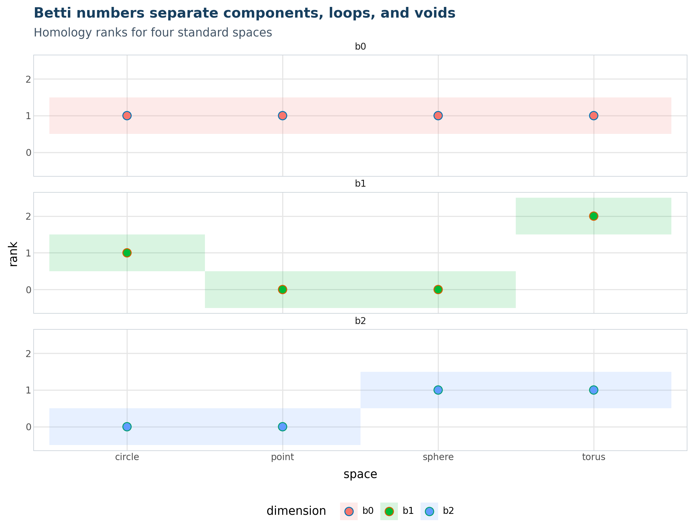

# Cohomology and Products {#sec-topology-cohomology}

For the primary Atlas route, see [Cohomology and Products](#/books/algebraic-topology-chains-spaces/cohomology-and-products).
This chapter provides a companion viewpoint with the hypotheses stated below.

Homology represents cycles. Cohomology represents measurements on cycles and
adds a multiplication that can distinguish spaces with identical Betti
numbers.

## Preparation from this book

Read Chapters 13–14 for chain complexes and homology. Only elementary linear
duality is assumed; Hom, Ext, and coefficient effects are developed more fully
in Chapter 25. Additive coefficient groups and coefficient-ring multiplication
are distinguished below. Exercise 8 uses the cellular cohomology comparison
theorem, named where it is imported.

## Cochains and coboundaries

Let $G$ be an **abelian group**, with commutative addition. Using the integral
singular chains from Chapter 14, define the additive cochain group

$$
\begin{gathered}
C^k(X;G)\\
=\operatorname{Hom}_{\mathbb Z}(C_k(X;\mathbb Z),G).
\end{gathered}
$$

Thus a cochain assigns a value in $G$ to each singular $k$-simplex and extends
additively to chains. The coboundary is dual to boundary:

$$
(\delta\varphi)(c)=\varphi(\partial c).
$$

Because $\partial^2=0$, also $\delta^2=0$. Cocycles and coboundaries are
$Z^k=\ker\delta$ and $B^k=\operatorname{im}\delta$, and

$$
H^k(X;G)=Z^k/B^k.
$$

Over a field $F$ and a finite complex, cohomology and homology have the same
dimensions over $F$. Their structures differ because cohomology is
contravariant: a map $f:X\to Y$ induces $f^*:H^k(Y;G)\to H^k(X;G)$ by
pulling measurements backward. This additive construction requires no
multiplication on $G$.

## Cup products

An internal cup product needs a chosen multiplication of coefficient values.
Now let $R$ be an **associative unital ring**: its additive group is abelian,
its multiplication is associative and distributes over addition, and it has an
identity $1_R$. Commutativity of multiplication is an additional condition.

For $\varphi\in C^p(X;R)$ and $\psi\in C^q(X;R)$, take a singular
$(p+q)$-simplex $\sigma$. Restrict it to its front face with vertices
$v_0,\ldots,v_p$ and its back face with vertices
$v_p,\ldots,v_{p+q}$, writing the restrictions as
$\sigma_{\mathrm{front}}$ and $\sigma_{\mathrm{back}}$. Define

$$
\begin{gathered}
(\varphi\smile\psi)(\sigma)\\
=\varphi(\sigma_{\mathrm{front}})
\,\psi(\sigma_{\mathrm{back}}).
\end{gathered}
$$

The product on the right is the chosen multiplication in $R$, in that order.
This formula is associative because multiplication in $R$ is associative.
The **cup-product coboundary identity** is

$$
\begin{gathered}
\delta(\varphi\smile\psi)\\
=\delta\varphi\smile\psi
+(-1)^p\varphi\smile\delta\psi.
\end{gathered}
$$

Its general proof is imported from
[Hatcher, Section 3.2 and Lemma 3.6, pages 206–207](https://pi.math.cornell.edu/~hatcher/AT/ATch3.pdf).
The identity shows that products of cocycles are cocycles. It also shows that
changing either cocycle by a coboundary changes their product by a coboundary.
Consequently cup product descends to

$$
\begin{gathered}
\smile:H^p(X;R)\times H^q(X;R)\\
\longrightarrow H^{p+q}(X;R).
\end{gathered}
$$

Thus $H^*(X;R)$ is a graded ring: multiplication adds degrees. The constant
zero-cochain with value $1_R$ supplies its identity class. If $R$ is also
**commutative**, then the **graded-commutativity theorem** gives, on cohomology
classes,

$$
\alpha\smile\beta=(-1)^{pq}\beta\smile\alpha.
$$

This is
[Hatcher's Theorem 3.11, page 210](https://pi.math.cornell.edu/~hatcher/AT/ATch3.pdf).
Associative noncommutative coefficient rings still give associative cup
products; the displayed graded-commutativity assertion requires the additional
commutativity hypothesis.

Already at a point, $H^0(\{*\};R)=R$ with its chosen multiplication. A
zero-cochain is determined by its value at the point, its coboundary is zero,
and there are no degree-zero coboundaries. The front/back formula in degree
zero multiplies those two values in $R$. Hence the additive coefficient group
alone does not specify this cup product. Exercise 7 holds that group fixed
while changing its multiplication.

On a torus, two independent degree-one classes have a nonzero product in
degree two. On a wedge of two circles, degree-one ranks are also two, but every
degree-two product vanishes because there is no degree-two cohomology. The ring
distinguishes the spaces beyond $b_1$.
Exercise 8 adds a sphere to the wedge, giving the same additive cohomology
groups as the torus in every degree, and then compares their products.

<figure id="fig-cohomology-betti">


<figcaption>

Figure 15.1: The torus and circle entries in the Betti chart motivate why additive ranks are useful but not always sufficient; cohomology adds products.

</figcaption>
</figure>

## Pairings and universal coefficients

A cohomology class evaluates on a homology class through
$\langle[\varphi],[c]\rangle=\varphi(c)$. Boundaries and coboundaries pair to
zero, making this well defined.

Universal coefficient theorems relate integer cohomology to homology through
Hom and Ext terms. Over a field the relation becomes ordinary vector-space
duality. Changing coefficients can expose or erase torsion.

**Nonexample.** Equal Betti numbers do not imply equal cohomology rings, and
equal cohomology rings do not imply spaces are homeomorphic. Invariants filter
possibilities; they rarely classify all spaces alone.

<!-- inline-formula-code:start -->
## Formula and finite computation

For an oriented edge $[u,v]$ and a zero-cochain $\varphi$,

$$
(\delta\varphi)([u,v])=\varphi(v)-\varphi(u).
$$

```python
def coboundary_zero(
    values: dict[str, int], edges: list[tuple[str, str]]
) -> list[int]:
    missing = {vertex for edge in edges for vertex in edge} - set(values)
    if missing:
        raise ValueError(f"missing vertex values: {sorted(missing)}")
    return [values[end] - values[start] for start, end in edges]

potential = {"a": 2, "b": 5, "c": 1}
edges = [("a", "b"), ("b", "c"), ("c", "a")]
edge_values = coboundary_zero(potential, edges)
print(edge_values, sum(edge_values))
```

**What the computation establishes.** Differences around this oriented triangle
sum to zero, so the coboundary $\delta\varphi$ evaluates trivially on this
one-cycle. If the loop is the boundary of a filled oriented triangle, this is
also the corresponding finite evaluation of $\delta^2\varphi=0$. It does not
construct the general cup product or prove cohomology invariance.
<!-- inline-formula-code:end -->

## Summary

Cochains with abelian-group coefficients measure chains, and coboundary is dual
to boundary. Cohomology records cocycles modulo coboundaries; pullback reverses
map direction. A chosen coefficient-ring multiplication gives cup products and
a graded ring, graded commutative when the coefficient ring is commutative.
The resulting products can separate spaces with identical additive cohomology
groups. Pairings and coefficient theorems connect homology and cohomology while
retaining torsion caveats.

## Exercises

<div class="exercise" id="topology-15-cohomology-ex-1">
<p class="exercise-title"><strong>Exercise 1</strong></p>

Write coboundary matrices as transposes of boundary matrices.

</div>

<div class="exercise" id="topology-15-cohomology-ex-2">
<p class="exercise-title"><strong>Exercise 2</strong></p>

Verify $\delta^2=0$ from $\partial^2=0$.

<details class="solution"><summary>Solution</summary>

For Exercise 2,
$(\delta^2\varphi)(c)=(\delta\varphi)(\partial c)
=\varphi(\partial^2c)=\varphi(0)=0$. The equality is formal once coboundary is
defined by precomposition with boundary.

</details>

</div>

<div class="exercise" id="topology-15-cohomology-ex-3">
<p class="exercise-title"><strong>Exercise 3</strong></p>

Compute zero- and one-dimensional cohomology of a triangle boundary.

</div>

<div class="exercise" id="topology-15-cohomology-ex-4">
<p class="exercise-title"><strong>Exercise 4</strong></p>

Compare cohomology groups of a torus and wedge of two circles.

</div>

<div class="exercise" id="topology-15-cohomology-ex-5">
<p class="exercise-title"><strong>Exercise 5</strong></p>

Explain contravariance of pullback.

</div>

<div class="exercise" id="topology-15-cohomology-ex-6">
<p class="exercise-title"><strong>Exercise 6</strong></p>

Compute edge differences of a vertex potential on a graph.

</div>

<div class="exercise" id="topology-15-cohomology-ex-7">
<p class="exercise-title"><strong>Exercise 7</strong></p>

**Change the multiplication, keep the additive group.** Let
$A=\mathbb F_2^2$, with componentwise addition. All the following
arithmetic is modulo two. Compare these two multiplications on $A$:

$$
\begin{gathered}
\mu_1((a,b),(c,d))=(ac,bd),\\
\mu_2((a,b),(c,d))=(ac,ad+bc).
\end{gathered}
$$

Determine the identity element for each multiplication and compute the
square of $e=(0,1)$ under each. Check associativity of $\mu_2$ by
multiplying three general pairs. How do the resulting cup products on
$H^0(\{*\};A)$ differ despite the same additive group? Can the two
coefficient rings be isomorphic?

<details class="solution"><summary>Solution</summary>

For Exercise 7, $\mu_1$ has identity $(1,1)$ and is the componentwise product
ring $\mathbb F_2\times\mathbb F_2$. The multiplication $\mu_2$ has
identity $(1,0)$ and is called dual-number multiplication. It is commutative,
since $ac=ca$ and $ad+bc=cb+da$. For three pairs $(a,b)$, $(c,d)$, and
$(f,g)$, both parenthesizations under $\mu_2$ give

$$
(acf,\;acg+adf+bcf).
$$

This proves associativity for all pairs, not just selected elements.
Distributivity follows by expanding each coordinate over $\mathbb F_2$.
The products with $(1,0)$ verify the identity law directly. Thus both choices
give commutative unital coefficient rings on the same additive group.

Nevertheless,

$$
\begin{gathered}
\mu_1(e,e)=e,\\
\mu_2(e,e)=(0,0).
\end{gathered}
$$

The corresponding degree-zero cohomology groups of a point are additively the
same $A$, while these squares in their cup rings differ. Moreover, every
element of the product ring satisfies $x^2=x$, so it has no nonzero element
whose square is zero. The second ring has the nonzero element $e$ with
$e^2=0$. A ring isomorphism preserves this property, so the rings are not
isomorphic. These coordinate calculations establish the finite coefficient
algebras. The identification of their multiplication with cup product uses the
degree-zero cochain formula proved above.

</details>

</div>

<div class="exercise" id="topology-15-cohomology-ex-8">
<p class="exercise-title"><strong>Exercise 8</strong></p>

**Keep all additive groups, change the space.** Use integral coefficients.
Compare $T^2=S^1\times S^1$ with
$W=S^1\vee S^1\vee S^2$, where the three spaces meet only at their
chosen base points. Give $T^2$ its standard CW structure with one vertex,
two one-cells, and one two-cell attached along the commutator loop. Give
$W$ one vertex, two loop one-cells, and the sphere's two-cell attached by
the constant map. Determine their additive cohomology groups and Betti
vectors. For the cellular inclusion $i:S^2\hookrightarrow W$, identify
the induced maps in degrees one and two. Use cup naturality to determine
every product of two degree-one classes on $W$. Finally compare with the
imported torus computation $\alpha\smile\beta=\gamma$, where
$\gamma$ generates $H^2(T^2;\mathbb Z)$. State which claims the cellular
cochain calculation establishes and which require separate cup-product
theorems.

<details class="solution"><summary>Solution</summary>

For Exercise 8, each one-cell has its two endpoints at the single vertex, so
its cellular boundary is zero. In the torus attaching word, each one-cell is
traversed once in each orientation; the signed contributions to its cellular
two-boundary cancel. The sphere's attaching map in $W$ is constant, so its
two-boundary is also zero. This uses the imported **cellular boundary
formula**, which computes the degrees of the attaching maps; the torus case
is worked out in
[Hatcher, Section 2.2 and Example 2.36, pages 140–141](https://pi.math.cornell.edu/~hatcher/AT/ATch2.pdf).
Their cellular cochain models therefore have

$$
\begin{gathered}
C^0_{\mathrm{cell}}=\mathbb Z,\\
C^1_{\mathrm{cell}}=\mathbb Z^2,\\
C^2_{\mathrm{cell}}=\mathbb Z,\\
\delta^0=0,\qquad\delta^1=0,
\end{gathered}
$$

with no cells in higher degrees. The **cellular cohomology comparison
theorem** identifies the resulting cellular cohomology with singular
cohomology; this is an imported theorem, not an inference from the numbers of
cells alone. See
[Hatcher, Theorem 3.5, page 203](https://pi.math.cornell.edu/~hatcher/AT/ATch3.pdf).
Thus, for either space $Y=T^2$ or $Y=W$,

$$
H^k(Y;\mathbb Z)\cong
\begin{cases}
\mathbb Z,&k=0,2,\\
\mathbb Z^2,&k=1,\\
0,&k>2.
\end{cases}
$$

Both have the full Betti vector $(1,2,1)$ and Euler characteristic zero.
These additive calculations do not determine the cup product.

The inclusion $i:S^2\hookrightarrow W$ is cellular: it sends each sphere
skeleton into the corresponding skeleton of $W$. In degree two, restriction
of cellular cochains sends the value on $W$'s unique two-cell to the same value
on the sphere's two-cell. It is the identity $\mathbb Z\to\mathbb Z$,
and the differentials on either side are zero. **Naturality of the
cellular–singular comparison** for this cellular map therefore identifies

$$
\begin{gathered}
i^*:H^2(W;\mathbb Z)\\
\xrightarrow{\cong}H^2(S^2;\mathbb Z).
\end{gathered}
$$

In degree one, the restriction is zero because $H^1(S^2;\mathbb Z)=0$.
For arbitrary $u,v\in H^1(W;\mathbb Z)$, **cup naturality** gives

$$
\begin{gathered}
i^*(u\smile v)\\
=i^*(u)\smile i^*(v)=0.
\end{gathered}
$$

This naturality theorem is
[Hatcher's Proposition 3.10, page 210](https://pi.math.cornell.edu/~hatcher/AT/ATch3.pdf).
Since $i^*$ in degree two is injective, $u\smile v=0$ for every such pair.
The restriction map and its naturality supply the argument; matching group
ranks alone would not establish it.

On the torus, compatible choices of the two degree-one generators and the
orientation generator give

$$
\begin{gathered}
\alpha,\beta\in H^1(T^2;\mathbb Z),\\
\alpha\smile\beta=\gamma\ne0,\\
H^2(T^2;\mathbb Z)=\mathbb Z\gamma.
\end{gathered}
$$

This nonzero cup product is the separate **torus cup-product computation** in
[Hatcher, Example 3.7, pages 207–208](https://pi.math.cornell.edu/~hatcher/AT/ATch3.pdf),
also restated in Example 3.13, page 213. It is imported here; the zero cellular
differentials do not prove it. The torus and $W$ therefore have the same
graded additive cohomology groups, while their cup rings differ: on $W$ every
degree-one pair multiplies to zero, whereas on $T^2$ this pair does not. No
universal coefficient theorem or duality theorem is used in this comparison.

</details>

</div>

### Hints for Exercises 7 and 8

For Exercise 7, multiply an unknown candidate identity by $(a,b)$. For three
pairs, expand both parenthesizations in coordinates. Compare nonzero elements
whose squares are zero.

For Exercise 8, the standard cellular differentials are zero in both models.
The sphere inclusion is cellular; inspect restriction of degree-two cellular
cochains, rather than comparing dimensions alone. A degree-one class restricts
to zero on $S^2$.

### Selected solutions

For Exercise 2,
$(\delta^2\varphi)(c)=(\delta\varphi)(\partial c)
=\varphi(\partial^2c)=\varphi(0)=0$. The equality is formal once coboundary is
defined by precomposition with boundary.

For Exercise 7, $\mu_1$ has identity $(1,1)$ and is the componentwise product
ring $\mathbb F_2\times\mathbb F_2$. The multiplication $\mu_2$ has
identity $(1,0)$ and is called dual-number multiplication. It is commutative,
since $ac=ca$ and $ad+bc=cb+da$. For three pairs $(a,b)$, $(c,d)$, and
$(f,g)$, both parenthesizations under $\mu_2$ give

$$
(acf,\;acg+adf+bcf).
$$

This proves associativity for all pairs, not just selected elements.
Distributivity follows by expanding each coordinate over $\mathbb F_2$.
The products with $(1,0)$ verify the identity law directly. Thus both choices
give commutative unital coefficient rings on the same additive group.

Nevertheless,

$$
\begin{gathered}
\mu_1(e,e)=e,\\
\mu_2(e,e)=(0,0).
\end{gathered}
$$

The corresponding degree-zero cohomology groups of a point are additively the
same $A$, while these squares in their cup rings differ. Moreover, every
element of the product ring satisfies $x^2=x$, so it has no nonzero element
whose square is zero. The second ring has the nonzero element $e$ with
$e^2=0$. A ring isomorphism preserves this property, so the rings are not
isomorphic. These coordinate calculations establish the finite coefficient
algebras. The identification of their multiplication with cup product uses the
degree-zero cochain formula proved above.

For Exercise 8, each one-cell has its two endpoints at the single vertex, so
its cellular boundary is zero. In the torus attaching word, each one-cell is
traversed once in each orientation; the signed contributions to its cellular
two-boundary cancel. The sphere's attaching map in $W$ is constant, so its
two-boundary is also zero. This uses the imported **cellular boundary
formula**, which computes the degrees of the attaching maps; the torus case
is worked out in
[Hatcher, Section 2.2 and Example 2.36, pages 140–141](https://pi.math.cornell.edu/~hatcher/AT/ATch2.pdf).
Their cellular cochain models therefore have

$$
\begin{gathered}
C^0_{\mathrm{cell}}=\mathbb Z,\\
C^1_{\mathrm{cell}}=\mathbb Z^2,\\
C^2_{\mathrm{cell}}=\mathbb Z,\\
\delta^0=0,\qquad\delta^1=0,
\end{gathered}
$$

with no cells in higher degrees. The **cellular cohomology comparison
theorem** identifies the resulting cellular cohomology with singular
cohomology; this is an imported theorem, not an inference from the numbers of
cells alone. See
[Hatcher, Theorem 3.5, page 203](https://pi.math.cornell.edu/~hatcher/AT/ATch3.pdf).
Thus, for either space $Y=T^2$ or $Y=W$,

$$
H^k(Y;\mathbb Z)\cong
\begin{cases}
\mathbb Z,&k=0,2,\\
\mathbb Z^2,&k=1,\\
0,&k>2.
\end{cases}
$$

Both have the full Betti vector $(1,2,1)$ and Euler characteristic zero.
These additive calculations do not determine the cup product.

The inclusion $i:S^2\hookrightarrow W$ is cellular: it sends each sphere
skeleton into the corresponding skeleton of $W$. In degree two, restriction
of cellular cochains sends the value on $W$'s unique two-cell to the same value
on the sphere's two-cell. It is the identity $\mathbb Z\to\mathbb Z$,
and the differentials on either side are zero. **Naturality of the
cellular–singular comparison** for this cellular map therefore identifies

$$
\begin{gathered}
i^*:H^2(W;\mathbb Z)\\
\xrightarrow{\cong}H^2(S^2;\mathbb Z).
\end{gathered}
$$

In degree one, the restriction is zero because $H^1(S^2;\mathbb Z)=0$.
For arbitrary $u,v\in H^1(W;\mathbb Z)$, **cup naturality** gives

$$
\begin{gathered}
i^*(u\smile v)\\
=i^*(u)\smile i^*(v)=0.
\end{gathered}
$$

This naturality theorem is
[Hatcher's Proposition 3.10, page 210](https://pi.math.cornell.edu/~hatcher/AT/ATch3.pdf).
Since $i^*$ in degree two is injective, $u\smile v=0$ for every such pair.
The restriction map and its naturality supply the argument; matching group
ranks alone would not establish it.

On the torus, compatible choices of the two degree-one generators and the
orientation generator give

$$
\begin{gathered}
\alpha,\beta\in H^1(T^2;\mathbb Z),\\
\alpha\smile\beta=\gamma\ne0,\\
H^2(T^2;\mathbb Z)=\mathbb Z\gamma.
\end{gathered}
$$

This nonzero cup product is the separate **torus cup-product computation** in
[Hatcher, Example 3.7, pages 207–208](https://pi.math.cornell.edu/~hatcher/AT/ATch3.pdf),
also restated in Example 3.13, page 213. It is imported here; the zero cellular
differentials do not prove it. The torus and $W$ therefore have the same
graded additive cohomology groups, while their cup rings differ: on $W$ every
degree-one pair multiplies to zero, whereas on $T^2$ this pair does not. No
universal coefficient theorem or duality theorem is used in this comparison.
