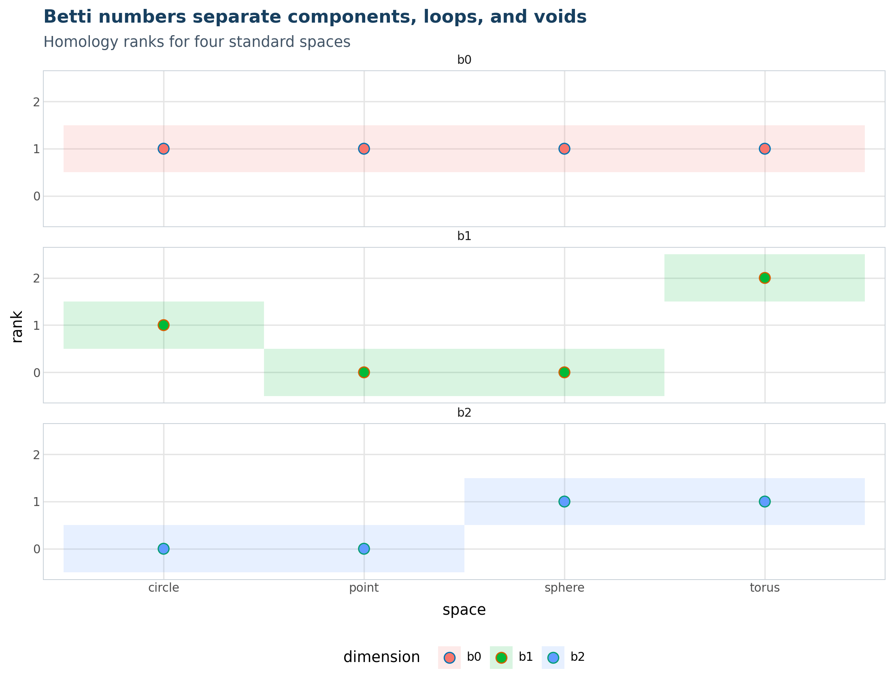

# Exact Sequences, Excision, and Duality {#sec-topology-exactness}

For the primary Atlas route, see [Manifold Duality](#/books/algebraic-topology-chains-spaces/manifold-duality).
This chapter provides a companion viewpoint with the hypotheses stated below.

Homology calculations become scalable when spaces are cut into pieces.
Exact sequences organize which classes extend, disappear, or arise at an
interface; excision justifies removing irrelevant interior material; duality
relates complementary dimensions in manifolds.

## Preparation from this book

Read Chapters 13–15. Appendix A reviews kernels and images. This chapter is a
structural overview; Chapter 24 supplies a chain-level calculation workshop and
Chapter 25 develops the coefficient algebra.

## Exactness

A sequence

$$
\cdots\to A_{k+1}\xrightarrow{f_{k+1}}A_k
\xrightarrow{f_k}A_{k-1}\to\cdots
$$

is exact at $A_k$ when
$\operatorname{im}f_{k+1}=\ker f_k$. Thus everything arriving becomes zero
next, and everything becoming zero came from the previous term.

A short exact sequence
$0\to A\to B\to C\to0$ says the first map embeds $A$, the second surjects onto
$C$, and $C$ is the quotient of $B$ by the copy of $A$. Over vector spaces it
splits, though not canonically; over general groups splitting can fail.

## Relative homology and long exact sequences

For $A\subseteq X$, relative chains are $C_*(X,A)=C_*(X)/C_*(A)$.
Their homology records features of $X$ while treating $A$ as collapsed or
already understood. The pair has a long exact sequence

$$
\cdots\to H_k(A)\to H_k(X)\to H_k(X,A)
\xrightarrow{\partial}H_{k-1}(A)\to\cdots.
$$

The connecting map takes a relative cycle, chooses a representative whose
boundary lies in $A$, and records that boundary class. Exactness can determine
unknown groups when neighboring groups and maps are known.

## Excision and Mayer–Vietoris

Excision says suitable material inside $A$ may be removed from both $X$ and
$A$ without changing relative homology. It turns local deformation into a
computational theorem.

If $X=U\cup V$ with interiors covering $X$, Mayer–Vietoris gives

$$
\cdots\to H_k(U\cap V)
\to H_k(U)\oplus H_k(V)
\to H_k(X)
\to H_{k-1}(U\cap V)\to\cdots.
$$

It computes a circle from two arcs whose intersection has two components, and
spheres by gluing hemispheres. The maps and exactness matter; substituting only
group ranks can miss torsion or nontrivial homomorphisms.

<figure id="fig-exactness-betti">


<figcaption>

Figure 16.1: Betti ranks across dimensions provide the finite-dimensional shadows that exact sequences constrain.

</figcaption>
</figure>

## Duality

For a closed connected orientable $n$-manifold, Poincaré duality gives

$$
H^k(M;R)\cong H_{n-k}(M;R)
$$

over suitable coefficients. A fundamental class represents the global
orientation, and cap product realizes the isomorphism. For nonorientable
manifolds, twisted coefficients or mod-two coefficients repair the statement.
Manifolds with boundary use Poincaré–Lefschetz duality.

Alexander duality relates the topology of a compact subset of a sphere to the
reduced homology of its complement. It explains why an embedded codimension-one
sphere separates.

**Nonexample.** Symmetric Betti numbers alone do not prove a space is a
manifold or that Poincaré duality applies. The theorem needs local manifold
structure, compactness, and coefficient-aware orientation conditions.

<!-- inline-formula-code:start -->
## Formula and finite computation

For vector spaces $A\xrightarrow{F}B\xrightarrow{G}C$, exactness at $B$
requires

$$
GF=0,\qquad
\operatorname{rank}F+\operatorname{rank}G=\dim B.
$$

```python
def rank_mod2(matrix: list[list[int]]) -> int:
    if not matrix:
        return 0
    rows = [[entry % 2 for entry in row] for row in matrix]
    width = len(rows[0])
    if any(len(row) != width for row in rows):
        raise ValueError("matrix must be rectangular")
    rank = 0
    for column in range(width):
        pivot = next((row for row in range(rank, len(rows)) if rows[row][column]), None)
        if pivot is None:
            continue
        rows[rank], rows[pivot] = rows[pivot], rows[rank]
        for row in range(rank + 1, len(rows)):
            if rows[row][column]:
                rows[row] = [a ^ b for a, b in zip(rows[row], rows[rank], strict=True)]
        rank += 1
    return rank

# F: F2 -> F2^2 sends 1 to (1, 0); G: F2^2 -> F2 selects the second coordinate.
f_matrix = [[1], [0]]
g_matrix = [[0, 1]]
composition = [[sum(g_matrix[0][k] * f_matrix[k][0] for k in range(2)) % 2]]
print(composition, rank_mod2(f_matrix) + rank_mod2(g_matrix) == 2)
```

**What the computation establishes.** The two finite rank tests certify
exactness at the middle vector space in this example. Exactness of topological
long sequences and duality require chain-level constructions and proofs.
<!-- inline-formula-code:end -->

## Summary

Exactness identifies what arrives with what vanishes. Relative homology and
excision localize calculations; Mayer–Vietoris glues information from a cover.
Poincaré and Alexander dualities relate complementary dimensions under precise
manifold and orientation hypotheses. Rank calculations are useful shadows of
these structural theorems.

## Exercises

<div class="exercise" id="topology-16-exact-sequences-duality-ex-1">
<p class="exercise-title"><strong>Exercise 1</strong></p>

Interpret exactness in a short exact sequence.

</div>

<div class="exercise" id="topology-16-exact-sequences-duality-ex-2">
<p class="exercise-title"><strong>Exercise 2</strong></p>

Verify the relative sequence for a disk and its boundary.

</div>

<div class="exercise" id="topology-16-exact-sequences-duality-ex-3">
<p class="exercise-title"><strong>Exercise 3</strong></p>

Use Mayer–Vietoris to compute homology of a circle from two arcs.

<details class="solution"><summary>Solution</summary>

For Exercise 3, each arc is contractible, while their intersection has two
components. Reduced Mayer–Vietoris shifts the one-dimensional reduced
homology of the circle to the zero-dimensional reduced homology of the
intersection, which has rank one. Thus $H_1(S^1)$ has rank one.

</details>

</div>

<div class="exercise" id="topology-16-exact-sequences-duality-ex-4">
<p class="exercise-title"><strong>Exercise 4</strong></p>

Outline the sphere calculation from two hemispheres.

</div>

<div class="exercise" id="topology-16-exact-sequences-duality-ex-5">
<p class="exercise-title"><strong>Exercise 5</strong></p>

Check Poincaré duality Betti numbers for an orientable surface.

</div>

<div class="exercise" id="topology-16-exact-sequences-duality-ex-6">
<p class="exercise-title"><strong>Exercise 6</strong></p>

Give a reason duality needs modified coefficients for nonorientable spaces.

</div>

### Selected solution

For Exercise 3, each arc is contractible, while their intersection has two
components. Reduced Mayer–Vietoris shifts the one-dimensional reduced
homology of the circle to the zero-dimensional reduced homology of the
intersection, which has rank one. Thus $H_1(S^1)$ has rank one.
