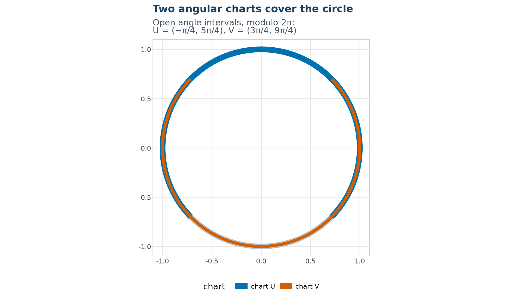

# Manifolds and Bundles {#sec-topology-manifolds}

For the primary Atlas route, see [Topological Manifolds and Surfaces](#/books/topology-proof-counterexample/topological-manifolds-and-local-euclidean-structure).
This chapter provides a companion viewpoint with the hypotheses stated below.

A manifold has Euclidean neighborhoods but may have global twists, holes, and
no single coordinate system. A bundle attaches a space of auxiliary data to
each point—tangent directions, vectors, lines, or group elements—and records
how local products twist globally.

## Preparation from this book

Chapters 5–9 supply homeomorphisms, products, quotients, compactness, and
separation. Chapters 14–16 are needed only for the orientation and
characteristic-class sections.

## Topological manifolds

An $n$-manifold is Hausdorff, second countable, and locally homeomorphic to
$\mathbb R^n$. A manifold with boundary uses the half-space
$\mathbb H^n=\{x_n\ge0\}$. The dimension is locally invariant: no open subset
of $\mathbb R^m$ is homeomorphic to one of $\mathbb R^n$ when $m\ne n$.

Charts $(U,\varphi)$ overlap through transition maps
$\psi\varphi^{-1}$. Requiring smooth transition maps produces a smooth
manifold; topology alone asks only for homeomorphisms.

<figure id="fig-topology-manifold-atlas">


<figcaption>

Figure 17.1: Two proper open angular arcs cover the circle; their exact ranges and overlap transitions are specified below.

</figcaption>
</figure>

For this atlas, write $q(\theta)=(\cos\theta,\sin\theta)$ and take

$$
\begin{gathered}
I_U=(-\pi/4,5\pi/4),\\
I_V=(3\pi/4,9\pi/4),\\
U=q(I_U),\qquad V=q(I_V).
\end{gathered}
$$

Both angle intervals are open and have length $3\pi/2<2\pi$.
The exponential parametrization restricts to a homeomorphism from each
interval onto its proper open arc: it is injective there, and its inverse
angle is continuous locally, using a rotated angular coordinate. These
inverse angles are the two chart coordinates.

Use representatives $0\le\theta<2\pi$ to check coverage, without identifying
the two chart coordinate ranges. The arc $U$ omits the closed angular
interval $[5\pi/4,7\pi/4]$; $V$ omits $[\pi/4,3\pi/4]$. These omitted
arcs are disjoint, so $U\cup V=S^1$. Every endpoint omitted by one chart
lies in the other chart. The overlap has two components. On
$q((3\pi/4,5\pi/4))$, the two inverse angles agree. On
$q((-\pi/4,\pi/4))$, the $V$ angle equals the $U$ angle plus $2\pi$.
Thus both transition maps are continuous, indeed smooth, on their overlap
components.

The figure draws increasing unwrapped angles inside $I_U$ and $I_V$.
Cosine and sine remain continuous when a parameter crosses $0$ or $2\pi$;
no path is joined across a missing angular interval. The finitely sampled
traces illustrate the stated open arcs; the coverage argument above concerns
all their points. Blue is drawn wider than orange so both chart memberships
remain visible on their overlaps.

Compact one-manifolds **without boundary** are disjoint unions of circles.
Allowing boundary also permits closed intervals. Connected compact
two-manifolds are classified by orientability and genus, developed in
[sec-topology-surfaces-knots](19-surfaces-knots.md#sec-topology-surfaces-knots).

## Orientation and local homology {#orientation-and-local-homology}

Orientation can be expressed through compatible chart signs or local homology
classes. A connected orientable closed $n$-manifold has a fundamental class in
$H_n(M;\mathbb Z)$. A Möbius band is locally an ordinary strip but reverses a
transverse direction around its core, so no consistent global orientation
exists.

Boundary points have half-space neighborhoods. The boundary of an
$n$-manifold with boundary is an $(n-1)$-manifold without boundary, and
“the boundary of a boundary is zero” appears both geometrically and in chain
complexes.

## Fiber bundles

A fiber bundle $p:E\to B$ with fiber $F$ is locally a product:

$$
p^{-1}(U)\cong U\times F,
$$

with the homeomorphism respecting projection to $U$. A covering space is a
bundle with discrete fiber. The cylinder is a trivial line bundle over a
circle; the Möbius band is locally the same product but globally twisted.

On overlaps, trivializations differ by transition functions
$g_{\alpha\beta}:U_\alpha\cap U_\beta\to G$ satisfying the cocycle relation

$$
g_{\alpha\beta}g_{\beta\gamma}=g_{\alpha\gamma}.
$$

A vector bundle has vector-space fibers and linear transition functions.
The tangent bundle $TM=\coprod_pT_pM$ is locally
$U\times\mathbb R^n$.

## Sections and obstructions

A section $s:B\to E$ chooses one fiber point over each base point with
$p\circ s=\operatorname{id}$. A nowhere-zero tangent section is a nonvanishing
vector field. The hairy-ball theorem says every continuous tangent vector field
on an even-dimensional sphere vanishes somewhere. This is a global
topological obstruction invisible in any single chart.

Characteristic classes assign cohomology classes measuring bundle twisting.
Stiefel–Whitney classes detect real-bundle phenomena, Chern classes complex
ones, and the Euler class controls zeroes of sections in oriented settings.
This chapter establishes their purpose rather than their full construction.

**Nonexample.** Local product charts do not prove a bundle is globally trivial.
The cylinder and Möbius band have the same local fiber model; their transition
around the circle differs by a sign.

<!-- inline-formula-code:start -->
## Formula and finite computation

For a finite triangulated closed surface,

$$
\chi=V-E+F.
$$

```python
def euler_characteristic(
    vertices: set[str],
    edges: set[frozenset[str]],
    faces: set[frozenset[str]],
) -> int:
    if any(len(edge) != 2 or not edge <= vertices for edge in edges):
        raise ValueError("invalid edge")
    if any(len(face) != 3 or not face <= vertices for face in faces):
        raise ValueError("invalid triangular face")
    return len(vertices) - len(edges) + len(faces)

# Boundary of a tetrahedron, a triangulated sphere.
vertices = set("abcd")
edges = {frozenset(edge) for edge in ("ab", "ac", "ad", "bc", "bd", "cd")}
faces = {frozenset(face) for face in ("abc", "abd", "acd", "bcd")}
print(euler_characteristic(vertices, edges, faces))
```

**What the computation establishes.** The tetrahedral sphere model has Euler
characteristic two. It does not prove invariance under triangulation, identify
every surface, or construct bundle characteristic classes.
<!-- inline-formula-code:end -->

## Summary

Manifolds are locally Euclidean, with countability and separation ensuring
usable global structure. Orientation joins chart compatibility to top homology.
Bundles are locally products glued by cocycles; sections reveal whether local
choices can be made globally. Characteristic classes measure obstructions that
finite chart inspection misses.

## Exercises

<div class="exercise" id="topology-17-manifolds-bundles-ex-1">
<p class="exercise-title"><strong>Exercise 1</strong></p>

Give a two-chart atlas for the circle.

</div>

<div class="exercise" id="topology-17-manifolds-bundles-ex-2">
<p class="exercise-title"><strong>Exercise 2</strong></p>

Explain why a figure-eight is not a one-manifold at its crossing.

</div>

<div class="exercise" id="topology-17-manifolds-bundles-ex-3">
<p class="exercise-title"><strong>Exercise 3</strong></p>

Describe boundary charts for a disk.

</div>

<div class="exercise" id="topology-17-manifolds-bundles-ex-4">
<p class="exercise-title"><strong>Exercise 4</strong></p>

Write transition functions for the cylinder and Möbius line bundles.

<details class="solution"><summary>Solution</summary>

For Exercise 4, cover the circle by overlapping arcs. The cylinder glues fiber
coordinates with multiplication by $+1$ on every overlap. The Möbius bundle
requires a transition with multiplication by $-1$ across one overlap, producing
the global twist.

</details>

</div>

<div class="exercise" id="topology-17-manifolds-bundles-ex-5">
<p class="exercise-title"><strong>Exercise 5</strong></p>

Compute Euler characteristics of tetrahedral sphere and triangulated disk.

</div>

<div class="exercise" id="topology-17-manifolds-bundles-ex-6">
<p class="exercise-title"><strong>Exercise 6</strong></p>

Explain how a covering is a bundle with discrete fiber.

</div>

### Selected solution

For Exercise 4, cover the circle by overlapping arcs. The cylinder glues fiber
coordinates with multiplication by $+1$ on every overlap. The Möbius bundle
requires a transition with multiplication by $-1$ across one overlap, producing
the global twist.
