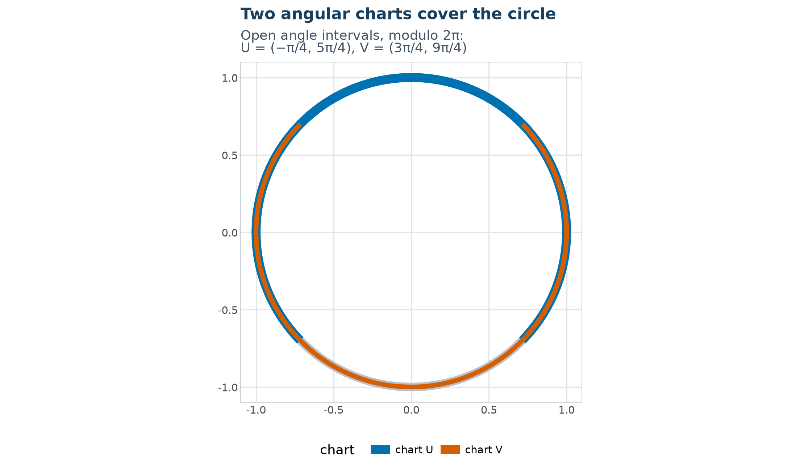

# Differential Forms and de Rham Cohomology {#sec-topology-derham}

For the primary Atlas route, see [Cohomology and Products](#/books/algebraic-topology-chains-spaces/cohomology-and-products).
This chapter provides a companion viewpoint with the hypotheses stated below.

Differential forms turn multivariable integration into a topological detector.
Closed forms have zero local derivative; exact forms come from potentials.
Their quotient measures global failure of local antiderivatives.

## Preparation from this book

Read Chapters 14–17 for cohomology, duality, manifolds, and orientation. The
coordinate differentiation and line-integration rules used here are reviewed
inside the examples; a full multivariable-calculus course is helpful but not
silently assumed.

## Forms and exterior derivative

A differential $k$-form assigns an alternating $k$-linear measurement to each
tangent space. Functions are zero-forms; one-forms integrate along curves; top
forms integrate over oriented manifolds.

The exterior derivative raises degree and satisfies

$$
\begin{gathered}
d(\alpha\wedge\beta)
\\
=d\alpha\wedge\beta+(-1)^{\deg\alpha}\alpha\wedge d\beta,
\\
d^2=0.
\end{gathered}
$$

A form is closed when $d\omega=0$ and exact when $\omega=d\eta$. Every exact
form is closed. For **positive degree $k>0$**, the Poincaré lemma says that
closed forms on an open ball are exact, though the converse can fail
globally. The degree restriction matters: closed zero-forms require separate
treatment below. See [Guillemin and Haine, *Differential Forms*, Definition
2.4.15 and Lemma 2.4.16, pages 55–56, and the discussion after Definition
2.6.16 on contractible open sets, page 64](https://math.mit.edu/classes/18.952/2019SP/18.952_book_2019.pdf).

On the punctured plane,

$$
\omega=\frac{-y\,dx+x\,dy}{x^2+y^2}
$$

is closed. Its integral around a positively oriented unit circle is $2\pi$, so
it cannot be exact: an exact one-form would integrate to zero around every
closed loop.

The period can be approximated from the parametrization
$(x(t),y(t))=(\cos t,\sin t)$. Pulling the form back replaces `dx` and `dy`
by the corresponding derivatives with respect to $t$.

```python
from math import cos, pi, sin

def angular_form_period(panels: int) -> float:
    """Approximate the angular one-form integral around the unit circle."""
    if panels <= 0:
        raise ValueError("panels must be positive")
    width = 2.0 * pi / panels
    total = 0.0
    for panel in range(panels):
        parameter = (panel + 0.5) * width
        x_coordinate = cos(parameter)
        y_coordinate = sin(parameter)
        x_derivative = -sin(parameter)
        y_derivative = cos(parameter)
        denominator = x_coordinate**2 + y_coordinate**2
        total += (
            -y_coordinate * x_derivative + x_coordinate * y_derivative
        ) / denominator
    return width * total

period = angular_form_period(256)
print(period, period - 2.0 * pi)
```

The pullback integrand is identically one up to roundoff, so the finite sum
recovers $2\pi$. Nonzero numerical circulation on a sampled curve alone would
not prove a continuum form closed or non-exact; those facts use differentiation
and Stokes' theorem.

## Stokes and cohomology

For a compact oriented manifold with boundary,

$$
\int_Md\omega=\int_{\partial M}\omega.
$$

This includes the Fundamental Theorem, Green, classical Stokes, and divergence
theorems. If $\omega=d\eta$ and $c$ is a cycle, Stokes gives
$\int_c\omega=0$.

For the ordinary de Rham complex, put $\Omega^{-1}(M)=0$. For $k\ge0$,
write $d_k$ for the exterior derivative in degree $k$. The incoming map
$d_{-1}:0\to\Omega^0(M)$ is zero. Define

$$
\begin{gathered}
d_k:\Omega^k(M)\longrightarrow\Omega^{k+1}(M),\\
Z^k=\ker d_k,\\
B^k=\operatorname{im}d_{k-1},\\
H_{\mathrm{dR}}^k(M)=Z^k/B^k.
\end{gathered}
$$

In degree zero, a closed form is a smooth function satisfying $df=0$.
On a coordinate ball,
$df=\sum_i(\partial f/\partial x_i)\,dx_i$, so every partial derivative
vanishes. The Fundamental Theorem of Calculus along line segments makes
$f$ constant on that ball. Thus closed zero-forms are locally constant,
and hence constant on each connected component; conversely, such functions
are closed.

There are no nonzero exact zero-forms because the incoming space
$\Omega^{-1}(M)$ is zero. Consequently $H_{\mathrm{dR}}^0(M)$ records an
independent real constant on each connected component. For finitely many
components, say $c$, it is $\mathbb R^c$. In particular, a nonzero constant
function is closed but not exact, even on a ball.

The de Rham theorem identifies these real vector spaces with singular
cohomology with real coefficients. Integration over cycles realizes the
pairing. This is a theorem connecting smooth and topological constructions,
not a definition by sampled integrals.

<figure id="fig-derham-atlas">


<figcaption>

Figure 18.1: The two open angular charts from Chapter 17 cover the circle; local forms must agree through pullback on both overlap components.

</figcaption>
</figure>

The exact arc ranges, omitted endpoints and continuous overlap transitions
are verified in [sec-topology-manifolds](17-manifolds-bundles.md#sec-topology-manifolds). The sampled drawing illustrates that
atlas rather than proving coverage by itself.

Partitions of unity combine local forms while respecting overlap data. They
exist on smooth manifolds because paracompactness follows from the standard
manifold hypotheses.

## Periods and topology

The integral of a closed form over a cycle depends only on the homology class of
the cycle and cohomology class of the form. These **periods** can detect holes.
On a torus, two independent closed one-forms measure the two fundamental
directions, and their wedge product represents area.

Hodge theory adds a Riemannian metric and identifies each cohomology class on a
compact oriented manifold with a unique harmonic representative. The
cohomology dimension remains topological, while the chosen harmonic form
depends on the metric.

**Nonexample.** A numerically small discrete curl does not make a sampled
one-form exact. Noise, mesh error, and an unresolved hole can all create or hide
periods.

<!-- inline-formula-code:start -->
## Formula and finite computation

For a vertex potential $\phi$ on an oriented closed edge loop,

$$
\sum_{[u,v]\text{ in loop}}\bigl(\phi(v)-\phi(u)\bigr)=0.
$$

```python
def exact_circulation(
    potential: dict[str, float], loop: list[tuple[str, str]]
) -> float:
    missing = {vertex for edge in loop for vertex in edge} - set(potential)
    if missing:
        raise ValueError(f"missing potential at {sorted(missing)}")
    return sum(potential[end] - potential[start] for start, end in loop)

potential = {"a": 0.0, "b": 2.0, "c": -1.0}
loop = [("a", "b"), ("b", "c"), ("c", "a")]
print(exact_circulation(potential, loop))
```

**What the computation establishes.** Telescoping gives zero for this finite
exact one-cochain. It does not prove the Poincaré lemma, de Rham theorem, or
exactness of a measured field on an underlying continuum.
<!-- inline-formula-code:end -->

## Summary

Exterior differentiation squares to zero, so exact forms are closed. Stokes
turns derivatives into boundary integrals. De Rham cohomology quotients closed
forms by exact ones, and the de Rham theorem connects smooth periods to
topological cohomology. Metrics choose harmonic representatives but do not
change cohomology dimensions.

## Exercises

<div class="exercise" id="topology-18-differential-forms-derham-ex-1">
<p class="exercise-title"><strong>Exercise 1</strong></p>

Compute $d(f\,dx+g\,dy)$.

</div>

<div class="exercise" id="topology-18-differential-forms-derham-ex-2">
<p class="exercise-title"><strong>Exercise 2</strong></p>

Verify $d^2f=0$ in coordinates.

</div>

<div class="exercise" id="topology-18-differential-forms-derham-ex-3">
<p class="exercise-title"><strong>Exercise 3</strong></p>

Integrate the angular form around a unit circle.

<details class="solution"><summary>Solution</summary>

For Exercise 3, parametrize by $(\cos t,\sin t)$. Then
$-y\,dx+x\,dy=(\sin^2t+\cos^2t)\,dt=dt$, and the denominator is one. The
integral from $0$ to $2\pi$ is $2\pi$.

</details>

</div>

<div class="exercise" id="topology-18-differential-forms-derham-ex-4">
<p class="exercise-title"><strong>Exercise 4</strong></p>

Use Stokes to show exact forms have zero periods.

</div>

<div class="exercise" id="topology-18-differential-forms-derham-ex-5">
<p class="exercise-title"><strong>Exercise 5</strong></p>

Find all de Rham cohomology groups of a nonempty contractible open ball,
including degree zero.

<details class="solution"><summary>Solution</summary>

For Exercise 5, closed zero-forms on the connected ball are constant and
the only exact zero-form is zero. Thus
$H_{\mathrm{dR}}^0(B)\cong\mathbb R$. The positive-degree Poincaré lemma
gives $H_{\mathrm{dR}}^k(B)=0$ for every $k>0$. Contractibility does not
make ordinary degree-zero cohomology vanish.

</details>

</div>

<div class="exercise" id="topology-18-differential-forms-derham-ex-6">
<p class="exercise-title"><strong>Exercise 6</strong></p>

Explain metric dependence and topological independence in Hodge theory.

</div>

<div class="exercise" id="topology-18-differential-forms-derham-ex-7">
<p class="exercise-title"><strong>Exercise 7</strong></p>

Let $B=\{(x,y):x^2+y^2<1\}$. For $f=7$, $g=x$, and
$\omega=x\,dy+y\,dx$, identify each form's degree and decide whether it is
closed and exact. Exhibit a primitive when one exists. Then compare
$H_{\mathrm{dR}}^0$ and the positive-degree groups for $B$ and
$B\sqcup B$, using coordinates $(x,y)$ on each disjoint copy.

<details class="solution"><summary>Solution</summary>

For Exercise 7, $f$ and $g$ are zero-forms. We have $df=0$, so $f=7$ is
closed, but it is not exact. Since $dg=dx\ne0$, $g=x$ is neither closed
nor exact. The one-form $\omega$ has primitive $xy$:
$d(xy)=y\,dx+x\,dy=\omega$. It is therefore exact and closed; directly,
$d\omega=dx\wedge dy+dy\wedge dx=0$.

On $B$, degree-zero cohomology is $\mathbb R$ and all positive-degree
groups vanish. On $B\sqcup B$, a closed zero-form may choose independent
constants on the two components, giving $\mathbb R^2$. Every closed
positive-degree form has a primitive on each ball. Those primitives combine
into a smooth form on the disjoint union because its components are open,
so the positive-degree groups again vanish.

</details>

</div>

### Selected solutions

For Exercise 3, parametrize by $(\cos t,\sin t)$. Then
$-y\,dx+x\,dy=(\sin^2t+\cos^2t)\,dt=dt$, and the denominator is one. The
integral from $0$ to $2\pi$ is $2\pi$.

For Exercise 5, closed zero-forms on the connected ball are constant and
the only exact zero-form is zero. Thus
$H_{\mathrm{dR}}^0(B)\cong\mathbb R$. The positive-degree Poincaré lemma
gives $H_{\mathrm{dR}}^k(B)=0$ for every $k>0$. Contractibility does not
make ordinary degree-zero cohomology vanish.

For Exercise 7, $f$ and $g$ are zero-forms. We have $df=0$, so $f=7$ is
closed, but it is not exact. Since $dg=dx\ne0$, $g=x$ is neither closed
nor exact. The one-form $\omega$ has primitive $xy$:
$d(xy)=y\,dx+x\,dy=\omega$. It is therefore exact and closed; directly,
$d\omega=dx\wedge dy+dy\wedge dx=0$.

On $B$, degree-zero cohomology is $\mathbb R$ and all positive-degree
groups vanish. On $B\sqcup B$, a closed zero-form may choose independent
constants on the two components, giving $\mathbb R^2$. Every closed
positive-degree form has a primitive on each ball. Those primitives combine
into a smooth form on the disjoint union because its components are open,
so the positive-degree groups again vanish.
