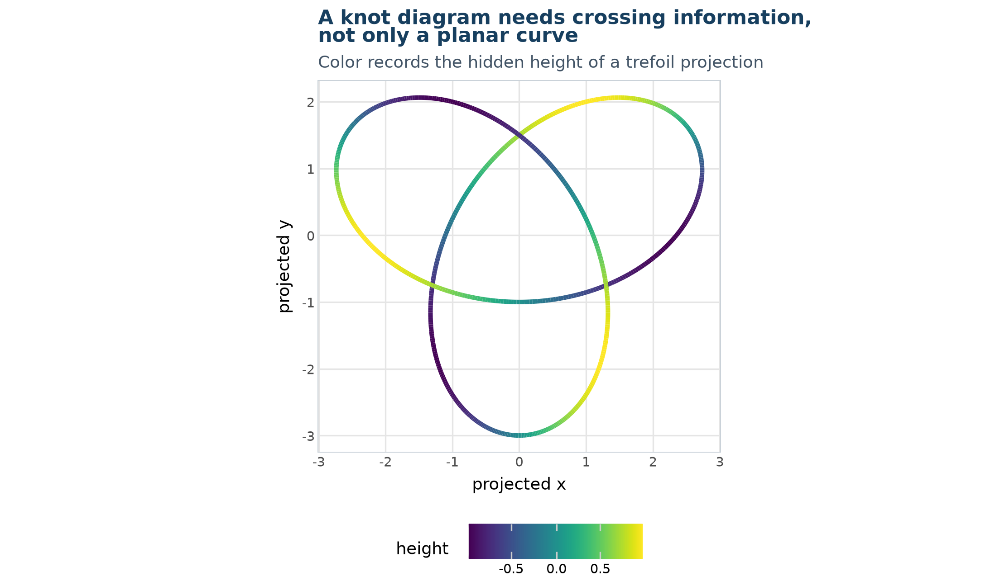

# Surfaces and Knots {#sec-topology-surfaces-knots}

For the primary Atlas route, see [Topological Manifolds and Surfaces](#/books/topology-proof-counterexample/topological-manifolds-and-local-euclidean-structure).
This chapter provides a companion viewpoint with the hypotheses stated below.

Low-dimensional topology is concrete enough to draw and subtle enough that
drawings mislead. Compact surfaces admit a complete classification; knots
already support an enormous range of inequivalent embeddings.

## Preparation from this book

Chapters 11, 14, and 17 supply the fundamental group, homology, manifolds, and
orientation. The chapter introduces knot-specific diagram language from
scratch. Surface classification, including its boundary case, the equivalence
of smooth and piecewise linear knot types, and Reidemeister's theorem are
imported results; the computations below do not prove them.

## Classification of compact surfaces

For nonempty connected **closed** surfaces, where closed means compact and without
boundary, the classification theorem gives exactly one of:

- an orientable surface of genus $g\ge0$, a sphere with $g$ handles; or
- a nonorientable surface with $k\ge1$ cross-caps, the connected sum of $k$
  projective planes.

A nonempty compact connected surface with $b\ge0$ boundary circles is instead
homeomorphic to one of these closed models with the **interiors** of $b$
pairwise disjoint embedded closed disks removed. The boundary circles of those
disks remain in the surface. This is the boundary form of the imported
classification theorem. Its usual capping description attaches one disk to
each boundary circle, classifies the closed surface, then removes the cap
interiors; the surface boundary and collar/triangulation facts used in that
step are also imported here. The classification by orientability, boundary
count and Euler characteristic, and the closed models, are given in
[Gallier and Xu, Theorem 6.2, page 97, and Section 6.4, page 98](https://www.cis.upenn.edu/~jean/surfclassif-root.pdf).

With $b$ boundary components, the Euler characteristics are

$$
\begin{gathered}
\chi_{\mathrm{or}}=2-2g-b,\\
\chi_{\mathrm{non}}=2-k-b.
\end{gathered}
$$

Polygon edge identifications encode surfaces. A square with opposite edges
identified in matching directions gives a torus; reversing one pair gives a
Klein bottle. Classification proof uses triangulation, edge moves, and normal
forms, not Euler characteristic alone. Orientability and the number of boundary
components must also be checked.

## Knots and ambient isotopy

In this chapter a **knot** is a smooth embedding of $S^1$ in $\mathbb R^3$.
Two knots are equivalent when a smooth ambient isotopy deforms all of space
carrying one to the other. The equivalent piecewise linear theory uses finite
polygonal embeddings. Arbitrary continuous embeddings can be wild and are
outside this chapter's scope.

A **regular diagram** is a generic planar projection with finitely many
transverse double crossings, no cusps or triple crossings, and over/under
information at every double crossing.

<figure id="fig-knot-projection">


<figcaption>

Figure 19.1: Height color supplies the crossing information missing from a plain planar trefoil projection.

</figcaption>
</figure>

Reidemeister's theorem says two regular diagrams represent equivalent knots
exactly when related by planar isotopy and a **finite sequence** of the three
types of local Reidemeister moves. The smooth/PL convention, diagram
requirements and theorem are stated in
[Ozsváth, Stipsicz and Szabó, Definition 2.1.1, Remark 2.1.3 and Theorem 2.1.4, pages 13–14](https://web.math.princeton.edu/~petero/GridHomologyBook.pdf).
Crossing number is minimized over all diagrams; the crossings in one drawing
are not automatically an invariant.

The knot complement carries strong information. Its fundamental group, with
peripheral data, distinguishes many knots. Polynomial invariants such as the
Alexander and Jones polynomials are computable but incomplete: different knots
can share them.

## Linking and surfaces

For two disjoint oriented closed curves, the linking number counts signed
crossings between components, halved under a standard diagram convention. It
is invariant under isotopy and equals an intersection number with a spanning
surface.

A **Seifert surface** is a compact, connected, oriented surface smoothly
embedded in $\mathbb R^3$ whose boundary is the knot. If the knot has a chosen
orientation, the surface's induced boundary orientation must agree. See
[Ozsváth, Stipsicz and Szabó, Definition 2.2.1, page 20](https://web.math.princeton.edu/~petero/GridHomologyBook.pdf).
The minimum genus among such surfaces is the knot's Seifert genus, an
invariant. This turns a three-dimensional embedding question into surface
topology plus algebra.

**Nonexample.** A projection with a transverse double point is not itself a
knot embedding in the plane; over/under data represents separation in the
third dimension. Ignoring it can turn distinct knots into the same curve.

<!-- inline-formula-code:start -->
## Formula and finite computation

For a connected orientable compact surface,

$$
g=\frac{2-b-\chi}{2}.
$$

```python
def orientable_genus(vertices: int, edges: int, faces: int, boundary: int = 0) -> int:
    if min(vertices, edges, faces, boundary) < 0:
        raise ValueError("cell and boundary counts must be nonnegative")
    euler = vertices - edges + faces
    numerator = 2 - boundary - euler
    if numerator < 0 or numerator % 2:
        raise ValueError("counts are incompatible with a connected orientable surface")
    return numerator // 2

print("tetrahedral sphere genus", orientable_genus(4, 6, 4))
print("one-cell torus genus", orientable_genus(1, 2, 1))
```

**What the computation establishes.** Given valid cell decompositions and the
orientability assumptions, the formula returns genera zero and one. Cell counts
alone do not prove a complex is a surface, connected, or orientable.
<!-- inline-formula-code:end -->

## Summary

Compact surfaces are classified by orientability, genus or cross-cap number,
and boundary. Knot equivalence uses ambient isotopy, diagrams, and Reidemeister
moves. Complement groups, polynomials, linking, and spanning surfaces provide
invariants, but a single computable invariant rarely gives complete
classification.

## Exercises

<div class="exercise" id="topology-19-surfaces-knots-ex-1">
<p class="exercise-title"><strong>Exercise 1</strong></p>

Compute Euler characteristics of sphere, torus, and double torus.

</div>

<div class="exercise" id="topology-19-surfaces-knots-ex-2">
<p class="exercise-title"><strong>Exercise 2</strong></p>

Decode the square edge words for torus and Klein bottle.

</div>

<div class="exercise" id="topology-19-surfaces-knots-ex-3">
<p class="exercise-title"><strong>Exercise 3</strong></p>

Explain why Euler characteristic does not distinguish those two surfaces.

<details class="solution"><summary>Solution</summary>

For Exercise 3, both torus and Klein bottle have one vertex, two edges, and one
face in standard cell structures, hence Euler characteristic zero. The torus is
orientable and the Klein bottle is not, so classification needs both invariants.

</details>

</div>

<div class="exercise" id="topology-19-surfaces-knots-ex-4">
<p class="exercise-title"><strong>Exercise 4</strong></p>

Apply Reidemeister I to show diagram crossing count is not invariant.

</div>

<div class="exercise" id="topology-19-surfaces-knots-ex-5">
<p class="exercise-title"><strong>Exercise 5</strong></p>

Compute linking number of a standard Hopf-link diagram.

</div>

<div class="exercise" id="topology-19-surfaces-knots-ex-6">
<p class="exercise-title"><strong>Exercise 6</strong></p>

State what must be validated before using the genus formula on a mesh.

</div>

<div class="exercise" id="topology-19-surfaces-knots-ex-7">
<p class="exercise-title"><strong>Exercise 7</strong></p>

**Keep the boundary circles.** For the closed disk $D^2$, the closed
annulus $S^1\times[0,1]$, and the torus $T^2$, identify the closed model
and number of disk interiors removed. Give orientability, genus $g$,
boundary count $b$, and Euler characteristic $\chi$. Why does the disk
require the boundary case of classification? Why do orientability and
Euler characteristic together still fail to distinguish the annulus and
torus?

<details class="solution"><summary>Solution</summary>

All three surfaces are orientable. The closed disk is a sphere with one disk
interior removed: its retained circle is its boundary, and
$(g,b,\chi)=(0,1,1)$. For example, remove an open hemisphere and retain the
opposite closed hemisphere. Thus a list restricted to closed surfaces would
miss the disk.

The closed annulus is a sphere with two disjoint disk interiors removed, so
$(g,b,\chi)=(0,2,0)$. The torus is the closed model with one handle and no
disks removed, so $(g,b,\chi)=(1,0,0)$.

The annulus and torus have the same orientability and Euler characteristic,
but two boundary circles versus none. The boundary count is part of the
classification data and prevents a homeomorphism. These examples use the
imported surface-classification theorem; their Euler arithmetic does not
prove that theorem or validate an arbitrary mesh as a surface.

</details>

<details class="hint"><summary>Hint 1</summary>

Removing a disk interior retains its boundary circle. First identify the genus
of the closed surface obtained by capping all boundary circles, then use the
formula containing $b$.

</details>

</div>

### Hint for Exercise 7 {#surface-boundary-hint}

Removing a disk interior retains its boundary circle. First identify the genus
of the closed surface obtained by capping all boundary circles, then use the
formula containing $b$.

### Selected solution

For Exercise 3, both torus and Klein bottle have one vertex, two edges, and one
face in standard cell structures, hence Euler characteristic zero. The torus is
orientable and the Klein bottle is not, so classification needs both invariants.

### Solution for Exercise 7 {#surface-boundary-answer}

All three surfaces are orientable. The closed disk is a sphere with one disk
interior removed: its retained circle is its boundary, and
$(g,b,\chi)=(0,1,1)$. For example, remove an open hemisphere and retain the
opposite closed hemisphere. Thus a list restricted to closed surfaces would
miss the disk.

The closed annulus is a sphere with two disjoint disk interiors removed, so
$(g,b,\chi)=(0,2,0)$. The torus is the closed model with one handle and no
disks removed, so $(g,b,\chi)=(1,0,0)$.

The annulus and torus have the same orientability and Euler characteristic,
but two boundary circles versus none. The boundary count is part of the
classification data and prevents a homeomorphism. These examples use the
imported surface-classification theorem; their Euler arithmetic does not
prove that theorem or validate an arbitrary mesh as a surface.
