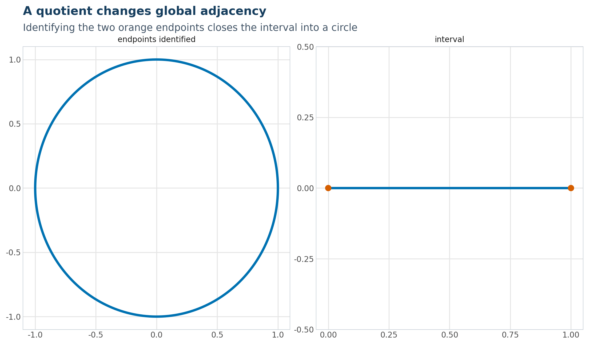

# Categories, Functors, and Universal Constructions {#sec-topology-categories}

For the primary Atlas route, see [The Functorial Bargain](#/books/algebraic-topology-chains-spaces/the-functorial-bargain).
This chapter provides a companion viewpoint with the hypotheses stated below.

Category theory records how objects relate through maps. In topology it explains
why products, quotients, homology, and fundamental groups recur with the same
formal patterns and why a construction is often determined by what maps into or
out of it.

## Preparation from this book

Chapter 1 supplies functions and composition; Chapters 6 and 14 provide the
product, quotient, and homology examples. No previous category theory is
assumed.

## Categories and morphisms

A category has objects, morphisms between objects, identity morphisms, and
associative composition:

$$
h\circ(g\circ f)=(h\circ g)\circ f.
$$

Top has topological spaces and continuous maps. Set has sets and functions.
Grp has groups and homomorphisms. An isomorphism is a morphism with a two-sided
inverse; in Top, isomorphisms are homeomorphisms.

A **functor** sends objects to objects and morphisms to morphisms while
preserving identities and composition. Homology is covariant:
$f:X\to Y$ gives $H_k(f):H_k(X)\to H_k(Y)$. Cohomology is contravariant and
reverses arrows.

A natural transformation gives compatible maps between two functors. Naturality
means the comparison commutes with every morphism, preventing choices that work
only object by object.

## Universal properties

A product $X\times Y$ comes with projections such that every pair of maps
$f:Z\to X$, $g:Z\to Y$ determines a unique map
$\langle f,g\rangle:Z\to X\times Y$. A coproduct has the dual mapping-out
property.

<figure id="fig-category-quotient">


<figcaption>

Figure 20.1: Endpoint identification is best characterized by the quotient's mapping property: class-constant maps factor uniquely through the circle.

</figcaption>
</figure>

A quotient is a coequalizer: it universally forces specified pairs of maps to
be equal. Universal properties determine objects uniquely up to unique
isomorphism and avoid dependence on a chosen construction.

## Adjunctions and equivalence

An adjunction is a natural correspondence

$$
\operatorname{Hom}_{\mathcal D}(F X,Y)
\cong
\operatorname{Hom}_{\mathcal C}(X,G Y).
$$

Free groups are left adjoint to forgetting group structure. In topology,
product with a space and a suitable mapping-space construction form an
adjunction under convenient hypotheses. Suspension and loop space form a
central homotopical adjunction.

Equivalence of categories is weaker than literal equality but preserves all
categorical structure. Homotopy categories formally identify homotopic maps;
modern higher categories retain the homotopies between maps rather than
discarding them.

**Nonexample.** A diagram that commutes for one selected object is not a natural
transformation. Naturality quantifies over every object and every relevant
morphism.

<!-- inline-formula-code:start -->
## Formula and finite computation

Function composition must satisfy

$$
h\circ(g\circ f)=(h\circ g)\circ f.
$$

```python
def compose(
    outer: dict[str, str], inner: dict[str, str]
) -> dict[str, str]:
    missing = set(inner.values()) - set(outer)
    if missing:
        raise ValueError(f"outer map is undefined at {sorted(missing)}")
    return {point: outer[value] for point, value in inner.items()}

f = {"a": "x", "b": "y"}
g = {"x": "u", "y": "v"}
h = {"u": "0", "v": "1"}
print(compose(h, compose(g, f)) == compose(compose(h, g), f))
```

**What the computation establishes.** Associativity holds for three declared
finite functions. General associativity follows because both sides send every
input $x$ to $h(g(f(x)))$; no finite enumeration proves a categorical theorem.
<!-- inline-formula-code:end -->

## Summary

Categories organize objects by structure-preserving maps. Functors transport
objects and morphisms, natural transformations compare functors uniformly, and
universal properties characterize products, coproducts, and quotients.
Adjunctions formalize paired constructions, while homotopical categories refine
what it means for maps to be equivalent.

## Exercises

<div class="exercise" id="topology-20-category-functors-ex-1">
<p class="exercise-title"><strong>Exercise 1</strong></p>

Verify identity laws for functions.

</div>

<div class="exercise" id="topology-20-category-functors-ex-2">
<p class="exercise-title"><strong>Exercise 2</strong></p>

Describe products in Set and Top by their universal properties.

</div>

<div class="exercise" id="topology-20-category-functors-ex-3">
<p class="exercise-title"><strong>Exercise 3</strong></p>

State the coproduct property by reversing arrows.

<details class="solution"><summary>Solution</summary>

For Exercise 3, a coproduct $X\amalg Y$ has inclusions from $X$ and $Y$ such
that any maps from those objects to $Z$ extend uniquely to one map from the
coproduct to $Z$. This is the product property with every arrow reversed.

</details>

</div>

<div class="exercise" id="topology-20-category-functors-ex-4">
<p class="exercise-title"><strong>Exercise 4</strong></p>

Show homology preserves identity and composition.

</div>

<div class="exercise" id="topology-20-category-functors-ex-5">
<p class="exercise-title"><strong>Exercise 5</strong></p>

Explain why cohomology reverses arrows.

</div>

<div class="exercise" id="topology-20-category-functors-ex-6">
<p class="exercise-title"><strong>Exercise 6</strong></p>

Give an objectwise family of maps that is not natural.

</div>

### Selected solution

For Exercise 3, a coproduct $X\amalg Y$ has inclusions from $X$ and $Y$ such
that any maps from those objects to $Z$ extend uniquely to one map from the
coproduct to $Z$. This is the product property with every arrow reversed.
