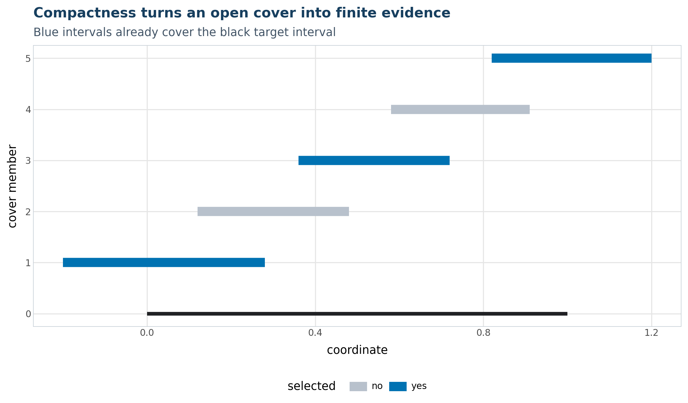

# Sheaves and Local-to-Global Reasoning {#sec-topology-sheaves}

For the primary Atlas route, see [Sheaf Cohomology and Local Systems](#/books/algebraic-topology-chains-spaces).
This chapter provides a companion viewpoint with the hypotheses stated below.

A manifold is described by compatible charts, a continuous function by
compatible local restrictions, and a differential-equation solution often by
local data that agree on overlaps. A sheaf isolates exactly when local
information determines a unique global object.

## Preparation from this book

Read Chapters 3–6 for open covers, restrictions, and gluing maps. Chapters
15, 17, and 20 motivate cohomology, charts, and functorial language, but the
sheaf axioms themselves are introduced here. The Čech calculation below uses
abelian groups and the kernel/image definition of cohomology from Chapter 15;
the general sheaf axioms still apply to sets.

## Presheaves

A presheaf $\mathcal F$ assigns to each open $U\subseteq X$ a set, group, ring,
or vector space $\mathcal F(U)$ of sections and to every inclusion
$V\subseteq U$ a restriction map

$$
\rho^U_V:\mathcal F(U)\to\mathcal F(V).
$$

Restrictions satisfy identity and composition. For group, ring, or vector-space
valued presheaves, they also preserve the stated algebraic structure.
Continuous real functions, smooth functions on a manifold, differential forms,
and solutions of a local homogeneous differential equation are examples.

## Locality and gluing

A presheaf is a sheaf when, for every open cover $U=\bigcup_iU_i$:

1. **locality:** sections agreeing after restriction to every $U_i$ are equal;
2. **gluing:** compatible sections $s_i\in\mathcal F(U_i)$ satisfying
   $s_i|_{U_i\cap U_j}=s_j|_{U_i\cap U_j}$ come from a section on $U$.

<figure id="fig-sheaf-cover">


<figcaption>

Figure 21.1: An open cover is not only a compactness object: overlaps are where local sections must be compared before gluing.

</figcaption>
</figure>

The assignment of bounded continuous functions is a presheaf but can fail the
sheaf gluing axiom: compatible locally bounded functions may glue to an
unbounded global function. The restriction on sections must itself be local.

## Stalks and germs

The stalk $\mathcal F_x$ is the collection of germs of sections near $x$:
two local sections define the same germ when they agree on some smaller
neighborhood. A sheaf morphism is an isomorphism exactly when it induces
isomorphisms on every stalk. Stalks detect local behavior but not by themselves
how local data glue globally.

Support needs a specified zero, as in a sheaf of abelian groups or modules.
For a section $s\in\mathcal F(U)$ of such a sheaf, its support in its domain is

$$
\begin{gathered}
\operatorname{supp}_U(s)\\
=\{x\in U:s_x\ne0_x\}.
\end{gathered}
$$

If $s_x=0_x$, then $s$ is zero on some neighborhood of $x$ in $U$. Thus the
zero-germ locus is open in $U$, and this support is already closed in $U$;
it need not be closed in $X$. See
[Stacks, Definition 17.5.1](https://stacks.math.columbia.edu/tag/01AT)
for the module formulation. A sheaf of sets needs additional zero sections
preserved by restrictions before this definition applies.

Skyscraper sheaves concentrate data at one point; locally constant sheaves
encode monodromy and connect to covering spaces.

## Čech data and cohomology

For the additive Čech construction, let $\mathcal F$ be an **abelian
presheaf**: each $\mathcal F(V)$ is an abelian group and restrictions are
group homomorphisms. Sheaves of modules also have this additive structure.
Fix a cover $\mathcal U=(U_i)$ of $U$, with a total ordering of its indices. In
the **ordered Čech complex**, a zero-cochain $s=(s_i)$ consists of sections
on the $U_i$, a one-cochain $d=(d_{ij})_{i<j}$ consists of sections on
pairwise intersections, and a two-cochain has sections on increasing triple
intersections. Write $U_{ij}=U_i\cap U_j$ and
$U_{ijk}=U_i\cap U_j\cap U_k$. The first two coboundary maps are

$$
\begin{gathered}
(\delta^0s)_{ij}\\
=s_j|_{U_{ij}}-s_i|_{U_{ij}},
\end{gathered}
$$

and, for $i<j<k$,

$$
\begin{gathered}
(\delta^1d)_{ijk}\\
=d_{jk}|_{U_{ijk}}-d_{ik}|_{U_{ijk}}\\
{}+d_{ij}|_{U_{ijk}}.
\end{gathered}
$$

In $\delta^1\delta^0s$, each restricted section appears once with each sign,
so $\delta^1\delta^0=0$. Thus the one-cocycles and one-coboundaries give
the cover's first Čech cohomology group:

$$
\begin{gathered}
Z^1=\ker\delta^1,\qquad B^1=\operatorname{im}\delta^0,\\
\check H^1(\mathcal U,\mathcal F)=Z^1/B^1.
\end{gathered}
$$

These are the ordered conventions in
[Stacks, Section 20.23 and Definition 20.23.2](https://stacks.math.columbia.edu/tag/01FG).
For a one-cocycle $c$, its class $[c]$ is zero precisely when
$c=\delta^0a$ for some zero-cochain $a$. A nonzero class therefore obstructs
solving this particular correction equation on this cover; an interpretation
as a geometric obstruction requires a problem encoded by that cocycle.

For given local sections $s_i$ of an **abelian sheaf**, their mismatch
$\delta^0s$ is always a coboundary and hence always represents the zero
class. Literal gluing of those original sections requires the stronger
condition $\delta^0s=0$ as a cochain. This is exactly agreement on overlaps;
the sheaf axioms then supply a unique section on $U$. Exercise 7 separates
these statements.

Ordinary derived-functor sheaf cohomology is defined for abelian sheaves
(or sheaves of modules); see
[Stacks, Section 20.2](https://stacks.math.columbia.edu/tag/01DZ).
Its construction and comparison with Čech cohomology are not used here.

**Nonexample.** Pairwise agreement on nonempty overlaps is not meaningful if
restrictions are compared in different coordinate or gauge conventions.
First transport both sections into the same sheaf representation.

<!-- inline-formula-code:start -->
## Formula and finite computation

Compatible finite local dictionaries satisfy

$$
s_i|_{U_i\cap U_j}=s_j|_{U_i\cap U_j}.
$$

```python
def glue_sections(sections: list[dict[str, float]]) -> dict[str, float]:
    glued: dict[str, float] = {}
    for section in sections:
        for point, value in section.items():
            if point in glued and glued[point] != value:
                raise ValueError(f"incompatible local values at {point}")
            glued[point] = value
    return glued

left = {"a": 1.0, "b": 2.0}
middle = {"b": 2.0, "c": 4.0}
right = {"c": 4.0, "d": 8.0}
print(glue_sections([left, middle, right]))
```

**What the computation establishes.** Exact equality on finite overlaps gives
a unique merged dictionary. Continuous, smooth, analytic, or equation-solving
sections require their own local validation, and sheaf cohomology is not
computed by this merge alone.
<!-- inline-formula-code:end -->

## Summary

Presheaves assign restrictable data to open sets. Sheaves add locality and
unique gluing. Stalks retain behavior arbitrarily near a point; support uses
zero germs and is relative to the section's domain. For abelian presheaves,
the ordered Čech group identifies cocycles modulo coboundaries. For an abelian sheaf,
literal gluing requires zero mismatch on overlaps, even though the class of a
given mismatch is always zero. The language unifies chart, function, equation,
and bundle data without assuming that every presheaf glues.

## Exercises

<div class="exercise" id="topology-21-sheaves-local-global-ex-1">
<p class="exercise-title"><strong>Exercise 1</strong></p>

Verify continuous functions form a sheaf.

</div>

<div class="exercise" id="topology-21-sheaves-local-global-ex-2">
<p class="exercise-title"><strong>Exercise 2</strong></p>

Show constant functions form a presheaf but not generally a sheaf.

<details class="solution"><summary>Solution</summary>

For Exercise 2, locally constant functions do form a sheaf, but globally
constant functions do not: on a disconnected union, choose different constants
on the two disjoint open components. Compatibility is vacuous, yet no single
global constant realizes both values.

</details>

</div>

<div class="exercise" id="topology-21-sheaves-local-global-ex-3">
<p class="exercise-title"><strong>Exercise 3</strong></p>

Describe the stalk of continuous functions at a real point.

</div>

<div class="exercise" id="topology-21-sheaves-local-global-ex-4">
<p class="exercise-title"><strong>Exercise 4</strong></p>

Glue three compatible polynomial restrictions on overlapping intervals.

</div>

<div class="exercise" id="topology-21-sheaves-local-global-ex-5">
<p class="exercise-title"><strong>Exercise 5</strong></p>

Construct incompatible local data and locate the failed overlap.

</div>

<div class="exercise" id="topology-21-sheaves-local-global-ex-6">
<p class="exercise-title"><strong>Exercise 6</strong></p>

Explain how a locally constant sheaf can record monodromy.

</div>

<div class="exercise" id="topology-21-sheaves-local-global-ex-7">
<p class="exercise-title"><strong>Exercise 7</strong></p>

**Separate a zero class from literal gluing.** Let
$\mathcal F(V)=C(V,\mathbb R)$ be continuous real functions, with
pointwise addition and ordinary restriction. Cover $U=(-2,3)$ by

$$
\begin{gathered}
U_0=(-2,1),\\
U_1=(-1,2),\\
U_2=(0,3).
\end{gathered}
$$

On these respective intervals take

$$
\begin{gathered}
s_0(x)=x,\\
s_1(x)=x+1,\\
s_2(x)=x+3.
\end{gathered}
$$

Use the order $0<1<2$. Find every pairwise and triple intersection,
compute $d=\delta^0s$ and $\delta^1d$, and decide whether the original
sections glue. What is $[d]\in\check H^1(\mathcal U,\mathcal F)$?
Find local constant corrections $a_i$ such that the sections $s_i-a_i$
glue, and identify their global function. Distinguish the cochain
identity from the use of the sheaf axioms.

<details class="solution"><summary>Solution</summary>

For Exercise 7, these section spaces are abelian groups and restriction is
additive. They form a sheaf: compatible continuous functions define a unique
function on their union by taking the given value on any member of the cover.
For every open $O\subseteq\mathbb R$, the inverse image of $O$ is the union
of the local inverse images, hence is open. This proves continuity and the
sheaf axiom directly, as in
[Stacks, Example 6.7.3](https://stacks.math.columbia.edu/tag/006S).

The three intervals have union $(-2,3)$, and their intersections are

$$
\begin{gathered}
U_{01}=(-1,1),\\
U_{02}=(0,1),\\
U_{12}=(0,2),\\
U_{012}=(0,1).
\end{gathered}
$$

On the respective pairwise intersections, subtraction gives the constant
sections

$$
\begin{gathered}
d_{01}=1,\\
d_{02}=3,\\
d_{12}=2.
\end{gathered}
$$

On $U_{012}$ their coboundary is

$$
(\delta^1d)_{012}=2-3+1=0.
$$

Thus $d$ is a one-cocycle. Nevertheless, $d\ne0$: on $U_{01}$ the original
sections differ by one, so no single function can restrict to both. They do
not glue literally. Since $d=\delta^0s$, it is already a one-coboundary,
and $[d]=0$ in this cover's Čech group. This identifies the class of this
particular cocycle, rather than computing the whole group.

Take the local constant sections

$$
a_0=0,\qquad a_1=1,\qquad a_2=3.
$$

Then $\delta^0a=d$, so the corrected sections $t_i=s_i-a_i$ all equal
$x$ on their domains. In particular,

$$
\delta^0t=\delta^0s-\delta^0a=0.
$$

The sheaf axioms now give their unique global section $t(x)=x$ on $(-2,3)$.
The subtraction and cocycle identities are explicit calculations for these
functions; the gluing step uses their sheaf property. The original nonzero
mismatch represents a zero class throughout this example.

</details>

</div>

### Hint for Exercise 7

Compare $d=\delta^0s$ with the separate condition $d=0$. To find
corrections, compare each local section with $s_0(x)=x$.

### Selected solutions

For Exercise 2, locally constant functions do form a sheaf, but globally
constant functions do not: on a disconnected union, choose different constants
on the two disjoint open components. Compatibility is vacuous, yet no single
global constant realizes both values.

For Exercise 7, these section spaces are abelian groups and restriction is
additive. They form a sheaf: compatible continuous functions define a unique
function on their union by taking the given value on any member of the cover.
For every open $O\subseteq\mathbb R$, the inverse image of $O$ is the union
of the local inverse images, hence is open. This proves continuity and the
sheaf axiom directly, as in
[Stacks, Example 6.7.3](https://stacks.math.columbia.edu/tag/006S).

The three intervals have union $(-2,3)$, and their intersections are

$$
\begin{gathered}
U_{01}=(-1,1),\\
U_{02}=(0,1),\\
U_{12}=(0,2),\\
U_{012}=(0,1).
\end{gathered}
$$

On the respective pairwise intersections, subtraction gives the constant
sections

$$
\begin{gathered}
d_{01}=1,\\
d_{02}=3,\\
d_{12}=2.
\end{gathered}
$$

On $U_{012}$ their coboundary is

$$
(\delta^1d)_{012}=2-3+1=0.
$$

Thus $d$ is a one-cocycle. Nevertheless, $d\ne0$: on $U_{01}$ the original
sections differ by one, so no single function can restrict to both. They do
not glue literally. Since $d=\delta^0s$, it is already a one-coboundary,
and $[d]=0$ in this cover's Čech group. This identifies the class of this
particular cocycle, rather than computing the whole group.

Take the local constant sections

$$
a_0=0,\qquad a_1=1,\qquad a_2=3.
$$

Then $\delta^0a=d$, so the corrected sections $t_i=s_i-a_i$ all equal
$x$ on their domains. In particular,

$$
\delta^0t=\delta^0s-\delta^0a=0.
$$

The sheaf axioms now give their unique global section $t(x)=x$ on $(-2,3)$.
The subtraction and cocycle identities are explicit calculations for these
functions; the gluing step uses their sheaf property. The original nonzero
mismatch represents a zero class throughout this example.
