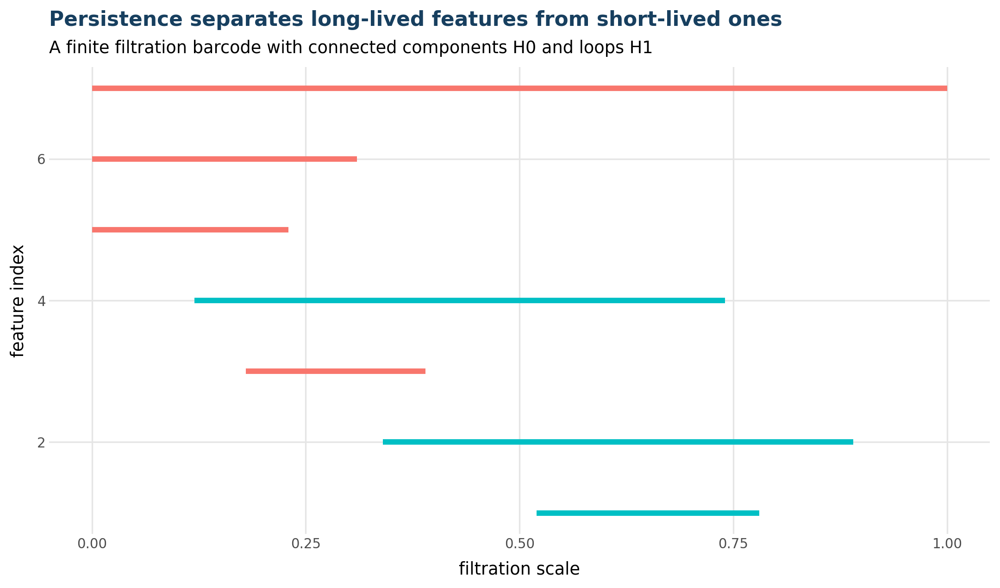

# Computational Topology and Persistence {#sec-topology-persistence}

For the primary Atlas route, see [Persistent Homology](#/books/algebraic-topology-chains-spaces/persistent-homology-and-computational-topology).
This chapter provides a companion viewpoint with the hypotheses stated below.

Data provide finitely many noisy samples, not a topological space with a known
atlas. Computational topology builds complexes across scales, computes
invariants, and tracks which features persist. The result is a controlled
summary of a model, not an automatic discovery of the source's true shape.

## Preparation from this book

Read Chapters 2, 13, and 14 for metrics, simplicial complexes, and boundary
matrices. Chapter 16 explains exactness, but it is not required for the
degree-zero algorithm.

## From points to filtrations

Given points in a metric space and scale $\varepsilon$, the Čech complex
includes a simplex when the radius-$\varepsilon$ balls around its vertices have
common intersection. The Vietoris–Rips complex includes a simplex when every
pair of vertices is within a chosen threshold. Rips complexes are easier to
build from distances and satisfy scale-shifted comparisons with Čech complexes
in Euclidean settings.

As scale increases, complexes nest:

$$
K_{\varepsilon_1}\subseteq K_{\varepsilon_2}
\quad\text{when }\varepsilon_1\le\varepsilon_2.
$$

Applying homology gives a persistence module: vector spaces connected by
linear maps. Over a field and under finite-type assumptions, it decomposes into
intervals. Each interval records a feature's birth and death.

<figure id="fig-persistence-barcode">


<figcaption>

Figure 22.1: A persistence barcode separates one long-lived component and two long-lived loops from shorter finite-scale features.

</figcaption>
</figure>

A barcode or persistence diagram records the same interval information.
Distance from the diagonal measures lifetime. A long bar may be meaningful,
but no universal lifetime threshold separates signal from noise.

## Boundary-matrix reduction

Order simplices compatibly with filtration and face relations. The boundary
matrix is reduced by adding earlier columns over a field until no two nonzero
columns have the same lowest nonzero row. A zero reduced column creates a
homology class; a later column whose pivot matches it kills that class.

The algorithm is exact for its finite complex and coefficient field. Runtime
and memory can grow rapidly because a Rips complex may contain exponentially
many simplices. Sparse representations, clearing, compression, and dimension
caps are practical necessities.

## Stability and inference

The stability theorem bounds bottleneck distance between persistence diagrams
of tame functions by the uniform difference between functions. Related results
control changes under metric perturbation. Stability means small input
perturbations cannot move the whole diagram arbitrarily far under stated
conditions; it does not say every persistent feature corresponds to a desired
scientific object.

Sampling theorems can recover homology of a manifold when reach, density, noise,
and scale conditions hold. Those conditions are assumptions to estimate or
justify. High dimension makes dense sampling expensive.

## Other constructions

Alpha complexes reduce Euclidean Čech computation through Delaunay geometry.
Cubical complexes suit image grids. Mapper constructs a graph from a filter
function, cover, and clustering choices. Discrete Morse theory reduces cells
while preserving homotopy type. Multiparameter persistence handles several
scales but lacks a complete interval barcode in general.

**Nonexample.** Building one Rips complex at one visually chosen threshold and
counting holes is not persistent homology. It hides scale sensitivity and
selection.

## Zero-dimensional persistence

In degree zero, components are born at vertices and die when an edge first
joins two previously separate components. Kruskal's minimum-spanning-forest
logic computes the finite death times.

<!-- inline-formula-code:start -->
## Formula and finite computation

For an interval $[b,d)$, persistence is

$$
\ell=d-b.
$$

Degree-zero death times arise from union operations in increasing edge order:

```python
def component_deaths(
    vertex_count: int, weighted_edges: list[tuple[float, int, int]]
) -> list[float]:
    from math import isfinite

    if vertex_count <= 0:
        raise ValueError("vertex_count must be positive")
    if any(
        not isfinite(scale)
        or scale < 0.0
        or not 0 <= left < vertex_count
        or not 0 <= right < vertex_count
        for scale, left, right in weighted_edges
    ):
        raise ValueError("edges need finite nonnegative scales and valid endpoints")
    parent = list(range(vertex_count))

    def find(vertex: int) -> int:
        if not 0 <= vertex < vertex_count:
            raise ValueError("edge endpoint is outside the vertex range")
        while parent[vertex] != vertex:
            parent[vertex] = parent[parent[vertex]]
            vertex = parent[vertex]
        return vertex

    deaths: list[float] = []
    for scale, left, right in sorted(weighted_edges):
        root_left, root_right = find(left), find(right)
        if root_left != root_right:
            parent[root_right] = root_left
            deaths.append(scale)
    return deaths

edges = [(0.2, 0, 1), (0.35, 1, 2), (0.5, 0, 2), (0.9, 2, 3)]
print(component_deaths(4, edges))
```

**What the computation establishes.** Three merges give exact finite
zero-dimensional death scales for the declared weighted graph; one component
persists forever. It does not compute higher homology or prove the graph
recovers the topology of an unsampled source.
<!-- inline-formula-code:end -->

## Reproducible workflow

Record metric, preprocessing, filtration, coefficient field, maximum dimension,
scale grid, and software version. Vary scientifically plausible choices and
report feature stability. Compare to null or resampled data when interpreting
features statistically. Keep computational precision separate from sampling
uncertainty and model mismatch.

## Summary

Complex filtrations turn multiscale data into persistence modules. Boundary
reduction pairs births and deaths; degree-zero persistence reduces to component
merges. Stability controls perturbations under hypotheses, while sampling
theorems connect finite complexes to spaces only with geometric conditions.
Reproducibility requires reporting every modeling and algorithmic choice.

## Exercises

<div class="exercise" id="topology-22-computational-persistence-ex-1">
<p class="exercise-title"><strong>Exercise 1</strong></p>

Build Rips complexes for four points at three thresholds.

</div>

<div class="exercise" id="topology-22-computational-persistence-ex-2">
<p class="exercise-title"><strong>Exercise 2</strong></p>

Compare Čech and Rips simplex rules.

</div>

<div class="exercise" id="topology-22-computational-persistence-ex-3">
<p class="exercise-title"><strong>Exercise 3</strong></p>

Reduce the boundary matrix of a triangle filtration over two elements.

</div>

<div class="exercise" id="topology-22-computational-persistence-ex-4">
<p class="exercise-title"><strong>Exercise 4</strong></p>

Compute degree-zero deaths from a weighted tree.

<details class="solution"><summary>Solution</summary>

For Exercise 4, process tree edges from smallest to largest weight. Every edge
joins two previously separate components, so each edge weight is a finite death
time. One component remains unpaired and represents the final connected
component.

</details>

</div>

<div class="exercise" id="topology-22-computational-persistence-ex-5">
<p class="exercise-title"><strong>Exercise 5</strong></p>

Explain coefficient-field dependence.

</div>

<div class="exercise" id="topology-22-computational-persistence-ex-6">
<p class="exercise-title"><strong>Exercise 6</strong></p>

Design a sensitivity analysis for metric and scale choices.

</div>

### Selected solution

For Exercise 4, process tree edges from smallest to largest weight. Every edge
joins two previously separate components, so each edge weight is a finite death
time. One component remains unpaired and represents the final connected
component.

## Track inclusion maps, not only Betti numbers {#sec-topology-persistence-maps}

A Betti number gives the dimension of a homology group at one stage. It does
not say which earlier class reaches which later class. The following finite
calculation makes that distinction using only the chain and quotient
definitions from Chapters 13 and 14. No exact sequence or reconstruction
theorem is needed.

**Conventions for this supplement.** Use ordinary, unreduced simplicial
homology over the fixed field $\mathbb F_2$. A symbol such as $012$ denotes a
filled two-simplex together with all its faces. The complexes below are
assigned abstract simplicial complexes, not Rips complexes: three edges do
not force us to insert their triangular face. No other positive-dimensional
simplices are present.

The complex is empty for $t<0$. The stage labeled $i$ is present for
$i\le t<i+1$, and the final stage is held constant for every $t\ge2$ unless a
different continuation is explicitly requested. A simplex is already present
at its assigned time. Intervals are $[b,d)$: a class with death $d$ is absent
at $d$. An endpoint $\infty$ refers to this declared constant future, not to
unobserved data.

### Fix the chain and quotient bases {#sec-topology-persistence-chain-bases}

Use vertex order $(0,1,2,3,4)$ and write $v_i$ for its zero-chain. Set
$e_{ij}=[i,j]$ for $i<j$. The full edge order used throughout is

$$
E=(e_{01},e_{12},e_{02},e_{03},e_{34},e_{04}).
$$

Before $e_{04}$ is present, omit its last coordinate; inclusion puts a zero
in that coordinate. Every matrix column below is the image of a domain-basis
vector, with coordinates in the stated target basis. Over $\mathbb F_2$,

$$
\partial_1 e_{ij}=v_i+v_j.
$$

Thus the full edge-to-vertex boundary matrix is

$$
D_1=
\begin{pmatrix}
1&0&1&1&0&1\\
1&1&0&0&0&0\\
0&1&1&0&0&0\\
0&0&0&1&1&0\\
0&0&0&0&1&1
\end{pmatrix}.
$$

Its first five columns give the initial boundary matrix. In both matrices,
the four columns for $01,12,03,34$ are independent: successively use the leaf
vertices $2,1,4,3$ to force every coefficient in a zero combination to vanish.
Their edges form a tree through all five vertices. The sum of all five rows
is zero, so the rank is at most four. Consequently both boundary matrices
have rank exactly four, and both graphs are connected.

Define the cycles

$$
a=e_{01}+e_{12}+e_{02},
\qquad
b=e_{03}+e_{34}+e_{04}.
$$

For a cycle with full edge coordinates $(c_1,\ldots,c_6)$, the rows for
vertices $1,2,3,4$ give
$c_1=c_2=c_3=u$ and $c_4=c_5=c_6=v$. The row for vertex $0$ is then
automatically satisfied. Hence every full-graph cycle is uniquely $ua+vb$.
Initially $c_6=0$, so $v=0$ and the cycle space is just
$\operatorname{span}(a)$. After edge $04$ is added, it is
$\operatorname{span}(a,b)$. The two vectors are independent because their
edge supports are disjoint.

Write $A=012$ and $B=034$ for the two possible faces. Their boundaries are
$\partial_2 A=a$ and $\partial_2 B=b$. When both faces are present, their
boundary matrix, in face order $(A,B)$ and edge order $E$, is

$$
D_2=
\begin{pmatrix}
1&0\\
1&0\\
1&0\\
0&1\\
0&1\\
0&1
\end{pmatrix}.
$$

Keep only the column for a face actually present; with no faces, $C_2=0$.
The displayed columns are independent. Therefore $H_2=0$ with zero, one or
both of these faces, and all higher homology vanishes.

Always distinguish cycles from their classes:
$H_1=Z_1/B_1$, where $B_1=\operatorname{im}\partial_2$. Inclusion carries a
chain to the same chain with any new coordinates zero. It commutes with
boundary and carries old boundaries to later boundaries, so the induced map

$$
[z]\longmapsto[z]
$$

is well defined between the two quotient spaces. The representative chain
may be unchanged even when its later class is zero.

### Worked comparison: an old loop survives or is replaced {#sec-topology-persistence-survive-replace}

At time $0$, include all five vertices and exactly the five edges
$01,12,02,03,34$, with no faces. Compare two filtrations:

| Time | Filtration $S$ | Filtration $T$ |
| --- | --- | --- |
| $0$ | The common initial complex | The same initial complex |
| $1$ | Add edge $04$ and face $B=034$ | Add edge $04$ and face $A=012$ |
| $2$ | Add face $A=012$ | Add face $B=034$ |

Every face has all its edges when it enters. The two final complexes agree.
Their simplex counts at successive stages are
$(n_0,n_1,n_2)=(5,5,0),(5,6,1),(5,6,2)$. The ranks of
$(\partial_1,\partial_2)$ are respectively $(4,0),(4,1),(4,2)$, so both have
Betti vectors

$$
(\beta_0,\beta_1,\beta_2)
=(1,1,0),\ (1,1,0),\ (1,0,0).
$$

Now calculate the maps, rather than matching those dimensions.

- At stage $0$, $Z_1=\operatorname{span}(a)$ and $B_1=0$, with quotient
  basis $([a])$.
- At stage $1$ of $S$, $Z_1=\operatorname{span}(a,b)$ and
  $B_1=\operatorname{span}(b)$. Use quotient basis $([a])$:
  $[ua+vb]=u[a]$. Inclusion therefore sends the old $[a]$ to the nonzero
  target $[a]$; its matrix is $(1)$ and its rank is one.
- At stage $1$ of $T$, the same cycle space is quotiented by
  $B_1=\operatorname{span}(a)$. Use basis $([b])$:
  $[ua+vb]=v[b]$. Inclusion sends the old $[a]$ to zero; its matrix is
  $(0)$ and its rank is zero. The nonzero target class $[b]$ is new.
- At stage $2$ of either filtration,
  $B_1=\operatorname{span}(a,b)=Z_1$, so the target group is zero. Both
  maps into it, and both composites from stage $0$ to stage $2$, are zero.

The loop in $S$ lasts from $0$ to $2$. In $T$, one loop dies at $1$ and a
different one is born there. Directly from the displayed generators, the
$H_1$ interval lists are

$$
S:\ \{[0,2)\},
\qquad
T:\ \{[0,1),[1,2)\}.
$$

Each has ordinary $H_0:\{[0,\infty)\}$ and no $H_2$ intervals. Thus the
initial complex, final complex, simplex counts and every Betti snapshot can
agree while persistence differs. A change of quotient basis cannot repair
the difference: the rank of a linear map is unchanged by invertible changes
of its source and target bases.

In $S$, the new edge $04$ and its filling face $B$ enter at the same real
parameter. An internal face-compatible simplex ordering may place the edge
first, but the face is already present at $t=1$. A bookkeeping pair $(1,1)$
therefore represents $[1,1)=\varnothing$, not a class supported on the
singleton $\{1\}$. The nonzero intervals above concern the declared grouped
times, not an invented extra stage between tied simplices.

## Changed task: neighboring ranks still hide a composite {#sec-topology-persistence-composite-task}

Keep the initial complex, edge order, coefficients and time convention above.
At time $1$ add **only edge $04$**. At time $2$ add **only face $A=012$**,
and hold that stage constant thereafter.

1. Compute the simplex counts and $(\beta_0,\beta_1,\beta_2)$ at stages
   $0,1,2$. State cycle, boundary and quotient bases.
2. Compute both adjacent $H_1$ maps as matrices and the composite
   $H_1(K_0)\to H_1(K_2)$. Give their ranks and both the $H_1$ and ordinary
   $H_0$ interval lists.
3. Change only the face inserted at $2$ from $A$ to $B$. Repeat the map and
   interval calculations. Which dimensions and adjacent ranks remain equal?
   Which basis-independent composite rank distinguishes the filtrations?
4. Suppose stages through $2$ are observations and **no future extension**
   has been specified. Do they show that the remaining $H_1$ class never
   dies? Give a concrete continuation with the same observations and a
   different right endpoint. Explain separately why at least one ordinary
   component class remains nonzero in an increasing nonempty filtration.

### Hint before the complete key {#sec-topology-persistence-composite-hint}

At time $1$ use the ordered basis $([a],[b])$. An inclusion does not swap
these chains. Decide which one becomes a boundary at time $2$, then multiply
the two adjacent matrices. For the finite-window question, try adding the
missing face at time $3$.

The [complete key and descriptive rubric](app-c-solutions.md#sec-topology-persistence-composite-solution)
are separate from the task. Preserve a first attempt before consulting them;
a successful self-comparison is not an independently marked proof.

### What this finite comparison does not establish {#sec-topology-persistence-map-limits}

The calculation is exact for the assigned complexes and the fixed field.
It neither proves the general interval-decomposition theorem nor determines
integral torsion, an unknown point cloud's topology, a sampling guarantee or
a universal signal/noise threshold. In particular, edge adjacency here is
not permission to replace the assigned complex by a Rips complex.

The earlier barcode illustration is schematic, not a barcode computed from
either assigned filtration here. Its finite drawing window must be
distinguished from a mathematical death convention. A plain drawn endpoint
alone should not be used to infer that every ordinary component class has
died. The interval lists in this supplement instead use the future extension
stated explicitly above.
