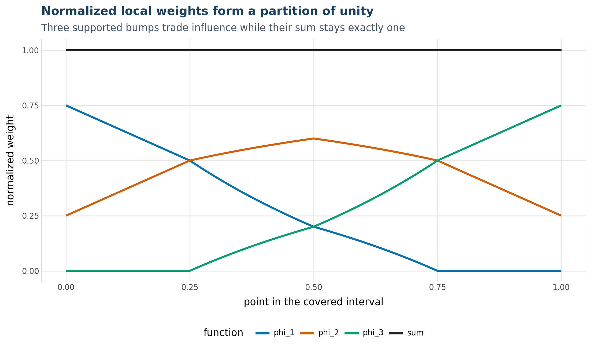

# Paracompactness, Partitions of Unity, and Dimension {#sec-topology-paracompactness-dimension}

For the primary Atlas route, see [Paracompactness, Partitions and Refinements](#/books/topology-proof-counterexample/paracompactness-partitions-and-refinements).
This chapter provides a companion viewpoint with the hypotheses stated below.

Compactness extracts finitely many sets from one cover. Paracompactness takes
a different route: it replaces an arbitrary cover by a locally finite cover,
so calculations remain finite near each point even when the whole space is not
compact. That local finiteness powers partitions of unity, metrization,
integration on manifolds, and one useful definition of topological dimension.
The route follows the point-set and manifold foundations in
([Munkres 2000](bibliography.md#ref-munkres2000topology); [Lee 2011](bibliography.md#ref-lee2011topological)).

## Preparation from this book

Read Chapters 4, 6, 8, and 9 for bases, refinements, compactness, and separation.
Chapter 17 explains why manifolds need globally compatible local constructions.
The finite Python model below uses only lists, functions, and arithmetic from
the concise toolkit.

## Refinements and local finiteness

A cover $\mathcal V$ **refines** a cover $\mathcal U$ when every
$V\in\mathcal V$ lies in at least one member of $\mathcal U$. Refinement does
not mean choosing a subcover: the new sets may be smaller and more numerous.
A family $\mathcal V$ is **locally finite** if every point has a neighborhood
meeting only finitely many members of $\mathcal V$.

A Hausdorff space is called **paracompact** when every open cover has a locally
finite open refinement. Some authors build Hausdorffness into the definition
and some state it separately; this book always states it. Compact Hausdorff
spaces are paracompact because a finite subcover is already locally finite.
Every metric space is paracompact, a theorem whose proof chooses balls at
successively finer scales and organizes them into locally finite layers.

Local finiteness is stronger than point-finiteness. Point-finiteness says each
point belongs to finitely many sets. Local finiteness asks for a whole
neighborhood meeting only finitely many sets. For example, the intervals

$$
U_n=\left(\frac{1}{n+1},\frac{1}{n-1}\right),\qquad n\ge2,
$$

form a point-finite family on $\mathbb R$: zero belongs to none. Yet every
neighborhood of zero meets infinitely many $U_n$, so the family is not locally
finite. This distinction matters because a pointwise finite sum of continuous
functions need not be continuous unless the same finite list works nearby.

**Lemma 23.1 (Locally finite closed-union).** If $\{F_i\}$ is a locally finite family
of closed subsets, then $\bigcup_iF_i$ is closed. If a point $x$ is outside the
union, choose a neighborhood $N$ meeting only
$F_{i_1},\ldots,F_{i_r}$. Removing those finitely many closed sets from $N$
leaves an open neighborhood of $x$ disjoint from the entire union. The proof
shows exactly where local finiteness, rather than point-finiteness, is used.

## Partitions of unity

A **partition of unity subordinate to** an open cover $\{U_i\}_{i\in I}$ is a
family of continuous functions $\phi_i:X\to[0,1]$ such that

$$
\begin{gathered}
\operatorname{supp}(\phi_i)\subseteq U_i,
\\
\{\operatorname{supp}(\phi_i)\}_{i\in I}
\\
\text{is locally finite},
\\
\sum_{i\in I}\phi_i(x)=1.
\end{gathered}
$$

Here $\operatorname{supp}(\phi)$ is the closure of the set where $\phi$ is
nonzero. The sum is meaningful and continuous because only finitely many terms
are nonzero near any chosen point. A paracompact Hausdorff space admits a
partition of unity subordinate to every open cover. The proof first obtains a
locally finite shrinking of the cover, uses normality to build bump functions,
and normalizes their sum.

The normalization step is elementary but important. If nonnegative continuous
functions $\psi_i$ have locally finite supports and their sum is positive
everywhere, then

$$
\phi_i(x)=\frac{\psi_i(x)}{\sum_j\psi_j(x)}
$$

defines a partition of unity. The denominator is a locally finite continuous
sum and never vanishes. The difficult topological work lies in constructing
the $\psi_i$ with controlled support, not in dividing them.

At one point only finitely many locally finite weights are active, so the
normalization is an ordinary finite division. Zero total weight is rejected
because it is exactly the failure of the “positive everywhere” hypothesis.

```python
from math import fsum, isfinite

def normalize_partition_weights(raw_weights: list[float]) -> list[float]:
    """Normalize one finite collection of nonnegative local bump values."""
    if not raw_weights or any(
        not isfinite(weight) or weight < 0.0 for weight in raw_weights
    ):
        raise ValueError("weights must be a nonempty finite nonnegative list")
    total = fsum(raw_weights)
    if total <= 0.0:
        raise ValueError("at least one local function must be positive")
    return [weight / total for weight in raw_weights]

weights = normalize_partition_weights([0.2, 0.8, 0.0])
print(weights, fsum(weights))
```

The values are nonnegative and sum to one at the declared point. This local
calculation does not construct continuous bump functions, prove support
containment, or establish paracompactness.

Partitions of unity blend local objects. If $s_i$ are local vector-valued
functions, then $s=\sum_i\phi_i s_i$ is global whenever the operations make
sense. They construct Riemannian metrics from chartwise Euclidean metrics,
define integration by reducing to coordinates, and extend local differential
forms. They cannot average objects in a set without an addition operation;
one cannot generally blend local homeomorphisms by a weighted sum.

<figure id="fig-topology-partition-unity">


<figcaption>

Figure 23.1: Three normalized bump functions add to one while each remains concentrated in its assigned interval.

</figcaption>
</figure>

The figure shows a finite numerical partition on an interval. A plotted grid
does not prove support containment or continuity on every point; those follow
from the explicit piecewise-linear formulas.

## Covering dimension

The **order** of a cover $\mathcal V$ is at most $n+1$ when no point belongs to
more than $n+1$ members. For a normal space, the Lebesgue covering dimension
satisfies $\dim X\le n$ when every finite open cover has a finite open
refinement of order at most $n+1$. The least such $n$ is the dimension; if none
exists, the dimension is infinite.

This convention makes a discrete space zero-dimensional: refine a finite cover
by pairwise disjoint singletons or clopen pieces. A graph realization is
typically one-dimensional, a surface two-dimensional, and
$\mathbb R^n$ has dimension $n$. The upper bound for a triangulated
$n$-complex can be built from carefully colored neighborhoods in a subdivision.
The lower bound for $\mathbb R^n$ is much deeper and is related to invariance
of domain: Euclidean dimension cannot be lowered by a homeomorphism.

Cover order translates into the **nerve**. The nerve $N(\mathcal U)$ has one
vertex per cover member and a simplex for every finite subfamily with nonempty
intersection. If no point lies in more than $n+1$ sets, the nerve has dimension
at most $n$. A partition of unity gives the canonical map

$$
x\longmapsto \sum_i\phi_i(x)v_i
$$

from $X$ to the geometric realization of the nerve. The nonzero weights at
$x$ correspond to cover members containing $x$, hence to a simplex. Under a
good-cover hypothesis—every nonempty finite intersection is contractible—the
nerve theorem says this map captures the homotopy type of $X$.

Dimension behaves differently from cardinality. The interval and square both
have continuum many points, yet have covering dimensions one and two.
The **finite-polyhedron dimension theorem** says that if a finite simplicial
complex triangulates a space $P$, then the covering dimension of $P$ equals
the largest dimension of its simplices. This is an imported theorem, not a
consequence of counting intersections in one cover; see
[Schultz, *Notes on Topological Dimension Theory*, Theorem 7(ii), page 7](https://math.ucr.edu/~res/miscpapers/top-dimension-theory.pdf).
A triangulation realizes $P$ by a homeomorphism. A cover's nerve instead
records overlap data and need not be a triangulation of the covered space,
even when it has the same homotopy type. Its dimension can be larger.

### Worked task: one interval, two nerves

**Task.** In $X=[0,1]$, consider the relative-open cover

$$
\begin{gathered}
U_1=[0,4/5),\\
U_2=(1/10,9/10),\\
U_3=(1/5,1].
\end{gathered}
$$

Find its order and nerve. Then check that the following cover refines it and
compare the new order and nerve:

$$
\begin{gathered}
V_1=[0,1/2),\\
V_2=(2/5,1].
\end{gathered}
$$

Do either of these two cover calculations alone prove $\dim X=1$?

**Answer.** All sets are open in $X$'s relative topology; for example,
$U_1=X\cap(-1,4/5)$ and $V_1=X\cap(-1,1/2)$. The triple intersection is
$(1/5,4/5)$, so all three vertices, all edges, and the two-simplex belong to
$N(\mathcal U)$. The nerve is a **filled** triangle of dimension two. This
cover has order three: a point in the triple intersection belongs to all
three sets.

The two $V_i$ cover $X$, with $V_1\subseteq U_1$ and
$V_2\subseteq U_3$. Their intersection is $(2/5,1/2)$, so this is an
order-two refinement and its nerve is one edge of dimension one. This
matches the convention that order at most $n+1$ gives nerve dimension at
most $n$.

The interval, the filled triangle, and the edge are all contractible, so
homotopy equivalence does not distinguish their dimensions. In particular,
the filled-triangle nerve is not a triangulation of the interval.
Independently, $[0,1]$ has its usual triangulation with two endpoint vertices
and one edge. The imported finite-polyhedron theorem applied to that
triangulation gives $\dim[0,1]=1$. Checking the displayed refinement handles
only the displayed cover; it does not establish the required refinement
condition for **every** finite open cover, and alone does not prove even
$\dim[0,1]\le1$.

## Metrization and manifold consequences

Paracompact Hausdorff spaces are normal. Together with local metrizable
structure, paracompactness often yields a global metric. In particular, a
Hausdorff second-countable locally Euclidean space is metrizable and
paracompact. Thus the manifold definition in Chapter 17 silently supplies the
cover control needed for partitions of unity.

The hypotheses should not be blurred. A locally Euclidean space without a
Hausdorff condition may have doubled points that cannot be separated. A
Hausdorff locally Euclidean space without a countability or paracompactness
condition can be too large for the usual global analytic tools. Local
Euclidean formulas alone do not guarantee a manageable global space.

Another useful consequence is the **locally finite sum rule**. If
$\{f_i:X\to\mathbb R\}$ is locally finite in support, then
$f=\sum_i f_i$ is continuous: near each point, it is an ordinary finite sum.
This is the precise bridge from infinitely many chartwise definitions to one
global object.

**Nonexample.** Choosing one function for each cover member and normalizing at
a finite sample does not construct a topological partition of unity. The
denominator might vanish between samples, supports may leak outside assigned
opens, or infinitely many functions may become active near a limit point.

<!-- inline-formula-code:start -->
## Formula and finite computation

For centers $c_i$ and a positive radius $r$, triangular bump functions

$$
\begin{gathered}
\psi_i(x)=\max\!\left(0,1-\frac{|x-c_i|}{r}\right),
\\
\phi_i(x)=\frac{\psi_i(x)}{\sum_j\psi_j(x)}
\end{gathered}
$$

give normalized weights wherever the bumps cover the point. In the code,
`centers` represents $(c_i)$, `radius` represents $r$, `raw_weights`
represents $(\psi_i(x))$, and the returned tuple represents $(\phi_i(x))$.

```python
from math import isfinite

def partition_weights(
    point: float, centers: tuple[float, ...], radius: float
) -> tuple[float, ...]:
    if not isfinite(point) or any(not isfinite(center) for center in centers):
        raise ValueError("point and centers must be finite")
    if not centers or not isfinite(radius) or radius <= 0.0:
        raise ValueError("use at least one center and a finite positive radius")
    raw_weights = tuple(
        max(0.0, 1.0 - abs(point - center) / radius)
        for center in centers
    )
    total_weight = sum(raw_weights)
    if total_weight == 0.0:
        raise ValueError("the bump supports do not cover this point")
    return tuple(weight / total_weight for weight in raw_weights)

cover_centers = (0.0, 0.5, 1.0)
for sample_point in (0.0, 0.25, 0.5, 0.75, 1.0):
    weights = partition_weights(sample_point, cover_centers, radius=0.75)
    print(sample_point, tuple(round(weight, 3) for weight in weights), sum(weights))
```

**What the computation establishes.** The formulas exactly normalize three
piecewise-linear bumps at the five declared points, up to floating-point
rounding. From the formula one can prove normalization at every covered point
and continuity because the denominator is positive there. The calculation does
not prove the paracompactness theorem, construct a subordinate partition on an
arbitrary space, or determine topological dimension from samples.
<!-- inline-formula-code:end -->

## Summary

Paracompactness replaces arbitrary covers by locally finite refinements.
Local finiteness makes infinite unions and sums behave finitely near each
point, enabling partitions of unity. Covering dimension asks for refinements
whose overlap multiplicity is controlled, and the nerve converts those
overlaps into a simplicial complex. For manifolds these results justify the
passage from local coordinates to global geometry.

## Exercises

<div class="exercise" id="topology-23-paracompactness-dimension-ex-1">
<p class="exercise-title"><strong>Exercise 1</strong></p>

Prove that a finite family of subsets is locally finite.

</div>

<div class="exercise" id="topology-23-paracompactness-dimension-ex-2">
<p class="exercise-title"><strong>Exercise 2</strong></p>

Verify that the intervals $U_n$ above are point-finite but not locally
finite at zero.

</div>

<div class="exercise" id="topology-23-paracompactness-dimension-ex-3">
<p class="exercise-title"><strong>Exercise 3</strong></p>

Prove the locally finite closed-union lemma.

<details class="solution"><summary>Solution</summary>

For Exercise 3, take a point $x$ outside all closed sets. Local finiteness gives
a neighborhood $N$ meeting only $F_{i_1},\ldots,F_{i_r}$. Then
$N\setminus(F_{i_1}\cup\cdots\cup F_{i_r})$ is an open neighborhood of $x$
missing every member of the family. Therefore the complement of the union is
open.

</details>

</div>

<div class="exercise" id="topology-23-paracompactness-dimension-ex-4">
<p class="exercise-title"><strong>Exercise 4</strong></p>

Prove that normalized nonnegative bumps sum to one wherever their original
sum is positive.

</div>

<div class="exercise" id="topology-23-paracompactness-dimension-ex-5">
<p class="exercise-title"><strong>Exercise 5</strong></p>

Find an order-two refinement of the cover
$(-0.1,0.6),(0.4,1.1)$ of $[0,1]$.

</div>

<div class="exercise" id="topology-23-paracompactness-dimension-ex-6">
<p class="exercise-title"><strong>Exercise 6</strong></p>

Construct the nerve of three arcs that cover a circle with pairwise but no
triple intersections.

<details class="solution"><summary>Solution</summary>

For Exercise 6, the nerve has three vertices and all three edges. The absent
triple intersection means there is no two-simplex, so the nerve is a triangle
boundary, homotopy equivalent to a circle. Contractibility of each arc and
each nonempty pairwise intersection supplies the good-cover hypothesis.

</details>

</div>

<div class="exercise" id="topology-23-paracompactness-dimension-ex-7">
<p class="exercise-title"><strong>Exercise 7</strong></p>

Explain why a finite sample cannot establish $\dim X\le n$.

</div>

<div class="exercise" id="topology-23-paracompactness-dimension-ex-8">
<p class="exercise-title"><strong>Exercise 8</strong></p>

Use a partition of unity to blend two real-valued functions defined on
overlapping intervals.

</div>

### Selected solutions

For Exercise 3, take a point $x$ outside all closed sets. Local finiteness gives
a neighborhood $N$ meeting only $F_{i_1},\ldots,F_{i_r}$. Then
$N\setminus(F_{i_1}\cup\cdots\cup F_{i_r})$ is an open neighborhood of $x$
missing every member of the family. Therefore the complement of the union is
open.

For Exercise 6, the nerve has three vertices and all three edges. The absent
triple intersection means there is no two-simplex, so the nerve is a triangle
boundary, homotopy equivalent to a circle. Contractibility of each arc and
each nonempty pairwise intersection supplies the good-cover hypothesis.
