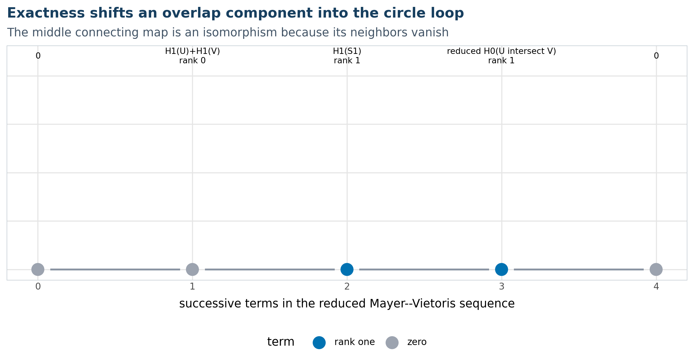

# Relative Homology, Excision, and Mayer–Vietoris in Practice {#sec-topology-relative-workshop}

For the primary Atlas route, see [Mayer–Vietoris](#/books/algebraic-topology-chains-spaces).
This chapter provides a companion viewpoint with the hypotheses stated below.

Chapter 16 introduced exact sequences as a map of the subject. This chapter
does the chain-level work. Relative homology turns a subspace into background,
the connecting homomorphism records the boundary left behind, excision permits
local replacement, and Mayer–Vietoris computes a union from two overlapping
pieces. Together they form the main calculation engine of an introductory
algebraic-topology course ([Hatcher 2002](bibliography.md#ref-hatcher2002algebraic); [OpenCourseWare 2016](bibliography.md#ref-mit18905)).

## Preparation from this book

Read Chapters 13–16. Appendix A reviews kernels, images, quotients, and matrix
rank. Calculations may be done over integers or a field; when only dimensions
are used below, a field is named explicitly.

## Relative chains and the connecting map

Let $A\subseteq X$. Singular chains in $A$ form a subcomplex of singular
chains in $X$, so the quotient

$$
\begin{gathered}
C_n(X,A;R)\\
=C_n(X;R)/C_n(A;R).
\end{gathered}
$$

inherits a boundary. A relative cycle is represented by a chain $c$ in $X$
whose boundary lies in $A$. Two representatives define the same relative
class when they differ by a chain in $A$ and a boundary in $X$.

The short exact sequence of chain complexes

$$
\begin{gathered}
0\longrightarrow C_*(A)\xrightarrow{i}C_*(X),\\
C_*(X)\xrightarrow{q}C_*(X,A)\longrightarrow0
\end{gathered}
$$

produces the long exact sequence

$$
\begin{gathered}
\cdots\to H_n(A)\xrightarrow{i_*}H_n(X),\\
H_n(X)\xrightarrow{q_*}H_n(X,A),\\
H_n(X,A)\xrightarrow{\partial}H_{n-1}(A)\to\cdots.
\end{gathered}
$$

Repeated terms at the row breaks join consecutive portions of one exact
sequence.

The connecting map is concrete. Start with a relative cycle $[c]$. Its
ordinary boundary $\partial c$ lies in $C_{n-1}(A)$ and is a cycle there, so

$$
\begin{gathered}
\partial_{\operatorname{conn}}[c]\\
=[\partial c]\in H_{n-1}(A).
\end{gathered}
$$

Changing the representative changes $\partial c$ only by a boundary in $A$,
so the class is well defined. This representative check is indispensable; a
formula on quotient classes is not a map until it has been shown independent
of choices.

Exactness at $H_n(X,A)$ can now be seen rather than memorized. A relative class
has zero connecting image precisely when its boundary bounds in $A$. Choose
$a\in C_n(A)$ with $\partial a=\partial c$. Then $c-a$ is an absolute
cycle in $X$ representing the same relative class, so the class comes from
$H_n(X)$. Conversely, an absolute cycle has zero boundary,
so every class arriving from $H_n(X)$ maps to zero.

## Disk relative to its boundary

For a unital coefficient ring $R$ and $n\ge1$, contractibility of the disk
and the long exact sequence of the pair $(D^n,S^{n-1})$ give

$$
\begin{gathered}
H_k(D^n,S^{n-1};R)\\
\cong
\begin{cases}
R,&k=n,\\
0,&k\ne n.
\end{cases}
\end{gathered}
$$

Reduced homology handles degree zero cleanly. For nonempty $X$, one augments
$C_0(X;R)\to R$ by summing coefficients. If $X$ has finitely many path
components, say $c\ge1$, then

$$
\widetilde H_0(X;R)\cong R^{c-1}.
$$

This is a free-module statement. With coefficients in a field $F$, its
dimension over $F$ is $c-1$. Statements such as
$\widetilde H_n(S^n;R)\cong R$ then have no exceptional extra copy of $R$ in
degree zero.

For every $n\ge1$, the connecting map is an isomorphism with this
**reduced** target:

$$
\begin{gathered}
H_n(D^n,S^{n-1};R)\\
\xrightarrow[\partial]{\cong}
\widetilde H_{n-1}(S^{n-1};R).
\end{gathered}
$$

For $n\ge2$, the target degree is positive, so reduced and ordinary homology
agree and the unreduced target $H_{n-1}(S^{n-1};R)$ is also valid. For $n=1$,
the boundary has two components: the connecting image is the signed difference
of endpoints, not all of $H_0(S^0;R)\cong R^2$ when $R\ne0$. The relative
fundamental class maps to the oriented boundary class, interpreted in reduced
degree zero for the interval. This calculation is the local algebra behind
orientation of a manifold. See
[Hatcher, Theorem 2.16 and Example 2.17, pages 116–118](https://pi.math.cornell.edu/~hatcher/AT/ATch2.pdf).
The long exact sequence is the theorem being used; the interval task below
checks its maps explicitly.

The case $n=0$ is separate: $D^0$ is one point and its boundary is empty. In
ordinary homology,

$$
\begin{gathered}
H_0(D^0,\varnothing;R)\cong R,\\
H_{-1}(\varnothing;R)=0.
\end{gathered}
$$

Thus its ordinary degree-zero connecting map is zero and is not an isomorphism
when $R\ne0$. These statements use ordinary negative-degree homology equal to
zero; no augmented negative-degree convention for reduced homology is needed.

## Excision: what may be removed

Suppose $Z\subseteq A\subseteq X$ and
$\overline Z\subseteq\operatorname{int}_X(A)$. Excision says inclusion induces

$$
\begin{gathered}
H_n(X\setminus Z,A\setminus Z;R)\\
\xrightarrow{\cong}H_n(X,A;R).
\end{gathered}
$$

The closure-inside-interior condition keeps the removed material away from the
interface where relative information lives. One proof repeatedly subdivides
singular simplices until every small simplex lies either inside $A$ or inside
$X\setminus\overline Z$. A chain homotopy shows subdivision does not change
homology; the pieces lying in $A$ vanish in the relative quotient.

**Nonexample.** Removing the entire subspace $A$ need not preserve relative
homology. In $(D^n,S^{n-1})$, deleting the boundary violates the closure
condition and destroys precisely the interface detected by the connecting
map. “Excision” does not mean arbitrary deletion.

## Mayer–Vietoris from a chain sequence

Let $X=U\cup V$ with $U$ and $V$ open. After replacing singular chains by the
chain-homotopy-equivalent subcomplex of chains small relative to the cover,
there is a short exact sequence

$$
\begin{gathered}
0\to C_*(U\cap V),\\
C_*(U\cap V)\xrightarrow{\alpha}C_*(U)\oplus C_*(V),\\
C_*(U)\oplus C_*(V)\xrightarrow{\beta}C_*(X)\to0,
\end{gathered}
$$

where

$$
\begin{gathered}
\alpha(c)=(c,-c),\\
\beta(a,b)=a+b.
\end{gathered}
$$

The signs make $\beta\alpha(c)=c-c=0$. Exactness says two local chains describe
the same global chain exactly up to a chain on the overlap. Passing to homology
gives

$$
\begin{gathered}
\cdots\to H_n(U\cap V),\\
H_n(U\cap V)\to H_n(U)\oplus H_n(V),\\
H_n(U)\oplus H_n(V)\to H_n(X),\\
H_n(X)\xrightarrow{\partial}H_{n-1}(U\cap V)\to\cdots.
\end{gathered}
$$

The connecting map cuts a cycle into a part in $U$ and a part in $V$; their
boundaries cancel globally and therefore determine a cycle on the overlap.
This description is often more informative than a rank table.

<figure id="fig-topology-mayer-vietoris">


<figcaption>

Figure 24.1: The Mayer–Vietoris calculation for a circle shifts one reduced component class of the overlap into the loop class of the union.

</figcaption>
</figure>

## Circle and sphere calculations

Cover $S^1$ by slightly enlarged upper and lower arcs. Each arc is
contractible; their intersection has two contractible components. In reduced
homology, the decisive part is

$$
\begin{gathered}
0\longrightarrow\widetilde H_1(S^1;R),\\
\widetilde H_1(S^1;R)\xrightarrow{\partial}
\widetilde H_0(U\cap V;R),\\
\widetilde H_0(U\cap V;R)\longrightarrow0.
\end{gathered}
$$

The overlap has two components, so its reduced zero-dimensional homology is
$R$. Exactness makes the connecting map an isomorphism and gives
$\widetilde H_1(S^1;R)\cong R$.

For $S^n$, thicken the northern and southern hemispheres. Both pieces are
contractible and their intersection deformation retracts onto $S^{n-1}$.
Reduced Mayer–Vietoris yields the suspension shift

$$
\begin{gathered}
\widetilde H_k(S^n;R)\\
\cong\widetilde H_{k-1}(S^{n-1};R).
\end{gathered}
$$

Starting with $\widetilde H_0(S^0;R)\cong R$ proves that $S^n$ has one reduced
homology class in degree $n$ and none elsewhere. The same argument shows more
generally that
$\widetilde H_k(\Sigma X;R)\cong\widetilde H_{k-1}(X;R)$ under standard
basepoint hypotheses.

## Maps, not only ranks

Exact sequences constrain kernels and images, not just dimensions. Over a
field, exactness at a finite-dimensional middle space $B$ in

$$
A\xrightarrow{F}B\xrightarrow{G}C
$$

is equivalent to both $GF=0$ and

$$
\operatorname{rank}F+\operatorname{rank}G=\dim B.
$$

The first condition gives $\operatorname{im}F\subseteq\ker G$; rank–nullity
and the second give equality. Over abelian groups, rank equality alone misses
torsion and subgroup index. Even over a field, a list of group dimensions does
not determine the maps in a long exact sequence.

Natural maps also matter. A map of pairs induces a map between their long exact
sequences and commutes with connecting homomorphisms. This naturality lets one
compare local orientations, degrees, and inclusions without choosing a new
isomorphism for each object.

<!-- inline-formula-code:start -->
## Formula and finite computation

The following code checks the two finite-dimensional exactness conditions over
$\mathbb F_2$. Matrices act on column vectors: `map_into_middle` represents
$F:B_{\mathrm{source}}\to B$, `map_out_of_middle` represents $G:B\to C$, and
`middle_dimension` represents $\dim B$.

$$
\begin{gathered}
GF=0,\\
\operatorname{rank}F+\operatorname{rank}G=\dim B.
\end{gathered}
$$

```python
def rank_mod2(matrix: list[list[int]]) -> int:
    if not matrix or not matrix[0]:
        raise ValueError("matrix must have positive row and column counts")
    column_count = len(matrix[0])
    if any(len(row) != column_count for row in matrix):
        raise ValueError("matrix must be rectangular")
    rows = [[entry % 2 for entry in row] for row in matrix]
    rank = 0
    for column in range(column_count):
        pivot = next(
            (row for row in range(rank, len(rows)) if rows[row][column]),
            None,
        )
        if pivot is None:
            continue
        rows[rank], rows[pivot] = rows[pivot], rows[rank]
        for row in range(len(rows)):
            if row != rank and rows[row][column]:
                rows[row] = [
                    left ^ right
                    for left, right in zip(rows[row], rows[rank], strict=True)
                ]
        rank += 1
    return rank

def is_exact_at_middle_mod2(
    map_into_middle: list[list[int]],
    map_out_of_middle: list[list[int]],
) -> bool:
    if not map_into_middle or not map_out_of_middle:
        raise ValueError("use explicit nonempty matrices")
    middle_dimension = len(map_into_middle)
    if any(len(row) != middle_dimension for row in map_out_of_middle):
        raise ValueError("matrix dimensions do not compose")
    source_dimension = len(map_into_middle[0])
    if source_dimension == 0 or any(
        len(row) != source_dimension for row in map_into_middle
    ):
        raise ValueError("incoming matrix must be nonempty and rectangular")
    composition = [
        [
            sum(
                out_row[middle] * map_into_middle[middle][source]
                for middle in range(middle_dimension)
            ) % 2
            for source in range(source_dimension)
        ]
        for out_row in map_out_of_middle
    ]
    composition_is_zero = all(
        entry == 0 for row in composition for entry in row
    )
    return (
        composition_is_zero
        and rank_mod2(map_into_middle) + rank_mod2(map_out_of_middle)
        == middle_dimension
    )

incoming = [[1], [1]]
outgoing = [[1, 1]]
print(is_exact_at_middle_mod2(incoming, outgoing))
```

**What the computation establishes.** For the declared sequence
$\mathbb F_2\to\mathbb F_2^2\to\mathbb F_2$, the composition vanishes and
the two ranks add to two, so the sequence is exact at its middle term. The code
does not construct a connecting homomorphism, prove excision, or certify
exactness of a sequence of infinite groups.
<!-- inline-formula-code:end -->

## A reliable calculation workflow

When using a long exact sequence:

1. write the spaces, coefficient ring, and every map before simplifying;
2. replace pieces by homotopy-equivalent spaces only with an explicit reason;
3. use reduced homology when connected degree-zero terms obscure the pattern;
4. identify which adjacent maps are zero, injective, or surjective;
5. apply exactness at one term at a time; and
6. check the answer against Euler characteristic or a cellular computation.

This workflow prevents a common mistake: treating exactness as a collection of
unrelated isomorphisms. The information lies in the entire linked sequence.

## Summary

Relative chains quotient out a subspace, and their connecting map records the
boundary that remains in that subspace. Excision makes the construction local.
Mayer–Vietoris arises from the difference and sum maps on an overlap and
calculates unions, spheres, and suspensions. Finite rank tests can audit a
linear sequence, while topological exactness still rests on chain maps,
subdivision, and well-defined connecting homomorphisms.

## Exercises

<div class="exercise" id="topology-24-relative-homology-mayer-vietoris-ex-1">
<p class="exercise-title"><strong>Exercise 1</strong></p>

Check directly that the relative boundary is well defined on
$C_n(X)/C_n(A)$.

</div>

<div class="exercise" id="topology-24-relative-homology-mayer-vietoris-ex-2">
<p class="exercise-title"><strong>Exercise 2</strong></p>

Prove the connecting map is independent of the chosen representative.

<details class="solution"><summary>Solution</summary>

For Exercise 2, replace $c$ by $c+a+\partial b$, where $a$ is a chain in $A$.
Then $\partial(c+a+\partial b)=\partial c+\partial a$. The two boundaries
differ by a boundary inside $A$, so they determine the same class in
$H_{n-1}(A)$.

</details>

</div>

<div class="exercise" id="topology-24-relative-homology-mayer-vietoris-ex-3">
<p class="exercise-title"><strong>Exercise 3</strong></p>

Write the long exact sequence of $(D^2,S^1)$ and determine every group.

</div>

<div class="exercise" id="topology-24-relative-homology-mayer-vietoris-ex-4">
<p class="exercise-title"><strong>Exercise 4</strong></p>

Identify why deleting the boundary in the disk pair violates excision.

</div>

<div class="exercise" id="topology-24-relative-homology-mayer-vietoris-ex-5">
<p class="exercise-title"><strong>Exercise 5</strong></p>

Derive the reduced homology of $S^2$ from two hemispheres.

<details class="hint"><summary>Hint 1</summary>

Cover $S^n$ by two open sets deforming to the hemispheres. Both are
contractible, while their intersection deforms to $S^{n-1}$. In positive
reduced degrees, all terms from the two pieces vanish, so exactness makes the
connecting map
$\widetilde H_k(S^n)\to\widetilde H_{k-1}(S^{n-1})$ an isomorphism.

</details>

</div>

<div class="exercise" id="topology-24-relative-homology-mayer-vietoris-ex-6">
<p class="exercise-title"><strong>Exercise 6</strong></p>

Use Mayer–Vietoris to compute the homology of a figure-eight from two
overlapping neighborhoods.

</div>

<div class="exercise" id="topology-24-relative-homology-mayer-vietoris-ex-7">
<p class="exercise-title"><strong>Exercise 7</strong></p>

Give two composable linear maps with zero composition that are not exact at
the middle.

<details class="solution"><summary>Solution</summary>

For Exercise 7, take both maps to be zero with a nonzero middle vector space.
Their composition vanishes, but the incoming image is zero while the outgoing
kernel is the whole middle space. Zero composition gives containment, not
equality.

</details>

</div>

<div class="exercise" id="topology-24-relative-homology-mayer-vietoris-ex-8">
<p class="exercise-title"><strong>Exercise 8</strong></p>

Modify the code example so exactness fails while the composition remains
zero.

</div>

<div class="exercise" id="topology-24-relative-homology-mayer-vietoris-ex-9">
<p class="exercise-title"><strong>Exercise 9</strong></p>

**Change the disk dimension.** Replace $(D^2,S^1)$ by
$(I,\partial I)$, where $I=[-1,1]$ is oriented from left to right and
$\partial I=\{-1,1\}$. Use a nonzero unital coefficient ring $R$ and
order the endpoint basis as $(\mathrm{left},\mathrm{right})$. Compute
the connecting map from $H_1(I,\partial I;R)$ to
$H_0(\partial I;R)$, its kernel, image, and cokernel. Determine
$H_0(I,\partial I;R)$. Which target makes the connecting map an
isomorphism, and why does the unreduced target work for the two-dimensional
disk instead?

<details class="solution"><summary>Solution</summary>

For Exercise 9, let $\sigma(t)=2t-1$ for $0\le t\le1$. Its ordinary
boundary is $[\mathrm{right}]-[\mathrm{left}]$, so the relative class
$[\sigma]$ generates $H_1(I,\partial I;R)\cong R$ with the chosen
orientation. The connecting map and the inclusion-induced map are

$$
\begin{gathered}
\partial:R\longrightarrow R^2,\\
\partial(r)=(-r,r),\\
i_*:R^2\longrightarrow R,\\
i_*(u,v)=u+v.
\end{gathered}
$$

The second map identifies both endpoints with the single path component of
$I$. Thus the relevant exact sequence is

$$
\begin{gathered}
0\longrightarrow R\xrightarrow{\partial}R^2,\\
R^2\xrightarrow{i_*}R\longrightarrow0.
\end{gathered}
$$

The connecting map has zero kernel and image
$\{(-r,r):r\in R\}=\ker i_*$. Its cokernel is $R$, since $i_*$ is
surjective with exactly this kernel. The subsequent relative group
$H_0(I,\partial I;R)$ is zero, because the endpoint inclusion already
surjects onto $H_0(I;R)$. The image is precisely
$\widetilde H_0(\partial I;R)$, the kernel of the coefficient-sum
augmentation. Therefore the connecting map is an isomorphism onto this reduced
group, but not onto the full $R^2$. For $(D^2,S^1)$ its target is instead
$H_1(S^1;R)$, where ordinary and reduced homology agree. Reversing the
orientation negates the chosen generator and its signed endpoint image.

</details>

</div>

### Selected solutions

For Exercise 2, replace $c$ by $c+a+\partial b$, where $a$ is a chain in $A$.
Then $\partial(c+a+\partial b)=\partial c+\partial a$. The two boundaries
differ by a boundary inside $A$, so they determine the same class in
$H_{n-1}(A)$.

For Exercise 7, take both maps to be zero with a nonzero middle vector space.
Their composition vanishes, but the incoming image is zero while the outgoing
kernel is the whole middle space. Zero composition gives containment, not
equality.

For Exercise 9, let $\sigma(t)=2t-1$ for $0\le t\le1$. Its ordinary
boundary is $[\mathrm{right}]-[\mathrm{left}]$, so the relative class
$[\sigma]$ generates $H_1(I,\partial I;R)\cong R$ with the chosen
orientation. The connecting map and the inclusion-induced map are

$$
\begin{gathered}
\partial:R\longrightarrow R^2,\\
\partial(r)=(-r,r),\\
i_*:R^2\longrightarrow R,\\
i_*(u,v)=u+v.
\end{gathered}
$$

The second map identifies both endpoints with the single path component of
$I$. Thus the relevant exact sequence is

$$
\begin{gathered}
0\longrightarrow R\xrightarrow{\partial}R^2,\\
R^2\xrightarrow{i_*}R\longrightarrow0.
\end{gathered}
$$

The connecting map has zero kernel and image
$\{(-r,r):r\in R\}=\ker i_*$. Its cokernel is $R$, since $i_*$ is
surjective with exactly this kernel. The subsequent relative group
$H_0(I,\partial I;R)$ is zero, because the endpoint inclusion already
surjects onto $H_0(I;R)$. The image is precisely
$\widetilde H_0(\partial I;R)$, the kernel of the coefficient-sum
augmentation. Therefore the connecting map is an isomorphism onto this reduced
group, but not onto the full $R^2$. For $(D^2,S^1)$ its target is instead
$H_1(S^1;R)$, where ordinary and reduced homology agree. Reversing the
orientation negates the chosen generator and its signed endpoint image.
