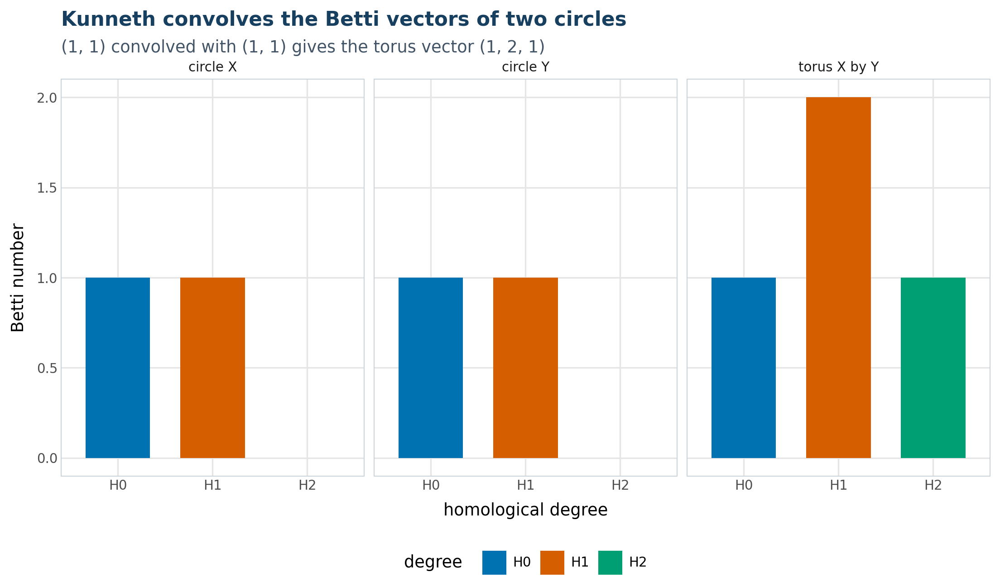

# Coefficients, Tensor Products, Universal Coefficients, and Künneth {#sec-topology-homological-algebra}

For the primary Atlas route, see [Exact Sequences as Conservation Laws](#/books/algebraic-topology-chains-spaces/exact-sequences-as-conservation-laws).
This chapter provides a companion viewpoint with the hypotheses stated below.

Homology with field coefficients is linear algebra, but coefficients are not a
cosmetic choice. Torsion may appear, disappear, or move by one degree. Tensor
products describe how coefficients and Cartesian factors combine; Tor and Ext
record the failure of exactness that simple tensor or dual formulas would miss.
This chapter develops enough homological algebra to use the universal
coefficient and Künneth theorems responsibly ([Hatcher 2002](bibliography.md#ref-hatcher2002algebraic); [OpenCourseWare 2016](bibliography.md#ref-mit18905)).

## Preparation from this book

Read Chapters 14–16 and the calculation workshop in Chapter 24. Appendix A
reviews kernels, quotients, and rank. Familiarity with abelian groups is useful,
but cyclic groups and the required universal properties are introduced below.

## Changing coefficients

The integral singular chain group $C_n(X;\mathbb Z)$ is free on singular
$n$-simplices. For an abelian group $G$, chains with coefficients in $G$ can
be expressed as

$$
C_n(X;G)=C_n(X;\mathbb Z)\otimes G.
$$

The boundary acts on the chain factor and leaves coefficients unchanged. If
$G$ is a field, kernels and images are vector spaces and Betti numbers are
dimensions. With $G=\mathbb Z$, finitely generated homology decomposes as

$$
H_n(X;\mathbb Z)\cong
\mathbb Z^{\beta_n}\oplus
\mathbb Z/d_1\oplus\cdots\oplus\mathbb Z/d_r,
\qquad d_i\mid d_{i+1}.
$$

Smith normal form computes these invariant factors from an integer boundary
matrix using invertible integer row and column operations. Ordinary floating-
point rank cannot recover them. Reducing a matrix modulo two can reveal
two-torsion effects but cannot distinguish $\mathbb Z/2$ from
$\mathbb Z/4$ in integral homology.

For the standard CW structure on $\mathbb{RP}^2$, there is one cell in each
dimension zero, one, and two, with cellular boundaries
$d_2$ equal to multiplication by $2$ and $d_1=0$. Therefore

$$
H_1(\mathbb{RP}^2;\mathbb Z)\cong\mathbb Z/2,
\qquad H_2(\mathbb{RP}^2;\mathbb Z)=0.
$$

After reducing modulo two, $d_2$ becomes zero. Both degree one and degree two
then contain a copy of $\mathbb F_2$. The coefficient field has not changed
the space; it has changed which algebraic features the invariant sees.

## Tensor products

For abelian groups $A$ and $B$, the tensor product $A\otimes B$ comes with a
bilinear map $(a,b)\mapsto a\otimes b$ universal among bilinear maps out of
$A\times B$. Bilinearity imposes

$$
(a+a')\otimes b=a\otimes b+a'\otimes b,
\qquad
a\otimes(b+b')=a\otimes b+a\otimes b'.
$$

The universal property is more reliable than treating $\otimes$ as a formal
multiplication sign. It implies

$$
\mathbb Z\otimes B\cong B,
\qquad
(A_1\oplus A_2)\otimes B
\cong(A_1\otimes B)\oplus(A_2\otimes B),
$$

and, for positive integers $m,n$,

$$
(\mathbb Z/m)\otimes(\mathbb Z/n)
\cong\mathbb Z/\gcd(m,n).
$$

Tensoring is right exact but need not preserve injectivity. Tensor the
injection $\mathbb Z\xrightarrow{\times2}\mathbb Z$ with $\mathbb Z/2$:
the resulting map is multiplication by two on $\mathbb Z/2$, hence zero and
not injective. The derived functor $\operatorname{Tor}_1$ measures this lost
exactness.

For cyclic groups,

$$
\operatorname{Tor}_1^{\mathbb Z}(\mathbb Z/m,\mathbb Z/n)
\cong\mathbb Z/\gcd(m,n).
$$

The formula resembles the tensor formula, but the groups occupy different
positions in exact sequences and must not be conflated.

## Universal coefficient theorem for homology

Because singular chain groups are free, for every abelian group $G$ there is a
natural short exact sequence

$$
0\to H_n(X;\mathbb Z)\otimes G
\longrightarrow H_n(X;G)
\longrightarrow
\operatorname{Tor}_1^{\mathbb Z}(H_{n-1}(X;\mathbb Z),G)
\to0.
$$

It splits as a sequence of abelian groups, but not naturally. The left term is
the expected coefficient change in degree $n$; the Tor term imports torsion
from degree $n-1$. This explains the new mod-two top class of
$\mathbb{RP}^2$: the Tor of its degree-one $\mathbb Z/2$ with
$\mathbb Z/2$ contributes in degree two.

If $H_{n-1}(X;\mathbb Z)$ is torsion-free, its Tor contribution vanishes.
In the common finitely generated case, field coefficients then let dimensions
be read from the free ranks together with any degree-$n$ torsion that survives
tensoring. If $H_{n-1}$ has torsion, the shifted Tor term must still be checked;
being a field does not by itself remove a Tor group computed over $\mathbb Z$.

## Universal coefficient theorem for cohomology

Cochains use $\operatorname{Hom}(C_n,G)$. The cohomology theorem gives

$$
0\to
\operatorname{Ext}_{\mathbb Z}^1(H_{n-1}(X;\mathbb Z),G)
\longrightarrow H^n(X;G)
\longrightarrow
\operatorname{Hom}(H_n(X;\mathbb Z),G)
\to0.
$$

Again the sequence splits noncanonically. Hom describes coefficient-valued
measurements on degree-$n$ homology. Ext records information one degree lower.
If chains and cochains are instead formed **from the outset over a field**
$F$, exactness of vector-space duality gives

$$
H^n(\operatorname{Hom}_F(C_*(X;F),F))
\cong\operatorname{Hom}_F(H_n(X;F),F).
$$

This field-level statement is not obtained by simply deleting the
$\operatorname{Ext}_{\mathbb Z}$ term after substituting $G=F$ into the
displayed integral UCT. For example,
$\operatorname{Ext}_{\mathbb Z}^1(\mathbb Z/p,\mathbb F_p)\cong\mathbb F_p$
is nonzero. The coefficient ring attached to Hom, Ext, tensor, and Tor must
always be visible.

For example,
$\operatorname{Hom}(\mathbb Z/m,\mathbb Z)=0$ but
$\operatorname{Ext}^1(\mathbb Z/m,\mathbb Z)\cong\mathbb Z/m$.
Consequently torsion in $H_{n-1}(X;\mathbb Z)$ reappears as torsion in
$H^n(X;\mathbb Z)$.

## Künneth theorem

The homology cross product sends classes $a\in H_p(X)$ and $b\in H_q(Y)$ to a
class $a\times b\in H_{p+q}(X\times Y)$. Over a field $F$, the Künneth theorem
takes the clean form

$$
H_n(X\times Y;F)
\cong\bigoplus_{p+q=n}H_p(X;F)\otimes_F H_q(Y;F).
$$

Therefore Betti numbers convolve:

$$
b_n(X\times Y)=\sum_{p+q=n}b_p(X)b_q(Y).
$$

For $S^1\times S^1$, the vector $(1,1)$ convolved with itself is
$(1,2,1)$: a connected torus, two independent one-cycles, and one top class.

<figure id="fig-topology-kunneth">


<figcaption>

Figure 25.1: The Künneth convolution of the two nonzero Betti numbers of each circle produces torus Betti numbers one, two, and one.

</figcaption>
</figure>

Over integers, under the usual hypotheses for singular homology, there is a
short exact sequence

$$
0\to\bigoplus_{p+q=n}H_p(X)\otimes H_q(Y)
\to H_n(X\times Y)
\to\bigoplus_{p+q=n-1}
\operatorname{Tor}_1(H_p(X),H_q(Y))\to0.
$$

It splits, but not naturally. Torsion products can therefore contribute in a
shifted degree. One must know both the groups and their coefficient ring before
using the formula.

## Generating functions and Euler characteristic

When Betti numbers are finite and vanish above some degree, package them in the
Poincaré polynomial

$$
P_X(t)=\sum_{n\ge0}b_n(X)t^n.
$$

Field Künneth becomes $P_{X\times Y}(t)=P_X(t)P_Y(t)$. Evaluating at
$t=-1$ gives

$$
\chi(X\times Y)=\chi(X)\chi(Y).
$$

This is a useful checksum, not a replacement for the homology calculation:
many different Betti vectors have the same alternating sum.

**Nonexample.** Taking ranks of integer boundary matrices over the real
numbers and reporting the result as integral homology discards all torsion.
Real rank correctly gives real Betti numbers, but the integral invariant needs
Smith normal form or equivalent exact arithmetic.

<!-- inline-formula-code:start -->
## Formula and finite computation

For field coefficients, the Betti-vector formula is discrete convolution. For
cyclic integer groups, tensor and Tor both have order $\gcd(m,n)$. In the code,
`left_betti[p]` represents $b_p(X)$ and `right_betti[q]` represents $b_q(Y)$;
the output entry `product[n]` represents $b_n(X\times Y)$.

$$
b_n(X\times Y)=\sum_{p+q=n}b_p(X)b_q(Y),
\qquad
\left|(\mathbb Z/m)\otimes(\mathbb Z/n)\right|
=\left|\operatorname{Tor}_1^{\mathbb Z}(\mathbb Z/m,\mathbb Z/n)\right|
=\gcd(m,n).
$$

```python
from math import gcd

def product_betti(
    left_betti: tuple[int, ...], right_betti: tuple[int, ...]
) -> tuple[int, ...]:
    if not left_betti or not right_betti:
        raise ValueError("each Betti vector must contain degree zero")
    if any(rank < 0 for rank in left_betti + right_betti):
        raise ValueError("Betti numbers must be nonnegative")
    product = [0] * (len(left_betti) + len(right_betti) - 1)
    for left_degree, left_rank in enumerate(left_betti):
        for right_degree, right_rank in enumerate(right_betti):
            product[left_degree + right_degree] += left_rank * right_rank
    return tuple(product)

def cyclic_tensor_and_tor_orders(left_order: int, right_order: int) -> tuple[int, int]:
    if left_order <= 0 or right_order <= 0:
        raise ValueError("cyclic group orders must be positive")
    common_order = gcd(left_order, right_order)
    return common_order, common_order

circle_betti = (1, 1)
print("torus Betti numbers:", product_betti(circle_betti, circle_betti))
print("Z/12 with Z/18, tensor and Tor orders:", cyclic_tensor_and_tor_orders(12, 18))
```

**What the computation establishes.** Field Künneth gives torus Betti numbers
$(1,2,1)$, and the cyclic formulas give groups of order six in the declared
tensor and Tor example. The code assumes the Künneth hypotheses and already
known input homology; it neither computes Smith normal form nor proves the
universal coefficient or Künneth theorems.
<!-- inline-formula-code:end -->

## Summary

Coefficient change is governed by tensor products plus Tor, while integral
cohomology is governed by Hom plus Ext. Over a field, Künneth turns product
homology into tensor products and Betti numbers into a convolution. Over
integers, torsion contributes shifted terms and splittings are noncanonical.
Exact integer computation must retain more than numerical matrix rank.

## Exercises

<div class="exercise" id="topology-25-homological-algebra-coefficients-ex-1">
<p class="exercise-title"><strong>Exercise 1</strong></p>

Prove $\mathbb Z\otimes A\cong A$ from the tensor universal property.

</div>

<div class="exercise" id="topology-25-homological-algebra-coefficients-ex-2">
<p class="exercise-title"><strong>Exercise 2</strong></p>

Compute $(\mathbb Z/8)\otimes(\mathbb Z/12)$ and the corresponding Tor
group.

</div>

<div class="exercise" id="topology-25-homological-algebra-coefficients-ex-3">
<p class="exercise-title"><strong>Exercise 3</strong></p>

Use the homology UCT to compute $H_*(\mathbb{RP}^2;\mathbb F_2)$ from its
integral homology.

<details class="solution"><summary>Solution</summary>

For Exercise 3, integral homology is $H_0=\mathbb Z$,
$H_1=\mathbb Z/2$, and $H_2=0$. In degree one, tensoring $H_1$ with
$\mathbb F_2$ gives $\mathbb F_2$. In degree two, the Tor term from
$H_1$ also gives $\mathbb F_2$. Thus the mod-two Betti vector through degree
two is $(1,1,1)$.

</details>

</div>

<div class="exercise" id="topology-25-homological-algebra-coefficients-ex-4">
<p class="exercise-title"><strong>Exercise 4</strong></p>

Use the cohomology UCT to locate the integral torsion in
$H^*(\mathbb{RP}^2;\mathbb Z)$.

</div>

<div class="exercise" id="topology-25-homological-algebra-coefficients-ex-5">
<p class="exercise-title"><strong>Exercise 5</strong></p>

Compute the field Betti numbers of $S^2\times S^3$.

</div>

<div class="exercise" id="topology-25-homological-algebra-coefficients-ex-6">
<p class="exercise-title"><strong>Exercise 6</strong></p>

Compute the Poincaré polynomial of the $n$-torus $(S^1)^n$.

<details class="solution"><summary>Solution</summary>

For Exercise 6, $P_{S^1}(t)=1+t$, and repeated Künneth gives
$P_{(S^1)^n}(t)=(1+t)^n$. Therefore the $k$th Betti number is
$\binom nk$ and the Euler characteristic is $(1-1)^n=0$ for $n>0$.

</details>

</div>

<div class="exercise" id="topology-25-homological-algebra-coefficients-ex-7">
<p class="exercise-title"><strong>Exercise 7</strong></p>

Explain why real row rank cannot distinguish multiplication by two from
multiplication by four as integral boundary maps.

</div>

<div class="exercise" id="topology-25-homological-algebra-coefficients-ex-8">
<p class="exercise-title"><strong>Exercise 8</strong></p>

Give two different Betti vectors with the same Euler characteristic.

</div>

### Selected solutions

For Exercise 3, integral homology is $H_0=\mathbb Z$,
$H_1=\mathbb Z/2$, and $H_2=0$. In degree one, tensoring $H_1$ with
$\mathbb F_2$ gives $\mathbb F_2$. In degree two, the Tor term from
$H_1$ also gives $\mathbb F_2$. Thus the mod-two Betti vector through degree
two is $(1,1,1)$.

For Exercise 6, $P_{S^1}(t)=1+t$, and repeated Künneth gives
$P_{(S^1)^n}(t)=(1+t)^n$. Therefore the $k$th Betti number is
$\binom nk$ and the Euler characteristic is $(1-1)^n=0$ for $n>0$.
