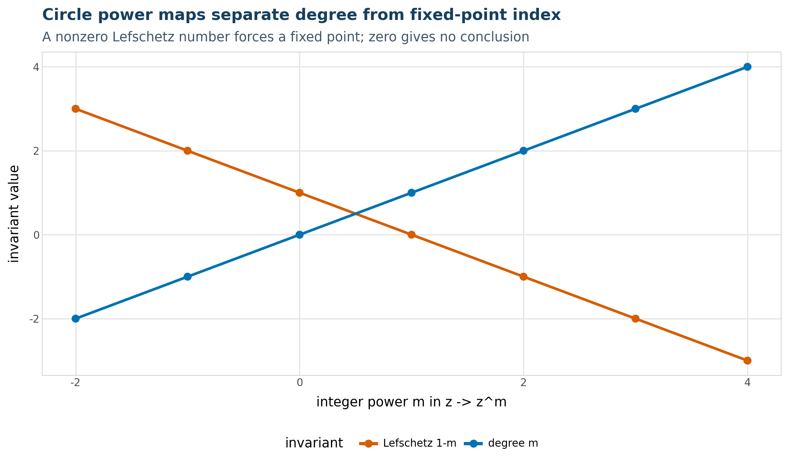

# Degree, Intersection Numbers, and Lefschetz Theory {#sec-topology-degree-lefschetz}

For the primary Atlas route, see [Homotopy Invariance and Degree](#/books/algebraic-topology-chains-spaces/homotopy-invariance-and-degree).
This chapter provides a companion viewpoint with the hypotheses stated below.

Homology becomes especially powerful when a continuous map acts on a top class
or on all homology groups at once. Degree turns an oriented map between
manifolds into an integer. Intersection numbers turn geometric crossings into
homological pairings. The Lefschetz number combines traces across dimensions
and can force a fixed point even when no fixed point is visible locally
([Hatcher 2002](bibliography.md#ref-hatcher2002algebraic)).

## Preparation from this book

Read Chapters 14–18 and Chapter 24. Orientation, fundamental classes, cup and
cap products are introduced there; Chapter 25 supplies coefficient-aware
linear algebra. Smooth Jacobian language is explained at its first use below.

## Degree from top homology

Let $M$ and $N$ be connected closed oriented $n$-manifolds, and let
$f:M\to N$ be continuous. Their top integral homology groups have chosen
fundamental classes $[M]$ and $[N]$. There is one integer
$\deg f$ satisfying

$$
f_*[M]=(\deg f)[N].
$$

This integer is the **degree**. Reversing one chosen orientation reverses its
sign. Homotopic maps have equal degree because homotopic maps induce the same
homology map. Composition multiplies degrees:

$$
\deg(g\circ f)=(\deg g)(\deg f).
$$

The identity has degree one; an orientation-preserving homeomorphism has degree
one and an orientation-reversing homeomorphism degree minus one. A constant
map between positive-dimensional closed manifolds has degree zero because it
factors through a point, whose positive-dimensional homology vanishes.

For the circle power map $p_m:S^1\to S^1$, $p_m(z)=z^m$, a lift of its angular
coordinate changes by $m$ turns. Hence

$$
\deg p_m=m.
$$

On $S^n$, the antipodal map has degree $(-1)^{n+1}$. As the restriction of
$-I$ on $\mathbb R^{n+1}$, it reverses the ambient orientation by
$(-1)^{n+1}$, which induces the displayed boundary orientation sign.

## Counting preimages with signs

Suppose $f:M\to N$ is smooth and $y\in N$ is a regular value: at every
$x\in f^{-1}(y)$, the derivative
$D f_x:T_xM\to T_yN$ is invertible. Compactness makes the preimage finite.
Each preimage has a local sign

$$
\operatorname{sign}_x(f)=
\begin{cases}
+1,&D f_x\text{ preserves orientation},\\
-1,&D f_x\text{ reverses orientation}.
\end{cases}
$$

The degree theorem says

$$
\deg f=\sum_{x\in f^{-1}(y)}\operatorname{sign}_x(f).
$$

Once all preimages of a certified regular value have been found, the displayed
sum is a finite computation. Nonzero determinants encode the regularity check,
and their signs encode the chosen local orientations.

```python
from math import isfinite

def regular_value_degree(jacobian_determinants: list[float]) -> int:
    """Sum local orientation signs at a certified finite regular preimage."""
    if any(
        not isfinite(determinant) or determinant == 0.0
        for determinant in jacobian_determinants
    ):
        raise ValueError(
            "every supplied Jacobian determinant must be finite and nonzero"
        )
    return sum(1 if determinant > 0.0 else -1 for determinant in jacobian_determinants)

# A model regular value with three positive and one negative local orientations.
degree = regular_value_degree([2.0, -0.5, 3.0, 1.25])
print(degree)
```

The signed count is $2$.  The routine assumes the list is complete and the
value is regular; numerical root searches cannot certify either fact by
themselves, and the homological theorem proves independence of the chosen
regular value.

This formula explains why unsigned root counting is unstable: pairs with
opposite signs can appear or disappear under deformation while the signed sum
remains fixed. Sard's theorem ensures regular values are abundant for smooth
maps, and approximation connects the smooth count to the homological
definition.

A nonzero degree forces surjectivity. If $y$ were omitted, the map would factor
through $N\setminus\{y\}$, whose top homology vanishes, contradicting the
nonzero action on the fundamental class. Degree one is stronger than
surjectivity but does not in general imply homeomorphism.

## Brouwer's fixed-point theorem through degree

Let $n\geq1$, let $D^n=\{x\in\mathbb R^n:\|x\|\leq1\}$ be the closed
unit ball, and let $S^{n-1}=\partial D^n$. Suppose, for a contradiction, that
a continuous map $F:D^n\to D^n$ has no fixed point. For each $x$, continue
the ray from $F(x)$ through $x$ to its **forward exit at or beyond $x$**.
This qualification matters: if $F(x)$ itself is on the boundary, the starting
point of that ray is not the exit we need.

Here is an explicit formula that proves continuity, including that boundary
case. Set

$$
v=x-F(x),\qquad A=\|v\|^2>0,\qquad
\beta=\langle x,v\rangle,\qquad \delta=1-\|x\|^2\geq0,
$$

and define

$$
\lambda(x)=\frac{\sqrt{\beta^2+A\delta}-\beta}{A},
\qquad r(x)=x+\lambda(x)v.
$$

All quantities in this formula are continuous. The radicand is nonnegative
and the denominator is positive everywhere by the no-fixed-point assumption,
so $r$ is continuous on the whole ball. Moreover,
$\sqrt{\beta^2+A\delta}\geq|\beta|$ gives $\lambda\geq0$. The equation
$A\lambda^2+2\beta\lambda-\delta=0$ then gives

$$
\|r(x)\|^2=\|x\|^2+2\beta\lambda+A\lambda^2=1.
$$

Thus $r$ takes values in the sphere along the required forward ray. If
$\|x\|<1$, then $\delta>0$ and the displayed quadratic has exactly one
positive root, so this is the forward exit. If $\|x\|=1$, then
$\delta=0$ and $\beta=1-\langle x,F(x)\rangle>0$: equality would force
$F(x)=x$ by the equality case of Cauchy–Schwarz. Hence $\lambda=0$ and
$r(x)=x$ on the boundary. This proves that $r:D^n\to S^{n-1}$ is a
continuous retraction, even when some values of $F$ lie on the boundary.

But no such retraction exists. Use **reduced homology with integer
coefficients**, as in Chapter 24. If $i:S^{n-1}\hookrightarrow D^n$ is
inclusion, $r\circ i=\operatorname{id}$ would induce

$$
\widetilde H_{n-1}(S^{n-1};\mathbb Z)
\xrightarrow{i_*}\widetilde H_{n-1}(D^n;\mathbb Z)
\xrightarrow{r_*}\widetilde H_{n-1}(S^{n-1};\mathbb Z),
$$

whose composite must be the identity on $\mathbb Z$. The sphere groups shown
are $\mathbb Z$, whereas the middle group is zero because the ball is
contractible. The composite would therefore be zero, a contradiction. This
also covers $n=1$: $S^0$ has two points, so
$\widetilde H_0(S^0;\mathbb Z)\cong\mathbb Z$, while the interval has
$\widetilde H_0(D^1;\mathbb Z)=0$. Unreduced $H_0(D^1;\mathbb Z)$ is
$\mathbb Z$, so it could not be called zero in that case.

Therefore every continuous self-map of a closed unit ball in positive
dimension has a fixed point. The argument is existence-only; it gives no
numerical procedure for locating the point.

## Intersections and dual classes

Let oriented submanifolds $A^p$ and $B^q$ lie in an oriented $n$-manifold and
meet transversely, with $p+q=n$. Their intersection is a finite set when the
relevant compactness conditions hold. At each intersection, compare the
orientation of $T_xA\oplus T_xB$ with $T_xM$ and assign a sign. The algebraic
intersection number is

$$
A\cdot B=\sum_{x\in A\cap B}\operatorname{sign}(x).
$$

Moving either submanifold by a suitable homotopy may create or remove
opposite-sign pairs, leaving the algebraic count unchanged. Poincaré duality
turns the homology classes of $A$ and $B$ into cohomology classes. Their cup
product evaluated on $[M]$ recovers the intersection number, up to the adopted
orientation convention:

$$
A\cdot B
=\left\langle\operatorname{PD}[A]\smile
\operatorname{PD}[B],[M]\right\rangle.
$$

On an oriented surface, two closed oriented curves in general position have a
signed intersection number. The standard meridian and longitude of a torus
intersect once. On the sphere, every two one-cycles are null-homologous, so
their homological intersection pairing is zero.

Intersection forms carry deep information. For a closed oriented
$4k$-manifold, middle-dimensional intersection is symmetric; for dimension
$4k+2$ it is skew-symmetric. On a closed oriented surface, the skew pairing on
$H_1$ explains why its first Betti number is even.

## The Lefschetz number

Let $X$ be a finite CW complex, or another space for which the Lefschetz
fixed-point theorem applies, and let $f:X\to X$. Over a field $F$, define

$$
L(f)=\sum_{k\ge0}(-1)^k
\operatorname{tr}\bigl(f_*:H_k(X;F)\to H_k(X;F)\bigr).
$$

Only finitely many terms are nonzero. The Lefschetz fixed-point theorem states

$$
L(f)\ne0\quad\Longrightarrow\quad f\text{ has a fixed point}.
$$

The converse is false: fixed points can have local indices that cancel. For
the identity, $L(\operatorname{id})=\chi(X)$, so a nonzero Euler
characteristic prevents a fixed-point-free map homotopic to the identity.

For the circle power map $p_m$, the map on $H_0$ has trace one and the map on
$H_1$ is multiplication by $m$. Thus

$$
L(p_m)=1-m.
$$

When $m\ne1$, the theorem forces a fixed point. Indeed $z^m=z$ has
$|m-1|$ solutions on the unit circle when interpreted appropriately, while the
identity case $m=1$ has every point fixed despite Lefschetz number zero.

<figure id="fig-topology-degree-lefschetz">


<figcaption>

Figure 26.1: For circle power maps, degree is m and the Lefschetz number is 1 minus m; nonzero Lefschetz values force fixed points.

</figcaption>
</figure>

For isolated nondegenerate smooth fixed points, the local index is the sign of
$\det(I-Df_x)$. A stronger form of the theorem gives

$$
L(f)=\sum_{x\in\operatorname{Fix}(f)}\operatorname{ind}_x(f).
$$

This resembles the regular-value degree formula because both convert a global
homological invariant into a stable signed local count.

## Scope and common failures

Degree needs source and target of the same dimension together with orientations
or modified coefficients. A Jacobian determinant at sample points is not a
degree calculation unless regularity, all preimages, compactness, and
orientation conventions are controlled. For manifolds with boundary or
noncompact manifolds, proper maps and relative or compactly supported homology
provide variants with additional hypotheses.

Lefschetz theory needs the induced maps on homology, not merely the geometric
formula for $f$. A numerical fixed-point search can miss points and cannot
certify their nonexistence. Conversely, a zero Lefschetz number means only that
the theorem gives no obstruction.

**Nonexample.** The constant map on $S^n$ has degree zero but is surjective only
when the target degenerates to its constant value, which it does not. This does
not contradict “nonzero degree implies surjective”: the implication has no
converse.

<!-- inline-formula-code:start -->
## Formula and finite computation

For finite-dimensional homology, the Lefschetz number is an alternating sum of
matrix traces. In the code, `induced_maps[degree]` is the matrix of $f_*$ on
$H_{\text{degree}}$, and `power` is the exponent $m$ in $z\mapsto z^m$.

$$
L(f)=\sum_{k\ge0}(-1)^k\operatorname{tr}(f_*|H_k(X;F)),
\qquad
\deg(z\mapsto z^m)=m.
$$

```python
def lefschetz_number(
    induced_maps: tuple[tuple[tuple[int, ...], ...], ...]
) -> int:
    total = 0
    for degree, matrix in enumerate(induced_maps):
        dimension = len(matrix)
        if any(len(row) != dimension for row in matrix):
            raise ValueError("each induced homology map must be square")
        trace = sum(matrix[index][index] for index in range(dimension))
        total += (-1) ** degree * trace
    return total

def circle_power_invariants(power: int) -> tuple[int, int]:
    degree = power
    induced_maps = (((1,),), ((degree,),))
    return degree, lefschetz_number(induced_maps)

for exponent in range(-2, 4):
    print(exponent, circle_power_invariants(exponent))
```

**What the computation establishes.** Given the already known induced maps on
$H_0(S^1)$ and $H_1(S^1)$, the code returns degree $m$ and Lefschetz number
$1-m$ for six power maps. It does not infer those induced maps from a black-box
function, enumerate all fixed points, or prove the degree and Lefschetz
theorems.
<!-- inline-formula-code:end -->

## Summary

Degree is the integer by which a map acts on oriented top homology and can be
computed as a signed regular-value count. Intersection numbers are stable
signed counts encoded by Poincaré duality and cup products. The Lefschetz
number alternates traces of induced homology maps; a nonzero value forces a
fixed point. Each invariant needs its compactness, orientation, transversality,
or finiteness hypotheses stated explicitly.

## Exercises

<div class="exercise" id="topology-26-degree-intersection-lefschetz-ex-1">
<p class="exercise-title"><strong>Exercise 1</strong></p>

Prove degree is multiplicative under composition.

<details class="solution"><summary>Solution</summary>

For Exercise 1,
$(g\circ f)_*[M]=g_*((\deg f)[N])=(\deg f)(\deg g)[P]$.
Uniqueness of the integer multiplying the fundamental class gives
$\deg(g\circ f)=\deg g\deg f$.

</details>

</div>

<div class="exercise" id="topology-26-degree-intersection-lefschetz-ex-2">
<p class="exercise-title"><strong>Exercise 2</strong></p>

Compute the degrees of complex conjugation and $z\mapsto z^m$ on $S^1$.

</div>

<div class="exercise" id="topology-26-degree-intersection-lefschetz-ex-3">
<p class="exercise-title"><strong>Exercise 3</strong></p>

Show that a map of nonzero degree between connected closed oriented
manifolds is surjective.

</div>

<div class="exercise" id="topology-26-degree-intersection-lefschetz-ex-4">
<p class="exercise-title"><strong>Exercise 4</strong></p>

Fill in the continuity argument for the retraction used in Brouwer's
theorem.

</div>

<div class="exercise" id="topology-26-degree-intersection-lefschetz-ex-5">
<p class="exercise-title"><strong>Exercise 5</strong></p>

Compute the intersection pairing of meridian and longitude on a torus.

</div>

<div class="exercise" id="topology-26-degree-intersection-lefschetz-ex-6">
<p class="exercise-title"><strong>Exercise 6</strong></p>

Compute $L(f)$ for a reflection of $S^2$.

</div>

<div class="exercise" id="topology-26-degree-intersection-lefschetz-ex-7">
<p class="exercise-title"><strong>Exercise 7</strong></p>

Give a map with fixed points but Lefschetz number zero.

<details class="solution"><summary>Solution</summary>

For Exercise 7, the identity on $S^1$ fixes every point, while
$L(\operatorname{id})=\chi(S^1)=0$. Thus zero Lefschetz number is not a
fixed-point-free certificate.

</details>

</div>

<div class="exercise" id="topology-26-degree-intersection-lefschetz-ex-8">
<p class="exercise-title"><strong>Exercise 8</strong></p>

Explain which information a sampled Jacobian calculation lacks before it
can certify a degree.

</div>

### Selected solutions

For Exercise 1,
$(g\circ f)_*[M]=g_*((\deg f)[N])=(\deg f)(\deg g)[P]$.
Uniqueness of the integer multiplying the fundamental class gives
$\deg(g\circ f)=\deg g\deg f$.

For Exercise 7, the identity on $S^1$ fixes every point, while
$L(\operatorname{id})=\chi(S^1)=0$. Thus zero Lefschetz number is not a
fixed-point-free certificate.
