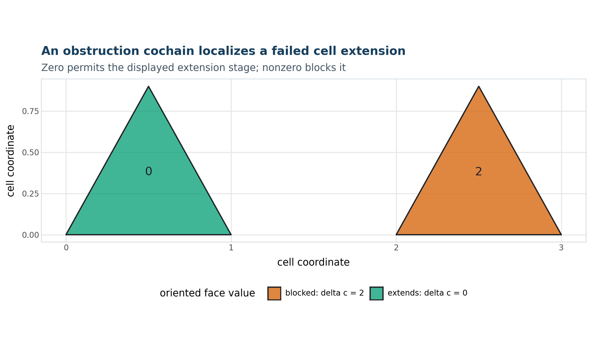

# Higher Homotopy, Fibrations, and Obstruction Theory {#sec-topology-higher-homotopy}

For the primary Atlas route, see [Fibrations and Spectral Sequences](#/books/algebraic-topology-chains-spaces).
This chapter provides a companion viewpoint with the hypotheses stated below.

The fundamental group records loops, but spheres of every dimension can probe a
space. Higher homotopy groups detect families of spheres, fibrations organize
their lifting behavior, and obstruction theory asks whether a partially
defined map or section can be extended one skeleton at a time. These tools are
less algorithmic than homology, yet they explain why cohomology classes arise
as precise barriers to geometric constructions ([Hatcher 2002](bibliography.md#ref-hatcher2002algebraic)).

## Preparation from this book

Read Chapters 11–17 and the relative-homology workshop in Chapter 24. The CW
skeleton language comes from Chapter 13. Fundamental groups and covering-space
lifts provide the one-dimensional prototype for every construction here.

## Higher homotopy groups

For a based space $(X,x_0)$ and $n\ge1$, define

$$
\pi_n(X,x_0)=[(S^n,s_0),(X,x_0)]_*,
$$

the based homotopy classes of based maps. Equivalently, use maps
$I^n\to X$ that send the entire boundary $\partial I^n$ to $x_0$. Gluing cubes
across a coordinate face defines multiplication. For $n=1$ this is loop
concatenation. For $n\ge2$, two independent coordinate directions allow the
Eckmann–Hilton argument, forcing the group to be abelian.

Homotopy groups are functorial and invariant under homotopy equivalence. A
contractible space has every homotopy group zero. The basic sphere results are

$$
\pi_k(S^n)=0\quad(k<n),
\qquad
\pi_n(S^n)\cong\mathbb Z,
$$

where the second isomorphism is degree. Above the dimension, the groups become
subtle: $\pi_3(S^2)\cong\mathbb Z$ is generated by the Hopf map, and many
higher sphere groups contain finite torsion. Homology does not determine these
groups. For instance, $S^2$ has no third homology but has nonzero
$\pi_3$.

A space is **$r$-connected** when $\pi_k(X)=0$ for $0\le k\le r$, where
$\pi_0=0$ means path connected. A map is $r$-connected when its homotopy fibers
are $(r-1)$-connected. Connectivity estimates compress long stretches of exact
sequences into isomorphisms and surjections.

The Hurewicz theorem connects the first nonzero homotopy group to homology. If
$X$ is $(n-1)$-connected for $n\ge2$, then

$$
h:\pi_n(X)\xrightarrow{\cong}H_n(X;\mathbb Z)
$$

is an isomorphism, with a corresponding degree-one version after
abelianization. The hypotheses matter: beyond the first nonzero degree,
homology usually loses homotopy information.

### Worked bridge: why $\pi_1$ misses $S^2$ {#sec-topology-sphere-loop-gap}

Chapter 11 promised a simply connected space that is not contractible. Here
are the separate arguments for $S^2$, using the hypotheses of that chapter's
two-set Seifert–van Kampen theorem and Chapter 24's sphere homology.

Let $N,S$ be the north and south poles, and choose the base point
$b=(1,0,0)$. The open sets

$$
U=S^2\setminus\{N\},\qquad V=S^2\setminus\{S\}
$$

cover $S^2$. Each is homeomorphic to $\mathbb R^2$ by stereographic
projection and is therefore contractible. Their intersection is homeomorphic
to $S^1\times(-1,1)$: record the direction of the first two coordinates and
the third coordinate. In particular, $U\cap V$ is nonempty and path connected
and contains $b$. The **Seifert–van Kampen theorem**, with exactly this
overlap hypothesis, says that the two trivial groups $\pi_1(U,b)$ and
$\pi_1(V,b)$ generate $\pi_1(S^2,b)$. Consequently
$\pi_1(S^2,b)=0$. The overlap itself need not be simply connected. This
applies to every continuous loop through the theorem, without assuming its
image misses a pole. See
[Hatcher, *Algebraic Topology*, Proposition 1.14 and Lemma 1.15, page 35](https://pi.math.cornell.edu/~hatcher/AT/ATch1.pdf).

Nevertheless, Chapter 24's reduced Mayer–Vietoris calculation gives
$H_2(S^2;\mathbb Z)\cong\mathbb Z$. If the identity on $S^2$ were homotopic
to a constant map, **homotopy invariance of homology** from Chapter 14 would
make their induced maps on this group equal. The identity induces the
identity on $\mathbb Z$; a constant factors through a point and induces zero
because $H_2(\{\mathrm{point}\};\mathbb Z)=0$. This contradiction proves
that $S^2$ is not contractible. The argument forbids an ordinary contraction,
without a requirement to keep $b$ fixed. Thus vanishing of the loop group
does not imply contractibility.

For the higher homotopy group, now apply the separately imported **Hurewicz
theorem** stated above. The sphere is path connected and has trivial
$\pi_1$, so its $n=2$ hypotheses hold. After choosing an orientation,

$$
h:\pi_2(S^2,b)\xrightarrow{\cong}H_2(S^2;\mathbb Z),
$$

and its natural definition is

$$
h([f])=f_*[S^2]=\deg(f)[S^2].
$$

It follows that $\pi_2(S^2,b)\cong\mathbb Z$, with the identity class a
generator and the constant class zero. Here $[f]$ means a **based** homotopy
class of a based map $S^2\to S^2$. Hurewicz supplies the isomorphism;
computing the homology group alone would not supply it. Its general proof
is an additional theorem, rather than a consequence of the two-chart
calculation. See
[Hatcher, Section 4.2, Theorem 4.32 and the definition of the Hurewicz map](https://pi.math.cornell.edu/~hatcher/AT/ATch4.pdf).

## Fibrations and homotopy lifting

A map $p:E\to B$ is a **fibration** if it has the homotopy lifting property:
given a homotopy $H:Z\times I\to B$ and a lift
$\widetilde H_0:Z\to E$ at time zero, there is a homotopy
$\widetilde H:Z\times I\to E$ satisfying

$$
p\widetilde H=H,
\qquad
\widetilde H(z,0)=\widetilde H_0(z).
$$

Covering maps are fibrations with discrete fibers. Fiber bundles are
fibrations under the standard numerability hypotheses met by the spaces in
this book. The path-space fibration

$$
\Omega X\longrightarrow PX\xrightarrow{\operatorname{ev}_1}X
$$

has contractible total space $PX$ of paths beginning at the base point; its
fiber is the loop space $\Omega X$. It implies
$\pi_n(X)\cong\pi_{n-1}(\Omega X)$.

For a based fibration $F\to E\xrightarrow p B$, lifting spheres and disks gives
the long exact homotopy sequence

$$
\begin{gathered}
\cdots\to\pi_n(F)\to\pi_n(E),\\
\pi_n(E)\to\pi_n(B)\xrightarrow{\partial}\pi_{n-1}(F),\\
\pi_{n-1}(F)\to\cdots.
\end{gathered}
$$

The repeated terms join consecutive rows of the same exact sequence.
The connecting map lifts a representative sphere in $B$ over a hemisphere or
disk and reads the resulting boundary map into the fiber. This is the homotopy
analogue of the connecting map in relative homology.

Exactness for pointed sets needs care at the low-degree end, but from degree
two onward it has the familiar group meaning. A fibration with contractible
fiber is a weak homotopy equivalence; additional hypotheses such as CW type are
needed to promote weak equivalence to homotopy equivalence via Whitehead's
theorem.

## The Hopf fibration

The Hopf fibration is

$$
S^1\longrightarrow S^3\longrightarrow S^2.
$$

Using $\pi_2(S^3)=\pi_1(S^3)=0$, its long exact sequence includes

$$
\begin{gathered}
0\to\pi_2(S^2)\xrightarrow{\partial}\pi_1(S^1),\\
\pi_1(S^1)\cong\mathbb Z\to0.
\end{gathered}
$$

Therefore $\partial$ is an isomorphism and
$\pi_2(S^2)\cong\mathbb Z$. One degree higher, the vanishing of higher
homotopy groups of $S^1$ yields

$$
\pi_3(S^3)\xrightarrow{\cong}\pi_3(S^2),
$$

so the Hopf map generates $\pi_3(S^2)\cong\mathbb Z$. Its Hopf invariant can
be interpreted as the linking number of inverse images of two regular values.
This is a genuine higher-homotopy phenomenon invisible to the homology groups
of $S^2$ alone.

## Extending maps over cells

Let $X$ be a CW complex, $A\subseteq X$ a subcomplex, and suppose
$f$ is defined on $A\cup X^{(k)}$. To extend $f$ across a $(k+1)$-cell, attach
its boundary $S^k$ and examine the composite

$$
S^k\xrightarrow{\text{attaching map}}A\cup X^{(k)}
\xrightarrow f Y.
$$

The extension exists over that disk exactly when this map is null-homotopic,
that is, when its class in $\pi_k(Y)$ vanishes. Gathering the classes for all
$(k+1)$-cells produces an obstruction cochain. Under the usual simplicity or
local-coefficient hypotheses, it is a cocycle and determines

$$
o_{k+1}(f)\in H^{k+1}(X,A;\pi_k(Y)).
$$

If the obstruction class is nonzero, no extension exists. If it vanishes, one
may change the choices on $k$-cells to kill the cochain and extend to the next
skeleton. Further obstructions can appear later. Vanishing of the primary
class therefore does not automatically solve the entire extension problem.

The coefficient group can twist as one moves around loops in $X$. The action of
$\pi_1$ on $\pi_k(Y)$ produces a local coefficient system; Chapter 28 develops
that correction. Writing ordinary untwisted cohomology without checking the
action is a common error.

<figure id="fig-topology-obstruction">


<figcaption>

Figure 27.1: An obstruction cochain vanishes on one oriented face and is nonzero on another, locating where edge data fail to extend across a two-cell.

</figcaption>
</figure>

## Sections, vector fields, and characteristic classes

A section of a fibration or bundle is a lift of the identity map on the base.
Build it over the zero-skeleton by choosing fiber points, then extend over
successive cells. The obstruction groups have coefficients in homotopy groups
of the fiber.

Let $p:E\to X$ be an oriented real vector bundle of rank $n\ge2$ over a
connected finite CW complex. Choose a continuous positive-definite inner
product on its fibers; such a metric exists because $X$ is compact Hausdorff.
Its unit-sphere bundle is

$$
\begin{gathered}
S(E)=\{v\in E:\|v\|=1\},\\
S(E)\longrightarrow X.
\end{gathered}
$$

A continuous nowhere-zero **section of $E$** is a map $s:X\to E$ with
$p\circ s=\operatorname{id}_X$ and $s(x)\ne0_x$. It gives a section of
$S(E)$ by $x\mapsto s(x)/\|s(x)\|$; the norm is continuous and positive.
Conversely, a section of $S(E)$ is already a nowhere-zero section of $E$.
These are tangent vector fields only when $E$ is the tangent bundle $TM$ of
a smooth manifold $M$.

The sphere fiber $S^{n-1}$ is $(n-2)$-connected, so a section exists over
$X^{(n-1)}$. The **Euler-class obstruction theorem** identifies the primary
obstruction to extending it over the $n$-skeleton with
$e(E)\in H^n(X;\mathbb Z)$, up to the sign convention for orientations. The
orientation of $E$ makes this coefficient system untwisted. Thus
$e(E)\ne0$ forbids a nowhere-zero section. In higher-dimensional bases,
later obstructions must still be checked when their groups do not vanish;
zero Euler class alone is not a general sufficiency theorem. This is an
imported characteristic-class theorem, not a consequence of the finite
cochain computation below. For the metric and obstruction theorems, see
[Hatcher, *Vector Bundles and K-Theory*, Proposition 1.2 and Proposition 3.22](https://pi.math.cornell.edu/~hatcher/VBKT/VB.pdf).

Now specialize to $E=TM$ for a closed, connected, oriented smooth
$n$-manifold $M$, $n\ge2$, with a chosen Riemannian metric. The Euler-class
form of the **Poincaré–Hopf theorem**, using the induced orientation on
$TM$ and the fundamental class $[M]$, gives

$$
\langle e(TM),[M]\rangle=\chi(M).
$$

Thus $\chi(M)\ne0$ prevents a continuous nowhere-zero tangent vector field.
The theorem concerns the tangent bundle: it does not replace $e(E)$ by the
Euler characteristic of the base for an arbitrary bundle $E\to M$. Hatcher's
Section 3.2, pages 92–93, discusses the tangent-bundle Euler class; the
Poincaré–Hopf identity is another imported theorem. A finite vector plot
cannot establish either obstruction theorem.

### Cohomology representation and its coefficients {#sec-topology-cohomology-representation}

An Eilenberg–Mac Lane space $K(G,n)$, for $n\ge1$, will mean a
path-connected CW model with a specified identification $\pi_n\cong G$
and $\pi_i=0$ for $i\ne n$, $i\ge1$. When $n\ge2$, the group $G$ must
be abelian because higher homotopy groups are abelian. For $n=1$, a
nonabelian group is allowed.

The **cohomology representation theorem** uses an **abelian** coefficient
group $A$. For a CW complex $X$, an integer $n\ge1$, and a path-connected
CW model $K(A,n)$, it gives a natural bijection

$$
[X,K(A,n)]\longleftrightarrow H^n(X;A).
$$

Here brackets denote **ordinary** homotopy classes of continuous maps. With
a chosen zero-cell as base point in $X$ and in $K(A,n)$, based maps modulo
based homotopy give the same classification in this abelian setting;
forgetting the base point induces a bijection. A universal cohomology class
$\iota\in H^n(K(A,n);A)$ realizes the map by
$[f]\mapsto f^*\iota$. This is an imported theorem; see
[Hatcher, *Algebraic Topology*, Theorem 4.57, pages 393–394](https://pi.math.cornell.edu/~hatcher/AT/ATch4.pdf).

The abelian hypothesis cannot be discarded for $K(G,1)$. Based loops in
$K(G,1)$ retain elements of $G$, while ordinary loop homotopy retains their
conjugacy classes. Ordinary cohomology requires abelian coefficient groups.
Replacing $G$ by its abelianization is a change of coefficients that can lose
information; Exercise 12 makes that loss explicit. Under the stated abelian
hypotheses, the representation theorem explains why cohomology is the natural
home for the extension obstructions considered here.

## Postnikov towers and what they retain

A Postnikov tower approximates a connected space $Y$ by spaces $P_nY$ that
retain $\pi_k(Y)$ through degree $n$ and discard higher groups. Each stage is
assembled by a fibration whose fiber is an Eilenberg–Mac Lane space, with a
$k$-invariant specifying the twist. Homotopy groups alone do not determine the
space; the $k$-invariants record how the layers fit together.

This viewpoint makes obstruction theory systematic: lifting a map from
$P_nY$ to $P_{n+1}Y$ is controlled by a cohomology class. It is also a scope
boundary. Computing higher homotopy groups or Postnikov invariants for a
general finite complex is difficult, and no short numerical routine replaces
the underlying homotopy theory.

**Nonexample.** A cellular cochain that evaluates to zero on a displayed mesh
does not prove every obstruction vanishes. It may represent only the first
stage, use the wrong coefficient action, or omit higher-dimensional cells.

<!-- inline-formula-code:start -->
## Formula and finite computation

For an integer-valued oriented edge cochain $c$, its coboundary on an oriented
triangle $[a,b,c]$ is

$$
\begin{gathered}
(\delta c)([a,b,c])\\
=c([b,c])-c([a,c])+c([a,b])\\
=c([a,b])+c([b,c])+c([c,a]).
\end{gathered}
$$

In the code, `edge_values[(start, end)]` represents $c([start,end])$; reversing
an edge negates the stored value. Each returned integer is the finite
obstruction on the corresponding oriented face.

```python
def oriented_edge_value(
    edge_values: dict[tuple[str, str], int], start: str, end: str
) -> int:
    if start == end:
        raise ValueError("an oriented edge needs distinct endpoints")
    if (start, end) in edge_values:
        return edge_values[(start, end)]
    if (end, start) in edge_values:
        return -edge_values[(end, start)]
    raise ValueError(f"missing edge value for {start}-{end}")

def face_obstructions(
    edge_values: dict[tuple[str, str], int],
    oriented_faces: list[tuple[str, str, str]],
) -> tuple[int, ...]:
    if any(len({first, second, third}) != 3 for first, second, third in oriented_faces):
        raise ValueError("each face needs three distinct vertices")
    return tuple(
        oriented_edge_value(edge_values, first, second)
        + oriented_edge_value(edge_values, second, third)
        + oriented_edge_value(edge_values, third, first)
        for first, second, third in oriented_faces
    )

increments = {("a", "b"): 2, ("b", "c"): -1, ("a", "c"): 1,
              ("b", "d"): 0, ("c", "d"): -1}
print(face_obstructions(increments, [("a", "b", "c"), ("b", "d", "c")]))
```

**What the computation establishes.** The first oriented triangular sum is
zero and the second is nonzero for the declared integer cochain. In a specific
cellular extension problem, after proving that these integers model the
relevant homotopy classes and coefficient transport, a nonzero value can locate
a failed extension. The code alone does not construct a fibration, verify a
local system, or decide all higher obstructions.
<!-- inline-formula-code:end -->

## Summary

Higher homotopy groups classify based sphere maps and become abelian above
degree one. Fibrations supply a long exact sequence through homotopy lifting;
the Hopf fibration reveals nontrivial $\pi_3(S^2)$. Obstruction theory extends
maps and sections over CW skeleta, placing each failure in a cohomology group,
possibly with local coefficients. Postnikov towers organize these successive
layers without pretending they are easy to compute.

## Exercises

<div class="exercise" id="topology-27-higher-homotopy-fibrations-obstructions-ex-1">
<p class="exercise-title"><strong>Exercise 1</strong></p>

Explain why $\pi_n$ can be defined using $(I^n,\partial I^n)$.

</div>

<div class="exercise" id="topology-27-higher-homotopy-fibrations-obstructions-ex-2">
<p class="exercise-title"><strong>Exercise 2</strong></p>

Use the Hurewicz theorem to compute the first nonzero homotopy group of
$S^n$.

</div>

<div class="exercise" id="topology-27-higher-homotopy-fibrations-obstructions-ex-3">
<p class="exercise-title"><strong>Exercise 3</strong></p>

Write the low-degree long exact sequence of a covering space and recover the
injection on fundamental groups.

</div>

<div class="exercise" id="topology-27-higher-homotopy-fibrations-obstructions-ex-4">
<p class="exercise-title"><strong>Exercise 4</strong></p>

Derive $\pi_2(S^2)$ and $\pi_3(S^2)$ from the Hopf fibration and the stated
sphere groups.

</div>

<div class="exercise" id="topology-27-higher-homotopy-fibrations-obstructions-ex-5">
<p class="exercise-title"><strong>Exercise 5</strong></p>

Show that extending a map across a disk is equivalent to null-homotopy of
its restriction to the boundary.

<details class="solution"><summary>Solution</summary>

For Exercise 5, an extension $D^{k+1}\to Y$ is itself a null-homotopy of the
boundary map after identifying the disk with the cone on $S^k$. Conversely, a
null-homotopy descends from $S^k\times I$ after collapsing the final end to the
cone point, producing a map on the disk.

</details>

</div>

<div class="exercise" id="topology-27-higher-homotopy-fibrations-obstructions-ex-6">
<p class="exercise-title"><strong>Exercise 6</strong></p>

Compute the obstruction sums for a square divided into two triangles.

</div>

<div class="exercise" id="topology-27-higher-homotopy-fibrations-obstructions-ex-7">
<p class="exercise-title"><strong>Exercise 7</strong></p>

Explain why nontrivial monodromy forces local coefficients.

</div>

<div class="exercise" id="topology-27-higher-homotopy-fibrations-obstructions-ex-8">
<p class="exercise-title"><strong>Exercise 8</strong></p>

For a real vector bundle $E\to X$ with a chosen continuous fiber inner
product, relate a continuous nowhere-zero section of $E$ to a section of
$S(E)$. When is it a tangent vector field?

<details class="solution"><summary>Solution</summary>

For Exercise 8, a nowhere-zero section $s:X\to E$ normalizes to
$u(x)=s(x)/\|s(x)\|\in S(E)_x$. Scalar multiplication and the positive norm
are continuous, and normalization leaves the base point unchanged, so
$p\circ u=\operatorname{id}_X$. Conversely, composing a section of $S(E)$
with the inclusion $S(E)\hookrightarrow E$ gives a nowhere-zero section of
$E$. It is a tangent vector field in the case $X=M$ and $E=TM$.

</details>

</div>

<div class="exercise" id="topology-27-higher-homotopy-fibrations-obstructions-ex-9">
<p class="exercise-title"><strong>Exercise 9</strong></p>

**Change the bundle, keep the base.** Compare the oriented rank-two
bundles $E_0=S^2\times\mathbb R^2$ and $E_1=TS^2$, with the product
Euclidean metric and the metric induced from $\mathbb R^3$, respectively.
Which unit-sphere bundles have a continuous section? Give a section when
one exists and name the obstruction theorem when it does not. Does
$\chi(S^2)=2$ alone prevent a section of every rank-two bundle over $S^2$?

<details class="solution"><summary>Solution</summary>

For Exercise 9, $x\mapsto(x,(1,0))$ is a continuous unit section of
$S(E_0)=S^2\times S^1$. Consequently $e(E_0)=0$ by the necessary
Euler-class obstruction. For $E_1$, the Euler-class form of Poincaré–Hopf
gives $\langle e(TS^2),[S^2]\rangle=\chi(S^2)=2$, so
$e(TS^2)\ne0$. The Euler-class obstruction theorem therefore forbids a
section of $S(TS^2)$ and a continuous nowhere-zero tangent field on $S^2$.
The constant vector $(1,0)$ in the product fiber $\mathbb R^2$ is not a
specified tangent vector at each $x\in S^2$. The base, rank, and orientation
agree, but the bundles differ; the Euler characteristic of the base does not
by itself obstruct a section of an arbitrary bundle over that base.

</details>

</div>

<div class="exercise" id="topology-27-higher-homotopy-fibrations-obstructions-ex-10">
<p class="exercise-title"><strong>Exercise 10</strong></p>

**Change the overlap.** For $j=1,2$, cover $S^j$ by the complements
of its north and south poles. Both open sets are contractible. Describe
their intersection and decide whether the two-set van Kampen theorem
stated in Chapter 11 applies. Why do the two cases give different loop
groups?

<details class="solution"><summary>Solution</summary>

For Exercise 10, the intersection is $S^{j-1}\times(-1,1)$. When $j=2$,
it is a cylinder and is path connected, so the two-set van Kampen theorem
applies and gives $\pi_1(S^2)=0$. Its own nontrivial loop group adds no
generators when the two open-set groups are trivial. When $j=1$, the
intersection consists of two open arcs, so it has two components. The
path-connected-overlap hypothesis fails; one cannot apply that version of
the theorem. Chapter 11's winding proof gives $\pi_1(S^1)\cong\mathbb Z$.

</details>

</div>

<div class="exercise" id="topology-27-higher-homotopy-fibrations-obstructions-ex-11">
<p class="exercise-title"><strong>Exercise 11</strong></p>

**Change the ambient space.** Compare $\mathbb R^3\setminus\{0\}$
and $\mathbb R^3$. For the punctured space, prove that

$$
R(x,t)=\left((1-t)+\frac{t}{\|x\|}\right)x
$$

is a strong deformation retraction onto $S^2$. Determine the fundamental
group and second integral homology of each space. Which is contractible,
and why is the fundamental group insufficient to decide?

<details class="solution"><summary>Solution</summary>

For Exercise 11, the scalar $(1-t)+t/\|x\|$ is positive for $x\ne0$ and
$0\le t\le1$, so $R$ remains in the punctured space. It is jointly
continuous, starts at $x$, ends at $x/\|x\|$, and fixes each unit vector for
all $t$. This proves the asserted strong deformation retraction. Homotopy
invariance therefore gives

$$
\begin{gathered}
\pi_1(\mathbb R^3\setminus\{0\})=0,\\
H_2(\mathbb R^3\setminus\{0\};\mathbb Z)\cong\mathbb Z.
\end{gathered}
$$

The nonzero second homology prevents contractibility. In contrast,
$x\mapsto(1-t)x$ contracts all of $\mathbb R^3$ to zero, so its fundamental
group and second homology are both zero. The loop groups agree, but the
higher-dimensional homology distinguishes the spaces. This conclusion uses
homotopy invariance and sphere homology, without needing Hurewicz; identifying
the corresponding $\pi_2$ with $\mathbb Z$ uses the imported Hurewicz theorem.

</details>

</div>

<div class="exercise" id="topology-27-higher-homotopy-fibrations-obstructions-ex-12">
<p class="exercise-title"><strong>Exercise 12</strong></p>

**Change the target group.** Let $(Y,b)$ be a CW model of $K(S_3,1)$,
with a fixed identification $\pi_1(Y,b)\cong S_3$, the permutation group
on three letters. Keep the usual generator of $\pi_1(S^1,1)$ fixed.
Count based homotopy classes of based maps $S^1\to Y$ and ordinary
homotopy classes of maps $S^1\to Y$. Then compute the number of elements
in $H^1(S^1;S_3^{\mathrm{ab}})$. Identify which distinctions are lost
when the base-point condition is removed and when one passes to the
abelianization. Does ordinary cohomology with this changed coefficient
group classify the original maps into $Y$?

<details class="solution"><summary>Solution</summary>

For Exercise 12, a based loop class is its element of $\pi_1(Y,b)=S_3$,
so there are six based classes. Free, or ordinary, loop homotopy identifies
conjugate elements. The three conjugacy classes are

$$
\begin{gathered}
\{e\},\\
\{(12),(13),(23)\},\\
\{(123),(132)\}.
\end{gathered}
$$

Hence there are three ordinary classes. For example, $(12)$ and $(23)$
give distinct based classes but the same ordinary class. The free-loop
conjugacy description follows by transporting the moving base point of a
homotopy; see
[Hatcher, Chapter 1, Exercise 6, page 38](https://pi.math.cornell.edu/~hatcher/AT/ATch1.pdf).

The sign homomorphism has kernel $A_3$, generated by a three-cycle. Every
commutator has positive sign, and the commutator of $(12)$ and $(23)$ is a
three-cycle, so the commutator subgroup is exactly $A_3$. Thus
$S_3^{\mathrm{ab}}\cong C_2=\mathbb Z/2$. The circle's one-vertex,
one-edge cellular cochain complex has zero coboundary, giving

$$
H^1(S^1;C_2)\cong C_2.
$$

This group has two elements. Sign sends the identity and the three-cycles to
the same element, while the transpositions go to the other element. The
counts are therefore six, three, and two, respectively. Passing to the
abelianization merges two ordinary loop classes, so the changed cohomology
group does not classify the original maps into $K(S_3,1)$.

</details>

</div>

### Selected solutions

For Exercise 5, an extension $D^{k+1}\to Y$ is itself a null-homotopy of the
boundary map after identifying the disk with the cone on $S^k$. Conversely, a
null-homotopy descends from $S^k\times I$ after collapsing the final end to the
cone point, producing a map on the disk.

For Exercise 8, a nowhere-zero section $s:X\to E$ normalizes to
$u(x)=s(x)/\|s(x)\|\in S(E)_x$. Scalar multiplication and the positive norm
are continuous, and normalization leaves the base point unchanged, so
$p\circ u=\operatorname{id}_X$. Conversely, composing a section of $S(E)$
with the inclusion $S(E)\hookrightarrow E$ gives a nowhere-zero section of
$E$. It is a tangent vector field in the case $X=M$ and $E=TM$.

For Exercise 9, $x\mapsto(x,(1,0))$ is a continuous unit section of
$S(E_0)=S^2\times S^1$. Consequently $e(E_0)=0$ by the necessary
Euler-class obstruction. For $E_1$, the Euler-class form of Poincaré–Hopf
gives $\langle e(TS^2),[S^2]\rangle=\chi(S^2)=2$, so
$e(TS^2)\ne0$. The Euler-class obstruction theorem therefore forbids a
section of $S(TS^2)$ and a continuous nowhere-zero tangent field on $S^2$.
The constant vector $(1,0)$ in the product fiber $\mathbb R^2$ is not a
specified tangent vector at each $x\in S^2$. The base, rank, and orientation
agree, but the bundles differ; the Euler characteristic of the base does not
by itself obstruct a section of an arbitrary bundle over that base.

For Exercise 10, the intersection is $S^{j-1}\times(-1,1)$. When $j=2$,
it is a cylinder and is path connected, so the two-set van Kampen theorem
applies and gives $\pi_1(S^2)=0$. Its own nontrivial loop group adds no
generators when the two open-set groups are trivial. When $j=1$, the
intersection consists of two open arcs, so it has two components. The
path-connected-overlap hypothesis fails; one cannot apply that version of
the theorem. Chapter 11's winding proof gives $\pi_1(S^1)\cong\mathbb Z$.

For Exercise 11, the scalar $(1-t)+t/\|x\|$ is positive for $x\ne0$ and
$0\le t\le1$, so $R$ remains in the punctured space. It is jointly
continuous, starts at $x$, ends at $x/\|x\|$, and fixes each unit vector for
all $t$. This proves the asserted strong deformation retraction. Homotopy
invariance therefore gives

$$
\begin{gathered}
\pi_1(\mathbb R^3\setminus\{0\})=0,\\
H_2(\mathbb R^3\setminus\{0\};\mathbb Z)\cong\mathbb Z.
\end{gathered}
$$

The nonzero second homology prevents contractibility. In contrast,
$x\mapsto(1-t)x$ contracts all of $\mathbb R^3$ to zero, so its fundamental
group and second homology are both zero. The loop groups agree, but the
higher-dimensional homology distinguishes the spaces. This conclusion uses
homotopy invariance and sphere homology, without needing Hurewicz; identifying
the corresponding $\pi_2$ with $\mathbb Z$ uses the imported Hurewicz theorem.

For Exercise 12, a based loop class is its element of $\pi_1(Y,b)=S_3$,
so there are six based classes. Free, or ordinary, loop homotopy identifies
conjugate elements. The three conjugacy classes are

$$
\begin{gathered}
\{e\},\\
\{(12),(13),(23)\},\\
\{(123),(132)\}.
\end{gathered}
$$

Hence there are three ordinary classes. For example, $(12)$ and $(23)$
give distinct based classes but the same ordinary class. The free-loop
conjugacy description follows by transporting the moving base point of a
homotopy; see
[Hatcher, Chapter 1, Exercise 6, page 38](https://pi.math.cornell.edu/~hatcher/AT/ATch1.pdf).

The sign homomorphism has kernel $A_3$, generated by a three-cycle. Every
commutator has positive sign, and the commutator of $(12)$ and $(23)$ is a
three-cycle, so the commutator subgroup is exactly $A_3$. Thus
$S_3^{\mathrm{ab}}\cong C_2=\mathbb Z/2$. The circle's one-vertex,
one-edge cellular cochain complex has zero coboundary, giving

$$
H^1(S^1;C_2)\cong C_2.
$$

This group has two elements. Sign sends the identity and the three-cycles to
the same element, while the transpositions go to the other element. The
counts are therefore six, three, and two, respectively. Passing to the
abelianization merges two ordinary loop classes, so the changed cohomology
group does not classify the original maps into $K(S_3,1)$.
