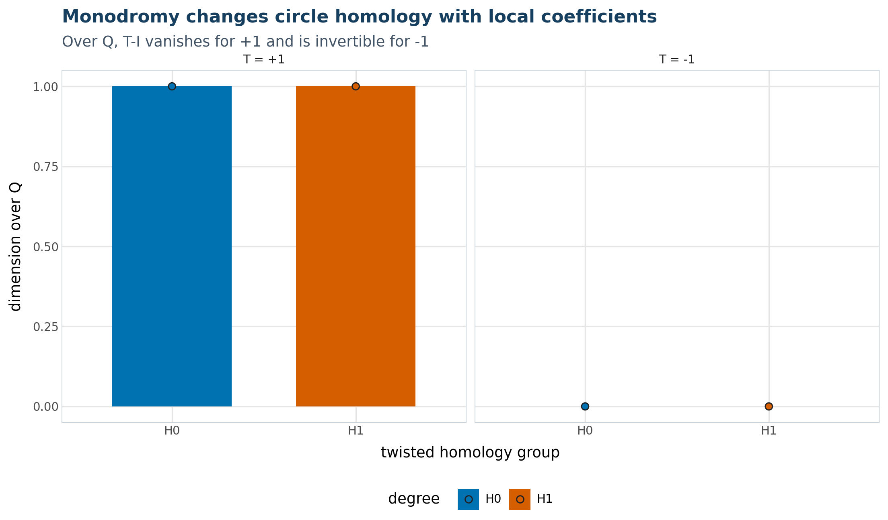

# Local Coefficients, Orientation Systems, and Cap Products {#sec-topology-local-coefficients}

For the primary Atlas route, see [Manifold Duality](#/books/algebraic-topology-chains-spaces/manifold-duality).
This chapter provides a companion viewpoint with the hypotheses stated below.

Ordinary homology carries one coefficient group uniformly across a space. Some
geometric data change when transported around a loop: an orientation may return
with the opposite sign, a fiber may be acted on by monodromy, and higher
homotopy groups may twist during an obstruction calculation. Local coefficient
systems remember that transport. They give the correct form of orientation and
Poincaré duality for nonorientable manifolds ([Hatcher 2002](bibliography.md#ref-hatcher2002algebraic); [OpenCourseWare 2016](bibliography.md#ref-mit18905)).

## Preparation from this book

Read Chapters 12, 15–18, and 27 for monodromy, cohomology, manifolds, duality,
and obstructions. Chapter 20 supplies functor language, but the transport rules
are described concretely here first.

## From one group to transported groups

A **local system** $\mathcal G$ of abelian groups assigns a group $G_x$ to each
point $x$ and an isomorphism

$$
\tau_\gamma:G_x\longrightarrow G_y
$$

to each path $\gamma$ from $x$ to $y$. Transport depends only on the homotopy
class of the path relative to its endpoints, constant paths act as identities,
and concatenation composes transports. In categorical language, a local system
is a functor from the fundamental groupoid of $X$ to abelian groups.

On a path-connected space, choose a base point $x_0$. A local system is then
encoded, up to the appropriate equivalence, by a representation

$$
\rho:\pi_1(X,x_0)\longrightarrow\operatorname{Aut}(G_{x_0}).
$$

Changing paths used to identify other fibers changes the matrices by
conjugation, not the underlying system. A constant local system has trivial
monodromy. “Locally constant” does not mean that every loop acts trivially.

For a rank-one real local system on $S^1$, the generator of $\pi_1(S^1)$ may
act by a nonzero scalar. Geometric sign systems commonly use $+1$ or $-1$.
Transport looks constant in local trivializations, but after one circuit the
fiber coordinate can return with a sign change.

## Chains with local coefficients

For an ordinary singular simplex
$\sigma:\Delta^n\to X$, a local-coefficient chain also carries an element in
a chosen vertex fiber, commonly the fiber over the first vertex. When taking a
face whose preferred vertex changes, the coefficient must be transported along
the corresponding edge. Thus the boundary is not merely the usual alternating
sum with one fixed coefficient copied everywhere.

The transport rules and the identity $\partial^2=0$ fit together because the
two edge paths around each triangular face are homotopic inside the simplex.
This is the chain-level reason a representation of the fundamental groupoid,
rather than arbitrary edge labels, is required.

For a CW complex with universal cover $\widetilde X$ and a module $G$ carrying
a $\pi_1(X)$ action, a compact algebraic model is

$$
\begin{gathered}
C_*(X;\mathcal G)\\
\cong C_*(\widetilde X)\otimes_{\mathbb Z[\pi_1X]}G,
\end{gathered}
$$

with left-versus-right action conventions chosen consistently. This formula
reduces local coefficients to ordinary chains upstairs plus deck-transformation
algebra.

## The circle calculation

Give $S^1$ one vertex and one oriented edge. Let $T:V\to V$ be the monodromy on
a finite-dimensional vector space over a field. The twisted cellular complex
is

$$
0\longrightarrow V\xrightarrow{T-I}V\longrightarrow0.
$$

Therefore

$$
\begin{gathered}
H_1(S^1;\mathcal V)=\ker(T-I),\\
H_0(S^1;\mathcal V)=\operatorname{coker}(T-I).
\end{gathered}
$$

The first group contains coefficient vectors unchanged by a circuit. The
zeroth identifies a vector with its transported value. With one-dimensional
rational coefficients, $T=+1$ gives one-dimensional $H_0$ and $H_1$, while
$T=-1$ makes $T-I=-2$ invertible and both groups vanish.

<figure id="fig-topology-local-monodromy">


<figcaption>

Figure 28.1: Trivial rational monodromy leaves one invariant class in degrees zero and one, whereas sign monodromy leaves none.

</figcaption>
</figure>

Over $\mathbb F_2$, the signs $+1$ and $-1$ coincide. This coefficient change
erases the orientation twist, one reason mod-two fundamental classes exist
without orientability.

## The orientation local system

For an $n$-manifold $M$ without boundary, the local homology group

$$
\mathcal O_x=H_n(M,M\setminus\{x\};\mathbb Z)
$$

is isomorphic to $\mathbb Z$. A path transports local orientation generators,
possibly reversing sign. The resulting local system $\mathcal O_M$ is the
**orientation system**. A global orientation is a coherent choice of generator
in every fiber, equivalently a trivialization of this sign system.

The associated sign representation is

$$
w_1:\pi_1(M,x_0)\longrightarrow\{+1,-1\}.
$$

It is the first Stiefel–Whitney class viewed as orientation monodromy. The
kernel corresponds to the orientation double cover. For a Möbius band, a loop
around the core reverses transverse orientation, and the orientation double
cover is a cylinder. For an orientable manifold the representation is trivial
and the double cover is disconnected, consisting of the two global orientation
choices.

A connected closed manifold always has a twisted fundamental class

$$
[M]\in H_n(M;\mathcal O_M)\cong\mathbb Z.
$$

With ordinary integer coefficients, the top homology is $\mathbb Z$ only in
the orientable case and is zero in the connected closed nonorientable case.
With mod-two coefficients, sign reversal disappears and every connected closed
manifold has a mod-two fundamental class.

## Cap products

Let $R$ be a commutative ring with identity and let $G$ be an abelian
group. Before choosing any further pairing of coefficients, the cap product
combines a cochain with a chain as follows:

$$
\begin{gathered}
\frown:C^k(X;G)\otimes_{\mathbb Z} C_n(X;R)\\
\longrightarrow C_{n-k}(X;G\otimes_{\mathbb Z} R).
\end{gathered}
$$

On an ordered simplex it evaluates the cochain on one face and retains the
complementary face, with a sign determined by convention. Its boundary formula
has the graded form

$$
\begin{gathered}
\partial(\varphi\frown c)\\
=(-1)^k\bigl(\varphi\frown\partial c
-(\delta\varphi)\frown c\bigr)
\end{gathered}
$$

under one standard convention. This identity ensures cap product descends to
homology and cohomology. Authors place signs differently; calculations must
declare the convention rather than mix formulas.

To obtain $G$-valued chains again, give $G$ a **unital $R$-module** structure:
scalars in $R$ act additively and associatively on $G$, and $1_Rg=g$. The
coefficient pairing is then

$$
\begin{gathered}
G\otimes_{\mathbb Z}R\longrightarrow G,\\
g\otimes r\longmapsto rg.
\end{gathered}
$$

This is a specified pairing, not an assertion that the tensor product is
automatically $G$.

Capping with a fundamental class turns a cohomology measurement into a
complementary-dimensional homology class. Let $M$ be a connected **closed**
$n$-manifold, meaning compact and without boundary. Choose an $R$-orientation
and its fundamental class $[M]_R\in H_n(M;R)$, whose image in every local
group $H_n(M,M\setminus\{x\};R)$ is an $R$-module generator. The
**Poincaré duality theorem** (Theorem 28.1), with the preceding coefficient pairing, gives
for every unital $R$-module $G$

$$
\begin{gathered}
-\frown[M]_R:H^k(M;G)\\
\xrightarrow{\cong}H_{n-k}(M;G).
\end{gathered}
$$

For $G=R$, see
[Hatcher, Theorem 3.30, page 241](https://pi.math.cornell.edu/~hatcher/AT/ATch3.pdf).
The module-coefficient version is stated in
[May, *A Concise Course in Algebraic Topology*, Chapter 20, page 152](https://www.math.uchicago.edu/~may/CONCISE/ConciseRevised.pdf).
These are imported global duality theorems; the chain-level cap formula alone
does not prove the isomorphisms. An orientation for one coefficient ring does
not license arbitrary unpaired coefficients. For example, $\mathbb Z$ is a
unital $\mathbb Z$-module, but it is not a unital $\mathbb F_2$-module.

For a connected closed $n$-manifold $M$ and a local system $\mathcal G$ of
abelian groups, the **local-coefficient Poincaré duality theorem** does not
require orientability. Capping with the twisted fundamental class gives

$$
\begin{gathered}
H^k(M;\mathcal G)\\
\xrightarrow{\cong}
H_{n-k}(M;\mathcal G\otimes_{\mathbb Z}\mathcal O_M).
\end{gathered}
$$

Here tensor products are taken fiber by fiber over $\mathbb Z$, and transport
acts on both factors. For constant integral coefficients on a nonorientable
closed connected manifold, this is
[Hatcher's Theorem 3H.6, page 336](https://pi.math.cornell.edu/~hatcher/AT/AT.pdf).
The orientation twist cannot be dropped just because the manifold has a
mod-two orientation.

For a connected compact $n$-manifold with boundary and a local system
$\mathcal G$ of abelian groups, **Poincaré–Lefschetz duality** pairs absolute
cohomology with relative homology. Here $\mathcal O_M$ is the orientation
system of the interior, extended across a boundary collar using the
collar-neighborhood theorem:

$$
\begin{gathered}
H^k(M;\mathcal G)\\
\xrightarrow{\cong}
H_{n-k}(M,\partial M;
\mathcal G\otimes_{\mathbb Z}\mathcal O_M).
\end{gathered}
$$

There is a companion version interchanging absolute and relative positions.
The outward collar direction identifies
$\mathcal O_M|_{\partial M}\cong\mathcal O_{\partial M}$. Under that
identification, the connecting homomorphism sends the twisted relative
fundamental class to the boundary's twisted fundamental class. When $M$ is
oriented, these become the usual untwisted classes with the induced boundary
orientation.

## Intersections and twisted duality

For an orientable manifold, Chapter 26 expressed intersection by cup product
and evaluation on $[M]$. On a nonorientable manifold, local orientation signs
cannot be compared globally without transport. The orientation system provides
exactly the missing bookkeeping. Over $\mathbb F_2$, signs disappear and
unoriented intersections can still be counted modulo two.

Local coefficients also repair obstruction theory. If moving a based sphere
around a loop acts nontrivially on $\pi_k(Y)$, the cellwise obstruction values
do not live in one globally fixed group. They form a cochain with coefficients
in the induced local system. Its cohomology class is invariant under the
allowed choices.

Poincaré duality with local coefficients is therefore not an ornamental
generalization. It is the statement that remains true when orientation or
monodromy prevents all fibers from being identified once and for all.

## Covering spaces and local systems

A covering $p:E\to X$ produces a local system by letting paths permute the
fiber $p^{-1}(x)$. Applying an abelian construction, such as the free abelian
group or functions on the fiber, gives a local system of modules. Conversely,
locally constant sheaves of sets correspond to covering spaces under standard
local hypotheses. This joins the covering theory of Chapter 12 to the sheaf
language of Chapter 21.

The monodromy representation depends on a chosen base point and fiber
identification; the local system does not. Reports should separate invariant
statements such as the conjugacy class of monodromy from coordinate matrices
chosen for computation.

**Nonexample.** Writing one matrix $T$ for every loop without checking the
relations in $\pi_1(X)$ does not define a local system. The assignments must
form a representation: identity loops act by identity and concatenation acts
by matrix multiplication.

<!-- inline-formula-code:start -->
## Formula and finite computation

For a rational local system on a one-cell circle, both twisted dimensions are
controlled by $T-I$:

$$
\begin{gathered}
\dim H_1=\dim\ker(T-I),\\
\dim H_0=\dim\operatorname{coker}(T-I).
\end{gathered}
$$

In the code, `monodromy` represents the square matrix $T$; the returned pair
is `(dimension_H0, dimension_H1)`.

```python
from fractions import Fraction

def rational_rank(matrix: list[list[int]]) -> int:
    if not matrix or not matrix[0]:
        raise ValueError("matrix must have positive row and column counts")
    column_count = len(matrix[0])
    if any(len(row) != column_count for row in matrix):
        raise ValueError("matrix must be rectangular")
    rows = [[Fraction(entry) for entry in row] for row in matrix]
    rank = 0
    for column in range(column_count):
        pivot = next(
            (row for row in range(rank, len(rows)) if rows[row][column] != 0),
            None,
        )
        if pivot is None:
            continue
        rows[rank], rows[pivot] = rows[pivot], rows[rank]
        pivot_value = rows[rank][column]
        rows[rank] = [entry / pivot_value for entry in rows[rank]]
        for row in range(len(rows)):
            if row == rank or rows[row][column] == 0:
                continue
            factor = rows[row][column]
            rows[row] = [
                entry - factor * pivot_entry
                for entry, pivot_entry in zip(rows[row], rows[rank], strict=True)
            ]
        rank += 1
    return rank

def circle_local_system_dimensions(
    monodromy: list[list[int]],
) -> tuple[int, int]:
    dimension = len(monodromy)
    if dimension == 0 or any(len(row) != dimension for row in monodromy):
        raise ValueError("monodromy must be a nonempty square matrix")
    transport_minus_identity = [
        [entry - (1 if row == column else 0) for column, entry in enumerate(values)]
        for row, values in enumerate(monodromy)
    ]
    boundary_rank = rational_rank(transport_minus_identity)
    kernel_dimension = dimension - boundary_rank
    cokernel_dimension = dimension - boundary_rank
    return cokernel_dimension, kernel_dimension

print("trivial monodromy:", circle_local_system_dimensions([[1]]))
print("sign monodromy:", circle_local_system_dimensions([[-1]]))
```

**What the computation establishes.** Exact rational row reduction gives
twisted $(H_0,H_1)$ dimensions $(1,1)$ for trivial monodromy and $(0,0)$ for
sign monodromy on the declared one-cell circle. It assumes the cellular
boundary $T-I$ has already been derived and does not prove Poincaré duality,
validate a monodromy representation on a general space, or recover torsion.
<!-- inline-formula-code:end -->

## Summary

Local systems assign coefficient fibers with homotopy-invariant path
transport. Twisted chains incorporate that transport into their boundaries.
The orientation system records sign monodromy and provides fundamental classes
for nonorientable manifolds. Cap product with a fundamental class yields the
local-coefficient and boundary-aware forms of Poincaré duality. Finite
monodromy matrices compute chosen models but do not replace the geometric
transport construction.

## Exercises

<div class="exercise" id="topology-28-local-coefficients-orientation-ex-1">
<p class="exercise-title"><strong>Exercise 1</strong></p>

Prove that a local system on a simply connected path-connected space is
isomorphic to a constant one.

<details class="solution"><summary>Solution</summary>

For Exercise 1, choose a base point and a path to every other point. Any two
such paths differ by a loop; simple connectedness makes that loop
null-homotopic, so transport is independent of the chosen path. These
identifications trivialize every fiber coherently.

</details>

</div>

<div class="exercise" id="topology-28-local-coefficients-orientation-ex-2">
<p class="exercise-title"><strong>Exercise 2</strong></p>

Derive the circle cellular boundary $T-I$ by lifting its one-cell to the
universal cover.

</div>

<div class="exercise" id="topology-28-local-coefficients-orientation-ex-3">
<p class="exercise-title"><strong>Exercise 3</strong></p>

Compute twisted circle homology for
$T=\begin{pmatrix}1&1\\0&1\end{pmatrix}$ over $\mathbb Q$.

<details class="solution"><summary>Solution</summary>

For Exercise 3, $T-I$ has rank one. Its kernel and cokernel are each
one-dimensional, so both twisted $H_1$ and $H_0$ have dimension one. The result
depends on the eigenspace for eigenvalue one, not merely on the fact that $T$
is not the identity.

</details>

</div>

<div class="exercise" id="topology-28-local-coefficients-orientation-ex-4">
<p class="exercise-title"><strong>Exercise 4</strong></p>

Explain why sign monodromy becomes trivial over $\mathbb F_2$.

</div>

<div class="exercise" id="topology-28-local-coefficients-orientation-ex-5">
<p class="exercise-title"><strong>Exercise 5</strong></p>

Identify the orientation double cover of the Möbius band.

</div>

<div class="exercise" id="topology-28-local-coefficients-orientation-ex-6">
<p class="exercise-title"><strong>Exercise 6</strong></p>

State Poincaré–Lefschetz duality for an orientable compact manifold with
boundary and constant coefficients.

</div>

<div class="exercise" id="topology-28-local-coefficients-orientation-ex-7">
<p class="exercise-title"><strong>Exercise 7</strong></p>

Explain where transport enters the boundary of a local-coefficient simplex.

</div>

<div class="exercise" id="topology-28-local-coefficients-orientation-ex-8">
<p class="exercise-title"><strong>Exercise 8</strong></p>

Check that a proposed assignment of matrices to generators respects a
stated fundamental-group relation.

</div>

<div class="exercise" id="topology-28-local-coefficients-orientation-ex-9">
<p class="exercise-title"><strong>Exercise 9</strong></p>

**Change the coefficients, keep the manifold.** Let
$M=\mathbb{RP}^2$, a connected closed nonorientable surface. Compare
$H^0(M;\mathbb Z)$ with $H_2(M;\mathbb Z)$, then compare
$H^0(M;\mathbb F_2)$ with $H_2(M;\mathbb F_2)$. Use the cellular
boundary $d_2=2$, $d_1=0$ from Chapter 25. Since $M$ is
$\mathbb F_2$-oriented, may one use an $\mathbb F_2$-fundamental class
to assert untwisted duality with $G=\mathbb Z$? Test the unital-module
condition. Finally determine $H_2(M;\mathcal O_M)$ and name the theorem
that supplies the correct integral duality. Explain which computation
verifies the ordinary groups and which conclusion imports a global theorem.

<details class="solution"><summary>Solution</summary>

For Exercise 9, connectedness makes degree-zero cohomology with constant
coefficients the group of constant functions. Hence
$H^0(M;\mathbb Z)\cong\mathbb Z$ and
$H^0(M;\mathbb F_2)\cong\mathbb F_2$. The ordinary integral cellular
complex is

$$
0\longrightarrow\mathbb Z\xrightarrow{\times2}\mathbb Z
\xrightarrow{0}\mathbb Z\longrightarrow0.
$$

Multiplication by two is injective on $\mathbb Z$, so
$H_2(M;\mathbb Z)=0$. Over $\mathbb F_2$ the same boundary is zero,
giving $H_2(M;\mathbb F_2)\cong\mathbb F_2$. Thus mod-two duality
has matching groups, while the proposed untwisted integral isomorphism would
identify $\mathbb Z$ with zero and is false.

The coefficient mismatch explains why the mod-two fundamental class cannot
justify that claim. If $\mathbb Z$ were a unital $\mathbb F_2$-module,
distributivity and the identity action would force, for every $g\in\mathbb Z$,

$$
\begin{gathered}
0=(0_{\mathbb F_2})g\\
=(1_{\mathbb F_2}+1_{\mathbb F_2})g\\
=g+g.
\end{gathered}
$$

Taking $g=1$ contradicts $2\ne0$ in $\mathbb Z$. In fact,
$\mathbb Z\otimes_{\mathbb Z}\mathbb F_2\cong\mathbb F_2$, so the
unpaired cap product has mod-two coefficients, not integer coefficients.

The correct integral statement uses the orientation system:

$$
\begin{gathered}
H^0(M;\mathbb Z)\\
\xrightarrow{\cong}H_2(M;\mathbb Z\otimes_{\mathbb Z}\mathcal O_M)\\
\cong H_2(M;\mathcal O_M)\cong\mathbb Z.
\end{gathered}
$$

This last isomorphism is supplied by the **local-coefficient Poincaré duality
theorem**, in the constant integral case stated by Hatcher's Theorem 3H.6.
The ordinary cellular calculation checks the untwisted groups; it neither
computes a twisted chain boundary by itself nor proves that global duality
theorem. The manifold and its compactness have stayed fixed throughout; the
coefficient pairing and orientation twist determine which duality applies.

</details>

</div>

### Selected solutions

For Exercise 1, choose a base point and a path to every other point. Any two
such paths differ by a loop; simple connectedness makes that loop
null-homotopic, so transport is independent of the chosen path. These
identifications trivialize every fiber coherently.

For Exercise 3, $T-I$ has rank one. Its kernel and cokernel are each
one-dimensional, so both twisted $H_1$ and $H_0$ have dimension one. The result
depends on the eigenspace for eigenvalue one, not merely on the fact that $T$
is not the identity.

For Exercise 9, connectedness makes degree-zero cohomology with constant
coefficients the group of constant functions. Hence
$H^0(M;\mathbb Z)\cong\mathbb Z$ and
$H^0(M;\mathbb F_2)\cong\mathbb F_2$. The ordinary integral cellular
complex is

$$
0\longrightarrow\mathbb Z\xrightarrow{\times2}\mathbb Z
\xrightarrow{0}\mathbb Z\longrightarrow0.
$$

Multiplication by two is injective on $\mathbb Z$, so
$H_2(M;\mathbb Z)=0$. Over $\mathbb F_2$ the same boundary is zero,
giving $H_2(M;\mathbb F_2)\cong\mathbb F_2$. Thus mod-two duality
has matching groups, while the proposed untwisted integral isomorphism would
identify $\mathbb Z$ with zero and is false.

The coefficient mismatch explains why the mod-two fundamental class cannot
justify that claim. If $\mathbb Z$ were a unital $\mathbb F_2$-module,
distributivity and the identity action would force, for every $g\in\mathbb Z$,

$$
\begin{gathered}
0=(0_{\mathbb F_2})g\\
=(1_{\mathbb F_2}+1_{\mathbb F_2})g\\
=g+g.
\end{gathered}
$$

Taking $g=1$ contradicts $2\ne0$ in $\mathbb Z$. In fact,
$\mathbb Z\otimes_{\mathbb Z}\mathbb F_2\cong\mathbb F_2$, so the
unpaired cap product has mod-two coefficients, not integer coefficients.

The correct integral statement uses the orientation system:

$$
\begin{gathered}
H^0(M;\mathbb Z)\\
\xrightarrow{\cong}H_2(M;\mathbb Z\otimes_{\mathbb Z}\mathcal O_M)\\
\cong H_2(M;\mathcal O_M)\cong\mathbb Z.
\end{gathered}
$$

This last isomorphism is supplied by the **local-coefficient Poincaré duality
theorem**, in the constant integral case stated by Hatcher's Theorem 3H.6.
The ordinary cellular calculation checks the untwisted groups; it neither
computes a twisted chain boundary by itself nor proves that global duality
theorem. The manifold and its compactness have stayed fixed throughout; the
coefficient pairing and orientation twist determine which duality applies.
