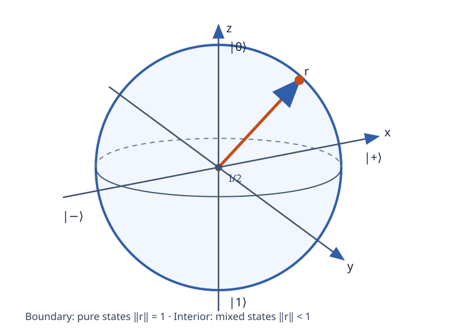

# Two-State Geometry and Experimental Questions

Two-state systems are the smallest nonclassical laboratory for phase, incompatibility, state reconstruction, and coherent control. Their geometry is unusually complete: every Hermitian operator is built from the identity and three Pauli matrices, and every density operator corresponds to a point in a solid ball. This makes the model powerful—and easy to overinterpret. A Bloch vector organizes predictions; it is not necessarily a little spatial arrow carried by an object.

## 1. The Pauli basis

Together with $I$, the matrices

\[
X=\begin{pmatrix}0&1\\1&0\end{pmatrix},\quad
Y=\begin{pmatrix}0&-i\\i&0\end{pmatrix},\quad
Z=\begin{pmatrix}1&0\\0&-1\end{pmatrix}
\]

form a real basis for the Hermitian $2\times2$ matrices. Hence every observable has a unique form

\[
A=a_0I+\mathbf a\cdot\boldsymbol\sigma,
\]

where $\mathbf a=(a_x,a_y,a_z)$ is real and $\mathbf a\cdot\boldsymbol\sigma=a_xX+a_yY+a_zZ$. The multiplication rule is

\[
(\mathbf a\cdot\boldsymbol\sigma)(\mathbf b\cdot\boldsymbol\sigma)
=(\mathbf a\cdot\mathbf b)I+i(\mathbf a\times\mathbf b)\cdot\boldsymbol\sigma.
\]

Consequently $(\mathbf a\cdot\boldsymbol\sigma)^2=\lVert\mathbf a\rVert^2I$, its eigenvalues are $\pm\lVert\mathbf a\rVert$, and $A$ has eigenvalues $a_0\pm\lVert\mathbf a\rVert$.

These formulas follow from $\sigma_j\sigma_k=\delta_{jk}I+i\sum_l\epsilon_{jkl}\sigma_l$, verified by the three squares and the ordered products $XY=iZ$, $YZ=iX$, $ZX=iY$, with opposite signs for reversed order. Bilinear expansion gives the vector product identity. Trace then supplies a useful uniqueness proof: $\operatorname{Tr}\sigma_j=0$ and $\operatorname{Tr}(\sigma_j\sigma_k)=2\delta_{jk}$ imply $a_0=\operatorname{Tr}A/2$ and $a_j=\operatorname{Tr}(A\sigma_j)/2$. These coefficients are real for Hermitian $A$, since conjugating the trace reverses the product and cyclicity restores it. There are four real degrees of freedom, precisely matching a Hermitian two-by-two matrix.

When $\mathbf a\ne0$, the spectral projectors are $[I\pm\widehat{\mathbf a}\cdot\boldsymbol\sigma]/2$. Their idempotence follows from the square identity, and multiplication by $A$ gives the appropriate eigenvalues. When $\mathbf a=0$, there is only the degenerate value $a_0$ and its projector is $I$; a direction obtained by dividing by $|\mathbf a|$ is undefined. This exception is physically important for a completely uninformative scalar observable.

## 2. Pure states and the Bloch sphere

After choosing a global phase, every normalized two-state vector can be written

\[
\lvert\psi\rangle=\cos\frac\theta2\lvert0\rangle
+e^{i\phi}\sin\frac\theta2\lvert1\rangle
\]

for $0\le\theta\le\pi$. Define

\[
\mathbf r=(\sin\theta\cos\phi,\ \sin\theta\sin\phi,\ \cos\theta).
\]

Then $r_j=\langle\sigma_j\rangle$ and $\lVert\mathbf r\rVert=1$. The associated projector is

\[
\rho=\lvert\psi\rangle\langle\psi\rvert
=\frac{I+\mathbf r\cdot\boldsymbol\sigma}{2}.
\]

Antipodal Bloch points represent orthogonal states. The half-angle in the state coordinates is essential: moving through $2\pi$ in a spinor representative changes its sign, hence only global phase, while the Bloch vector returns to itself.

### Accessible geometric description

For clarity, the parametrization of rays also has an endpoint qualification. If the first coefficient is nonzero, choose its global phase to make it real and nonnegative; the ratio of component magnitudes defines $\theta/2$ and their relative phase defines $\phi$. If the first coefficient vanishes, the ray is the south pole. At either pole the azimuth has no physical meaning. Direct multiplication of $\psi\psi^\dagger$ gives the displayed Bloch projector and proves that the coordinates identify the ray even though the angular chart is singular at the poles.

Imagine a sphere with $\lvert0\rangle$ at the north pole and $\lvert1\rangle$ at the south pole. The $X$ eigenstates occupy opposite points on the horizontal equator; the $Y$ eigenstates occupy another antipodal equatorial pair. A state is reported numerically by $(r_x,r_y,r_z)$ and by polar angles. No conclusion depends on color, animation, or a perspective drawing.

The drawing is a perspective map of the exact coordinates above: the outer sphere is the pure-state boundary $\lVert\mathbf r\rVert=1$, its center is the maximally mixed state, and any interior point represents $\lVert\mathbf r\rVert<1$. The displayed arrow is a coordinate vector in state space, not a claim about a particle's spatial direction.

## 3. Measurements along an axis

For a unit vector $\mathbf n$, the observable $\mathbf n\cdot\boldsymbol\sigma$ has projectors

\[
P_+=\frac{I+\mathbf n\cdot\boldsymbol\sigma}{2},
\qquad P_-=\frac{I-\mathbf n\cdot\boldsymbol\sigma}{2}.
\]

In state $\rho=(I+\mathbf r\cdot\boldsymbol\sigma)/2$, trace multiplication gives

\[
p(+\mid\mathbf n)=\frac{1+\mathbf n\cdot\mathbf r}{2},
\qquad p(-\mid\mathbf n)=\frac{1-\mathbf n\cdot\mathbf r}{2}.
\]

Thus the expectation is $\mathbf n\cdot\mathbf r$. The angle between state and measurement axes controls the distribution. Orthogonal state rays lie at opposite, not perpendicular, Bloch directions.

### Worked axis measurement

For $\mathbf r=(0,1,0)$ and $\mathbf n=(1,1,0)/\sqrt2$, the plus probability is $(1+1/\sqrt2)/2$. This is approximately $0.8536$. Reporting four decimals is a numerical presentation choice, not added physical precision.

The minus probability is $(1-1/\sqrt2)/2$, and the expectation of the measured observable is their difference $1/\sqrt2$. Because its square is $I$, its variance is $1-(1/\sqrt2)^2=1/2$. Conditional on the plus result for the ideal Lüders instrument, the new Bloch vector is $\mathbf n$. A repeat along that same axis then gives plus certainly, while an immediate $Z$ measurement gives equal signs since $n_z=0$. The original state was already pure, so the random first result does not indicate an initially mixed state. It reflects the angle between two different pure-state directions.

## 4. Density matrices fill the Bloch ball

Every two-state density operator has form

\[
\rho=\frac{I+\mathbf r\cdot\boldsymbol\sigma}{2},
\qquad \lVert\mathbf r\rVert\le1.
\]

Its eigenvalues are $(1\pm\lVert\mathbf r\rVert)/2$, so positivity is exactly the ball condition. Boundary points are pure; interior points are mixed. Purity satisfies

\[
\operatorname{Tr}(\rho^2)=\frac{1+\lVert\mathbf r\rVert^2}{2}.
\]

The maximally mixed state $I/2$ lies at the center. A reduced Bloch length can reflect uncontrolled noise, averaging over preparations, or entanglement with an unobserved system. Geometry alone does not identify the mechanism.

The ball representation follows rather than being an extra postulate. A Hermitian trace-one matrix has unique Pauli coefficients $\rho=(I+\mathbf r\cdot\boldsymbol\sigma)/2$. The spectral calculation above gives eigenvalues $(1\pm|\mathbf r|)/2$, so positivity is equivalent to $|\mathbf r|\le1$. Squaring with the Pauli identity and taking the trace proves the purity formula. A trace-one positive matrix is rank one precisely at $|\mathbf r|=1$, identifying pure states. Convex mixtures have averaged Bloch vectors because the matrix parametrization is affine.

### Worked example: one mixed state, different ensembles

Consider $\rho=\operatorname{diag}(3/4,1/4)$, with $\mathbf r=(0,0,1/2)$ and purity $5/8$. One preparation chooses $|0\rangle$ with probability $3/4$ and $|1\rangle$ with probability $1/4$. Another chooses equally between $\psi_\pm=(\sqrt3|0\rangle\pm|1\rangle)/2$. Their Bloch vectors are $(\pm\sqrt3/2,0,1/2)$, whose midpoint is exactly $\mathbf r$. Direct outer-product averaging cancels the off-diagonal entries and gives the same $\rho$.

For every ideal projector $P$, the two preparations give the same $\operatorname{Tr}(\rho P)$, by linearity. No collection of measurements on this system alone can reconstruct which of these ensemble decompositions was used. An external record correlated with the preparation could supply additional information, but it is extra data. The mixed point is a unique density operator with many possible decompositions, rather than a unique hidden choice of two antipodal pure states.

## 5. State tomography

Because $\rho=(I+r_xX+r_yY+r_zZ)/2$, estimating the three Pauli expectations reconstructs a two-state density matrix. If $N_j$ independent trials measure axis $j$ and outcomes are $\pm1$, the sample mean estimates $r_j$.

Finite data may produce an estimated vector slightly outside the Bloch ball. Blindly accepting it yields a nonpositive matrix. A physical estimator can project back to the ball or maximize a likelihood under positivity, but the procedure and uncertainty must be reported. Tomography depends on calibration: if the apparatus axes are wrong, more samples do not remove systematic bias.

For independent identically prepared trials along axis $j$, a sign outcome has mean $r_j$ and variance $1-r_j^2$. Its sample mean is unbiased with variance $(1-r_j^2)/N_j$. These statistical statements assume the preparation and measurement model remain stable across trials; the Born formula alone does not establish independence. A componentwise admissible estimate need not be jointly positive because three separate coordinates must also satisfy the ball constraint.

### Worked example: repairing an unphysical reconstruction

Suppose the three measured sample means are $\widehat{\mathbf r}=(4/5,4/5,0)$. Each coordinate lies in $[-1,1]$, but the length is $4\sqrt2/5>1$, giving a negative smaller eigenvalue. The nearest vector in Euclidean distance within the unit ball is $\widetilde{\mathbf r}=(1/\sqrt2,1/\sqrt2,0)$. To prove the radial projection, write an outside point as $R\mathbf v$, $R>1$, $|\mathbf v|=1$. For every admissible $\mathbf s$, $|R\mathbf v-\mathbf s|\ge R-|\mathbf s|\ge R-1$, with equality at $\mathbf s=\mathbf v$.

This produces a positive rank-one estimated density matrix, but does not prove the underlying preparation is exactly pure. The estimate was constrained to a boundary by the chosen procedure. Nor is radial projection automatically the maximum-likelihood estimator for unequal binomial sample sizes. Report the raw counts, the constraint procedure and uncertainty. For any true $\mathbf r$ in the ball, radial projection cannot increase its Euclidean estimation error: subtracting squared errors gives $(R-1)(R+1-2\mathbf v\cdot\mathbf r)\ge0$. That deterministic fact is useful, but it does not identify confidence levels or remove calibration bias.

## 6. Rotations and the double cover

For a unit axis $\mathbf n$, define

\[
U(\alpha)=e^{-i\alpha\mathbf n\cdot\boldsymbol\sigma/2}
=\cos\frac\alpha2 I-i\sin\frac\alpha2\,\mathbf n\cdot\boldsymbol\sigma.
\]

Conjugation rotates Bloch vectors by the ordinary three-dimensional rotation of angle $\alpha$ about $\mathbf n$. Both $U$ and $-U$ induce the same Bloch rotation. This is the two-to-one relation between $\mathrm{SU}(2)$ and $\mathrm{SO}(3)$.

The Bloch sphere is therefore a state-space geometry tied to two complex dimensions. For physical spin one-half, spatial rotations act through this representation. For polarization or a generic qubit, the Bloch coordinates may instead label mode or computational degrees of freedom.

The rotation assertion can be proved directly. Put $N=\mathbf n\cdot\boldsymbol\sigma$, $R=\mathbf r\cdot\boldsymbol\sigma$, $c=\cos(\alpha/2)$, $s=\sin(\alpha/2)$. The Pauli product identity gives $NRN=2(\mathbf n\cdot\mathbf r)N-R$ and $RN-NR=-2i(\mathbf n\times\mathbf r)\cdot\boldsymbol\sigma$. Consequently

$$URU^\dagger=c^2R+ics(RN-NR)+s^2NRN=\mathbf r'\cdot\boldsymbol\sigma,$$

where

$$\mathbf r'=\cos\alpha\,\mathbf r+(1-\cos\alpha)(\mathbf n\cdot\mathbf r)\mathbf n+\sin\alpha\,\mathbf n\times\mathbf r.$$

This is Rodrigues' rotation formula, including its orientation. It preserves the parallel component and rotates the perpendicular plane. Replacing $U$ by $-U$ cancels in conjugation. Conversely a two-by-two unitary that leaves all Bloch matrices unchanged commutes with both $X$ and $Z$, hence is scalar; determinant one restricts that scalar to $\pm1$. Every proper three-dimensional rotation has an axis-angle representation, so these exponentials cover its action with precisely that two-element kernel. This proves the stated algebraic double-cover relation without treating a spinor as a real spatial arrow.

## 7. Transition probability as geometry

For pure states with Bloch vectors $\mathbf r,\mathbf s$,

\[
|\langle\psi_{\mathbf r}\mid\psi_{\mathbf s}\rangle|^2
=\frac{1+\mathbf r\cdot\mathbf s}{2}.
\]

If $\gamma$ is the angle between the Bloch vectors, this equals $\cos^2(\gamma/2)$. Orthogonal rays have zero overlap and $\gamma=\pi$. Nearby Bloch directions have high transition probability.

This formula is basis independent. It quantifies statistical distinguishability for one ideal binary test, not the engineering effort needed to prepare or detect the states.

## 8. Experimental interpretation boundaries

The earlier Bloch reading's axial example is recovered at $\mathbf r=(0,0,3/5)$: the eigenvalues are $4/5,1/5$, both positive, whereas at $r_z=1$ they are one and zero. Its measurement diagram remains available as [an exact state–axis cross-section](../quantum-statistical-structures/figures/bloch-measurement.svg); the text formula $(1\pm\mathbf n\cdot\mathbf r)/2$ carries the full quantitative content.

This ball geometry is special to two levels. A Hermitian trace-one matrix in dimension $d$ has $d^2-1$ real coefficients, but positivity does not describe an ordinary ball for $d>2$. For a concrete qutrit direction use $\rho(t)=I/3+t\operatorname{diag}(2,-1,-1)$. Its eigenvalues are $1/3+2t,1/3-t,1/3-t$, so positivity requires $-1/6\le t\le1/3$. Opposite directions from the maximally mixed center have different allowable distances in the same Hilbert–Schmidt metric. The unitary-symmetric center is $I/d$, so this asymmetric positivity interval rules out a higher-dimensional Bloch ball with that ordinary Euclidean geometry. The general matrix state set remains convex.

- An ideal spin measurement may be modeled by $\mathbf n\cdot\boldsymbol\sigma$, but mapping magnet settings to $\mathbf n$ requires calibration.
- A polarization two-state model neglects loss, frequency, spatial modes, and multiphoton sectors.
- A computational qubit basis is a convention fixed by hardware control and readout.
- Estimated probabilities include sampling uncertainty; the Born rule does not remove statistical inference.
- State reconstruction assumes repeated preparation of the same effective state.
- A good fit to a two-level model does not prove higher levels or environmental correlations are absent.

## 9. Failure clinic

Do not confuse a Bloch vector with a vector in the two-dimensional Hilbert space. Do not omit the half-angle. Do not call all interior points classical: a mixed state can be the reduced state of an entangled pure system. Do not infer a preparation decomposition from $\rho$; distinct ensembles can produce the same density operator. Do not report tomography without an uncertainty and calibration ledger.

## The Bloch distance has an operational normalization

For two Bloch vectors r and s, the density-operator difference
is half of (r−s) dotted with the Pauli vector. Squaring this
Hermitian matrix gives one quarter of the squared Euclidean
distance times the identity. Its eigenvalues are therefore
plus and minus half that distance, so its trace norm
is exactly the Euclidean distance. The trace distance of
the two states is half the Bloch distance, not the
full distance across the ball.

Antipodal unit vectors consequently describe orthogonal states
at trace distance one. Identical Bloch vectors have distance
zero even when their representing state vectors differ by
an overall phase. This metric is therefore adapted to
state rays and mixtures rather than to an arbitrary
choice of vector phase. For equal-prior discrimination,
the later density chapter turns this distance into the
optimal success probability. The geometric normalization
already identifies which factor must be carried into
that operational formula and prevents a visually natural
ball diameter from being mistaken for a probability.

## Exercises with complete solutions

### 1. Pauli squares
Verify $X^2=Y^2=Z^2=I$.

Hint 1

Multiply each displayed two-by-two matrix by itself.

Hint 2

The imaginary off-diagonal entries of Y multiply to positive diagonal ones.

Full solution

Direct multiplication of each matrix gives $\operatorname{diag}(1,1)$.

### 2. Pauli product
Compute $XY$.

Hint 1

Use the order X then Y in the matrix product.

Hint 2

Compare its imaginary diagonal entries with those of iZ.

Full solution

Matrix multiplication gives $XY=iZ$. Reversing the order gives $YX=-iZ$.

### 3. Observable decomposition
Write $\begin{pmatrix}3&2-i\\2+i&1\end{pmatrix}$ as $a_0I+\mathbf a\cdot\boldsymbol\sigma$.

Hint 1

Start with half the trace and half the diagonal difference.

Hint 2

The upper-right entry is ax minus i times ay.

Full solution

Half the trace is $a_0=2$; diagonal difference gives $a_z=1$; the upper-right entry is $a_x-ia_y=2-i$, so $a_x=2,a_y=1$.

### 4. Spectrum from the Bloch coefficient
Find the eigenvalues of the matrix in Exercise 3.

Hint 1

Use the three Pauli coefficients found in the previous exercise.

Hint 2

The spectrum is the scalar coefficient plus or minus the Euclidean length of the three-vector.

Full solution

$\lVert\mathbf a\rVert=\sqrt{1+4+1}=\sqrt6$, so the eigenvalues are $2\pm\sqrt6$.

### 5. Bloch coordinates
Find the Bloch vector of $(\sqrt3\lvert0\rangle+i\lvert1\rangle)/2$.

Hint 1

Compute the three Pauli expectations or compare with the angular parametrization.

Hint 2

The relative phase is pi over two, so the equatorial component lies along positive Y.

Full solution

Here $\theta=\pi/3$ and $\phi=\pi/2$, so $\mathbf r=(0,\sqrt3/2,1/2)$.

### 6. Equatorial states
Which Bloch vectors represent $\lvert+\rangle$ and $\lvert-\rangle$?

Hint 1

The two states are the positive and negative X eigenvectors.

Hint 2

Their density projectors are (I plus or minus X) divided by two.

Full solution

They are $(1,0,0)$ and $(-1,0,0)$.

### 7. Projector formula
Show $P_+^2=P_+$ for $P_+=(I+\mathbf n\cdot\boldsymbol\sigma)/2$ and unit $\mathbf n$.

Hint 1

Expand the square of I plus the axis Pauli matrix.

Hint 2

The axis is unit, so its Pauli matrix has square I.

Full solution

Since $(\mathbf n\cdot\boldsymbol\sigma)^2=I$, squaring yields $(I+2\mathbf n\cdot\boldsymbol\sigma+I)/4=P_+$.

### 8. Axis probability
For state $\mathbf r=(0,0,1)$, find the plus probability along $\mathbf n=(1,0,0)$.

Hint 1

Take the dot product of the two stated real three-vectors.

Hint 2

A zero dot product gives equal signs, not orthogonal Hilbert-space states.

Full solution

The dot product is zero, so the probability is $1/2$.

### 9. Aligned measurement
What happens when $\mathbf n=\mathbf r$ for a pure state?

Hint 1

For a pure state its Bloch vector is unit.

Hint 2

An aligned axis has dot product one.

Full solution

Since $\mathbf n\cdot\mathbf r=1$, the plus outcome has probability one.

### 10. Antipodal measurement
What happens when $\mathbf n=-\mathbf r$?

Hint 1

The antipodal axis has dot product minus one with the state.

Hint 2

Insert that value into both outcome probabilities.

Full solution

The plus probability is zero and the minus probability one.

### 11. Positivity boundary
Why is $\rho=(I+1.2Z)/2$ not a state?

Hint 1

The two eigenvalues are half of one plus or minus the Bloch length.

Hint 2

A trace-one Hermitian matrix can still have a negative eigenvalue.

Full solution

Its eigenvalues are $1.1$ and $-0.1$; the negative eigenvalue violates positivity. Its Bloch length exceeds one.

### 12. Purity
Compute the purity of a state with $\lVert\mathbf r\rVert=1/2$.

Hint 1

Insert the stated length in the purity formula.

Hint 2

Square the length before adding one and dividing by two.

Full solution

$(1+1/4)/2=5/8$.

### 13. Maximally mixed statistics
Show $I/2$ gives equal probabilities along every axis.

Hint 1

The central state has all three Pauli coefficients zero.

Hint 2

Every unit axis therefore has zero dot product with its Bloch vector.

Full solution

Its Bloch vector is zero, so $(1\pm\mathbf n\cdot\mathbf0)/2=1/2$.

### 14. Tomography reconstruction
If measured expectations are $(0.6,0,0.8)$, write $\rho$.

Hint 1

Form I plus the stated X and Z coefficients before dividing by two.

Hint 2

Check the length as well as the matrix entries.

Full solution

$\rho=\begin{pmatrix}0.9&0.3\\0.3&0.1\end{pmatrix}$. The Bloch length is one, so this is pure.

### 15. An unphysical estimate
Is $(0.8,0.8,0)$ a valid Bloch vector?

Hint 1

Check the sum of squared coordinates, rather than each coordinate separately.

Hint 2

Positivity requires the complete vector to lie within the unit ball.

Full solution

No; its length is $\sqrt{1.28}>1$. Finite-sample reconstruction must impose or restore positivity.

### 16. Rotation about $Z$
Compute $U(\alpha)$ for $\mathbf n=(0,0,1)$.

Hint 1

Z is already diagonal in the chosen basis.

Hint 2

Its two spectral values acquire opposite half-angle exponential phases.

Full solution

It is $\operatorname{diag}(e^{-i\alpha/2},e^{i\alpha/2})$.

### 17. A $2\pi$ rotation
What is $U(2\pi)$ in Exercise 16, and why are state probabilities unchanged?

Hint 1

Evaluate both half-angle diagonal phases at the stated angle.

Hint 2

A common minus sign is global for an isolated two-state system.

Full solution

It is $-I$. Every vector gains global phase $-1$, which leaves all Born probabilities unchanged.

### 18. Transition probability
Pure Bloch vectors meet at angle $\pi/2$. Find their squared overlap.

Hint 1

Use the angle formula for the squared overlap.

Hint 2

A right angle on the Bloch sphere gives overlap squared one half, not zero.

Full solution

$(1+\cos(\pi/2))/2=1/2$.

### 19. Ensemble ambiguity
Show equal mixtures of $\lvert+\rangle,\lvert-\rangle$ and of $\lvert0\rangle,\lvert1\rangle$ give the same state.

Hint 1

Average the two density operators in each ensemble.

Hint 2

Each pair consists of opposite Bloch points whose average is the center.

Full solution

Each pair has opposite Bloch vectors, whose average is zero. Both density operators are therefore $I/2$.

### 20. Model boundary
Why does a fitted Bloch vector not prove a device is exactly two dimensional?

Hint 1

A finite measurement set can omit degrees of freedom that do not affect its recorded statistics.

Hint 2

Leakage or environmental sectors require extra probes beyond an internal two-state fit.

Full solution

The recorded measurements may be insensitive to leakage, frequency, spatial modes, or an environment. The fit validates predictions only within the tested operational regime.

## Chapter summary

The Pauli basis turns two-state observables and density matrices into Euclidean geometry. Pure states occupy the Bloch sphere, mixed states the ball, axis measurements become dot products, and unitary conjugation becomes rotation. This exact representation supports tomography and control while leaving calibration, uncertainty, and truncation as empirical responsibilities.

[Previous chapter](observables-spectra-measurement.md) · [Next chapter](unitary-dynamics-two-level.md) · [Book overview](#/books/two-state-quantum-mechanics)
